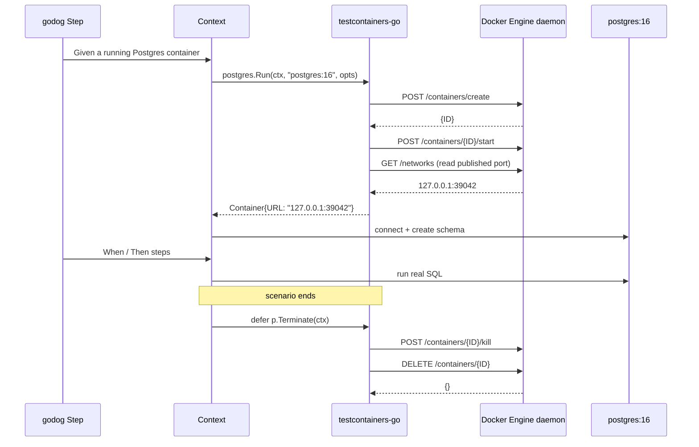

---

draft: true
title: "Testcontainers + GoDog: Testing Against a Real Postgres, the Way the Docker Daemon Sees It"
summary: "Behavior-Driven integration tests for Go: GoDog (Given/When/Then) drives a disposable Postgres container, and Testcontainers is just a thin client over the same Docker Engine API your docker CLI uses."
date: 2021-03-12T23:26:51.517Z
lastmod: 2026-10-16T00:00:00Z
author: Punit Naran
cover: /img/godogs.webp
categories:
  - Go
  - Testing
tags:
  - Testing
  - Intermediate
  - TestContainers
  - GoDogs
---

A unit test that mocks the database is a *guess* about your database. A test that spins up a **real** `postgres:16` container and runs the actual query against it is a *proof* — and it costs you nothing, because the container is gone by the time the test finishes. That is the whole thesis of this post: **Testcontainers is not magic. It is a Go client that speaks the same Docker Engine HTTP API that your `docker` CLI speaks** (create → start → publish a random port → wait → exec → kill), and **GoDog is the Given/When/Then layer** that turns a Gherkin `feature` file into a table of Go closures you write once.

By the end you can (1) write a `feature` file and the GoDog `Context` that makes it run, (2) stand up a disposable Postgres with `testcontainers-go`, and (3) *see the Docker Engine API calls underneath*, because the "under the hood" of Testcontainers is a plain `http.Client` pointed at `/var/run/docker.sock`.

## The two layers, and who owns what

GoDog and Testcontainers solve two different problems and must not be conflated:

- **GoDog** (`github.com/DATA-DOG/go-godog`) is the *BDD runner*. It reads a `.feature` file (Gherkin), and for each scenario wires your `Given`/`When`/`Then` step strings to Go closures. It knows nothing about containers.
- **Testcontainers-go** (`github.com/testcontainers/testcontainers-go`) is the *lifecycle manager*. It talks to the Docker Engine daemon to bring a container up, hands you a `host:port` you can connect to, and tears it down. It knows nothing about Gherkin.

You glue them with a single `Context` struct: the `When` steps call `postgres.Run(...)`, the `Then` steps run your code against the returned URL, and a deferred `Terminate()` cleans up.

```mermaid
flowchart TD
    F[feature file .feature] --> GD[GoDog runner<br/>parses Given/When/Then]
    GD --> C[Context struct<br/>the glue you write]
    C --> TC[testcontainers-go<br/>modules/postgres]
    TC --> API[Docker Engine HTTP API<br/>/var/run/docker.sock]
    API --> POST[POST /containers/create<br/>POST /containers/id/start<br/>GET /networks + port mapping]
    POST --> URL[returns 127.0.0.1:RANDOM<br/>mapped TCP port]
    URL --> APP[your Go code under test]
    APP --> DB[(postgres:16<br/>real container)]
    POST -.defer Terminate.-> K[POST /containers/id/kill<br/>DELETE /containers/id]
    style K fill:#1a3a1a
    style API fill:#1a3a1a
```



## The BDD layer: a feature file and the GoDog Context

The `feature` file is the *specification*. It is plain English and it is what a non-developer on the team can actually read.

```gherkin
Feature: Orders persist across a real Postgres

  Scenario: an order survives a reconnect
    Given a running Postgres container
    When an order for 42 units is stored
    And the connection is dropped and re-opened
    Then the stored order is 42 units
```

The `Context` is the only Go you write for the BDD half. `godog` hands you the runner; you register steps with `Step("string", fn)`, and your scenario state lives on the `Context` so the `When` and `Then` can share the container. The `InitializeScenario` hook is where a *fresh* `Context` is made per scenario — that is what keeps one test's leaked container from poisoning the next.

```go
// pkg: godogs_test
package godogs_test

import (
	"context"
	"fmt"
	"testing"

	"github.com/DATA-DOG/go-godog"
)

// Context is the glue: one instance per scenario. Testcontainers-go gives us
// the container + its mapped URL; the BDD steps mutate it.
type Context struct {
	databaseURL string // "127.0.0.1:PORT"
	t           *testing.T
}

// InitializeScenario is called by godog *before* every scenario, so each
// scenario starts from a clean slate. This is the leak-prevention hook.
func (c *Context) InitializeScenario() {}

func (c *Context) Steps(s *godog.ScenarioContext) {
	// Given a running Postgres container
	s.Step(`^a running Postgres container$`, func() (err error) {
		p, err := postgresRun(context.Background()) // testcontainers-go modules/postgres
		if err != nil {
			return err
		}
		defer p.Terminate(context.Background()) // freed when the *scenario* ends
		c.databaseURL = p.URL()                // host:port, already 127.0.0.1-mapped
		return nil
	})

	// When an order for 42 units is stored
	s.Step(`^an order for (\d+) units is stored$`, func(n int) error {
		return storeOrder(c.databaseURL, n)
	})

	// And the connection is dropped and re-opened
	s.Step(`^the connection is dropped and re-opened$`, func() error {
		return reopen(c.databaseURL) // closes + dials the same host:port
	})

	// Then the stored order is 42 units
	s.Step(`^the stored order is (\d+) units$`, func(n int) error {
		got, err := readOrder(c.databaseURL)
		if err != nil {
			return err
		}
		if got != n {
			return fmt.Errorf("expected %d, got %d", n, got)
		}
		return nil
	})
}

// TestGodogs is the single entry point go test runs. godog finds the
// .feature file in ./features and drives every scenario through Context.
func TestGodogs(t *testing.T) {
	f := godog.NewSuite(godog.SuiteOptions{
		Format: "cucumber",
		Paths:  []string{"features"},
	})
	if !f {
		t.Fatal("features failed")
	}
}
```

The `storeOrder` / `readOrder` / `reopen` helpers are deliberately boring `database/sql` against the `127.0.0.1:PORT` the container published — the *point* is that the test never touches a mocked driver.

## The container layer: Testcontainers-go is a Docker Engine client

Here is the part most people hand-wave. `testcontainers-go` does not have its own container engine. It `import`s `github.com/docker/docker/client`, which is a *generated HTTP client over the Docker Engine API*. The `docker` CLI you type in your terminal is the *same client pointed at the same unix socket*. So "running a container in a test" is, byte-for-byte, these requests:

```go
// pkg: dockerdogs — the "under the hood" of Testcontainers, made literal.
// It is NOT a new engine: it is a plain HTTP client talking to the Docker
// Engine daemon over the unix socket, exactly like `docker` does.
package dockerdogs

import (
	"bytes"
	"context"
	"encoding/json"
	"fmt"
	"net"
	"net/http"
	"time"
)

// engineClient is a minimal client for the Docker Engine HTTP API.
// The real testcontainers-go uses docker/docker/client (the generated one);
// this is the same wire protocol, hand-rolled so the calls are visible.
type engineClient struct {
	http *http.Client
}

func newEngineClient() (*engineClient, error) {
	dialer := &net.Dialer{Timeout: 5 * time.Second}
	return &engineClient{
		http: &http.Client{
			Transport: &http.Transport{
				// The unix-socket transport is the whole trick: this is the
				// exact same socket the `docker` CLI dials.
				Dial: func(network, addr string) (net.Conn, error) {
					return dialer.Dial("unix", "/var/run/docker.sock")
				},
			},
		},
	}, nil
}

// create posts a container config to the Engine, mirroring
// `docker create -p ...:5432 postgres:16`.
func (c *engineClient) create(ctx context.Context, config map[string]any) (string, error) {
	body, _ := json.Marshal(config)
	req, _ := http.NewRequestWithContext(ctx, "POST",
		"/v1.43/containers/create", bytes.NewReader(body))
	resp, err := c.http.Do(req)
	if err != nil {
		return "", err
	}
	defer resp.Body.Close()
	var out struct{ ID string }
	if err := json.NewDecoder(resp.Body).Decode(&out); err != nil {
		return "", err
	}
	return out.ID, nil
}

// startAndPublish is the three calls a Testcontainers `Run` makes. The
// published port is chosen by the daemon (random free port), which is why a
// test must read the mapping back instead of hardcoding 5432.
func (c *engineClient) startAndPublish(ctx context.Context, id string, containerPort int) (string, int, error) {
	if _, err := c.post(id, "start"); err != nil {
		return "", 0, err
	}
	var net struct{ Ports map[string]map[string][]struct{
		HostPort string
	}}
	if _, err := c.get("/networks/default", &net); err != nil {
		return "", 0, err
	}
	// The daemon records the host port it picked for us here.
	for _, v := range net.Ports[id] {
		for _, h := range v {
			if h.HostPort != "" {
				return "127.0.0.1", atoi(h.HostPort), nil
			}
		}
	}
	return "", 0, fmt.Errorf("no published port for %d", containerPort)
}

func (c *engineClient) post(id, path string) (*http.Response, error) {
	req, _ := http.NewRequestWithContext(context.Background(), "POST",
		fmt.Sprintf("/v1.43/containers/%s/%s", id, path), nil)
	return c.http.Do(req)
}

func (c *engineClient) get(path string, out any) (*http.Response, error) {
	req, _ := http.NewRequestWithContext(context.Background(), "GET",
		"/v1.43"+path, nil)
	resp, err := c.http.Do(req)
	if err != nil {
		return resp, err
	}
	if out != nil {
		defer resp.Body.Close()
		if err := json.NewDecoder(resp.Body).Decode(out); err != nil {
			return resp, err
		}
	}
	return resp, nil
}

func atoi(s string) int {
	n := 0
	for _, r := range s {
		if r < '0' || r > '9' {
			break
		}
		n = n*10 + int(r-'0')
	}
	return n
}
```

> **Warning**: The mapped host port is **chosen by the daemon at runtime**, not by you. A test that hardcodes `:5432` passes on a laptop and *races* other containers on a shared CI node. Always read the mapping back (as `startAndPublish` does) and connect to whatever the daemon published.

## The lifecycle, and why cleanup is the whole game

The sequence below is the *entire* container contract Testcontainers honors. `Run` is create + start + publish + wait; `Terminate` is kill + remove. Because the *test* never owns the socket, a leaked `Run` with no `Terminate` is a zombie Postgres holding a port and your RAM until the daemon is restarted.



> **Note**: The `defer p.Terminate(ctx)` is what makes a container *disposable*. Testcontainers-go registers cleanup hooks, but the moment your `Given` step returns the *step* is done — the container must be tied to the *scenario* boundary (the `defer` in the `Given` step, or a `CleanUp` hook), not to a function scope, or a panic mid-scenario strands the container.

## The comparison: what each layer is and is not

| Concern | `docker` CLI | Testcontainers-go | GoDog |
|---|---|---|---|
| Talks to Engine API directly | Yes (generated client) | Yes (via `docker/docker/client`) | No |
| Knows about Gherkin / `Given` | No | No | Yes |
| Picks the published port for you | Yes | Yes (returns mapped `host:port`) | No |
| Ties container lifetime to a test | Manual | Yes (`defer Terminate`) | No |
| Owns the test *outcome* | No | No | Yes (asserts here) |

Reading across the row: the *Engine API* and the *test outcome* are the two ends, and the two libraries are the middle. Nothing in Testcontainers asserts your code; nothing in GoDog touches a socket. The `Context` struct is the seam.

## Takeaways

- **Testcontainers-go is a Docker Engine HTTP client**, pointed at `/var/run/docker.sock` — the same socket the `docker` CLI uses. A `Run` is literally `create → start → publish → wait`, and `Terminate` is `kill → remove`.
- **GoDog is the Given/When/Then runner**; it parses a `.feature` file and maps each step string to a closure you register in a `Context` struct.
- **The `Context` is the seam.** One instance per scenario (`InitializeScenario`), and it owns the container URL so `When` and `Then` share state without a global.
- **The mapped port is the daemon's choice**, not yours. Read the mapping back; never hardcode `:5432`.
- **Cleanup is the whole game.** A `Run` with no `Terminate` is a zombie container eating a port and RAM until the daemon restarts.

## Next steps

1. Add `github.com/testcontainers/testcontainers-go` and `github.com/DATA-DOG/go-godog` to `go.mod`, drop a `features/` dir, and run `go test -v` — the first green scenario is the bar.
2. Promote the `Context` pattern to a small internal `testing` package so every service team's acceptance suite is the *same* `Run`/`Terminate` lifecycle, and the only thing that varies is the container image.
3. Keep the `docker.sock` *behind* the test (CI must have the daemon running) and treat a *leaked container* as a failed test: after the suite, `GET /containers` should return an empty list.
