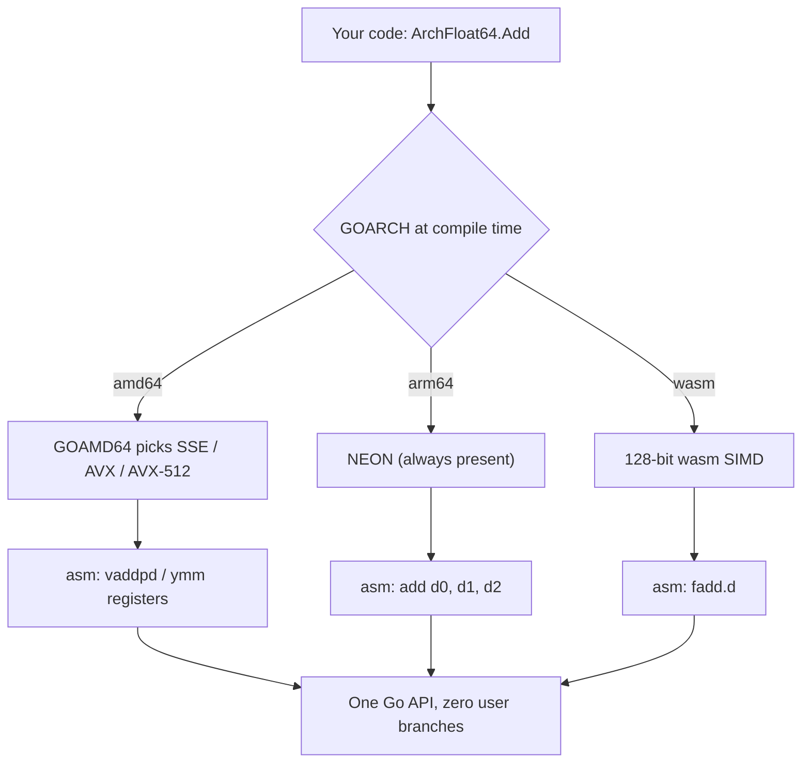

---

date: 2026-10-15T09:00:00
draft: true
title: "Arch-Specific SIMD in Go: The intrinsics layer, now for arm64 and wasm too"
summary: Go 1.27 extends the experimental simd/archsimd package to arm64 (NEON) and wasm, alongside the existing amd64 (AVX/AVX2/AVX-512) support — a named-instruction intrinsics layer that is deliberately not a 1:1 mapping to the underlying ISA.
categories:
  - Go
  - SIMD
  - Performance
---

# Arch-Specific SIMD in Go: The intrinsics layer, now for arm64 and wasm too

Go has had **no way to use SIMD without writing assembly** since the language launched. That changes with the `simd` experiment: Go 1.26 introduced an **amd64** `archsimd` package, and **Go 1.27 adds arm64 (NEON) and wasm** to it. The 1.27 notes are explicit that `archsimd` is *the intrinsics layer* — the same role `x86intrin.h` or `arm_neon.h` play in C — and that it is deliberately **not** a 1:1 mapping to the underlying ISA. The API uses *sensible* names (`ShiftAllLeft`, not `_mm512_slli_epi64`), and it leaves *some* architecture details to the compiler by *exposing* them in the name (a `Grouped` suffix for operations that only span a 128-bit lane on 256/512-bit registers). The result is an API that is smaller and more readable than the raw ISA, and that the `simd` portable layer (a separate, later post) builds on.

This post is the `archsimd` layer: the types, the naming rules, the lane-boundary `Grouped` suffix, the per-arch coverage, and the code you write against it.

## The types: the vector *is* its type

The `archsimd` API is **type-driven**: the type name encodes the element width *and* the lane count. There is no "vector of width N" — you pick the exact shape:

- `Float32x4` — four 32-bit floats (128 bits)
- `Float32x8` — eight 32-bit floats (256 bits, AVX)
- `Float32x16` — sixteen 32-bit floats (512 bits, AVX-512)
- `Int32x4`, `Int32x8`, `Int32x16`
- `Uint8x16`, `Uint8x32`, `Uint8x64`
- **Masks** have their own type family: `Mask32x4`, `Mask32x8`, `Mask8x16`, …

The *same* method name is used across every width and arch whenever the operation is semantically identical. The 1.27 notes make this the central design rule: **element-wise addition is `x.Add(y)` everywhere** — on `Float32x4`, on `Float32x16`, on `Int32x8`. There are *not* 18 names for "add"; there is *one* method name.

```go
// The "one method name, many widths" rule, in one function. The *type*
// of a and b picks the instruction; the *method name* is the same on
// amd64, arm64, and wasm. In real code you name the exact type and
// skip the switch entirely.
package simdtest

import (
	"simd/archsimd"
)

// addAll returns the element-wise sum of a and b. The compiler emits
// the correct VADD / vadd.2s / i32x4.add for the type.
func addAll(a, b any) any {
	switch a := a.(type) {
	case archsimd.Float32x4:
		return a.Add(b.(archsimd.Float32x4))
	case archsimd.Float32x8:
		return a.Add(b.(archsimd.Float32x8))
	case archsimd.Float32x16:
		return a.Add(b.(archsimd.Float32x16))
	case archsimd.Int32x4:
		return a.Add(b.(archsimd.Int32x4))
	case archsimd.Int8x16:
		return a.Add(b.(archsimd.Int8x16))
	}
	return nil
}
```

## The naming rules: where the API *does* diverge

The 1.27 notes are explicit that the API does *not* mirror the ISA. Three rules matter:

**1. Sensible names, not ISA names.** `ShiftAllLeft` instead of `_mm512_slli_epi64`. `PermuteOrZero` instead of `VPSHUFB`. The names describe *what the operation does*, not *which instruction encodes it*.

**2. Edge-case differences get *distinct* names.** This is the subtle one. The *same* conceptual operation (a 16-byte table lookup) behaves **differently** across archs in the edge cases:

- On **amd64** (`VPSHUFB`), a negative index **zeroes** the output byte; any other out-of-range index **wraps modulo 16**.
- On **arm64 NEON** (`VTBL`) and **wasm** (`i8x16.swizzle`), *any* out-of-range index (negative *or* `>= 16`) zeroes the output byte.

So the 1.27 API does *not* call them both `TableLookup`. It calls them **`PermuteOrZero`** (amd64 semantics) and **`LookupOrZero`** (arm64/wasm semantics). The name difference is the *only* signal that the edge-case behavior differs.

**3. The `Grouped` suffix makes the lane boundary explicit.** On amd64, many 256-bit and 512-bit instructions operate **independently within 128-bit lanes**, not across the whole register. The 1.27 API marks these with a `Grouped` suffix: `InterleaveLoGrouped`, `PermuteOrZeroGrouped`, … The `Grouped` suffix is the *only* signal that the operation does *not* cross the 128-bit lane boundary. On arm64 (128-bit only) the `Grouped` suffix does not appear, because there is no wider lane to group across.

```go
// The three "gotcha" methods. On amd64 the name is PermuteOrZero
// (VPSHUFB: negative index -> 0, else mod 16); on arm64 and wasm the
// name is LookupOrZero (any out-of-range index -> 0). The *name*
// difference is the contract.
package simdtest

import (
	"simd/archsimd"
)

// permuteOnAmd64 uses VPSHUFB semantics.
func permuteOnAmd64(v, idx archsimd.Int8x16) archsimd.Int8x16 {
	return v.PermuteOrZero(idx)
}

// permuteOnArm64 uses VTBL semantics. The *name* is LookupOrZero.
func permuteOnArm64(v, idx archsimd.Int8x16) archsimd.Int8x16 {
	return v.LookupOrZero(idx)
}

// The Grouped suffix: 256/512-bit operations that only span a 128-bit
// lane. On amd64 the *name* tells you the boundary.
func interleaveOnAmd64(a, b archsimd.Float32x16) archsimd.Float32x16 {
	return a.InterleaveLoGrouped(b)
}
```

```mermaid
flowchart LR
    subgraph api["simd/archsimd (one name per op)"]
        A1[Add, Mul, Sub]
        A2[PermuteOrZero  (amd64)]
        A3[LookupOrZero  (arm64, wasm)]
        A4[InterleaveLoGrouped  (lane boundary)]
    end
    subgraph amd["amd64"]
        B1[AVX: 128-bit]
        B2[AVX2: 128-bit lanes in 256-bit]
        B3[AVX-512: 16 x 32-bit]
    end
    subgraph arm["arm64"]
        C1[NEON: 128-bit]
    end
    subgraph wasml["wasm"]
        D1[128-bit SIMD]
    end
    A1 --> B1 & B2 & B3 & C1 & D1
    A2 --> B3
    A3 --> C1 & D1
    A4 --> B2 & B3
```

### Per-arch coverage as of Go 1.27

| Arch | Extensions covered | Vector widths | Mask model |
|---|---|---|---|
| **amd64** | AVX, AVX2, AVX-512 (largest surface) | 128, 256, 512 | Mask register (AVX-512), vector-as-mask (AVX2) |
| **arm64** | NEON (SVE, SVE2 on the way) | 128 (NEON); 128–2048 (SVE, future) | Bitmask per byte (SVE) |
| **wasm** | 128-bit SIMD (well-defined) | 128 | Bitmask |
| **RISC-V (RVV)** | Not in 1.27 | variable | — |
| **PowerPC / s390x** | Not in 1.27 | 128 | — |

The 1.27 notes call out **AMX** (Intel) and **SME** (Arm) matrix extensions as *not yet supported*: the Go team has "not fully settled on how to represent matrices effectively in Go." Matrix extensions are a different shape problem (2D, not 1D vectors) and will get their own API when they land.

## The `ToArch` / `FromArch` contract

`archsimd` is the *bottom* of the SIMD stack. The portable `simd` package sits on top and transitions in and out of it:

- `v.ToArch()` — returns an `any` that you type-assert to the concrete archsimd type for the current platform.
- `simd.Float32sFromArch(a)`, `simd.Int8sFromArch(a)`, … — the reverse direction.

The contract: **you write arch-specific code for *each* target platform, including an emulation for the platforms that do not have the instruction.** That is the price of the escape hatch. The portable layer is the "write once" answer; `archsimd` is the "write once per arch, get exactly the instruction I want" answer.

## Build: `GOEXPERIMENT=simd`

Both `simd` and `simd/archsimd` are **experimental** and require `GOEXPERIMENT=simd` *at build time*. The flag is per-arch in some cases (`simd`, `simd_arm64`, `simd_wasm`); in practice you set `GOEXPERIMENT=simd` and the build picks the right arch support. The API is expected to churn; the 1.27 notes explicitly ask for feedback on "usability, performance, etc."

## The dispatch, drawn out

The API looks the same on every architecture, but the runtime does not. Here is what happens under one `ArchFloat64` call:



> **Warning**: `simd/archsimd` is experimental — function names and exact semantics can move before 1.28. Don't build a production dependency on the *names*; wrap them in your own thin type so a rename is a one-file change.

> **Note**: `GOAMD64` is a *compile-time* choice. A binary built with `GOAMD64=avx2` does not auto-downgrade on a machine without AVX2 — the dispatch lives in the runtime, not in your code.

## Takeaways

- **`archsimd` is the intrinsics layer, not the portable one.** One method name per semantic op (`Add`, `Mul`, …) across all widths and archs; the *type* picks the instruction. `Float32x4.Add` and `Float32x16.Add` are the same method name.
- **The `PermuteOrZero` vs `LookupOrZero` split is the API telling you the edge cases differ.** On amd64 `VPSHUFB` zeroes on negative index and wraps mod 16; on arm64 `VTBL` and wasm `i8x16.swizzle` zero on *any* out-of-range. The name difference is the contract — do not assume they are the same.
- **The `Grouped` suffix marks the 128-bit lane boundary.** On amd64, 256/512-bit operations that only span a 128-bit lane carry the `Grouped` suffix. It is the only signal that the operation does *not* cross the lane boundary.
- **`archsimd` is the escape hatch from `simd`.** `ToArch()` / `FromArch` are the bridge. You write arch-specific code per platform, *including* an emulation, when the portable set is too narrow.
- **It is experimental.** `GOEXPERIMENT=simd` at build time. The API will churn; the 1.27 notes ask for feedback.

## Next steps

1. **Build one kernel per arch** you care about (amd64 AVX-512, arm64 NEON, wasm) with `GOEXPERIMENT=simd`, and *read the names* the compiler picks. The `Grouped` suffix and the `PermuteOrZero`/`LookupOrZero` split are the two things to internalize.
2. **Do not port the whole algorithm per arch.** The escape-hatch pattern is: implement the *one* missing op in `archsimd` per arch, and call it from the portable `simd` layer. The 1.27 notes' `Int8s.OnesCount()` example is exactly this.
3. **Watch the AMX / SME question.** Matrix extensions are the next big shape problem for the SIMD stack. If your workload is GEMM-class, the answer is not in 1.27.
4. **Keep the experiment flag out of prod** until `archsimd` stabilizes. The 1.27 notes are explicit that the API will move.
