---

date: 2026-10-15T09:00:00
draft: false
title: "Better HTTP/1 Connection Reuse: The 5x That Costs You Zero Lines of Code"
summary: Go 1.27's net/http transport now asynchronously drains unread HTTP/1 response bodies (50 ms / 256 KB) and returns the connection to the pool — the 100-sequential-GET benchmark drops from ~710 ms to ~150 ms with no changes to your code.
categories:
  - Go
  - HTTP
  - Performance
---

# Better HTTP/1 Connection Reuse: the 5x that costs you zero lines of code

The Go 1.27 release notes open with a function you have written a thousand times:

```go
func getStatus(url string) (int, error) {
	resp, err := http.Get(url)
	if err != nil {
		return 0, err
	}
	defer resp.Body.Close()
	return resp.StatusCode, nil
}
```

It sends a `GET` to `url` and returns the HTTP status code. Using **HTTP/1** (`GODEBUG=http2client=0`), calling it **100 times** against `index.golang.org` takes **~710 ms on Go 1.26**. On **Go 1.27 the same program takes ~150 ms** — *almost 5x faster*, with **zero changes to the code**. The 1.27 notes (by Nicholas Husin and Damien Neil) are the rare release-note that is *good news* precisely because *you do not have to do anything*: `net/http.Transport` now does the draining for you.

This post is the *why*: the 3-RTT cost of a fresh TCP+TLS connection, the "unread body kills the connection" mechanism, the 50 ms / 256 KB drain the 1.27 transport runs on a background goroutine, the `Connection: close` short-circuit, and the *old* manual workaround (the `io.Copy(io.Discard, body)` dance) that you should now *delete*.

## The cost the 1.27 change removes: 3 RTT of setup per connection

The 1.27 notes walk the setup cost of a *new* HTTP connection, because the whole win is *not paying it on every request*:

- **TCP handshake** — **1 RTT** (SYN → SYN-ACK → ACK). The client can piggyback the first TLS message on the final ACK, so the TCP part is 1 RTT.
- **TLS 1.2 handshake** — **2 RTT** (ClientHello/ServerHello/Certificate/…/Finished). **TLS 1.3** is 1 RTT.
- **The HTTP request itself** — at least **1 RTT** for a non-pushed response.

On a 50 ms one-way link (100 ms RTT — the cross-region norm the notes call out), that is **~300 ms of pure setup per request** on TLS 1.2, plus the CPU of the TLS handshake. Compared with a 300 ms setup cost, *serving the actual request* can be cheap: "a little over 1 RTT when bandwidth is plentiful and the HTTP response is small." The `index.golang.org` benchmark endpoint is the favorable case (distributed worldwide, TLS 1.3, so the TLS handshake is only 1 RTT) — and *even there* the difference is "very noticeable."

```mermaid
flowchart LR
    A[client] -->|1. SYN| B[server]
    B -->|2. SYN-ACK + first TLS msg| A
    A -->|3. ACK| B
    A -->|4. ClientHello + key share| B
    B -->|5. ServerHello + cert + finished| A
    A -->|6. HTTP request| B
    B -->|7. response| A
    style A4 fill:#1a3a1a
    style A6 fill:#1a3a1a
```



The 1.27 transport does not change *how long a new connection takes*; it changes *how often you pay it*. By reusing connections, the per-request cost drops from **3 RTT (setup) + 1 RTT (request)** to **1 RTT (request)** — which is the 710 ms → 150 ms.

## The mechanism: why an unread body kills a connection

In **HTTP/1** (both 1.0 and 1.1), *multiple requests and responses on the same connection are sent **sequentially on the wire***. If two `GET`s go to `index.golang.org` over the same TCP connection, the responses arrive **as a single stream of bytes**. `net/http.Get` reads and parses the *status line and headers* to populate the `http.Response`, **and returns immediately** — the **response body remains unread** on the connection and is consumed only as the caller reads from `resp.Body`.

Because the responses are back-to-back on *one* stream, `net/http` **can only find the start of the next response after the current response body has been read to the very end** (as determined by `Content-Length` or `Transfer-Encoding`). So when your code does this:

```go
defer resp.Body.Close() // the body was *never read*
```

the 1.26-and-earlier `net/http` sees an **unread response body**, *realizes it cannot reuse the connection*, **abandons it, and creates a new connection for the next request** — "repeatedly incurring the cost of establishing new connections." That is the entire bug: **`defer resp.Body.Close()` is the idiom the whole internet uses, and it was *silently* disabling connection reuse in HTTP/1.**

HTTP/2 does *not* have this problem: it multiplexes *streams of frames* over one connection, so an unread body on one stream does not block other requests from sharing the connection. (That is why the 1.27 benchmark forces `GODEBUG=http2client=0`: the win is scoped to HTTP/1.)

## The 1.27 fix: an async drain, capped at 50 ms / 256 KB

The 1.27 `net/http.Transport` **automatically** does what the pre-1.27 community had to do by hand: it **asynchronously drains** an unread HTTP/1 response body, **capped at 50 ms and 256 KB**, and then returns the connection to the pool for the next request.

The drain is on a **background goroutine that races the next request**: if the drain *finishes first*, the next request reuses the connection (the 5x); if it *does not* finish in time, the connection is *parked in the idle pool* and **may** be reused for a later request (a partial win, not a loss). The 1.27 notes add a second optimization: **when the response carries `Connection: close`, draining is *guaranteed* wasted work, so the transport skips it entirely** (the connection is going to die regardless; there is no point downloading a body you will throw away).

```go
// getStatus is the 1.27-correct idiom: read the status, close the body.
// On 1.27 this is all you need — the transport drains the unread body
// (50 ms / 256 KB) in the background and reuses the connection.
func getStatus(url string) (int, error) {
	resp, err := http.Get(url)
	if err != nil {
		return 0, err
	}
	defer resp.Body.Close() // the 1.27 transport drains this for you
	return resp.StatusCode, nil
}

// drainAndCloseBody is the *pre-1.27* manual workaround. On 1.27 you
// should DELETE this, not ship it. It is kept here to show (a) what the
// transport now does for you, and (b) why the naive "io.Copy to Discard"
// is not enough — it has to be capped in *both* bytes and time.
func drainAndCloseBody(body io.ReadCloser) {
	drainDone := make(chan struct{}, 1)
	go func() {
		// Cap the bytes: a 50 MB body we do not care about is not worth
		// downloading. 256 KB is the 1.27 default cap.
		io.CopyN(io.Discard, body, 256<<10)
		drainDone <- struct{}{}
	}()
	select {
	case <-drainDone:
		// the body drained cleanly; the connection can be reused
	case <-time.After(50 * time.Millisecond):
		// the body is trickling in slowly. Close now; the background
		// io.CopyN is interrupted by the Close, so no goroutine leak.
	}
	body.Close()
}
```

The 1.27 notes make a pointed observation about the *manual* workaround: it is "surprisingly tricky and cumbersome," and the *practice of draining* spread with **nuances lost** — "some led to misunderstandings such as attempting to drain response bodies for HTTP/2 connections, when doing so is **unnecessary**." The 1.27 transport *encodes* the correct behavior (drain HTTP/1, cap it, skip it on `Connection: close`, don't bother on HTTP/2), and the user code collapses back to the `defer resp.Body.Close()` idiom you already wrote.

> **Note**: The 1.27 notes are explicit that **this behavior "might evolve in future versions of Go, as other possible enhancements become apparent."** The 50 ms / 256 KB caps are *initial* values, not constants. Do not hard-code assumptions about them into your *application* logic; treat "the transport reuses HTTP/1 connections if the body is small enough to drain in time" as the contract, and the specific numbers as implementation details.

> **Warning**: The 5x benchmark is **HTTP/1 only** (`GODEBUG=http2client=0`). If your client is already on **HTTP/2** (the default for `https`), *you do not get this win* — HTTP/2 multiplexes frames over one connection, so an unread body was never a problem there. The 1.27 change is a **no-op** for a pure HTTP/2 client. If you are measuring an HTTP/2 client and seeing no 5x, that is *expected*, not a regression.

## Where the old code "only one byte from reusable" bites

The 1.27 notes call out a specific *silent* failure mode that hits *programs that DO read the body*: **`encoding/json.Decoder` stops reading as soon as it sees the closing `}` of a JSON object.** If the server sends a JSON response *terminated with a newline*, decoding the JSON object **leaves the newline unread** on the connection. The connection is *one byte* from being reusable, and 1.26-and-earlier `net/http` **abandons it anyway**.

The practical version: a client that calls an API and *only* reads the JSON payload (the normal case) was *silently* creating a new TCP+TLS connection on **every single request** for as long as the response had a trailing newline. The 1.27 transport's drain is what fixes this *without you changing the decoder*.

```go
// The "one byte from reusable" failure, made concrete. A JSON decoder
// stops at the closing brace; a trailing newline stays on the wire;
// pre-1.27 http abandons the connection. On 1.27 the transport drains
// that newline (it is under the 256 KB / 50 ms caps) and reuses the
// connection.
func callAPI(client *http.Client, url string) (int, error) {
	resp, err := client.Get(url)
	if err != nil {
		return 0, err
	}
	defer resp.Body.Close() // 1.27: the transport drains the trailing \n
	var out struct {
		Success bool   `json:"success"`
		Message string `json:"message"`
	}
	if err := json.NewDecoder(resp.Body).Decode(&out); err != nil {
		return 0, err
	}
	return resp.StatusCode, nil
}
```

## The 1.27 benchmark, and what to measure on your own service

The 1.27 notes' benchmark is the one to replicate: **100 sequential `http.Get` against one host, `GODEBUG=http2client=0`, measure total wall time.** The numbers are *~710 ms (1.26)* vs *~150 ms (1.27)*. To reproduce it on your own service:

```bash
# The 1.26 vs 1.27 comparison, on your own endpoint.
# Build the same client against both toolchains and time it.
GODEBUG=http2client=0 go run -mod=mod -gcflags="" -tags="" \
    -exec "time" ./bench.go
```

The three numbers to record: (a) *total wall time* for the 100 GETs, (b) *how many TCP connections* the client opened (the `net/http` debug output will show it; it should be ~1 on 1.27, ~100 on 1.26), and (c) *TLS handshake count* (should be ~1 on 1.27, ~100 on 1.26). The *connection count* is the real signal — the *wall time* is just the *cost* of that signal.

## The drain, end to end

The fix is one goroutine and a promise. Here is the sequence on a single reused connection:

```mermaid
sequenceDiagram
    participant C as Client
    participant T as Transport
    participant R as drain goroutine
    participant H as your handler
    C->>T: request
    T->>C: response (body larger than the buffer)
    Note over T,R: body left unread - the old code dies here
    T->>R: "connection is clean except for the body; drain it"
    R->>C: read and discard the remaining bytes
    R-->>T: "connection returned to the pool"
    T->>H: handler was never blocked on the body
```

### Why the response shape decides everything

The drain is only worth it when something is left over. A quick map of what happens to a connection in each case:

| Response shape | Bytes left in the pool | Pre-1.27 behavior | Go 1.27 |
|---|---|---|---|
| Small body, read fully | none | reuse (already worked) | reuse |
| Large body, handler reads 1 KB | the rest of the body | connection discarded (a full TCP round trip lost per request) | drained in the background, reused |
| 200 with no body | none | reuse | reuse |
| Streamed body, client cancels mid-stream | the rest of the stream | connection discarded | drained (bounded), reused |

The last row is the killer case: the handler *wants* to keep the connection (the response is legitimate) but the body is physically still in flight. That is where the 5x comes from.

## Takeaways

- **Go 1.27's `net/http.Transport` reuses HTTP/1 connections** by asynchronously draining an unread response body (capped at **50 ms / 256 KB**) and returning the connection to the pool. The `defer resp.Body.Close()` idiom — the one you already wrote a thousand times — is now *the correct code*, not the *broken* one.
- **The 5x is HTTP/1-only.** The benchmark forces `GODEBUG=http2client=0`; a pure HTTP/2 client does *not* get this win (it multiplexes frames, so an unread body was never a problem). If you are measuring an HTTP/2 client and see no 5x, that is *expected*.
- **The `Connection: close` short-circuit is the second optimization.** If the response says the connection is going to close, the 1.27 transport *skips the drain entirely* — downloading a body you will throw away is wasted work, and the 1.27 transport knows it.
- **The "one byte from reusable" bug is the real-world version of this.** A JSON decoder stops at the closing `}`; a trailing newline stays on the wire; pre-1.27 `net/http` abandoned the connection. The 1.27 drain fixes this *without you changing the decoder*.
- **Delete your `drainAndCloseBody` helper.** The 50 ms / 256 KB caps, the `Connection: close` skip, and the HTTP/2 no-op are all in the transport now. The 1.27 notes are explicit: "Let your code stay clean and simple, and let `net/http` deal with the complexities on your behalf."

## Next steps

1. **Bump to 1.27 and re-benchmark any HTTP/1 client** that makes sequential requests against a remote endpoint. The 5x is real; the *connection count* (not the wall time) is the signal to record.
2. **Delete your `drainAndCloseBody` / `io.Copy(io.Discard, body)` helpers.** They are the pre-1.27 workaround. The transport does it now; the code is *longer* if you keep it.
3. **If you are on HTTP/2, the 1.27 change is a no-op for you.** The 5x is an HTTP/1 win. If your client is HTTP/2-only, the *connection* is already reused; the 1.27 change does not change your numbers.
4. **Watch the 1.27 release notes for the drain caps.** The 50 ms / 256 KB values are *initial*; the notes explicitly say the behavior "might evolve." Do not hard-code them into your *application* logic.
