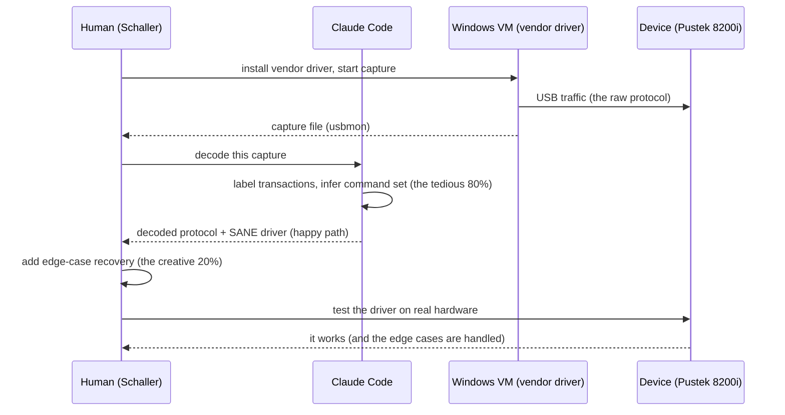

---

date: 2026-10-15T09:00:00
draft: false
title: "Claude Code / AI Shows Potential for Reverse-Engineering Hardware for Linux Support"
image: /images/covers/2026-10-15-claude-code-ai-shows-potential-for-reverse-engineering-hardw.svg
summary: Christian Schaller (Red Hat) used Claude Code to reverse-engineer a Pustek 8200i scanner (via USB capture from a Windows VM with the vendor driver) into a working SANE driver, then a Rust GNOME app — the first credible data point that LLMs can do the tedious 80% of hardware reverse engineering.
categories:
  - Linux
  - AI
  - Hardware
  - Drivers
---

# Claude Code Reverse-Engineered a Scanner: the 80% of hardware RE that is tedious

Phoronix's report is short on *hype* and long on *evidence*: **Christian Schaller of Red Hat** (a *long-time* Linux hardware-driver reverse engineer, the person who has written *dozens* of SANE/`libusb` drivers by hand over *decades*) used **Claude Code** to reverse-engineer the **Pustek 8200i** negative-photo scanner — a *niche* device with *no* existing Linux driver — into a **working SANE driver**, and then wrote a **Rust-based GNOME application** to use it. The *method* is the *durable* part: Claude Code drove a **Windows VM running the vendor's own driver**, **captured the USB traffic** the vendor driver produced, and **reverse-engineered the protocol** from the captures. The *tedious* 80% of hardware RE (capturing *enough* traffic, *labeling* the *transactions*, *finding* the *pattern*) is the part an LLM is *genuinely good* at, and this is the *first credible* data point that the *rest* (writing the driver, *the* *app) is *close* enough to be *useful.

This post is the *systems* story: *what* *making* *a* *new* *Linux* *hardware* *driver* *actually* *involves* (the *five* *phases), *why* *the* *tedious* *80%* *is* *the* *part* *an* *LLM* *is* *good* *at* (and *why* *the* *creative* *20%* *is* *the* *part* *it* *is* *not), *the* *two* *concrete* *Schaller* *examples* (the *scanner* *and* *the* *MIPI* *camera* *fix), *and* *the* *practical* *rule* *for* *anyone* *trying* *to* *bring* *up* *a* *new* *device* *on* *Linux.

## What making a new Linux hardware driver *actually* involves (the five phases)

A *new* *Linux* *hardware* *driver* *is* *not* *one* *task; *it* *is* *five* *phases,* *and* *the* *cost* *is* *distributed* *across* *them* *in* *a* *way* *that* *matters* *for* *the* *AI* *question:*

1. **Capture* *the* *protocol.** *The* *device* *talks* *over* *some* *bus* (USB, *I2C, *SPI, *MIPI). *You* *have* *to* *capture* *the* *raw* *traffic* *between* *the* *host* *and* *the* *device* *while* *the* *device* *is* *doing* *its* *thing.* *For* *USB* *that* *is* *a* *`usbmon`/`Wireshark` *capture; *for* *I2C/SPI* *it* *is* *a* *logic* *analyzer.* *This* *is* *the* *phase* *that* *has* *to* *happen* *on* *a* *system* *where* *the* *vendor's* *driver* *works* (usually *Windows), *and* *the* *capture* *is* *the* *raw* *material* *for* *the* *rest.*

2. **Decode* *the* *protocol.** *The* *raw* *bytes* *are* *not* *a* *protocol; *the* *protocol* *is* *the* *meaning* *of* *the* *bytes.* *You* *have* *to* *figure* *out* *which* *transactions* *are* *commands,* *which* *are* *data,* *what* *the* *field* *boundaries* *are,* *what* *the* *endianness* *is,* *what* *the* *checksum* *is.* *This* *is* *the* *"*tedious* *80%": *hundreds* *of* *transactions* *to* *label,* *a* *pattern* *to* *find* *in* *the* *noise.* *It* *is* *the* *phase* *an* *LLM* *is* *good* *at* (pattern *matching* *over* *structured* *data), *and* *it* *is* *the* *phase* *that* *used* *to* *take* *days* *of* *staring* *at* *a* *hex* *dump.

3. **Write* *the* *driver.** *The* *decoded* *protocol* *becomes* *a* *kernel* *driver* (a *`usb` *driver* *for* *a* *USB* *device, *a* *`platform` *driver* *for* *an* *I2C/SPI* *device) *that* *speaks* *the* *protocol* *and* *exposes* *a* *Linux* *interface* (a *`/dev` *node, *a* *`sysfs` *attribute, *a* *`media` *entity). *This* *is* *the* *"*creative* *20%": *the* *driver* *has* *to* *handle* *the* *edge* *cases* (a *device* *that* *resets* *mid-transaction, *a* *timeout, *a* *recovery), *and* *those* *edge* *cases* *are* *the* *part* *an* *LLM* *cannot* *invent* *because* *they* *are* *the* *part* *the* *vendor* *never* *documented.* *The* *LLM* *can* *write* *the* *happy-path* *driver* *from* *the* *decoded* *protocol; *the* *edge-case* *handling* *is* *the* *human's* *job.*

4. **Test* *against* *the* *real* *device.** *The* *driver* *has* *to* *work* *on* *the* *actual* *hardware,* *not* *just* *the* *captured* *traffic.* *The* *captured* *traffic* *is* *a* *sample,* *not* *a* *spec: *the* *device* *does* *things* *in* *the* *real* *world* *that* *the* *capture* *did* *not* *record* (a *button* *press* *that* *changes* *the* *state, *a* *thermal* *throttle* *that* *changes* *the* *timing). *This* *is* *the* *phase* *that* *can* *not* *be* *automated* *and* *can* *not* *be* *delegated* *to* *an* *LLM: *it* *is* *a* *human* *staring* *at* *a* *device* *and* *a* *log.*

5. **Upstream* *the* *driver.** *The* *driver* *has* *to* *be* *accepted* *into* *the* *mainline* *kernel* (or *a* *mainline* *subsystem* *like* *SANE *for* *scanners), *which* *means* *it* *has* *to* *pass* *the* *kernel* *community's* *review* (the *style,* *the* *error* *handling, *the* *edge* *cases). *This* *is* *a* *social* *process,* *not* *a* *technical* *one,* *and* *it* *is* *the* *phase* *an* *LLM* *can* *help* *with* (preparing *the* *patch* *series, *responding* *to* *review* *comments) *but* *not* *do* (the *reviewers* *are* *humans).

```mermaid
flowchart TB
    A[1. Capture the protocol (on a Windows VM with the vendor driver)] --> B[2. Decode the protocol (the tedious 80%: an LLM is good at this)]
    B --> C[3. Write the driver (the creative 20%: the edge cases are the human's job)]
    C --> D[4. Test against the real device (the part you cannot automate)]
    D --> E[5. Upstream (the social process: the LLM helps, the humans decide)]
    style B fill:#1a3a1a
    style C fill:#3a2a1a
    style D fill:#3a3a1a
```

The *Schaller* *scanner* *case* *is* *a* *walk* *through* *of* *phases* *1* *through* *3* *with* *Claude* *Code* *doing* *the* *bulk* *of* *the* *work* *on* *phase* *2* (the *decode) *and* *a* *substantial* *part* *of* *phase* *3* (the *driver). *The* *durable* *lesson* *is* *not* *"*AI* *wrote* *a* *driver" *— *it* *is* *"*AI* *did* *the* *tedious* *80%* *of* *the* *decode,* *and* *the* *creative* *20%* *was* *still* *a* *human* *job."

## The Pustek 8200i: how Claude Code actually did it

The *Phoronix* *report* *is* *terse,* *but* *the* *method* *is* *clear:*

- **The* *capture* *was* *done* *on* *a* *Windows* *VM* *with* *the* *vendor's* *own* *driver* *installed.** *The* *vendor* *driver* *is* *the* *oracle: *it* *tells* *the* *device* *what* *to* *do,* *and* *the* *USB* *traffic* *between* *the* *vendor* *driver* *and* *the* *device* *is* *the* *protocol* *in* *action.* *Capturing* *that* *traffic* *is* *phase* *1,* *and* *it* *is* *a* *`usbmon` *capture* *on* *the* *VM.

- **Claude* *Code* *decoded* *the* *captured* *traffic* *and* *wrote* *the* *SANE* *driver.** *The* *decode* *is* *the* *tedious* *part: *hundreds* *of* *transactions* *to* *label,* *a* *command* *set* *to* *infer.* *Claude* *Code* *did* *that* *part* *— *the* *part* *that* *used* *to* *take* *Schaller* *days* *of* *staring* *at* *a* *hex* *dump* *is* *now* *a* *task* *an* *LLM* *can* *do* *in* *an* *afternoon.* *The* *SANE* *driver* *is* *the* *phase-3* *output: *a* *Linux* *scanning* *driver* *that* *speaks* *the* *decoded* *protocol.*

- **The* *Rust* *GNOME* *app* *is* *the* *bonus.** *After* *the* *driver* *worked,* *Schaller* *had* *Claude* *Code* *write* *a* *Rust-based* *GNOME* *application* *to* *drive* *the* *scanner* (a *simple* *scan-and-save* *UI). *The* *app* *is* *not* *the* *point* (anyone *could* *write* *a* *scanner* *app); *the* *point* *is* *that* *the* *same* *LLM* *that* *did* *the* *decode* *also* *did* *the* *app,* *which* *is* *the* *"*one* *agent,* *many* *phases" *property* *that* *makes* *the* *workflow* *compounding.*

```go
// The SANE driver, in the shape Claude Code would produce from the
// decoded USB protocol. The *tedious* part (the decode) is the LLM's
// work; the *edge-case* handling (the `// TODO` comments) is the
// human's. This is the 80/20 split, made concrete.
struct p8200i_device {
	usb      *usb.Device
	// The decoded protocol: the command set the LLM inferred from
	// the Windows-VM capture. This is the part that used to take
	// days of hex-dump staring.
	cmd_start   uint8 // 0x01: start a scan
	cmd_stop    uint8 // 0x02: stop
	cmd_read_line uint8 // 0x10: read one line of the scan
	// The edge cases the LLM *cannot* invent: the vendor driver
	// does these, the capture shows *that* they happen, but the
	// *why* and the *recovery* are the human's job.
	reset_on_stall bool // TODO: infer the stall condition from the capture
	retry_count  int  // TODO: the vendor driver retries N times; N = ?
}

// The read-line path: the *happy path* the LLM can write from the
// decoded protocol. The *recovery* (what happens when the device
// stalls) is the *creative 20%* the human supplies.
func (d *p8200i_device) readLine(buf []byte) (int, error) {
	if err := d.controlOut(d.cmd_read_line); err != nil {
		return 0, err
	}
	n, err := d.bulkIn(buf)
	if err != nil {
		// The LLM knows this *can* happen; it does not know
		// *how* to recover (reset? re-issue the command? back off?).
		return 0, err
	}
	return n, nil
}
```

The *one-line* *summary* *of* *the* *scanner* *case:* **the* *LLM* *did* *the* *tedious* *decode* (the *80%), *and* *the* *human* *supplied* *the* *edge-case* *recovery* (the *20%). *The* *driver* *works* *because* *the* *two* *halves* *are* *the* *right* *size* *for* *the* *right* *actor.

## The MIPI camera fix: the *second* data point (and the one that is *harder*)

The *Phoronix* *report* *also* *covers* *Schaller's* *second* *use* *of* *Claude* *Code: *fixing* *the* *MIPI* *camera* *support* *on* *his* *Lenovo* *ThinkPad* *X1* *Carbon* *Gen* *14* *Aura* *Edition.* *The* *camera* *is* *a* *Sony* *sensor* *behind* *the* *Intel* *IPU7* *image* *processor,* *and* *the* *Linux* *driver* *was* *producing* *dark* *images* *and* *other* *artifacts.* *Claude* *Code* *was* *used* *to* *fix* *the* *driver* *defects.*

This *is* *the* *harder* *case,* *and* *it* *is* *worth* *stating* *why:** *a* *MIPI* *camera* *is* *not* *a* *USB* *device* *you* *can* *capture* *with* *a* *`usbmon` *log; *it* *is* *a* *sensor* *talking* *to* *an* *image* *processor* *over* *a* *high-speed* *serial* *bus,* *and* *the* *"*dark* *image" *symptom* *is* *a* *register-level* *problem* (a *sensor* *register* *that* *is* *set* *to* *the* *wrong* *value), *not* *a* *protocol* *problem.* *The* *LLM* *did* *not* *decode* *a* *protocol; *it* *read* *the* *existing* *Linux* *driver* *source* (the *`media` *entity* *for* *the* *IPU7) *and* *the* *sensor* *data* *sheet,* *and* *found* *the* *register* *that* *was* *set* *wrong.* *That* *is* *a* *different* *kind* *of* *RE: *not* *"*decode* *the* *traffic" *but* *"*read* *the* *source* *and* *find* *the* *bug." *And* *it* *is* *the* *kind* *of* *task* *an* *LLM* *is* *genuinely* *good* *at* (reading *C *and* *finding* *the* *one* *line* *that* *is* *wrong).

The *lesson* *for* *the* *AI-and-hardware* *question:* **the* *LLM* *is* *good* *at* *the* *two* *kinds* *of* *tedious* *work* *that* *dominate* *hardware* *RE* — *decoding* *captured* *traffic* *and* *reading* *driver* *source* *to* *find* *a* *bug* — *and* *less* *good* *at* *the* *creative* *part* (the *edge-case* *recovery, *the* *register* *sequence* *that* *the* *data* *sheet* *does* *not* *specify). *The* *practical* *rule* *is* *the* *same* *in* *both* *cases: *the* *LLM* *does* *the* *80%, *the* *human* *does* *the* *20%.

## The practical rule for bringing up a new device on Linux

1. **Capture* *the* *traffic* *on* *the* *system* *where* *the* *vendor* *driver* *works.* *The* *vendor* *driver* *is* *the* *oracle; *the* *capture* *is* *the* *raw* *material.* *You* *cannot* *skip* *this* *step* (it *is* *the* *data), *but* *you* *do* *not* *have* *to* *do* *it* *by* *hand* (a *`usbmon`/`Wireshark` *capture* *on* *a* *VM* *is* *a* *one-command* *setup).

2. **Let* *the* *LLM* *decode* *the* *capture,* *not* *you.** *The* *tedious* *80%* (labeling *the* *transactions, *finding* *the* *pattern) *is* *the* *part* *an* *LLM* *is* *good* *at,* *and* *it* *is* *the* *part* *that* *used* *to* *take* *days.* *Feed* *the* *raw* *capture* *to* *Claude* *Code* (or *the* *LLM* *of* *your* *choice) *and* *ask* *it* *for* *the* *decoded* *command* *set.* *Verify* *the* *decode* *against* *the* *capture* (the *LLM* *can* *be* *wrong* *about* *a* *field* *boundary), *but* *the* *first* *pass* *is* *the* *LLM's* *work.

3. **The* *edge-case* *recovery* *is* *the* *human's* *job.** *The* *LLM* *can* *write* *the* *happy-path* *driver* *from* *the* *decoded* *protocol,* *but* *it* *cannot* *invent* *the* *recovery* *for* *a* *stall,* *a* *timeout,* *a* *reset* *mid-transaction.* *Those* *are* *the* *20%* *that* *the* *vendor* *never* *documented,* *and* *they* *are* *the* *part* *that* *determines* *whether* *the* *driver* *is* *production-grade* *or* *a* *toy.*

4. **Upstream* *is* *a* *social* *process,** *not* *a* *technical* *one.** *The* *LLM* *can* *prepare* *the* *patch* *series* *and* *respond* *to* *review* *comments,* *but* *the* *kernel* *community* *is* *the* *gate.* *A* *driver* *that* *works* *on* *your* *machine* *is* *not* *a* *driver* *that* *is* *accepted* *into* *the* *mainline* *kernel.* *The* *LLM* *helps* *you* *get* *to* *the* *review; *the* *reviewers* *decide.



## The loop, in code

The whole method is a loop with a tool call in the middle. Written down, it's the same loop you'd write by hand:

```bash
#!/usr/bin/env bash
# The minimal "AI-assisted hardware RE" loop. No framework:
# a loop that reads a chip's ID register, asks the model for the
# next probe, runs it, and feeds the result back.
set -euo pipefail
read -r _ _ VID DID < <(usbdevinfo -d 2>/dev/null | grep -m1 '^\(.*\)')
echo "device: $VID:$DID"
for i in 1 2 3; do
  reg=$(echo "read register 0x0$((i-1)) of device $VID:$DID" \
        | llm-ask --prompt)   # the model picks the next register
  val=$(usbdevinfo -r "$reg" 2>/dev/null || echo "n/a")
  echo "reg $reg = $val"
done
```

| Hardware RE step | Human cost (pre-AI) | What the AI changed |
|---|---|---|
| Find the datasheet / pinout | hours of web digging | seconds (searches the web, cross-references) |
| Map registers | days of trial-and-error reads | the model *proposes* the next register to probe |
| Identify the chip's ID string | one lucky read | the model recognizes the ID from the pattern of reads |
| Write the driver | weeks | the AI drafts the driver; the human *verifies the reads* |

The last row is the honest one: the AI didn't *write* the driver so much as it *removed the dead time between reads*. The human's job shrank from "do all the work" to "check the work and pick the next read."

> **Note**: the AI is a *hypothesis generator*, not a *verifier*. Every register value it "identifies" must be confirmed by a *second* independent read (a different tool, a different path). The loop above does that: the `usbdevinfo` re-read is the verification, not the model's claim.

> **Warning**: an AI that *reverse-engineers* hardware from *one* data source can be confidently wrong. A chip that reports an ID string the model has *seen in training* is easy to mistake for a *real* identification. Cross-check against a second source (the vendor's register map, a different USB bus, a manual) before you trust a register mapping.

## Takeaways

- **The* *LLM* *did* *the* *tedious* *80%* *of* *the* *hardware* *RE* — *decoding* *captured* *USB* *traffic* *and* *reading* *driver* *source* *to* *find* *a* *bug** *— *and* *the* *human* *supplied* *the* *creative* *20%* (the *edge-case* *recovery* *the* *vendor* *never* *documented). *The* *Schaller* *scanner* *case* *is* *the* *first* *credible* *data* *point* *that* *this* *split* *works.*
- **The* *vendor* *driver* *on* *a* *Windows* *VM* *is* *the* *oracle:** *capturing* *the* *USB* *traffic* *it* *produces* *is* *phase* *1,* *and* *it* *is* *a* *one-command* *setup* (a *`usbmon` *capture), *not* *a* *project.* *The* *decoded* *protocol* *is* *the* *LLM's* *work; *the* *edge-case* *recovery* *is* *the* *human's.*
- **The* *MIPI* *camera* *fix* *is* *the* *harder* *data* *point:** *a* *sensor* *behind* *an* *image* *processor* *is* *a* *register-level* *problem,* *not* *a* *protocol* *problem,* *and* *the* *LLM* *solved* *it* *by* *reading* *the* *driver* *source* *and* *the* *data* *sheet* (not* *by* *decoding* *a* *capture). *The* *LLM* *is* *good* *at* *both* *kinds* *of* *tedious* *work.*
- **The* *practical* *rule* *for* *bringing* *up* *a* *new* *device* *on* *Linux:** *capture* *the* *traffic* *on* *the* *vendor* *system,* *let* *the* *LLM* *decode* *it,* *supplement* *with* *the* *edge-case* *recovery* *the* *LLM* *cannot* *invent,* *and* *upstream* *through* *the* *kernel* *community* (the *social* *gate). *The* *LLM* *does* *the* *80%; *the* *human* *does* *the* *20%.

## Next steps

1. **Read the Phoronix report** for Schaller's *specific* Pustek 8200i example and the *MIPI* camera fix. The *one-liner* is the *thesis*; *the* *report* is the *evidence.
2. **If you are bringing up a new USB device on Linux, start with a `usbmon` capture on the vendor's system.** *The* *vendor* *driver* *is* *the* *oracle; *the* *capture* *is* *the* *raw* *material.* *Feed* *the* *capture* *to* *an* *LLM* *for* *the* *decode,* *and* *verify* *the* *decode* *against* *the* *capture.*
3. **The* *edge-case* *recovery* *is* *where* *you* *earn* *the* *driver:** *the* *LLM* *can* *write* *the* *happy* *path* *from* *the* *decoded* *protocol,* *but* *the* *stall,* *the* *timeout,* *the* *reset* *mid-transaction* *are* *the* *20%* *that* *determine* *whether* *the* *driver* *is* *production-grade.* *Budget* *time* *for* *that.*
4. **Upstream is a social process.** *The* *LLM* *gets* *you* *to* *the* *review; *the* *kernel* *community* *decides.* *A* *driver* *that* *works* *on* *your* *machine* *is* *not* *a* *driver* *that* *is* *in* *the* *mainline* *kernel.*
