---

date: 2026-10-15T09:00:00
draft: false
title: "Code That Passes Every Test Can Still Break the Next AI Agent That Touches It"
summary: Go is being repositioned as the language for AI agents — not because agents write it well, but because its small surface, readable errors, and enforced formatting make it the lowest-cost language for the *next* agent (or human) to read, fix, and maintain.
categories:
  - Go
  - AI
  - Engineering
---

# Code that passes every test can still break the next AI agent that touches it

The New Stack's framing of Go in the agent era is a *reframe*, not a *hype* cycle: **the language that wins the agent era is the one a *non-author* can *read, understand, and fix* at the lowest cost** — and *that* *is* *the* *property* *Go* *currently* *has* *the* *most* *of.** *The* *counterintuitive* *part:* *it* *is* *not* *because* *AI* *writes* *Go* *best* (it *writes* *every* *language* *competently), *but* *because* *a* *second* *agent* (or *the* *human* *on* *call) *can* *read* *Go* *better* *than* *it* *can* *read* *the* *alternatives.* *The* *test* *suite* *is* *the* *floor* *that* *makes* *the* *first* *agent's* *work* *look* *right;* *the* *reading* *cost* *is* *the* *ceiling* *that* *decides* *whether* *the* *second* *agent* *can* *maintain* *it.*

This post is the *reframe*, expanded: *why* *"*passes* *every* *test*" *is* *not* *"*the* *next* *agent* *can* *read* *it", *what* *"*readable* *by* *a* *non-author*" *actually* *means* *as* *a* *measurable* *property* (and *why* *Go* *maximizes* *it), *the* *two* *concrete* *failure* *modes* *of* *AI* *code* *that* *a* *test* *suite* *cannot* *catch, *and* *the* *practical* *rule* *for* *anyone* *putting* *AI* *code* *into* *a* *production* *codebase.

## The reframe: the agent era measures *reading* cost, not *writing* cost

The *old* *question* (the *human* *era) *was* *"*how* *fast* *can* *I* *write* *this?" *The* *new* *question* (the *agent* *era) *is* *"*how* *cheap* *is* *it* *for* *the* *next* *reader* *to* *understand* *this* *and* *fix* *the* *one* *line* *that* *is* *wrong?" *The* *reason* *the* *question* *changed* *is* *that* *the* *writing* *cost* *collapsed* *to* *near-zero* (an *LLM* *writes* *a* *function* *in* *seconds), *but* *the* *reading* *cost* *did* *not* (the *next* *reader* *still* *has* *to* *reconstruct* *the* *meaning* *from* *the* *code). *The* *asymmetry* *is* *structural:* *an* *author* *knows* *the* *meaning* at *the* *moment* *of* *writing; *a* *reader* *reconstructs* *it* *later.* *AI* *agents* *collapse* *the* *author* *side* (the *LLM* *is* *the* *author); *they* *do* *not* *collapse* *the* *reader* *side.

The *consequence* *for* *language* *choice:* **the* *generation* *axis* *is* *a* *race* *to* *the* *bottom* (every *LLM* *can* *write* *every* *language), *but* *the* *maintenance* *axis* *is* *a* *race* *to* *the* *top* (the *language* *that* *is* *easiest* *for* *a* *non-author* *to* *read* *wins). *Go* *is* *the* *current* *top* *of* *that* *race* *for* *the* *reasons* *below,* *and* *that* *is* *why* *"*Google* *is* *repositioning* *Go* *for* *AI* *agents" *is* *a* *real* *strategic* *move,* *not* *a* *marketing* *one.

```mermaid
flowchart LR
    A["Writing cost (LLM): collapsed to ~0"] --> B["code in the repo"]
    B --> C["Reading cost (next agent/human): unchanged, expensive"]
    C --> D["the language that minimizes C wins the agent era"]
    style A fill:#1a3a1a
    style C fill:#3a2a1a
```



## What "readable by a non-author" actually means (the four measurable properties)

"*Readable*" *is* *not* *a* *vibe; *it* *is* *four* *concrete,* *measurable* *properties,* *and* *Go* *maximizes* *all* *four:*

1. **The* *surface* *area* *is* *small** *— *few* *ways* *to* *say* *the* *same* *thing.** *Go* *has* *one* *idiom* *per* *concept* (one *way* *to* *loop, *one* *way* *to* *express* *a* *type* *constraint, *one* *way* *to* *handle* *errors). *A* *non-author* *reading* *Go* *does* *not* *have* *to* *disambiguate* *between* *equally-valid* *idioms.* *A* *language* *with* *five* *idioms* *for* *a* *loop* *is* *a* *language* *a* *non-author* *has* *to* *study* *before* *they* *can* *read* *it.

2. **The* *errors* *are* *readable** *— *a* *type* *error* *is* *a* *one-line* *explanation,* *not* *a* *two-page* *template* *trace.** *A* *non-author* *reading* *a* *compile* *error* *in* *Go* *can* *usually* *tell* *what* *the* *author* *meant* *and* *what* *the* *compiler* *is* *saying* *is* *wrong* *without* *a* *reference.* *A* *template-instantiation* *trace* *is* *a* *maintenance* *cost* *the* *non-author* *pays* *every* *time* *the* *compiler* *complains.

3. **The* *formatting* *is* *enforced** *— *the* *reading* *does* *not* *depend* *on* *the* *author's* *preferences.** *gofmt* *means* *a* *non-author* *reading* *line* *N* *does* *not* *have* *to* *parse* *the* *author's* *formatting* *to* *find* *the* *logic* — *the* *formatting* *is* *the* *same* *on* *every* *line.* *A* *codebase* *with* *inconsistent* *formatting* *is* *a* *codebase* *a* *non-author* *reads* *more* *slowly,* *for* *no* *reason.

4. **The* *standard* *library* *is* *the* *shared* *vocabulary** *— *code* *that* *uses* *the* *standard* *library* *is* *code* *a* *non-author* *can* *read* *because* *the* *standard* *library* *is* *the* *common* *language.* *A* *codebase* *that* *reaches* *for* *a* *third-party* *framework* *for* *every* *thing* *is* *a* *codebase* *a* *non-author* *cannot* *read* *without* *the* *framework's* *docs.* *Go's* *standard* *library* *is* *the* *reason* *"*just* *use* *the* *standard* *library" *is* *a* *maintainability* *argument,* *not* *a* *cliché.

```go
// The four properties, in one function a non-author can read.
// 1. One idiom: the loop is the only loop.
// 2. Readable error: if the type is wrong, the compiler says so in
//    one line, not a template trace.
// 3. Enforced format: gofmt means the layout is the same on every
//    line, so the reader never parses the author's taste.
// 4. Standard library: io, fmt, strconv are the shared vocabulary.
func SumWords(text string) (int, error) {
	words := strings.Fields(text) // stdlib: the shared vocabulary
	if len(words) == 0 {
		return 0, fmt.Errorf("no words in %q", text) // readable error
	}
	total := 0
	for _, w := range words { // one idiom: the for-range
		total += len(w)
	}
	return total, nil
}
```

## The two failure modes a test suite *cannot* catch

The *New* *Stack* *headline* *is* *the* *claim:* **code* *that* *passes* *every* *test* *can* *still* *break* *the* *next* *agent* *that* *touches* *it.** *There* *are* *two* *specific* *failure* *modes* *that* *a* *test* *suite* *is* *structurally* *incapable* *of* *catching:*

**Failure* *mode* *1: *the* *test* *covers* *the* *happy* *path,* *the* *code* *has* *an* *edge* *case* *the* *test* *does* *not.* *Agent* *1* *writes* *a* *function* *and* *a* *test* *that* *checks* *the* *input* *the* *function* *is* *called* *with* *most* *of* *the* *time.* *Agent* *2* *reads* *the* *function* (or *a* *human* *reads* *it* *at* *3am), *sees* *a* *line* *that* *looks* *wrong* *for* *a* *rare* *input* (a *nil, *an* *empty* *slice, *a* *negative* *index), *"*fixes*" *it* *in* *a* *way* *that* *changes* *the* *function's* *contract* (not *just* *the* *bug), *and* *the* *test* *still* *passes* (because *the* *test* *never* *tested* *that* *input). *The* *breakage* *is* *silent* *because* *the* *test* *suite* *is* *the* *floor,* *not* *the* *ceiling.

**Failure* *mode* *2: *the* *code* *is* *correct* *but* *unreadable,** *and* *the* *next* *reader* *"fixes"* *the* *style* *and* *breaks* *the* *logic.** *Agent* *1* *writes* *a* *function* *that* *works* *but* *has* *a* *non-idiomatic* *structure* (a *deeply* *nested* *if-chain* *where* *a* *table* *would* *be* *clearer, *a* *magic* *number* *where* *a* *named* *constant* *would* *be* *clearer). *Agent* *2* *refactors* *the* *structure* *to* *make* *it* *readable,* *and* *in* *the* *refactor* *changes* *one* *boundary* *condition* *by* *a* *single* *comparison* *operator* (a *`<` *that* *should* *be* *`<=`). *The* *test* *suite* *passes* (the *test* *does* *not* *hit* *that* *boundary), *and* *the* *code* *is* *now* *broken* *in* *a* *way* *that* *is* *harder* *to* *find* *than* *the* *original* *bug* (because *the* *refactor* *made* *the* *code* *look* *more* *correct* *than* *it* *is).

```go
// Failure mode 2, made concrete. Agent 1's "working" code:
// the boundary is correct (< cap) but the structure is a nested
// if-chain that is hard to read. Agent 2 refactors it to a table
// to make it readable, and in the refactor changes `< cap` to
// `<= cap` (off-by-one). The test suite passes (it never tests the
// boundary), and the code is now broken at the boundary.
func (s *Scheduler) admit(req Request) bool {
	if req.Priority < s.cap { // Agent 1: correct, but nested
		if req.Payload != nil {
			if len(req.Payload) <= s.maxPayload {
				return true
			}
		}
	}
	return false
}

// Agent 2's "readability" refactor: the table is cleaner, but the
// boundary is now `<= s.cap` (off-by-one). The test suite passes.
var priorityTable = []struct {
	min, max int
}{
	{0, s.cap}, // the refactor changed < to <= here
}
```

The *practical* *rule* *that* *follows:* **a* *test* *suite* *is* *a* *floor,* *not* *a* *ceiling:** *it* *proves* *the* *code* *does* *not* *do* *the* *specific* *wrong* *things* *the* *tests* *check,* *and* *it* *does* *not* *prove* *the* *code* *does* *the* *right* *thing* *for* *the* *cases* *the* *tests* *do* *not* *express.* *A* *pull* *request* *that* *adds* *code* *without* *edge-case* *tests* *is* *a* *pull* *request* *that* *shifts* *the* *maintenance* *cost* *to* *the* *next* *reader.* *Reject* *it.*

## The practical rule for putting AI code into a production codebase

1. **The* *AI* *agent* *is* *a* *junior* *developer,** *not* *a* *peer.** *Its* *code* *is* *reviewed* *before* *it* *is* *merged.* *The* *review* *is* *the* *maintenance* *cost,* *and* *it* *is* *not* *optional.* *A* *codebase* *where* *AI* *pull* *requests* *merge* *without* *review* *is* *a* *codebase* *that* *shifts* *the* *reading* *cost* *to* *the* *next* *reader* *and* *hopes* *for* *the* *best.

2. **The* *edge-case* *test* *is* *the* *merge* *gate,** *not* *the* *happy-path* *test.** *Every* *AI* *pull* *request* *has* *to* *come* *with* *tests* *that* *cover* *the* *nil,* *the* *empty,* *the* *negative,* *and* *the* *boundary* *inputs.* *A* *pull* *request* *that* *only* *tests* *the* *happy* *path* *is* *a* *pull* *request* *that* *is* *asking* *the* *next* *reader* *to* *pay* *the* *reading* *cost* *twice.*

3. **The* *language* *is* *the* *maintainability* *bet.** *If* *you* *are* *choosing* *a* *language* *for* *a* *codebase* *that* *AI* *agents* *will* *write* *and* *humans* *will* *maintain,* *weight* *the* *reading* *cost* *for* *a* *non-author* *heavier* *than* *the* *generation* *cost.* *Go* *is* *the* *current* *best* *answer* *for* *that* *reason* (small *surface, *readable* *errors, *enforced* *formatting, *standard* *library* *as* *the* *shared* *vocabulary). *The* *argument* *is* *not* *"*Go* *is* *the* *smartest" *— *it* *is* *"*Go* *is* *the* *easiest* *for* *a* *non-author* *to* *read."

```mermaid
flowchart TB
    A[AI agent writes code + happy-path tests] --> B{review: edge-case tests present?}
    B -- yes --> C[merge: the tests are the floor, the code is readable]
    B -- "no (happy-path only)" --> D[reject: the reading cost is shifted to the next reader]
    C --> E[next agent reads the code: low cost (small surface, readable errors)]
    D --> A
    style C fill:#1a3a1a
    style D fill:#3a2a1a
```

## What "passes every test" actually buys you

Coverage tells you the *known* paths work. It says nothing about the *unknown* paths — the ones your tests never named. A small, honest map:

| Test outcome | What it proves | What it hides |
|---|---|---|
| All green, 100% line coverage | every *named* line executed | the *unnamed* branches (the `if` nobody wrote a test for) |
| All green, property tests pass | the *invariants* hold over a sampled domain | the samples you *didn't* draw (properties are probabilistic) |
| All green, integration green | the *seams* you wired up behave | the *seams you didn't* wire (every untested adapter is a fake) |
| All green, fuzzing clean (10k seeds) | no crash on *the inputs you tried* | the 100,001st input; fuzzing is *negative* evidence |

The last column is the whole post: **a green suite is a list of things you checked, not a certificate that nothing is un-checked.**

```python
# The smallest demonstration of the gap: a function whose tests
# all pass, and a next agent (or next you) breaking it.
def clamp(v, lo, hi):
    # ponytail: the tests only cover v >= lo and v <= hi;
    # the hi < lo case is never named, so it's never guarded.
    if v < lo:
        return lo
    if v > hi:
        return hi
    return v

def self_check():
    assert clamp(5, 0, 10) == 5
    assert clamp(-1, 0, 10) == 0
    assert clamp(11, 0, 10) == 10
    # The unnamed case: hi < lo. Returns 10, "correct" by the
    # tests, wrong by any sane reading. No test exists to fail.
    assert clamp(5, 10, 0) == 10   # "green" - and silently broken
    print("all green - and one bug no test can see")

self_check()
```

> **Note**: the fix is not *more* tests — it's *naming the cases you didn't*. A one-line `assert lo <= hi` at the top of `clamp` turns the invisible gap into a visible contract. Coverage measures lines; *naming* measures cases.

> **Warning**: "the tests pass" is not a reason to merge when the *contract* is untested. An agent that can read the code can also *break* it; the only thing standing between a green CI and a broken production is a test that names the case the agent is about to touch.

## Takeaways

- **The* *agent* *era* *measures* *reading* *cost,* *not* *writing* *cost:** *the* *writing* *collapsed* *to* *near-zero* (an *LLM* *writes* *a* *function* *in* *seconds), *but* *the* *reading* *did* *not* (the *next* *reader* *still* *reconstructs* *the* *meaning). *The* *language* *that* *minimizes* *the* *reading* *cost* *wins* *the* *agent* *era.
- **"*Passes* *every* *test*" *is* *a* *floor,* *not* *a* *ceiling:** *a* *happy-path* *test* *suite* *makes* *the* *next* *reader's* *mistakes* *silent.* *The* *two* *failure* *modes* *a* *test* *cannot* *catch* *are* *the* *edge-case* *the* *test* *does* *not* *cover* (the *first* *reader* *"*fixes"* *it* *and* *breaks* *the* *contract) *and* *the* *readability* *refactor* *that* *changes* *a* *boundary* *by* *one* *operator.*
- **Go* *maximizes* *the* *four* *readability* *properties** (small *surface* *area, *readable* *errors, *enforced* *formatting, *standard* *library* *as* *the* *shared* *vocabulary). *That* *is* *why* *"*Google* *is* *repositioning* *Go* *for* *AI* *agents" *is* *a* *strategic* *move* *and* *not* *a* *marketing* *one: *the* *maintenance* *axis* *is* *the* *axis* *that* *decides* *which* *languages* *win.*
- **The* *practical* *rules* *are* *three:** *the* *AI* *agent* *is* *a* *junior* *developer* (review *is* *mandatory), *the* *edge-case* *test* *is* *the* *merge* *gate* (a *happy-path-only* *pull* *request* *is* *rejected), *and* *the* *language* *is* *the* *maintainability* *bet* (pick *the* *one* *a* *non-author* *can* *read).

## Next steps

1. **Read the New Stack article in full** for the *specific* Go examples the author uses to make the "repositioning" argument. The *one-liner* is the *thesis*; *the* *article* is the *evidence.
2. **If you are putting AI code into a production codebase, make the edge-case test the merge gate.** *A* *pull* *request* *that* *only* *tests* *the* *happy* *path* *is* *a* *pull* *request* *that* *shifts* *the* *reading* *cost* *to* *the* *next* *reader.* *Reject* *it.*
3. **If you are choosing a language for an AI-heavy codebase, weight the reading cost for a non-author heavier than the generation cost.** *Go* *is* *the* *current* *best* *answer* *for* *that* *reason; *the* *argument* *is* *not* *"*Go* *is* *the* *smartest" *— *it* *is* *"*Go* *is* *the* *easiest* *for* *a* *non-author* *to* *read."
