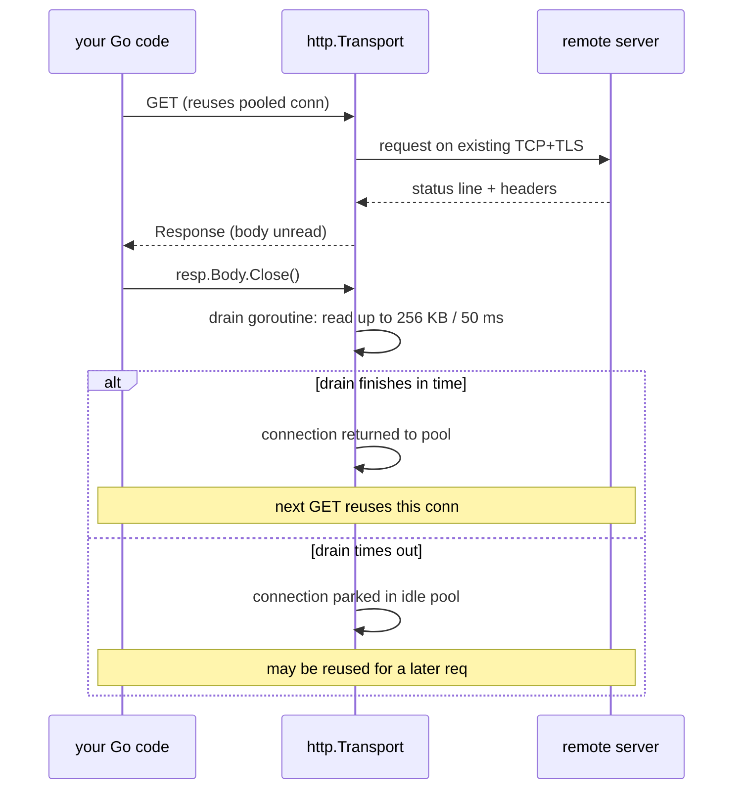

---

date: 2026-10-15T09:00:00
draft: true
title: "Go 1.27 Released: Portable SIMD, Arch-Specific SIMD, and a 5x Faster HTTP/1 Client"
summary: Go 1.27 ships an experimental portable SIMD package, extends arch-specific SIMD to arm64 and wasm, and makes the HTTP/1 client reuse connections by auto-draining unread response bodies.
categories:
  - Go
  - Release
  - Performance
tags:
  - Go
  - SIMD
  - HTTP
---

# Go 1.27: The Release That Makes Vector Code Portable and HTTP/1 Fast

Go 1.27 lands with two headline features that matter to anyone who writes performance-critical Go: a **portable, size-agnostic SIMD package** (the `simd` experiment) and a **`net/http` transport that finally reuses HTTP/1 connections** by draining unread response bodies on the server's behalf. On top of the platform-independent API, the release extends the arch-specific `archsimd` layer to **arm64 (NEON) and wasm**, so the SIMD story is no longer amd64-only. The practical effect: the 100-sequential-GET benchmark that takes ~710 ms on Go 1.26 drops to **~150 ms on Go 1.27 — a 5x improvement** — with zero changes to user code, and a class of "write one vector kernel, run it on every architecture" that was previously an assembly exercise now has a standard-library answer.

This post walks the three features, the RTT math that makes the HTTP change worth a release, the code you write against `simd` vs `archsimd`, and the gotchas that bite when you enable the experiment flag.

## The SIMD stack: `archsimd` at the bottom, `simd` on top

Go has had **no portable SIMD API** until this release. You could use SIMD in Go only by writing Go assembly (the same `·AddVV`-style asm that `math/bits` and the GC's scanner use), which is fine for a few kernels and miserable for everything else. Go 1.26 introduced an experimental **amd64** arch-specific API in `simd/archsimd`; **1.27 adds arm64 and wasm to that layer** and, for the first time, a **portable** `simd` package loosely modeled on Google's Highway.

The layering is the whole design. Two packages, two contracts:

- **`simd/archsimd`** — the *intrinsics* layer. Fixed-width vectors (`Float32x4`, `Int32x8`, `Uint8x16`, `Mask32x4`), one method name per operation (`Add`, `Mul`, `PermuteOrZero`, `ShiftAllLeft`), edge-case behavior made explicit in the name, and a `Grouped` suffix for operations that only span a 128-bit lane on 256/512-bit registers. This is what you reach for when you need exactly the instruction the hardware has.
- **`simd`** — the *portable* layer. `Float32s`, `Int8s`, `Mask32s`, … **no fixed width**: the lane count is whatever the platform's vector unit happens to be (8 lanes of 32-bit on AVX, 4 on NEON, …), queried at runtime. The API is the *intersection* of what all supported architectures can do, with efficient emulation filling the gaps so the code always runs.

```go
// innerProduct computes a·b with the portable simd package.
// It is the single reference example from the 1.27 release notes, and
// it shows the entire portable surface: a Load, a fused MulAdd, and a
// final scalar reduction. No widths, no arch, no asm.
func innerProduct(x, y []float32) float32 {
	var a simd.Float32s
	var i int
	// The main loop processes a.Len() elements per iteration. Len() is a
	// runtime property — on AVX-512 it is 16, on NEON it is 4 — so the
	// *same* source adapts to the machine it runs on.
	for i = 0; i < len(x)-a.Len()+1; i += a.Len() {
		u := simd.LoadFloat32s(x[i : i+a.Len()])
		v := simd.LoadFloat32s(y[i : i+a.Len()])
		a = u.MulAdd(v, a) // fused multiply-add: a += u*v
	}
	if i < len(x) {
		// The tail is shorter than one register. LoadFloat32sPart returns
		// how many elements it actually loaded; the rest is zero.
		u, _ := simd.LoadFloat32sPart(x[i:])
		v, _ := simd.LoadFloat32sPart(y[i:])
		a = u.MulAdd(v, a)
	}
	return reduceSum(a) // 1.27 has no ReduceSum yet — next release adds it
}

// reduceSum is the 1.27 stand-in for the future simd.ReduceSum.
// It stores the vector to a slice and sums the scalar elements.
func reduceSum(v simd.Float32s) float32 {
	s := make([]float32, v.Len())
	v.Store(s)
	var r float32
	for _, e := range s {
		r += e
	}
	return r
}
```

The portable package deliberately keeps the API small enough that an LLM (or a tired human) can write it correctly: `Load*`, `Store*`, `Add`, `Sub`, `Mul`, `MulAdd`, `Div`, `Sqrt`, `Min`, `Max`, `And`, `Or`, `Xor`, `AndNot`, `Not`, `IfElse`, `Masked`, `Masked`-select, `Equal`/`Less`/`Greater`/… (comparisons return *mask* types), `ConvertTo*`, `ToBits`/`BitsTo*`, `ReshapeTo*`, `ShiftAll*`, `RotateAll*`, `Abs`, `Neg`, `Average`. The missing pieces (per the 1.27 notes) are the ones you can't define without a width: **`ReduceSum`** is the canonical example and is promised for the next release.

When you outgrow the portable set — say you need `Int8s.OnesCount()`, which doesn't exist in 1.27 — you *drop down* per platform with `ToArch()` and come back up with the `…FromArch` family. That is the escape hatch, and it is exactly as ugly as it sounds: one type-switch per target arch.

```go
// OnesCount is the documented 1.27 escape-hatch example: a per-arch
// LUT (lookup table) popcount that the portable simd package does not
// yet have. The amd64 case handles both the 128-bit (no HW popcnt for
// 8-bit lanes) and 512-bit (HW popcnt exists) shapes.
func onesCount(v simd.Int8s) simd.Int8s {
	var popcnt4x16 = [16]int8{0,1,1,2,1,2,2,3,1,2,2,3,2,3,3,4}
	var popcnt4x32 = [32]int8{
		0,1,1,2, 1,2,2,3, 1,2,2,3, 2,3,3,4,
		0,1,1,2, 1,2,2,3, 1,2,2,3, 2,3,3,4,
	}
	switch x := v.ToArch().(type) {
	case archsimd.Int8x16:
		lut := archsimd.LoadInt8x16Array(&popcnt4x16)
		mask0f := archsimd.BroadcastInt8x16(0x0f)
		lo := x.And(mask0f)
		hi := x.ToBits().ReshapeToUint16s().ShiftAllRight(4).
			ReshapeToUint8s().BitsToInt8().And(mask0f)
		// PermuteOrZero on amd64 (VPSHUFB): index<0 → 0, else mod 16.
		return simd.Int8sFromArch(lut.PermuteOrZero(lo).
			Add(lut.PermuteOrZero(hi)))
	case archsimd.Int8x32:
		lut := archsimd.LoadInt8x32Array(&popcnt4x32)
		mask0f := archsimd.BroadcastInt8x32(0x0f)
		lo := x.And(mask0f)
		hi := x.ToBits().ReshapeToUint16s().ShiftAllRight(4).
			ReshapeToUint8s().BitsToInt8().And(mask0f)
		return simd.Int8sFromArch(lut.PermuteOrZero(lo).
			Add(lut.PermuteOrZero(hi)))
	default:
		// Fallback for arches without a matching case: emulate with
		// scalar ops. Slow but always correct.
		s := make([]int8, v.Len())
		v.Store(s)
		for i, b := range s {
			s[i] = int8(bits.OnesCount8(uint8(b)))
		}
		return simd.Int8sFromArch(archsimd.LoadInt8sArray(s))
	}
}
```

```mermaid
flowchart TB
    subgraph portable["simd  (portable, size-agnostic)"]
        A[Float32s, Int8s, Mask32s]
        B[Load / Store / MulAdd / IfElse / Compare]
    end
    subgraph arch["archsimd  (per-arch intrinsics)"]
        C1[amd64: AVX / AVX2 / AVX-512]
        C2[arm64: NEON  (SVE, SVE2 on the way)]
        C3[wasm: 128-bit]
    end
    A --> B
    B -- "ToArch() / FromArch" --> C1
    B -- "ToArch() / FromArch" --> C2
    B -- "ToArch() / FromArch" --> C3
    C1 -.-> D[asm: VADD, VPADD, …]
    C2 -.-> E[asm: vadd.2s, …]
    C3 -.-> F[asm: i32x4.add, …]
    style A fill:#1a3a1a
    style C1 fill:#3a1a1a
```

### Portable vs arch-specific: the decision table

| Dimension | `simd` (portable) | `simd/archsimd` |
|---|---|---|
| Vector width | Runtime-determined (128/256/512) | Fixed per type (`Float32x4`, …) |
| Portability | One source, all arches + emulated on non-SIMD | One source per arch |
| Instruction coverage | Intersection of arches | Full per-arch instruction set |
| Mask model | Mask types per element width | Mask types, lane-aware |
| Typical user | Data processing, ML, crypto | The 1–2 kernels that need a specific instruction |
| Go 1.27 status | Experimental (`GOEXPERIMENT=simd`) | Experimental, amd64 + arm64 + wasm |

> **Note**: Both `simd` and `simd/archsimd` are **experimental** in Go 1.27. You enable them with `GOEXPERIMENT=simd` (or `simd_arm64`, `simd_wasm` per arch) at *build* time; the API is expected to churn before it stabilizes. Do not write a production hot path against it until the experiment lands. The `1.27` release notes call it "experimental," not "new," for exactly this reason.

> **Warning**: The portable `simd` package **emulates** operations on platforms that lack the hardware instruction (no SIMD at all, or the specific op). The emulation is *competent* — the 1.27 notes promise it is close to asm speed when the source op matches a hardware op, and reasonably fast when it doesn't — but it is **not free**. Benchmark the emulated path on your target before you assume "I used `simd`" means "I am fast." The whole point of the portable API is *write once, correct everywhere*; the point of `archsimd` is *write once per arch, exactly the instruction I want*.

## The HTTP/1 change: why 100 GETs went from 710 ms to 150 ms

The second 1.27 headline is small to state and huge to feel: **`net/http.Transport` now reuses HTTP/1 connections** by default. Before 1.27, the *only* way to get connection reuse was to **fully read** `resp.Body`. Close an unread body (the `defer resp.Body.Close()` idiom, the idiom the whole internet uses), and Go discarded the connection and paid a fresh TCP + TLS handshake for the next request.

The cost of a new connection is 3 RTT of setup before a single byte of HTTP is on the wire:

- **TCP handshake** — 1 RTT (SYN → SYN-ACK → ACK; the client can piggyback the first TLS message on the final ACK).
- **TLS 1.2 handshake** — 2 RTT (ClientHello/ServerHello/…/Finished).
- **HTTP request** — at least 1 RTT for a response that is not a push.

On a 50 ms one-way link, a 100 ms RTT, that is **~300 ms of pure setup per request**. The `http.Get` benchmark from the 1.27 notes — 100 sequential `GET /` against `index.golang.org`, `GODEBUG=http2client=0` (HTTP/1 only) — went from **~710 ms on 1.26 to ~150 ms on 1.27**. The math: 100 requests × ~1 RTT each = ~100 RTT if the connection were reused, ~300 RTT if it weren't. That is the 5x.

The 1.27 fix is to **asynchronously drain** an unread HTTP/1 response body for up to **50 ms** and **256 KB**, then hand the connection back to the pool for the next request. The body is drained on a background goroutine that races the next request: if the drain finishes first, the next request reuses the connection; if it doesn't, the connection is parked in the idle pool and *may* be reused for a later request. The drain also skips itself entirely when the response carries `Connection: close` (the drain would be wasted work).

```go
// getStatus is the pre-1.27 idiom: read the status, close the body.
// On 1.27 this is all you need — the transport drains the body for you.
func getStatus(url string) (int, error) {
	resp, err := http.Get(url)
	if err != nil {
		return 0, err
	}
	defer resp.Body.Close() // the 1.27 transport drains this for you
	return resp.StatusCode, nil
}

// drainAndCloseBody is the pre-1.27 manual workaround. On 1.27 you
// should delete it, not ship it. It is kept here to show what the
// transport is now doing for you, and to show why the naive "io.Copy
// to Discard" is not enough.
func drainAndCloseBody(body io.ReadCloser) {
	drainDone := make(chan struct{}, 1)
	go func() {
		// Cap the bytes: a 50 MB body we do not care about is not worth
		// downloading. 256 KB is the 1.27 default cap.
		io.CopyN(io.Discard, body, 256<<10)
		drainDone <- struct{}{}
	}()
	select {
	case <-drainDone:
		// the body drained cleanly; the connection can be reused
	case <-time.After(50 * time.Millisecond):
		// the body is trickling in slowly. Close now; the background
		// io.CopyN is interrupted by the Close, so no goroutine leak.
	}
	body.Close()
}
```

The 1.27 transport does the 50 ms / 256 KB dance automatically, and the `defer resp.Body.Close()` idiom (the one you already wrote a thousand times) is now *the* correct code.



### RTT cost: the numbers that justify the change

| Scenario | TCP | TLS 1.2 | TLS 1.3 | Total setup | 100 requests, 100 ms RTT |
|---|---|---|---|---|---|
| New connection every request (pre-1.27, no drain) | 1 RTT | 2 RTT | 1 RTT | 3 RTT (1.2) / 2 RTT (1.3) | ~30 s (1.2) / ~20 s (1.3) |
| Connection reused (1.27, auto-drain) | 0 | 0 | 0 | 0 | ~10 s |
| HTTP/2 (multiplexed) | 0 (after first) | 0 | 0 | 0 | ~10 s |

The `http2client=0` flag in the benchmark is the control: it forces HTTP/1 so the *only* variable is the transport's connection-reuse behavior. On HTTP/2 the effect is invisible (it multiplexes streams over one connection), which is why the 1.27 notes explicitly scope the win to HTTP/1.

## What else is in 1.27

The 1.27 release notes (as of this writing) are dominated by the SIMD and HTTP stories above. The rest of the release is the usual churn: `go.mod`/`go.work` tooling, `cmd/go` cache and build improvements, `net` / `os` / `time` / `crypto` bug fixes, and the standard library continuing its steady removal of deprecated APIs. Nothing in the rest is a "you need to change your code" item.

## Takeaways

- **Go 1.27 makes SIMD a real API, not an asm exercise.** `simd` is the portable, size-agnostic layer; `simd/archsimd` is the per-arch intrinsics layer. The portable layer emulates on non-SIMD platforms, so the code *always* runs; the `archsimd` layer is what you reach for when you need the exact instruction.
- **The HTTP/1 win is the headline.** 100 sequential `GET /` went from **710 ms → 150 ms** (5x) with **zero code changes**, because `net/http.Transport` now asynchronously drains unread bodies (50 ms / 256 KB) and returns the connection to the pool. The `defer resp.Body.Close()` idiom is now the *correct* code, not the *broken* one.
- **Both SIMD packages are experimental.** Enable with `GOEXPERIMENT=simd` (or `simd_arm64` / `simd_wasm`). Do not build a production hot path against them until the experiment stabilizes; the API will churn.
- **The escape hatch is `ToArch()` / `FromArch`.** When the portable `simd` set is too narrow (the canonical example is `Int8s.OnesCount()`, which 1.27 lacks), you drop to `archsimd` per platform and come back. One type-switch per target arch is the cost.

## Next steps

1. **Bump your toolchain to 1.27** and **re-benchmark any HTTP/1 client** that does sequential requests against a remote endpoint. The 5x is real; the `defer resp.Body.Close()` idiom is now *more* correct, not less.
2. **Prototype one kernel in `simd`** (the portable layer) — `innerProduct` is the canonical example — and measure it on a machine with AVX-512 and one with NEON. That is the entire "write once" claim, in one afternoon.
3. **When the portable set is too narrow, reach for `archsimd`** with `ToArch()` / `FromArch` for the *one* kernel that needs it (popcount, carryless multiply, …). Do not port the whole algorithm per arch.
4. **Keep the experiment flag off in prod** until `simd` / `archsimd` stabilize. The 1.27 notes are explicit that the API will move. The *design* is sound; the *surface* is not final.
