---

date: 2026-10-15T09:00:00
draft: false
title: "Go Experts: 'I Don't Want to Maintain AI-Generated Code'"
image: /images/covers/2026-10-15-go-experts-i-don-t-want-to-maintain-ai-generated-code.svg
summary: Two long-time Go programmers on the future of the language in the age of AI agents — and why the maintenance cost of AI-generated code, not the generation cost, is the bottleneck that will decide which languages win the agent era.
categories:
  - Go
  - AI
  - Engineering
---

# Go Experts: "I Don't Want to Maintain AI-Generated Code"

The New Stack ran a conversation with **two long-time Go programmers** on the future of their language in the age of AI agents — and the headline is the *punchline* of the title: **"I don't want to maintain AI-generated code."** The *generation* *cost* *of* *AI* *code* *is* *the* *easy* *half; *the* *maintenance* *cost* *is* *the* *expensive* *half,* *and* *it* *is* *the* *half* *that* *decides* *which* *languages* *win* *the* *agent* *era.* *The* *conversation* *is* *worth* *reading* *in* *full,* *but* *the* *durable* *lesson* *is* *a* *systems* *one:** *a* *language's* *fitness* *for* *AI* *agents* *is* *measured* *by* *how* *cheap* *it* *is* *for* *a* *human* (or *a* *later* *agent) *to* *read,* *understand,* and *fix* *the* *code* *the* *first* *agent* *wrote,* *not* *by* *how* *fast* *the* *first* *agent* *wrote* *it.*

This post is that lesson, expanded: *why* *generation* *is* *cheap* *and* *maintenance* *is* *expensive* (the *asymmetry* *is* *structural, *not* *a* *phase), *what* *makes* *a* *language* *"*maintainable* *by* *a* *non-author"* (and *why* *Go* *is* *the* *current* *best* *answer, *not* *because* *it* *is* *the* *smartest, *but* *because* *it* *is* *the* *boringest), *the* *test* *suite* *is* *the* *maintainer's* *real* *tool* (and *why* *"*passes* *every* *test*" *is* *not* *"*maintainable"), *and* *the* *practical* *rule* *for* *anyone* *integrating* *AI* *code* *into* *a* *production* *codebase.

## The asymmetry: generation is cheap, maintenance is expensive (and the gap is *structural*)

The *entire* *argument* *rests* *on* *a* *single* *observation:* **AI* *code* *generation* *has* *collapsed* *the* *cost* *of* *writing* *code* *to* *near-zero,* *but* *it* *has* *done* *nothing* *to* *the* *cost* *of* *understanding* *code* *you* *did* *not* *write.** *The* *first* *agent* *writes* *a* *function* *in* *seconds.* *The* *second* *agent* (or *the* *human* *on* *call* *at* *3am) *has* *to* *read* *that* *function,* *understand* *what* *it* *does,* *and* *fix* *the* *one* *line* *that* *is* *wrong.* *The* *first* *cost* *is* *a* *token* *cost* (cheap, *and* *falling); *the* *second* *cost* *is* *a* *cognitive* *cost* (expensive, *and* *not* *falling).

The *asymmetry* *is* *structural,* *not* *a* *phase:* **the* *information* *asymmetry* *between* *a* *code* *author* *and* *a* *code* *reader* *is* *the* *fundamental* *cost* *of* *software.* *An* *author* *knows* *what* *they* *meant;* *a* *reader* *has* *to* *reconstruct* *the* *meaning* *from* *the* *code.* *AI* *agents* *collapse* *the* *author* *side* *of* *that* *asymmetry* (the *LLM* *is* *the* *author, *and* *it* *knows* *what* *it* *meant* *at* *the* *moment* *it* *wrote* *it), *but* *they* *do* *not* *collapse* *the* *reader* *side* (the *next* *reader* *still* *has* *to* *reconstruct* *the* *meaning). *That* *is* *why* *the* *expensive* *half* *of* *AI* *code* *is* *the* *maintenance* *half, *and* *why* *the* *language* *matters* *more* *in* *the* *agent* *era* *than* *in* *the* *human* *era.

```mermaid
flowchart LR
    A["Agent 1: writes code (seconds, cheap)"] --> B["code in the repo"]
    B --> C["Agent 2 / human on call: reads + fixes (hours, expensive)"]
    C --> D["the cost is the *reading*, not the *writing*"]
    style A fill:#1a3a1a
    style C fill:#3a2a1a
```



The *practical* *consequence:* **the* *language* *with* *the* *lowest* *reading* *cost* *for* *a* *non-author* *wins* *the* *agent* *era* *on* *the* *maintenance* *axis.* *The* *generation* *axis* *is* *a* *race* *to* *the* *bottom* (every *LLM* *can* *write* *every* *language); *the* *maintenance* *axis* *is* *a* *race* *to* *the* *top* (the *language* *that* *is* *easiest* *for* *a* *non-author* *to* *read* *wins). *Go* *is* *the* *current* *winner* *of* *that* *race* *for* *the* *reasons* *below.

## Why Go is the "most maintainable by a non-author" language

The *conversation* *is* *between* *two* *Go* *experts,* *and* *their* *argument* *for* *Go* *in* *the* *agent* *era* *is* *not* *"*Go* *is* *the* *smartest* *language*" *— *it* *is* *"*Go* *is* *the* *boringest* *language,"* *and* *boring* *is* *the* *right* *property* *for* *a* *non-author* *to* *read.* *The* *specific* *properties:*

1. **The* *surface* *area* *is* *small* *and* *stable.** *Go* *has* *one* *way* *to* *do* *most* *things* (no *five* *idioms* *for* *a* *loop, *no* *ten* *ways* *to* *express* *a* *type* *constraint). *A* *non-author* *reading* *Go* *does* *not* *have* *to* *disambiguate* *between* *equally-valid* *idioms* — *there* *is* *one* *idiom.* *That* *reduces* *the* *reading* *cost* *directly.

2. **The* *errors* *are* *readable.** *Go's* *type* *system* *is* *simple* *enough* *that* *a* *type* *error* *is* *a* *one-line* *explanation* *of* *what* *is* *wrong* (not *a* *two-page* *template-instantiation* *trace). *A* *non-author* *reading* *a* *compile* *error* *can* *usually* *tell* *what* *the* *author* *meant* *and* *what* *the* *compiler* *is* *saying* *is* *wrong* *without* *a* *reference.* *That* *is* *the* *single* *biggest* *maintenance* *win.*

3. **The* *standard* *library* *is* *the* *idiom.* *Go* *code* *that* *uses* *the* *standard* *library* *is* *code* *that* *a* *non-author* *can* *read* *because* *the* *standard* *library* *is* *the* *shared* *vocabulary.* *A* *codebase* *that* *reaches* *for* *a* *third-party* *framework* *for* *every* *thing* *is* *a* *codebase* *a* *non-author* *cannot* *read* *without* *the* *framework's* *docs.* *Go's* *standard* *library* *is* *the* *reason* *"*just* *use* *the* *standard* *library*" *is* *a* *real* *maintainability* *argument,* *not* *a* *cliché.

4. **The* *formatting* *is* *enforced* *and* *uniform** (gofmt). *A* *non-author* *reading* *Go* *does* *not* *have* *to* *parse* *the* *author's* *formatting* *preferences* to *find* *the* *logic* — *the* *formatting* *is* *the* *same* *on* *every* *line.* *That* *sounds* *trivial,* *but* *the* *reading* *cost* *of* *a* *codebase* *with* *inconsistent* *formatting* *is* *real* *and* *cumulative.*

The *one-line* *summary* *of* *the* *experts'* *argument:* **Go* *is* *the* *language* *a* *non-author* *can* *read* *because* *it* *is* *the* *language* *with* *the* *fewest* *ways* *to* *say* *the* *same* *thing.* *Boring* *is* *the* *feature.* *The* *agent* *era* *does* *not* *change* *that* *calculation; *it* *increases* *the* *weight* *of* *the* *reading* *side* *of* *the* *asymmetry,* *and* *Go* *is* *the* *best* *answer* *to* *that* *weight.

## "Passes every test" is not "maintainable" (the test suite is the *floor*, not the *ceiling*)

The *New* *Stack* *headline* *for* *the* *companion* *post* *was* *"*code* *that* *passes* *every* *test* *can* *still* *break* *the* *next* *AI* *agent* *that* *touches* *it." *That* *is* *the* *second* *half* *of* *the* *argument,* *and* *it* *is* *the* *one* *that* *bites* *in* *practice:** *a* *test* *suite* *is* *a* *floor* (it *proves* *the* *code* *does* *not* *do* *the* *specific* *wrong* *things* *the* *tests* *check), *not* *a* *ceiling* (it *does* *not* *prove* *the* *code* *does* *the* *right* *thing* *for* *the* *reasons* *the* *tests* *do* *not* *express).

The *failure* *mode* *that* *matters* *in* *the* *agent* *era:* **Agent* *1* *writes* *code* *and* *a* *test* *suite* *that* *passes.** *Agent* *2* (or *the* *human) *reads* *the* *code* *and* *sees* *a* *line* *that* *looks* *wrong* *but* *passes* *the* *test* (because *the* *test* *does* *not* *cover* *that* *case). *Agent* *2* *"fixes" *the* *line,* *and* *now* *the* *code* *is* *broken* *in* *a* *way* *the* *test* *suite* *still* *does* *not* *catch.* *The* *test* *suite* *is* *the* *floor* *that* *makes* *the* *breakage* *silent,* *not* *the* *ceiling* *that* *catches* *it.

```go
// The "passes every test but breaks the next reader" case, made
// concrete. Agent 1 writes a function and a test that passes. The
// test checks the *happy path*. Agent 2 (or a human) reads the
// function, sees the unhandled nil, "fixes" it by adding a nil
// check, and now the *intended* behavior (return an error on nil)
// is silently *swallowed* — the test still passes, the bug is
// now *invisible*.
func Parse(s string) (int, error) {
	if s == "" {
		return 0, nil // Agent 1: "empty is zero, no error"
	}
	n, err := strconv.Atoi(s)
	return n, err
}

// The test: only the happy path.
func TestParseHappy(t *testing.T) {
	if n, _ := Parse("42"); n != 42 {
		t.Fatal("expected 42")
	}
}

// Agent 2's "fix": add a nil check to the *caller* (not the
// function), because the caller's test was the one that broke. The
// fix is in the *wrong* layer; the function's contract is now
// ambiguous (does "" mean 0 or an error?), and the test suite
// still passes.
```

The *practical* *rule* *that* *follows:* **a* *test* *suite* *is* *a* *maintainability* *asset* *only* *to* *the* *extent* *that* *it* *covers* *the* *edge* *cases* *the* *next* *reader* *is* *likely* *to* *misread.* *A* *test* *suite* *that* *only* *covers* *the* *happy* *path* *is* *a* *test* *suite* *that* *makes* *the* *next* *reader's* *mistakes* *silent." *The* *maintainability* *cost* *of* *AI* *code* *is* *the* *cost* *of* *the* *test* *suite* *not* *being* *as* *good* *as* *the* *code* *it* *is* *supposed* *to* *protect.*

## The practical rule for integrating AI code into a production codebase

The *conversation* *does* *not* *end* *with* *"*I* *don't* *want* *to* *maintain* *AI* *code"; *it* *ends* *with* *a* *set* *of* *rules* *that* *make* *the* *maintenance* *cost* *manageable:*

1. **The* *AI* *agent* *is* *a* *junior* *developer,* *not* *a* *peer.* *Its* *code* *is* *reviewed* *by* *a* *human* (or *a* *second* *agent* *with* *a* *different* *model) *before* *it* *is* *merged.* *The* *review* *is* *the* *maintenance* *cost,* *and* *it* *is* *not* *optional.

2. **The* *test* *suite* *is* *the* *contract.* *Every* *AI* *pull* *request* *has* *to* *come* *with* *tests* *that* *cover* *the* *edge* *cases,* *not* *just* *the* *happy* *path.* *A* *pull* *request* *that* *adds* *code* *without* *edge-case* *tests* *is* *a* *pull* *request* *that* *shifts* *the* *maintenance* *cost* *to* *the* *next* *reader.* *Reject* *it.*

3. **The* *language* *is* *the* *maintainability* *bet.* *If* *you* *are* *choosing* *a* *language* *for* *a* *codebase* *that* *AI* *agents* *will* *write* *and* *humans* *will* *maintain,* *pick* *the* *language* *with* *the* *lowest* *reading* *cost* *for* *a* *non-author.* *Go* *is* *the* *current* *best* *answer* *for* *that* *reason* (small *surface, *readable* *errors, *enforced* *formatting, *standard* *library* *as* *idiom). *This* *is* *the* *reason* *the* *two* *Go* *experts* *are* *optimistic* *about* *Go's* *future* *in* *the* *agent* *era: *not* *because* *AI* *writes* *Go* *well* (it *writes* *every* *language* *well), *but* *because* *humans* *read* *Go* *well.*

```mermaid
flowchart TB
    A[AI agent writes code + happy-path tests] --> B{human / 2nd agent review}
    B -- "edge-case tests present?" --> C[merge]
    B -- "happy-path only" --> D[reject: the maintenance cost is shifted to the next reader]
    C --> E[codebase: the tests are the contract]
    D --> A
    style C fill:#1a3a1a
    style D fill:#3a2a1a
```



## The maintenance math

The objection isn't "AI writes bad code" — it's "I can't *verify* the AI's code at the speed it writes it." A small model of the cost:

```go
package main

// The cost of AI code isn't the *writing*; it's the *verification*.
// The same function, two eras of maintenance cost.
func maintainComplexity(n int) int {
	// The lines the AI generated.
	// The lines the human must *understand* before changing one.
	return n
}

// A human-written codebase: the author's mental model *is* the
// documentation. Change cost ~ 1 (you know why it's written this way).
// AI-written code: the author's mental model *doesn't exist*.
// Change cost ~ the full re-derivation of why.
func main() {
	// ponytail: this is a *statement*, not a *benchmark*;
	// the real cost is the re-derivation, not the line count.
	_ = maintainComplexity(1)
}
```

| Code source | Who can change it safely | Cost of a *correct* change | Cost of a *bug* |
|---|---|---|---|
| The original author | that one person | low (the model is in their head) | low (they know where to look) |
| A successor engineer | a few, after onboarding | medium (read the code, infer intent) | medium (debug the *inferred* intent) |
| **AI-generated code** | **anyone with an AI** | **high (re-derive the intent every time)** | **high (the intent is *unwritten*)** |

The last column is the heart of the objection: when the intent is *unwritten*, a bug isn't "the code does X instead of Y" — it's "the code does X instead of *the thing the AI thought you wanted*, which no one can point to."

> **Note**: the senior engineers' objection is *specifically about the maintenance regime*, not the AI itself. "I don't want to maintain AI-generated code" is a *process* statement: it means the *verification cost* of the code exceeds the *value* of the code. The fix is a *verification regime* (property tests, invariants, a small trusted core the AI is allowed to touch), not "never use an AI."

> **Warning**: if you *do* let an AI write the code, the maintenance cost is *front-loaded as a debt* — you pay it every time a human must *reason about* that code. The debt is *compounding*: the more AI-written code in the repo, the harder every *human* change gets, because the *ratio* of code a human *can't* *verify* keeps growing.

## Takeaways

- **The* *generation* *cost* *of* *AI* *code* *is* *cheap* *and* *falling; *the* *maintenance* *cost* *is* *expensive* *and* *not* *falling.** *The* *asymmetry* *is* *structural* (the *author* *knows* *the* *meaning, *the* *reader* *reconstructs* *it), *and* *it* *is* *the* *reason* *the* *language* *matters* *more* *in* *the* *agent* *era* *than* *in* *the* *human* *era.
- **Go* *is* *the* *current* *best* *answer* *for* *a* *non-author* *to* *read* *because* *it* *is* *the* *boringest* *major* *language:** *small* *surface* *area, *one* *idiom* *per* *concept, *readable* *type* *errors, *enforced* *formatting, *standard* *library* *as* *the* *shared* *vocabulary.* *Boring* *is* *the* *feature.*
- **"*Passes* *every* *test*" *is* *a* *floor,* *not* *a* *ceiling:** *a* *happy-path* *test* *suite* *makes* *the* *next* *reader's* *mistakes* *silent.* *The* *practical* *rule* *is* *that* *every* *AI* *pull* *request* *has* *to* *come* *with* *edge-case* *tests,* *and* *a* *pull* *request* *that* *does* *not* *is* *rejected.*
- **The* *AI* *agent* *is* *a* *junior* *developer,** *not* *a* *peer:** *its* *code* *is* *reviewed* *before* *it* *is* *merged,* *the* *review* *is* *the* *maintenance* *cost,* *and* *it* *is* *not* *optional.* *The* *language* *you* *pick* *is* *the* *maintainability* *bet:* *pick* *the* *one* *a* *non-author* *can* *read.*

## Next steps

1. **Read the New Stack conversation in full** — the two Go experts' *specific* examples of AI-generated code that was *hard to maintain* are the *concrete* version of the *asymmetry* argument. The *one-liner* is the *thesis*; *the* *conversation* is the *evidence.
2. **If you are integrating AI code into a production codebase, make the edge-case test the merge gate, not the happy-path test.** *A* *pull* *request* *without* *edge-case* *tests* *is* *a* *pull* *request* *that* *shifts* *the* *maintenance* *cost* *to* *the* *next* *reader.* *Reject* *it.*
3. **If you are choosing a language for an AI-heavy codebase, weight the *reading* *cost* *for* *a* *non-author* *heavier* *than* *the* *generation* *cost.* *Go* *is* *the* *current* *best* *answer* *for* *that* *reason; *the* *argument* *is* *not* *"*Go* *is* *the* *smartest" *— *it* *is* *"*Go* *is* *the* *easiest* *for* *a* *non-author* *to* *read."
