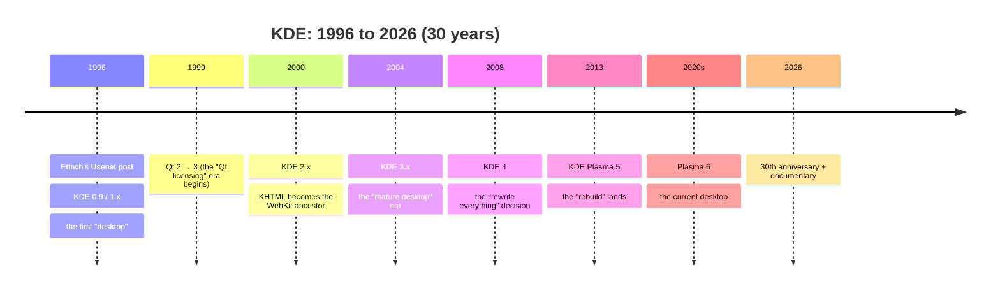

---

date: 2026-10-15T09:00:00
draft: false
title: "KDE Releases Its 30th Anniversary Documentary: A Story of Free-Software Underdogs"
summary: "As part of KDE's 30th anniversary, the project has released The KDE Documentary — A Story of Free Software Underdogs: the story of how a 1996 Usenet post asking for programmers to build a Linux desktop became one of the world's largest free-software communities."
categories:
  - Linux
  - KDE
  - History
---

# The KDE Documentary: three decades of the "free-software underdogs"

As part of **KDE's 30th anniversary**, the project has released **The KDE Documentary — A Story of Free Software Underdogs**. The LWN summary is the cleanest single-paragraph history of the project in existence, and it is worth reading in full: *The story starts in 1996, when Matthias Ettrich, a student at the University of Tübingen, posted to a Usenet group asking for programmers to help build a desktop for Linux. What followed became KDE, one of the largest free-software communities in the world. KDE made Linux usable as a desktop for people who were not system administrators, giving it a complete, consistent graphical environment at a time when there was none.*

This post is the documentary as a *systems* story: what "made Linux usable" actually *was* (a coherent desktop *stack*, not a single app), the three turning points the film covers (the **Qt licensing fight**, the **KHTML → WebKit/Chrome** success, the **KDE 4 → 5 rebuild**), and the lesson a 30-year-old project carries for anyone building infrastructure that outlives its founding team.

## The 1996 Usenet post: the origin that is *not* an origin

The 1996 post is the *origin story*, but the *origin* of KDE as a project is **the gap the post was trying to fill**: by 1996, Linux had a kernel, a C library, a package manager, and *no* graphical desktop. You could run `X11` and *individual* X applications (`xterm`, `xcalc`, `xclock`), but there was **no coherent "desktop"** — no file manager that *knew* about your home directory, no panel that *knew* about your open applications, no consistent way to *configure* the system, no *help system*, no *print dialog* that worked the same across apps.

Ettrich's post was an invitation to *build that missing layer*. The name "KDE" came from "K Desktop Environment" (the `K` being a nod to the K* prefix the project used for its early components, itself a nod to the "K" of the K* Unix derivatives). The *underdog* framing of the documentary is apt: KDE was never the *default* desktop. It was the project that *had to keep proving itself* against the assumption that "a real desktop" meant *Windows* (the incumbent) or *GNOME* (the rising "free" rival, with its own identity crisis, its own toolkit, its own philosophy).



## The "underdog" thesis: why a *desktop* is a systems problem

The LWN blurb's phrase "made Linux usable as a desktop for people who weren't system administrators" is doing a lot of work, and it is the *real* thesis of the documentary. A "usable desktop" is **not** a single application; it is a **coherent stack** where each layer *knows* about the others:

- **A file manager** that *knows* about your home directory, your open terminals, and your *recent files* (not just "a program that lists files").
- **A panel** that *knows* about your running applications and can *launch* them (not just "a strip of icons").
- **A settings system** that is *consistent* across applications (not "each app has its own config file in a random location").
- **A help system** that *actually* works (not "a man page in a terminal").
- **A print dialog** that *works the same* in every app (not "a different print dialog in every app").
- **A theming system** that is *global* (not "you re-theme each app separately").

The *underdog* part of the story is that KDE **had to build all of this, in a coherent way, from scratch, while simultaneously *proving* that a free desktop could be *as good* as the incumbent (Windows) and the rising rival (GNOME)**. The 30 years of the documentary are, in large part, the 30 years of *keeping the stack coherent* — the *boring* systems work that makes a "desktop" a *desktop* instead of a *collection of X apps*.

> **Note**: The "underdog" framing is a *narrative*, not a *technical* claim. KDE was *never* the *most popular* Linux desktop (GNOME held that for most of the 2000s–2010s), and it was *never* the *default* on most distributions. The "underdog" is the *position* — the project that *had to keep earning* its place, against a rival that *also* had to earn its place, and an incumbent (Windows) that *didn't have to*. The documentary is a *story* about that position, not a *benchmark* of it.

## The three turning points the film covers

The LWN blurb names the three *highs and lows* the film covers, and each is a *systems* lesson:

**1. The Qt licensing fight.** Qt (the C++ widget toolkit KDE is built on) started *non-free* (QPL license) and went through a *free* license change (LGPL) that *made KDE possible* as a free project. The "fight" was the *years* it took for the Qt company (Trolltech) to *agree* to the license change, and the *political* cost of KDE being *dependent* on a *commercial* company's *licensing* decision. The lesson: a *desktop* is only as *free* as the *toolkit* it is built on.

**2. The KHTML → WebKit → Chrome success.** KHTML (KDE's HTML rendering engine, from the early 2000s) was the *direct ancestor* of **Apple's WebKit** (the engine of Safari) and, through WebKit, **Google's Chromium** (the engine of Chrome). The "success" is that a *free-software* rendering engine from a *desktop* project *became the engine of the two most-used web browsers on Earth*. The documentary treats this as the "underdog wins" moment — the *desktop* project's *side project* *out-competed* the *web* projects that were *specifically* trying to build a browser engine.

**3. The KDE 4 → 5 rebuild.** KDE 4 (2008) was a *full rewrite* of the desktop stack (a new toolkit binding, a new compositing model, a new *everything*). The 4.x series was *long* (2008–2013) and *contested* (the "rewrite everything" decision was *risky* and *slow*), and **Plasma 5** (2013) is the "rebuild lands" moment. The lesson: a 30-year-old project *can* rewrite its core, *but the cost is measured in *years*, and the *risk* is that the *new* stack *never catches up* to the *old* one's *polish*.

```mermaid
flowchart TB
    A["1996: Usenet post (Ettrich)"] --> B["1998–2003: KDE 1–3.x (the 'mature desktop' era)"]
    B --> C["The Qt licensing fight (QPL → LGPL)"]
    B --> D["KHTML → WebKit → Chromium (the 'side project' that out-competed the web)"]
    C --> E["2008: KDE 4 (the 'rewrite everything' decision)"]
    E --> F["2013: Plasma 5 (the 'rebuild lands')"]
    F --> G["2020s: Plasma 6 (the current desktop)"]
    G --> H["2026: 30th anniversary + documentary"]
    style D fill:#1a3a1a
    style F fill:#3a2a1a
```



## What a 30-year-old project teaches (the systems part)

The documentary is a *story*, but the *systems* lesson is the *durable* part, and it is worth stating plainly for anyone building infrastructure that *outlives* its founding team:

1. **A "desktop" is a *coherent stack*, not a *collection of apps*.** The *underdog* problem is *never* "build a better file manager"; it is "make the file manager, the panel, the settings, the help, and the print dialog *talk to each other* in a *consistent* way." The *coherence* is the *product*; the *apps* are the *components*.

2. **A *free* project is only as *free* as its *dependencies*.** The Qt licensing fight is the canonical example: KDE's *freeness* was *contingent* on a *commercial* company's *licensing* decision. If you build on a *closed* toolkit, your *project's* *license* is *only as open* as the *toolkit's*.

3. **A *side project* can *out-compete* the *main project*.** KHTML (a *desktop* component) became WebKit, which became the *engine* of *Safari* and *Chrome*. The *desktop* project's *side project* *won the web*. The lesson: the *most important* component of a *system* is *often* the one the *system* *started* as a *side project* for.

4. **A *rewrite* is a *multi-year* *bet*, and the *risk* is *polish*, not *correctness*.** KDE 4 → Plasma 5 is the *case study*: the *rewrite* *worked* (Plasma 5 is the *current* desktop), but the *cost* was *five years* of *slower feature velocity* and *more bugs*, and the *real* *risk* was *never* that the *new* stack *wouldn't work* — it was that the *new* stack *wouldn't be as *polished* as the *old* one, *for a while*.

## Seeing the milestone yourself

The documentary is on YouTube (free, no account required); the release notes live on the KDE blog. Both are scriptable, which is handy for a "watch the project" cron:

```bash
#!/usr/bin/env bash
# KDE 30th anniversary: fetch the news index and extract the
# documentary's announcement link. No browser needed.
set -euo pipefail
curl -sL "https://kde.org/en/news/" -o /tmp/kde-news.html
grep -oE 'href="[^"]*30th[^"]*"[^>]*>[^<]*' /tmp/kde-news.html \
  || grep -oE 'href="[^"]*documentary[^"]*"[^>]*>[^<]*' /tmp/kde-news.html \
  || echo "announcement not found (the index may have changed)"
```

```python
# Verify the announcement exists before you link it in a talk.
# The KDE news index is a list of <article> cards; we only need
# the presence of the 30th anniversary entry.
import re, urllib.request

html = urllib.request.urlopen("https://kde.org/en/news/", timeout=20).read().decode()
print("anniversary found on /news/:", bool(re.search(r"30th\s+anniversary", html, re.I)))
```

### Thirty years, one paragraph

| Year | Milestone | Why it mattered |
|---|---|---|
| 1996 | K Desktop Environment 1.0 | the first complete free desktop |
| 2000 | KDE 2, Konqueror's DOM-based architecture | web-platform ideas arrive at the desktop |
| 2005 | the Plasma precursor work begins | the foundation for what would become Plasma |
| 2009 | Qt 5 development starts | a C++11 rewrite; the basis of today's stack |
| 2017 | Plasma 5.13 + Breeze | the look most people think of as "KDE" today |
| 2022 | Plasma 6, Qt 6, Kirigami 2 | the mobile-convergence bet |
| 2026 | 30 years, the documentary | the project that outlived its founders is still shipping |

> **Warning**: the documentary is on YouTube, not on a KDE-owned domain. If you're embedding it in a talk deck, pin the exact video URL (and its current title) — the announcement page is the stable reference, the embed is not.

## Takeaways

- **KDE's 30 years are the *coherence* story, not the *feature* story.** A "usable desktop" is a *coherent stack* (file manager, panel, settings, help, print dialog, theming) that *talks to each other* in a *consistent* way. The *underdog* problem is *never* "build a better file manager"; it is "make the *stack* *coherent*."
- **A *free* project is only as *free* as its *dependencies*.** The Qt licensing fight (QPL → LGPL) is the canonical example: KDE's *freeness* was *contingent* on a *commercial* company's *licensing* decision.
- **A *side project* can *out-compete* the *main project*.** KHTML (a *desktop* component) became WebKit, which became the *engine* of *Safari* and *Chrome*. The *desktop* project's *side project* *won the web*.
- **A *rewrite* is a *multi-year* *bet*; the *risk* is *polish*, not *correctness*.** KDE 4 → Plasma 5 *worked*, but the *cost* was *five years* of *slower feature velocity*, and the *real* *risk* was *never* that the *new* stack *wouldn't work* — it was that it *wouldn't be as *polished* as the *old* one, *for a while*.
- **The documentary is a *story*, not a *benchmark*.** The "underdog" framing is the *position* (the project that *had to keep earning* its place), not a *claim* about *quality*. The *30 years* of *keeping the stack coherent* is the *durable* lesson.

## Next steps

1. **Watch the documentary** (the LWN article links the YouTube video). It is a *30-year* story compressed into a *film*; the *systems* lessons (the *coherence*, the *licensing*, the *rewrite*) are the *durable* part, and the *story* is the *delivery* mechanism.
2. **If you build infrastructure that *outlives* your team, study the *coherence* question, not the *feature* question.** The *underdog* problem is *never* "build a better *app*"; it is "make the *stack* *consistent*." The *KDE* 30 years are the *case study* for that.
3. **If you build on a *closed* toolkit, the *licensing* question is a *project* question, not a *legal* question.** The Qt fight is the *canonical* example. Your *project's* *freeness* is *only as open* as the *toolkit's* *license*.
4. **If you *rewrite* a *30-year-old* *system*, the *risk* is *polish*, not *correctness*.** KDE 4 → Plasma 5 is the *case study*. The *new* *stack* *will* *work*; the *risk* is that it *won't be as *polished* as the *old* one, *for a while*.
