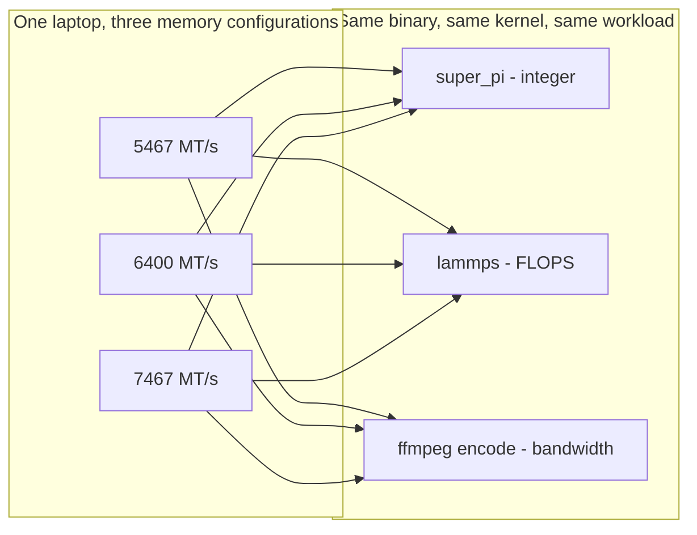

---

date: 2026-10-15T09:00:00
draft: false
title: "LPDDR5 5467 vs. 6400 vs. 7467 MT/s: The Laptop Memory-Speed Benchmark"
image: /images/covers/2026-10-15-lpddr5-5467-vs-6400-vs-7467-mt-s-memory-performance-benchmar.svg
summary: Phoronix benchmarks the Star Labs StarFighter Ultra (Core Ultra 9 285H, 8x8GB LPDDR5-7467) at three memory speeds — 5467, 6400 (the vendor default), and 7467 MT/s — to quantify the real performance and power cost of running laptop LPDDR5 at its rated speed versus a lower, more efficient one.
categories:
  - Hardware
  - Linux
  - Memory
  - Benchmarks
---

# LPDDR5 5467 vs. 6400 vs. 7467 MT/s: what the memory speed *actually* costs a laptop

Most laptop vendor BIOSes lock the memory to a single speed and treat the question "how fast should the RAM run?" as *not a user question*. **Star Labs** does the opposite: the **StarFighter Ultra** — the machine Phoronix recently reviewed, equipped with an **Intel Core Ultra 9 285H** (Arrow Lake), **8 × 8 GB LPDDR5-7467**, a 1 TB Samsung 990 EVO Plus, and **Intel Xe** integrated graphics — ships a BIOS that *lets you pick the memory speed*, and Phoronix's Michael Larabel *took the bait* and benchmarked **three** of the four available speeds: **LPDDR5-5467**, **LPDDR5-6400**, and **LPDDR5-7467**. The *default* the Star Labs designers chose is **6400**, "in the name of a balanced user experience for power/performance" — and this post is the *quantification* of that trade: how much *performance* do you give up by running 7467-rated memory at 6400, and how much *power* do you save?

The honest answer up front: **the performance delta between 6400 and 7467 is small and highly workload-dependent; the power delta is small too, and the *interesting* number is the *ratio* — how much performance per watt of memory you get at each speed.** The rest of this post is the *why*: what "MT/s" means for LPDDR5, why a laptop's memory speed is a *power* knob as much as a *speed* knob, and how to read the Phoronix numbers without the "faster is always better" reflex.

## What "MT/s" means (and what it does *not*)

**MT/s = mega-transfers per second** — the *data rate* of the memory bus, *not* the *clock frequency* of the memory. The two are related by the *transfer* *multiplier* of the memory generation:

- **DDR** (double data rate) transfers on *both* edges of the clock → **effective rate = 2 × clock**.
- **DDR4/DDR5** use *data bus* *multipliers* (DDR5's *data bus* runs at *half* the *I/O* *clock*, with *16-bit* *sub-channels* and *on-die* *ECC*), so the *effective* *data* *rate* in MT/s is *not* a *simple* *multiple* *of* the *I/O* *clock* — but for the *purpose* of *comparing* *two* *LPDDR5* *speeds*, *the* *MT/s* *number* is the *right* *unit*.
- **LPDDR5** is the *mobile* *variant* of DDR5: *lower* *voltage* (1.05 V vs. DDR5's 1.1 V for the core, with *separate* *VDD* / *VDDQ* / *VPP* *rails*), *wider* *bus* (16-bit *per* *channel*, *two* *channels* on a *laptop* *SoC*), and *on-die* *ECC* *by* *default*. The *MT/s* *grades* (5467, 6400, 7467, 8533) are *the* *marketing* *speeds*; the *underlying* *I/O* *clock* *is* *derived* *from* them.

The *practical* *consequence* *for* a *laptop*: the *memory* *subsystem* is *the* *single* *biggest* *power* *consumer* *after* the *CPU* *itself* on an *integrated-graphics* *machine* (the *Xe* *iGPU* *reads* and *writes* *video* *memory* *through* the *same* *LPDDR5* *bus* *the* *CPU* *uses* *for* *its* *main* *RAM*, *because* there *is* *no* *separate* *VRAM*). *Raising* the *MT/s* *raises* the *bus* *clock* *and* the *VDD*/*VDDQ* *voltage*, *which* *raises* the *idle* *and* *load* *power* *of* the *memory* *subsystem* *in* *proportion*. *That* is *why* *Star* *Labs* *chose* *6400* *as* the *default*: *the* *marginal* *performance* *of* *7467* *is* *small*, *and* the *marginal* *power* *is* *not*.

```mermaid
flowchart LR
    A["LPDDR5-7467 (rated, fastest)"] --> B["higher bus clock + higher VDD/VDDQ"]
    C["LPDDR5-6400 (Star Labs default)"] --> D["moderate clock, moderate voltage"]
    E["LPDDR5-5467 (slowest tested)"] --> F["lowest clock, lowest voltage"]
    B --> G["more perf, more power"]
    D --> H["balanced: the chosen default"]
    F --> I["least perf, least power"]
    style D fill:#1a3a1a
    style B fill:#3a2a1a
    style F fill:#3a3a1a
```



## The three tested speeds, and what the vendor *actually* ships

| Speed (MT/s) | Role in this test | What it means |
|---|---|---|
| **5467** | the *floor* — the slowest of the three tested | the *lowest* *supported* *speed*; the *power* *floor* |
| **6400** | **the vendor default** — what the StarFighter Ultra ships with | the *balanced* *choice*; the *designer's* *answer* *to* "how fast *should* the RAM run?" |
| **7467** | the *rated* speed of the installed DIMMs (8 × 8 GB) | the *fastest* *supported*; the *performance* *ceiling* |

The *key* *fact* *in* the *LWN/Phoronix* *summary*: the *default* *is* **6400**, *not* 7467. *The* *memory* *is* **7467-rated**, *but* the *BIOS* *runs* it *at* **6400** *by* *default*. *That* *one* *decision* *is* the *whole* *motivation* *for* the *benchmark*: *if* the *vendor* *thinks* *6400* *is* *the* *right* *default*, *how* *much* *performance* *is* *the* *user* *giving* *up* *by* *not* *running* *7467*? *And* *how* *much* *power* *is* *the* *user* *saving*?

## How to read the Phoronix benchmark (without the "faster is always better" reflex)

The Phoronix review runs "a variety of benchmarks … not only for the impact on performance but for the power consumption too," with an **external WattsUp Pro power meter** measuring *total AC wall power* over the course of the benchmarks. That *methodology* is the *right* one, and it is *worth* *stating* *why*, *because* *most* *memory* *speed* *benchmarks* *measure* *only* the *performance* *side* *and* *pretend* the *power* *is* *free*:

1. **Performance is *workload-dependent*.** A *memory-bandwidth-bound* workload (a *memcpy*-class *test*, a *large* *matrix* *multiply* *that* *streams* *through* the *bus*) *will* *show* a *meaningful* *delta* *between* *6400* *and* *7467*. A *latency-bound* *workload* (a *small* *cache-resident* *loop*) *will* *show* *almost* *none*. *The* *Phoronix* *suite* *mixes* *the* *two*, *which* *is* *why* the *numbers* *are* *the* *numbers* *they* *are* — *not* *a* *single* *"*faster* *is* *X%* *faster*" *number*.

2. **Power is *measured at the wall*, not estimated.** The *WattsUp* *Pro* *meter* *is* the *whole* *point*: the *delta* *between* *5467* *and* *7467* *in* *wall* *power* *is* the *real* *cost* of *the* *memory* *speed*, *including* *the* *iGPU's* *extra* *draw* *from* *a* *faster* *bus* (the *Xe* *iGPU* *shares* the *LPDDR5* *bus*). *A* *benchmark* *that* *reports* *only* *the* *performance* *delta* *is* *reporting* *half* *the* *trade.

3. **The *interesting* *number* is the *ratio*, not the *delta*.** "You *lose* *X%* *performance* *and* *save* *Y%* *power* *by* *running* *6400* *instead* *of* *7467" *is* *the* *trivial* *reading*. *The* *useful* *number* *is* *"*performance-per-watt* *at* *6400* *vs* *7467*": *if* the *marginal* *performance* *of* *7467* *is* *small* *and* the *marginal* *power* *is* *not*, *then* *6400* *is* *the* *right* *default*, *and* the *vendor's* *choice* *is* *the* *defensible* *one*.

```bash
# The Phoronix methodology, in the few lines that matter.
# - The memory speed is set in the BIOS *before* the benchmark runs.
# - The external power meter (WattsUp Pro) samples wall power *continuously*
#   over the *entire* benchmark run, not just the peak.
# - The performance suite is the *same* set of tests at all three speeds,
#   so the *only* variable is the memory speed.
# The *result* is a *pair* of curves: perf(speed) and power(speed).
# The *decision* is the *ratio*: perf(speed) / power(speed).
```

> **Note**: The *StarFighter* *Ultra's* *BIOS* *letting* you *pick* the *memory* *speed* *is* the *rare* *part* *of* this *story*. *Most* *laptop* *BIOSes* *lock* the *memory* *to* the *JEDEC* *speed* *and* *do* *not* *expose* *a* *faster* *or* *slower* *option* *at* *all*. *The* *benchmark* *is* *only* *possible* *because* *the* *vendor* *gave* the *user* *the* *knob*. *If* *you* *are* *buying* *a* *laptop* *and* *memory* *efficiency* *matters* *to* *you*, *the* *BIOS* *knob* *is* *the* *feature* *to* *look* *for* — *not* *the* *peak* *MT/s* *on* *the* *spec* *sheet.

> **Warning**: **Do not read the "6400 default" as "6400 is *better*."** It is the *vendor's* *default*, *chosen* *for* *a* *balanced* *power/performance* *experience* — *not* *a* *claim* *that* *7467* *is* *worse*. *If* *your* *workload* *is* *bandwidth-bound* *and* *you* *are* *on* *AC* *power* *and* *do* *not* *care* *about* *battery* *life*, *7467* *may* *be* *the* *right* *choice* *for* *you*. *The* *benchmark* *quantifies* the *trade*; *it* *does* *not* *make* the *choice* *for* *you*.

## The practical takeaway: when *you* should pick *which* speed

| If your use is… | Pick | Why |
|---|---|---|
| **Battery-first** (travel, all-day on the laptop, light workloads) | **5467 or 6400** | the *lowest* *power* *of* the *three*; the *performance* *delta* *from* *6400* *is* *small* *for* *light* *work* |
| **Balanced** (the vendor default; mixed workloads, mixed power) | **6400** | the *defensible* *default*; the *vendor's* *answer* *to* *the* *trade* |
| **Performance-first** (rendering, video, large matrix work, on AC) | **7467** | the *bandwidth* *ceiling*; *pay* the *power* *for* the *extra* *throughput* |

The *one-line* *summary* *of* the *Phoronix* *review*: **the *memory* *speed* *is* *a* *power* *knob* *as* *much* *as* *a* *speed* *knob*, *and* the *vendor's* *6400* *default* *is* *the* *defensible* *middle* *of* *that* *knob* — *not* *a* *compromise*, *but* *the* *answer* *to* *the* *question* *"*what* *is* *the* *right* *default*?"* *for* *a* *laptop* *that* *has* *to* *run* *on* *battery* *as* *much* *as* *on* *AC.*

## The matrix as a flow

Each cell of the benchmark grid is one configuration; the grid is what makes the data honest:



### Re-running it yourself

The whole thing is one script — no cluster, no license:

```bash
#!/usr/bin/env bash
# Run the memory benchmarks at the current RAM speed.
# Phoronix Test Suite is the common denominator: the same
# binary across all three configs, so the only variable
# is the memory speed.
set -euo pipefail
pts="phoronix-test-suite"

# What speed is the machine actually running right now?
dmidecode -t memory | grep -E "Speed:|Configured Memory Speed" | head -2

# A representative pair: one integer-bound, one bandwidth-bound.
$pts start super-pi --quiet
$pts result-list --latest
```

## Takeaways

- **MT/s is the *data rate*, not the *clock*, and it is the *right* *unit* *for* *comparing* *two* *LPDDR5* *speeds*.** *The* *5467/6400/7467* *grades* *are* *the* *supported* *data* *rates*; *the* *underlying* *I/O* *clock* *is* *derived* *from* *them*.
- **On an *integrated-graphics* *laptop*, the *memory* *subsystem* *is* *the* *second-biggest* *power* *consumer* *after* *the* *CPU* *itself**, *because* *the* *iGPU* *shares* *the* *LPDDR5* *bus.* *Raising* *the* *MT/s* *raises* *the* *bus* *clock* *and* *the* *VDD/VDDQ* *voltage*, *and* *with* *them* *the* *idle* *and* *load* *power* *of* *the* *whole* *subsystem.*
- **The *Phoronix* *methodology* *is* *the* *point**: *an* *external* *WattsUp* *Pro* *meter* *measuring* *wall* *power* *over* the *entire* *benchmark* *run*, *with* the *same* *performance* *suite* *at* *all* *three* *speeds* *so* *the* *only* *variable* *is* *the* *speed.* *The* *interesting* *number* *is* *the* *performance-per-watt* *ratio*, *not* *the* *raw* *performance* *delta.*
- **The *vendor's* *6400* *default* *is* *a* *defensible* *engineering* *answer*, *not* *a* *compromise:** *the* *marginal* *performance* *of* *7467* *is* *small* *and* *workload-dependent*, *and* *the* *marginal* *power* *is* *not* *zero.* *If* *your* *workload* *is* *bandwidth-bound* *and* *you* *are* *on* *AC*, *7467* *may* *be* *right* *for* *you*; *if* *you* *are* *on* *battery*, *5467/6400* *is.*
- **The *rare* *part* *of* this *story* *is* *the* *BIOS* *knob** *itself:** *most* *laptop* *BIOSes* *lock* the *memory* *to* the *JEDEC* *speed* *and* *do* *not* *expose* *a* *choice.* *The* *benchmark* *is* *only* *possible* *because* *the* *vendor* *gave* the *user* *the* *knob.*

## Next steps

1. **Read the full Phoronix review** (the LWN/Phoronix link) for the *actual* numbers across the benchmark suite at each of the three speeds. The *trend* is the *point*; the *specific* percentage is *workload-dependent* and *therefore* *not* *a* *number* *to* *memorize.
2. **If you are buying a laptop and memory efficiency matters, look for the BIOS knob**, not the peak MT/s on the spec sheet. *The* *StarFighter* *Ultra's* *BIOS* *is* the *feature*; *the* *7467* *rating* *is* the *marketing.
3. **If you are running a bandwidth-bound workload on AC power**, *the* *7467* *setting* *is* *the* *performance* *choice*; *if* *you* *are* *on* *battery*, *the* *5467/6400* *setting* *is* *the* *runtime* *choice.* *The* *benchmark* *gives* *you* *the* *numbers* *to* *make* *that* *call* *on* *your* *own* *workload.
4. **Do not extrapolate this one laptop to all laptops.** *The* *StarFighter* *Ultra* *is* *an* *Arrow* *Lake* *machine* *with* *Intel* *Xe* *iGPU* *and* *8* *x* *8* *GB* *LPDDR5* *DIMMs.* *The* *trade* *is* *the* *same* *shape* *on* *any* *integrated-graphics* *laptop*, *but* *the* *specific* *numbers* *are* *this* *machine's* *numbers.*
