---

date: 2026-10-15T09:00:00
draft: false
title: "Platform-Independent SIMD in Go: The write-once vector layer"
image: /images/covers/2026-10-15-platform-independent-simd-in-go.svg
summary: Go 1.27 adds an experimental, fully portable, size-agnostic simd package — a Highway-style "write once, run on every arch" vector API that emulates on non-SIMD platforms so the code always runs.
categories:
  - Go
  - SIMD
  - Performance
---

# Platform-Independent SIMD in Go: the write-once vector layer

Go has had **no portable SIMD API** until the `simd` experiment. Go 1.26 introduced an amd64-only arch-specific layer (`archsimd`); **Go 1.27 goes further** and adds an experimental, **fully portable, size-agnostic** `simd` package loosely based on Google's Highway. The goal, in the 1.27 notes' words: *write-once, near-asm-performance SIMD code on platforms with SIMD support, and a competent emulation on platforms that do not* — so the same source **always runs**, and is fast on the machines that have the instructions. This is the first time a Go developer can write a vectorized data-processing kernel *once* and run it on AVX-512, NEON, and wasm without touching a single line of assembly.

This post is the portable `simd` layer: why a *size-agnostic* API is the hard problem, the type system (`Float32s`, `Int8s`, `Mask32s`), the `Load`/`Store`/`MulAdd` core, the mask model, the `ToArch()`/`FromArch` escape hatch, and a complete inner-product you can compile with `GOEXPERIMENT=simd`.

## Why "portable" is the hard part

The 1.27 notes open with the real problem: **SIMD architectures vary in dimensions that are not just "what operations they support."** Three axes of variation make a naive portable API impossible:

**1. Vector size is a *runtime* property on some arches.** Some platforms have a *single* fixed vector size (wasm, PowerPC, s390x: 128 bits). Some have *several fixed* sizes (amd64: 128/256/512; loong64: 128/256). **RISC-V RVV** supports vectors of *unspecified* size between 128 and 65536 bits (powers of two only). **arm64** has one fixed size (128-bit NEON) and one *variable* size (128–2048 bits, SVE, powers of two). On a given machine, *determining what sizes that instance supports* requires feature checks: *amd64, but is it AVX, AVX2, or AVX-512? arm64, but is it NEON or SVE, and if SVE, how large?*

**2. The mask model varies.** "Do the operation, but only where the mask is true" is the universal SIMD idiom, but *how* the mask is represented differs: some SIMD variants have **no** masks (masking is done with vector bitmasks and boolean ops — wasm, AVX, AVX2, NEON); some have **one-bit-per-element** mask registers (AVX-512, RVV); **SVE** allocates one bit per *byte* and uses the least-significant bit of each element's mask bits.

**3. The operations themselves vary.** Each arch has its own primitives for rearranging vector elements; some require *constant* inputs, others *variable*. Crypto op support differs. Even *basic arithmetic* varies — wasm **lacks comparisons for vectors of 64-bit integers**. And instruction support depends on "features" that must be checked.

The `archsimd` package (the prior post) can only go *so far* toward making these look the same without compromising efficiency. The `simd` package *removes the fixed-size vectors from the type system entirely* and supports only the **intersection** of what all the arches can do, filling the gaps with efficient emulation.

```mermaid
flowchart TB
    subgraph problem["Why portable SIMD is hard"]
        P1["Vector size: 128 / 256 / 512 / variable (RVV, SVE)"]
        P2["Mask model: none / 1-bit-per-elem / 1-bit-per-byte (SVE)"]
        P3["Ops: permute, crypto, arithmetic all vary; wasm lacks 64-bit int compare"]
    end
    subgraph solution["The simd package: the intersection"]
        S1["No fixed size in the type system"]
        S2["Only ops present on every arch"]
        S3["Emulate the gaps with efficient SIMD ops"]
    end
    P1 --> S1
    P2 --> S2
    P3 --> S3
    style S1 fill:#1a3a1a
    style S2 fill:#1a3a1a
    style S3 fill:#1a3a1a
```



The design goal, stated plainly: a set of operations that is **adequate for many data-processing algorithms** (the ones that benefit from vectorization but are *not* tied to a particular vector size), **as efficient as assembly when the source op matches a hardware op**, **emulated as well as possible otherwise**, and **easy to read** (the 1.27 notes add: *even/especially if an LLM ends up writing the code*).

## The type system: `Float32s`, `Int8s`, `Mask32s`

The portable `simd` types are **capitalized, plural, primitive types** — the `s` suffix signals "a vector of this primitive," and the *width* is deliberately *not* in the name:

- `Float32s`, `Float64s` — vectors of 32/64-bit floats
- `Int8s`, `Int16s`, `Int32s`, `Int64s`
- `Uint8s`, `Uint16s`, `Uint32s`, `Uint64s`
- **Masks**: `Mask8s`, `Mask16s`, `Mask32s`, `Mask64s` (one bit per element of the matching width)

The *lane count* is a **runtime property** (`v.Len()`), not a type. On AVX-512 `Float32s` is 16 lanes; on NEON it is 4. The *same source* adapts.

```go
// innerProduct is the single reference example from the 1.27 notes.
// It shows the entire portable surface: a Load, a fused MulAdd, a
// partial-load tail, and a scalar reduction. No widths, no arch, no asm.
func innerProduct(x, y []float32) float32 {
	var a simd.Float32s
	var i int
	// The main loop processes a.Len() elements per iteration. Len() is a
	// *runtime* property — 16 on AVX-512, 4 on NEON — so the *same*
	// source adapts to the machine it runs on. This is the whole point.
	for i = 0; i < len(x)-a.Len()+1; i += a.Len() {
		u := simd.LoadFloat32s(x[i : i+a.Len()])
		v := simd.LoadFloat32s(y[i : i+a.Len()])
		a = u.MulAdd(v, a) // fused multiply-add: a += u*v
	}
	if i < len(x) {
		// The tail is shorter than one register. LoadFloat32sPart returns
		// how many elements it actually loaded; the rest is zero.
		u, _ := simd.LoadFloat32sPart(x[i:])
		v, _ := simd.LoadFloat32sPart(y[i:])
		a = u.MulAdd(v, a)
	}
	return reduceSum(a)
}

// reduceSum is the 1.27 stand-in for the future simd.ReduceSum.
// 1.27 has no cross-vector reduction (a real gap the notes call out);
// the next release adds ReduceSum and this collapses to one line.
func reduceSum(v simd.Float32s) float32 {
	s := make([]float32, v.Len())
	v.Store(s)
	var r float32
	for _, e := range s {
		r += e
	}
	return r
}
```

The `*Part` load functions are the "unaligned tail" answer: `LoadFloat32sPart` loads *up to* a full register and returns the count, so a slice whose length is not a multiple of `Len()` is handled without a special-case scalar loop over the last few elements.

## The 1.27 operation set: the intersection

The 1.27 notes publish the full supported operation table. The practical groups:

- **Load / broadcast**: `LoadV`, `LoadVPart`, `BroadcastV`, and the `Store`/`StorePart`/`String` counterparts.
- **Arithmetic**: `Add`, `Sub`, `Mul`, `Div`, `MulAdd` (fused), `AddSaturated`, `SubSaturated`, `Avg`, `Abs`, `Neg`, `Sqrt`, `Min`, `Max`, `And`, `Or`, `Xor`, `AndNot`, `Not`.
- **Masked / select**: `Masked`, `IfElse(mask, y)`, `ToMask`.
- **Comparison** (returns a `Mask*` type): `Equal`, `NotEqual`, `Less`, `LessEqual`, `Greater`, `GreaterEqual`.
- **Conversion**: `ConvertToFloatW`, `ConvertToIntW`, `ConvertToUintW`, `ToBits`, `BitsToFloatW`, `BitsToIntW`, `ReshapeToUint{8,16,32,64}s`.
- **Shift / rotate**: `ShiftAllLeft`, `ShiftAllRight`, `RotateAllLeft`, `RotateAllRight`.
- **Carryless** (crypto): `CarrylessMultiplyEven`, `CarrylessMultiplyOdd`.

The table is the *intersection*: an operation appears only if it is *meaningful* on every supported arch. That is why `Float64s` comparisons exist but, per the notes, **wasm has no 64-bit integer compare** — the `Int64s` comparison row is `Y` for the integer widths where the hardware supports it, and the *absence* of a `Y` on a given cell is the API telling you the op is not available (and will be emulated).

> **Note**: The `simd` package is **experimental** in Go 1.27. You build with `GOEXPERIMENT=simd` (or the per-arch `simd_arm64` / `simd_wasm` variants). The API is expected to churn before it stabilizes — the 1.27 notes explicitly invite feedback on "usability, performance, etc." Do not pin a production hot path to it until it lands.

> **Warning**: **Emulation is not free.** The 1.27 promise is *near-asm performance when the source op matches a hardware op*, and *competent emulation* otherwise. "Competent" means *correct and usually reasonable*, not *the speed of the native instruction*. If you `ConvertToFloat32` on an arch that has no native int→float conversion, you are paying the emulation cost. Benchmark the emulated path on your *actual* target before you assume "I used `simd`" means "I am at asm speed."

## The escape hatch: `ToArch()` / `FromArch`

When the portable set is too narrow — the canonical 1.27 example is **`Int8s.OnesCount()`**, which the portable package does *not* have in 1.27 — you do *not* rewrite the whole algorithm per arch. You implement the *one missing op* in `archsimd`, per platform, and bridge with:

- `v.ToArch()` — returns an `any` you type-assert to the concrete archsimd type for the platform.
- `simd.Int8sFromArch(a)` — the reverse direction.

```go
// The 1.27 notes' escape-hatch example: Int8s.OnesCount() does not
// exist in the portable set, so it is implemented per-arch with a LUT
// (lookup table) and bridged back through Int8sFromArch.
func onesCount(v simd.Int8s) simd.Int8s {
	var popcnt4x16 = [16]int8{0, 1, 1, 2, 1, 2, 2, 3, 1, 2, 2, 3, 2, 3, 3, 4}
	var popcnt4x32 = [32]int8{
		0, 1, 1, 2, 1, 2, 2, 3, 1, 2, 2, 3, 2, 3, 3, 4,
		0, 1, 1, 2, 1, 2, 2, 3, 1, 2, 2, 3, 2, 3, 3, 4,
	}
	switch x := v.ToArch().(type) {
	case archsimd.Int8x16:
		lut := archsimd.LoadInt8x16Array(&popcnt4x16)
		mask0f := archsimd.BroadcastInt8x16(0x0f)
		lo := x.And(mask0f)
		hi := x.ToBits().ReshapeToUint16s().ShiftAllRight(4).
			ReshapeToUint8s().BitsToInt8().And(mask0f)
		return simd.Int8sFromArch(lut.PermuteOrZero(lo).
			Add(lut.PermuteOrZero(hi)))
	case archsimd.Int8x32:
		lut := archsimd.LoadInt8x32Array(&popcnt4x32)
		mask0f := archsimd.BroadcastInt8x32(0x0f)
		lo := x.And(mask0f)
		hi := x.ToBits().ReshapeToUint16s().ShiftAllRight(4).
			ReshapeToUint8s().BitsToInt8().And(mask0f)
		return simd.Int8sFromArch(lut.PermuteOrZero(lo).
			Add(lut.PermuteOrZero(hi)))
	default:
		// No SIMD on this platform: emulate with a scalar loop.
		// Slow but always correct — the "write once, run everywhere"
		// contract, at the cost of the emulation.
		s := make([]int8, v.Len())
		v.Store(s)
		for i, b := range s {
			s[i] = int8(bits.OnesCount8(uint8(b)))
		}
		return simd.Int8sFromArch(archsimd.LoadInt8sArray(s))
	}
}
```

The pattern: **one type-switch per target arch**, each case writing the *missing op* in `archsimd`, and a `default` scalar fallback. You never rewrite the *algorithm*; you only supply the one instruction the portable layer does not have.

## How it compares: `simd` vs `archsimd` vs asm

| Dimension | `simd` (portable) | `simd/archsimd` | Go asm |
|---|---|---|---|
| Vector width | Runtime-determined | Fixed per type | Fixed per instruction |
| One source, all arches | Yes (intersection + emulation) | No — one per arch | No |
| Runs on non-SIMD arch | Yes (emulated) | Depends on arch support | No |
| Instruction control | Implicit (the type picks it) | Explicit (the method) | Total |
| Typical use | Data processing, ML, crypto | The 1–2 kernels that need a specific op | The GC's scanner, `math/bits` |
| 1.27 status | Experimental | Experimental (amd64+arm64+wasm) | Stable (always has been) |

```mermaid
flowchart TB
    A["your data-processing kernel (one source)"] --> B{simd}
    B --> C["Load / Store / MulAdd / IfElse / Compare"]
    C --> D{op in the intersection?}
    D -- yes --> E["emit the native instruction (AVX-512 / NEON / wasm)"]
    D -- no --> F["efficient emulation in terms of available ops"]
    B --> G["ToArch() / FromArch for the one missing op"]
    G --> H["archsimd per-arch implementation (LUT, carryless, ...)"]
    style E fill:#1a3a1a
    style F fill:#3a3a1a
```



## Takeaways

- **`simd` is the "write once" layer; `archsimd` is the "write once per arch" layer.** The portable package removes fixed sizes from the type system and supports only the *intersection* of all supported arches, emulating the gaps so the code *always runs*.
- **The `*Part` load functions are the unaligned-tail answer.** `LoadFloat32sPart` loads up to a register and returns the count, so a slice whose length is not a multiple of `Len()` is handled without a scalar epilogue.
- **The mask model is per-element-width.** `Equal`/`Less`/`Greater` on `Int8s` produce `Mask8s`, on `Float32s` produce `Mask32s`, etc. Masks are the universal "do it only here" primitive, and the `IfElse`/`Masked` select ops are how you branch across a vector.
- **`ToArch()` / `FromArch` is the escape hatch, not a workaround.** The 1.27 example (`Int8s.OnesCount()`) implements the *one missing op* per arch and bridges back. You never rewrite the algorithm; you supply the instruction the portable layer lacks.
- **It is experimental, and emulation is not free.** `GOEXPERIMENT=simd` at build time; the API will churn; "competent emulation" means *correct*, not *native speed*. Benchmark the emulated path on your real target.

## Next steps

1. **Bump to 1.27 and benchmark one data-processing kernel** (the `innerProduct` example is the canonical start) on an AVX-512 box and a NEON box. That is the entire "write once" claim, in an afternoon.
2. **When the portable set is too narrow, reach for `ToArch()`/`FromArch`** for the *one* missing op (popcount, carryless multiply, …). Do not port the whole algorithm per arch.
3. **Keep the experiment flag out of prod** until `simd` stabilizes. The 1.27 notes are explicit that the API will move.
4. **Watch for `ReduceSum` in the next release.** The 1.27 `reduceSum` helper (store to a slice, sum the scalars) is the stopgap; `simd.ReduceSum` is promised to make it one line.
