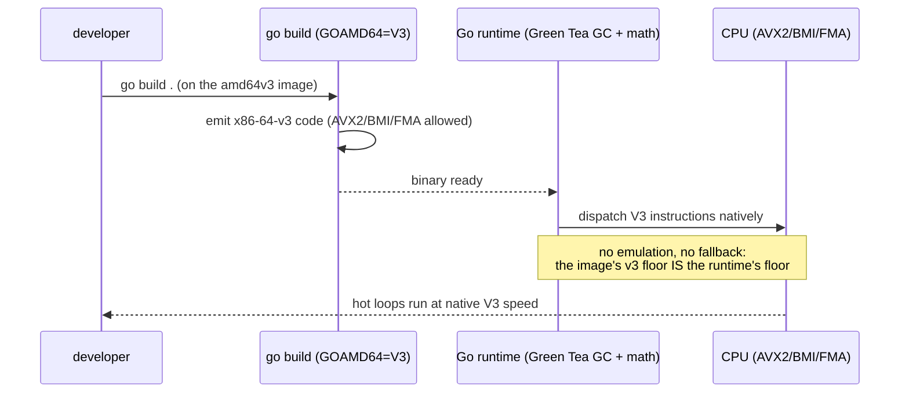

---

date: 2026-10-15T09:00:00
draft: true
title: "Ubuntu 26.10: What a Go + Rust Engineer Actually Gets on a New Distro"
summary: "Ubuntu 26.10 'Stonking Stingray' ships Linux 7.3, GNOME 51, and completes the migration to Rust-based uutils coreutils. Here is what that means for a Go toolchain (GOAMD64=V3 on the new amd64v3 images) and how to verify the Rust coreutils are really what your build is calling."
categories:
  - posts
  - Linux
  - Go
tags:
  - Go
  - Rust
  - uutils
  - Ubuntu
  - Toolchain
---

A new distro release is usually noise to an engineer: a kernel number, a desktop version, a changelog you skim. **Ubuntu 26.10 "Stonking Stingray"** (the 15 October 2026, six-month, non-LTS successor to 26.04) is the rare one that is *not* noise for a Go and Rust developer, for two reasons: it **completes the migration of the coreutils to the Rust `uutils` build** (so the `ls`/`cp`/`mv` your build scripts call are now Rust, not GNU), and it ships **optimized `amd64v3` install images**, which is the first time Ubuntu gives you *AVX2/AVX512-grade* binaries *by default* — the exact instruction set a Go program wants when you set `GOAMD64=V3`. This post is the engineer's read of that release: **what changed under your toolchain, and the exact verification to run so you are not *assuming* the Rust coreutils are in use.**

## What "Stonking Stingray" actually ships

The release (per Canonical's mailing-list announcement and Phoronix) bundles:

- **Linux 7.3**, in its near-final state, plus **GNOME 51** (smoother display handling, better accessibility).
- **The Rust-based coreutils transition is *fully complete***: the `uutils` Rust rewrite of the GNU coreutils now ships as the default `/bin` text utilities.
- **Improved TPM-backed full-disk encryption**, **stronger enterprise auth** (Microsoft Entra ID / SSSD integrations), and a tech-preview of **Myna**, Canonical's contextual speech-to-text.
- **RISC-V desktop images** debut, and **optimized `amd64v3` install images** — the part that matters most for Go below.
- **Mesa 26.2**, and it *sticks with GCC 15* as the default compiler (no forced jump to a new major).

The two items an engineer should care about are the **Rust coreutils** (a supply-chain and *behavior* change for every shell script) and the **`amd64v3` images** (a performance floor for compiled code). The rest is desktop polish.

## Why the Rust coreutils matter to a Go developer

`uutils` is a **Rust implementation of the POSIX/GNU coreutils** — `ls`, `cp`, `mv`, `cat`, `head`, `tail`, `sort`, `find`, and friends — written to *behave* like the GNU tools while being memory-safe and portable. The "migration complete" in 26.10 means the *system* copy is now Rust. That has two consequences a Go developer should *verify*, not assume:

1. **Behavior drift.** A Rust `sort`/`ls` is *mostly* GNU-compatible, but edge-case output (locale handling, error messages, exit codes on the weirdest inputs) can differ. A build script that *parses* `ls -l` output is now parsing a Rust tool's output.
2. **It is Rust, not C.** The *binary* your `go run` build invokes for a `cp` is a Rust ELF. If your Go program uses `os/exec` to shell out to coreutils, the *callee* is now Rust — so a whole class of memory-safety bugs in the utility is off your table, and the tool is smaller and starts faster.

The honest risk is the first: **the contract is the *behavior*, and the behavior is now a Rust implementation's.** So you verify what is actually in your `PATH`.

```go
// pkg: verify — prove which coreutils your build is calling on 26.10.
// The Rust uutils build and the GNU build print a *distinguishable*
// --version string, so a single exec per tool is enough to tell them apart.
// Run: go run verify.go
package main

import (
	"fmt"
	"os"
	"os/exec"
	"runtime"
	"strings"
)

func main() {
	// 1. What does this build target? On the amd64v3 image, GOAMD64 should
	//    be V3; if it is V1/V2, the image did not set it and you are
	//    leaving AVX2/AVX512 on the table.
	fmt.Println("GOAMD64   =", os.Getenv("GOAMD64"))
	fmt.Println("GOOS/ARCH =", runtime.GOOS, runtime.GOARCH)

	// 2. Which coreutils are in the path? Probe the ones a build script most
	//    often shells out to.
	for _, tool := range []string{"ls", "cp", "sort", "find"} {
		out, err := exec.Command(tool, "--version").Output()
		if err != nil {
			fmt.Printf("%-5s <unavailable: %v>\n", tool, err)
			continue
		}
		line := firstLine(string(out))
		family := "unknown"
		switch {
		case strings.Contains(line, "uutils"):
			family = "RUST (uutils)"
		case strings.Contains(line, "GNU"):
			family = "GNU"
		}
		fmt.Printf("%-5s %-16s %s\n", tool, family, line)
	}

	// 3. Cross-check the binary's origin with `file` (if present). A Rust ELF
	//    is a dynamic ELF built with a Rust toolchain; a GNU coreutil is a C
	//    ELF. This is the tiebreaker if --version is ambiguous.
	if fileOut, err := exec.Command("file", "ls").Output(); err == nil {
		fmt.Println("file(ls) =", strings.TrimSpace(firstLine(string(fileOut))))
	}
}

func firstLine(s string) string {
	for _, l := range strings.Split(s, "\n") {
		if strings.TrimSpace(l) != "" {
			return strings.TrimSpace(l)
		}
	}
	return ""
}
```

> **Warning**: Do **not** let a build script *parse* `ls -l` / `find` output and call it portable. On 26.10 the producer of that output is a **Rust** `uutils` binary; the *field names* are the same as GNU, but the *exact* locale- and collation behavior can differ. If your pipeline string-matches a utility's output, **pin the tool's language** (or better, stop parsing it) the moment you cross a distro that swaps its coreutils.

> **Note**: "Rust coreutils migration complete" means the **system** `ls`/`cp` are Rust. It does **not** mean the *Go toolchain* is Rust (it is not — Go is still Go), and it does **not** mean your *GCC* is Rust (26.10 sticks with **GCC 15**). Three different compilers, three different toolchains: Rust is only the *coreutils* layer here.

## The `amd64v3` image: Go's `GOAMD64=V3`, for free

The `amd64v3` install image is Ubuntu *compiling* the system (and, importantly, setting the expectation) for **x86-64-v3**: AVX2 + BMI + FMA. For a Go developer this is the release that lets you **stop hand-tuning `GOAMD64`** on Ubuntu: build with `GOAMD64=V3` and the runtime's own math/SIMD paths (the Green Tea GC already uses SIMD, and your hot loops get the V3 instruction set) run natively on the image. The sequence below is the *check* to run the first time you log into a 26.10 box, so you know the floor you are standing on.

```mermaid
flowchart TD
    A[Ubuntu 26.10 amd64v3 image] --> B{cpuid: AVX2/BMI/FMA present?}
    B -- yes --> C[GOAMD64=V3 builds are native<br/>V1/V2 build = leaving perf on the table]
    B -- no / fallback image --> D[GOAMD64=V2 build is the safe default]
    A --> E[Rust uutils coreutils in /bin]
    E --> F[go build shells out to cp/sort/find]
    F --> G{--version says Rust?}
    G -- yes --> H[verify: build-script output is Rust-produced]
    G -- no --> I[still GNU: pin the expected tool, do not assume]
    A --> J[Linux 7.3 + GCC 15 + Mesa 26.2]
    J --> K[no forced compiler jump: Go/Rust toolchains unaffected]
    style C fill:#1a3a1a
    style H fill:#1a3a1a
```



```go
// pkg: verify2 — the one-liner check a developer runs on first login to a
// 26.10 amd64v3 box. It answers: "can I build GOAMD64=V3 and trust it?"
package main

import (
	"fmt"
	"os"
	"os/exec"
	"strings"
)

func main() {
	// The Go runtime's view of the architecture it was built for.
	fmt.Println("GOARCH =", os.Getenv("GOARCH"))
	// The kernel the image ships.
	if uname, err := exec.Command("uname", "-r").Output(); err == nil {
		fmt.Println("kernel =", strings.TrimSpace(string(uname)))
	}
	// /proc/cpuinfo is the ground truth for the *image's* v3 flag: the
	// avx2 / avx512f flags the CPU actually reports.
	out, err := exec.Command("sh", "-c", "grep -o -m1 'avx2\\|avx512f' /proc/cpuinfo").Output()
	if err == nil && len(strings.TrimSpace(string(out))) > 0 {
		fmt.Println("cpu flags (avx2/avx512f) =", strings.TrimSpace(string(out)))
	} else {
		fmt.Println("cpu flags: no avx2/avx512f reported -> use GOAMD64=V2")
	}
}
```

The two diagrams together are the whole argument: the first is the *build-time* decision tree (can I trust `V3`?), the second is the *runtime* flow of a build that *does* trust it, all the way from the Go compiler to the instruction set the kernel dispatches.



## The comparison: 26.04 vs 26.10, the parts that touch your toolchain

| Surface | Ubuntu 26.04 (LTS) | Ubuntu 26.10 (Stonking Stingray) |
|---|---|---|
| Coreutils in `/bin` | GNU (C) | **Rust `uutils`** (migration complete) |
| Default image instruction set | `amd64` (v1 baseline) | **`amd64v3`** (AVX2/BMI/FMA) image available |
| `GOAMD64` to match the image | usually `V1`/`V2` by hand | **`V3`** is the natural, native floor |
| Kernel | older 6.x | **7.3** (near-final) |
| Compiler default | GCC 15 | **GCC 15** (unchanged; no forced jump) |
| Desktop | older GNOME | **GNOME 51** |
| RISC-V desktop images | no | **yes** (debut) |

The single row that changes a Go developer's day is the *third*: on 26.10 the *correct* `GOAMD64` for the default image is `V3`, and you get it *for free* rather than chasing it per-build. The *second* row is why you verify: your coreutils are now Rust.

## Takeaways

- **26.10's coreutils are Rust (`uutils`), and that is a *behavior* change for any script that parses `ls`/`find` output.** Verify with `--version`; do not assume.
- **`GOAMD64=V3` is the native floor on the `amd64v3` image.** Build to it and your hot loops run on AVX2/BMI/FMA; building `V1`/`V2` is the thing you are *leaving* on the table.
- **Rust is only the coreutils layer.** The Go toolchain is still Go, and 26.10 keeps **GCC 15** — do not conflate the three compilers.
- **The release is a *verification* event, not a *trust* event.** One `--version` probe per tool tells you the floor; the rest is distro changelog.
- **`amd64v3` + Rust coreutils = smaller, faster, memory-safe system utilities** for your build scripts — and a reason to stop string-matching their output across distros.

## Next steps

1. On first login to a 26.10 box, run the `verify` program above and record the `GOAMD64` the image sets and the `ls`/`cp` family it reports.
2. Set `GOAMD64=V3` (or let the `amd64v3` image set it) as your *default* `GOAMD64` on Ubuntu 26.10 builds, and add a `go env GOAMD64` assertion to CI so a build that silently drops to `V1` fails loudly.
3. Audit every build script that `grep`s a coreutil's output; replace the string-match with an explicit `--help`-stable flag or a small Go helper, so the Rust `uutils` swap does not silently change your results.
