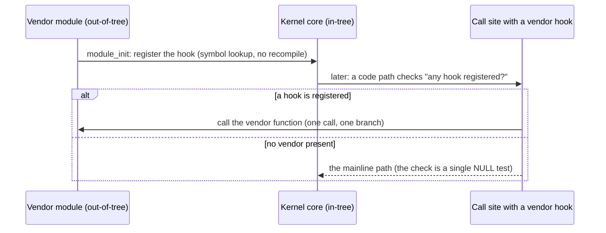

---

date: 2026-10-15T09:00:00
draft: false
title: "Vendor Hooks in the Android Kernel: How Out-of-Tree Code Survives Mainline"
summary: At the 2026 Linux Plumbers Conference, Todd Kjos ran the Android-track session on vendor hooks — the mechanism that lets phone vendors keep their out-of-tree kernel changes close to mainline without a full fork.
categories:
  - Linux
  - Kernel
  - Android
---

# Vendor Hooks in the Android Kernel: how out-of-tree code survives mainline

Since **Android's inception**, the kernels it has used have **diverged significantly from the mainline** — vendor-specific drivers, board files, patches that never made it upstream. Over the years much of that gap has closed (the **generic kernel image** was the big win), but **current devices still carry a lot of out-of-tree changes**. The **preferred form** for such changes is by way of **vendor hooks**: small, well-defined extension points in the mainline kernel that let a vendor *inject* behavior *without* forking the code. At the **2026 Linux Plumbers Conference**, **Todd Kjos** (Google) ran a fast-paced session in the **Android track** on exactly this: *what vendor hooks are, how they are used, and where the approach is heading.*

This post is the *systems* story: what a vendor hook *is* (and is *not*), the design tension it resolves (vendor *needs* vs. mainline *purity*), the kernel-side mechanism (the `vendor_hooks` Kconfig and the `vendor_hooks.h` extension points), the *consumer* side (the vendor kernel tree that *implements* the hooks), and the *governance* question — who decides *which* hooks exist, and *when* a hook should be *promoted* to a real mainline feature.

## The problem vendor hooks solve (and the one they do *not*)

The *core* problem is *simple to state and hard to solve*: **the mainline kernel is a *shared* resource, and vendors need *private* behavior in it.** Without a mechanism, the *only* way for a vendor to add a private behavior to a shared kernel is to **fork** the kernel (a *vendor* kernel tree that diverges from mainline and is *rebuilt* against every mainline release). Forking is *expensive*: every mainline release has to be *rebased*, every *conflict* has to be *resolved*, and the *divergence* *grows* *with* *time* (the classic "kernel fork debt" problem that ate Android for a decade).

**Vendor hooks** are the *middle path*: a *small*, *well-defined* *extension* *point* *in* the *mainline* *kernel* *that* *let*s *a* *vendor* *inject* *behavior* *at* *a* *specific* *place* *without* *forking* *the* *surrounding* *code*. *The* *vendor* *code* *is* *still* *out-of-tree* (it *lives* *in* *the* *vendor* *kernel* *tree*, *not* *mainline), *but* *the* *mainline* *kernel* *has* *a* *defined* *place* *where* *it* *hooks* *in*. *The* *mainline* *code* *does* *not* *know* *about* *the* *vendor* *code*; *it* *only* *knows* *"*there* *is* *a* *hook* *here*, *call* *it* *if* *a* *vendor* *implements* *it."

The *design* *tension* *the* *approach* *resolves:*

- **Mainline *purity*:** the *mainline* *kernel* *code* *is* *not* *polluted* *by* *vendor* *logic. *The* *hook* *is* *a* *call* *site*, *not* *a* *feature. *The* *mainline* *maintainer* *does* *not* *have* *to* *understand* *the* *vendor* *code* *to* *maintain* *the* *mainline* *code.
- **Vendor *flexibility*:** the *vendor* *can* *implement* *arbitrary* *behavior* *at* *the* *hook* *site, *without* *touching* *the* *mainline* *code* *around* *it. *The* *vendor* *code* *is* *the* *vendor's* *problem* (and *responsibility), *not* *mainline's.
- **The *cost*:** *a* *vendor* *hook* *is* *a* *mainline* *API* *in* *all* *but* *name. *Once* *a* *hook* *exists*, *mainline* *has* *to* *maintain* *the* *hook* *site* (the *call* *point*, *the* *argument* *shaping, *the* *error* *handling) *in* *the* *mainline* *code. *That* *is* *the* *governance* *question* *the* *LPC* *session* *was* *about.

```mermaid
flowchart LR
    subgraph mainline["mainline kernel (shared)"]
        A[hook site: a defined call point]
        B[argument shaping / error handling]
    end
    subgraph vendor["vendor kernel tree (out-of-tree)"]
        C[hook implementation: vendor-specific behavior]
        D[compiled as a module / built into the vendor kernel]
    end
    A -->|calls the hook if a vendor implements it| C
    B --> C
    C --> D
    style A fill:#1a3a1a
    style C fill:#3a2a1a
```



## What a vendor hook *is*, concretely

A vendor hook is **a small, named function pointer (or a set of them) in the mainline kernel's `vendor_hooks.h` header**, registered by a vendor module at init time and called by the mainline code at a specific point in its execution. The *mainline* side is *one* file (`vendor_hooks.h` + the `vendor_hooks` Kconfig option), and the *vendor* side is *a* set of *implementations* that *fill* the *hooks*. *The* *key* *property* *is* *that* the *mainline* *code* *only* *knows* *the* *hook* *interface*, *not* *the* *implementation.

The *typical* *shape* *of* a *vendor* *hook* *in* the *Android* *context* (the *LPC* *session* *was* *specifically* *about* the *Android* *kernel) *is* a *small* *number* *of* *hooks* *for* *the* *things* *that* *genuinely* *differ* *between* *phone* *and* *server* *kernels: *power* *management* *hooks* (the *phone's* *power* *rail* *is* *different* *from* *a* *server's), *thermal* *hooks* (the *phone* *has* *no* *fan*), *memory* *hooks* (the *phone's* *memory* *controller* *is* *different), *display* *hooks* (the *phone's* *display* *pipeline* *is* *different), *and* *a* *small* *number* *of* *board-specific* *hooks.* *The* *hooks* *are* *the* *minimal* *set* *of* *extension* *points* *that* *let* the *vendor* *kernel* *tree* *be* *a* *thin* *layer* *over* *the* *mainline* *kernel* *rather* *than* *a* *full* *fork.

The *governance* *question* *the* *LPC* *session* *raised* *is* *the* *durable* *one:** *who* *adds* *a* *hook*, *and* *when* *does* a *hook* *get* *promoted* *to* *a* *real* *mainline* *feature?* *The* *default* *posture* *is* *that* *a* *hook* *is* *a* *temporary* *measure: *the* *ideal* *end* *state* *is* *that* *the* *vendor* *behavior* *is* *upstreamed* *as* *a* *real* *mainline* *feature* (with *the* *hook* *deleted), *and* *the* *hook* *is* *a* *bridge* *between* *"*the* *vendor* *has* *this* *behavior*" *and* *"*mainline* *now* *has* *this* *behavior." *A* *hook* *that* *lives* *for* *five* *years* *is* *a* *hook* *that* *should* *have* *been* *upstreamed,* *or* *a* *hook* *that* *mainline* *genuinely* *does* *not* *want* *to* *take* *on* (in *which* *case* *it* *is* *a* *permanent* *vendor* *hook*, *and* *the* *cost* *is* *paid* *forever).

```go
// The shape of a vendor hook, in the kernel's C. The mainline side
// is one function pointer in vendor_hooks.h; the vendor side is the
// implementation. The mainline code calls the hook if it is set,
// and falls back to the mainline default if it is not.
//
// (This is the *shape*, not the exact mainline API — the real
// vendor_hooks.h has a different registration mechanism, but the
// *contract* is the same: a named hook, a vendor implementation,
// a mainline call site.)
struct vendor_hooks {
	/* Power: the vendor's power-management policy. NULL = mainline
	 * default (no special power policy). */
	int (*power_policy)(int state);
	/* Thermal: the vendor's thermal throttling policy. */
	void (*thermal_throttle)(int cpu, int temp);
	/* Memory: the vendor's memory controller tuning. */
	int (*mem_tune)(int channel);
};

/* The mainline side: a single global hook table, populated by the
 * vendor module at init. The mainline code does not know *what* the
 * hooks do — it only knows *that* they exist. */
static struct vendor_hooks vendor_hooks;

/* The mainline call site: call the hook if it is set, else do the
 * mainline default. This is the entire "hook" mechanism. */
static void mainline_power_event(int state)
{
	if (vendor_hooks.power_policy)
		vendor_hooks.power_policy(state);
	else
		mainline_default_power_policy(state);
}
```

The *vendor* *side* *is* *a* *module* *that* *populates* *the* *table* *at* *init* *time* *and* *implements* *the* *hooks* *with* *vendor-specific* *behavior. *The* *mainline* *code* *is* *unchanged* *by* *the* *presence* *of* *the* *vendor* *module* — *it* *just* *calls* *a* *function* *pointer* *that* *is* *set* *or* *not.* *That* *is* *the* *entire* *mechanism.

## The "generic kernel image" context: why this matters *now*

The *LWN* *summary* *is* *explicit* *that* *the* *move* *to* the *generic* *kernel* *image* (GKI, *introduced* *around* *Android* *10* / *kernel* *5.4* *and* *the* *mechanism* *by* *which* *the* *vendor* *kernel* *became* *a* *set* *of* *modules* *loaded* *on* *top* *of* *a* *mainline-based* *base* *kernel) *helped* *bring* *Android* *closer* *to* *mainline.* *But* *the* *generic* *image* *is* *not* *a* *cure* *for* *all* *out-of-tree* *behavior: *the* *vendor* *still* *has* *to* *implement* *the* *board-specific* *and* *power-specific* *behaviors* *somewhere,* *and* *the* *vendor* *hooks* *are* *the* *mechanism* *by* *which* *those* *behaviors* *live* *in* *the* *vendor* *tree* *without* *a* *full* *fork.* *The* *LPC* *session* *is* *the* *2026* *state* *of* *that* *mechanism: *what* *hooks* *exist*, *how* *they* *are* *used*, *and* *what* *is* *next.

## The mechanism, drawn out

The whole trick is that the hook is *registered at module load* and *checked at the call site* — nothing in the core kernel is recompiled:



```c
/* The vendor side: a module that registers a hook and implements it.
 * The core kernel never #includes this file; it only sees the
 * function pointer the module fills in at init time. */
#include <linux/module.h>

/* The hook slot the core kernel exports. NULL = "no vendor cares". */
int (*vendor_suspend_hook)(struct device *dev);

static int my_suspend_hook(struct device *dev)
{
    /* Vendor-specific work that must happen before the core
     * suspend continues: e.g. a quirk for this SoC's display. */
    return 0;
}

static int __init my_mod_init(void)
{
    vendor_suspend_hook = my_suspend_hook; /* one line: "I exist" */
    return 0;
}
module_init(my_mod_init);
MODULE_LICENSE("GPL");
```

### Hook vs. module vs. built-in

| Approach | Core kernel rebuilt? | Can be removed? | What it's good for |
|---|---|---|---|
| Built-in (in-tree) | yes | no (until the next release) | features everyone wants |
| Loadable module | no | yes (uninstall) | self-contained features |
| **Vendor hook** | no | yes (the module goes, the hook goes) | *changes to existing core behavior* that can't be a new module |

The last row is the whole point: a new module can add a device; it can't change how an existing device behaves mid-stream. The hook is the only mechanism that lets vendor code *intercept* core code.

> **Note**: a hook is a *checked* branch, not a callback list — the core code tests one pointer per call site. That's deliberate: the fast path is a single NULL test, so the "no vendor present" case costs nothing.

> **Warning**: hooks are a one-way door. Once vendor code is registered at a core call site, the core code can no longer reason about what happens there — you've traded kernel maintainability for vendor flexibility. Every hook is a maintenance contract the core team didn't sign up for.

## Takeaways

- **A vendor hook is a *named, mainline-defined call point* that a vendor module *fills* with vendor-specific behavior.** The *mainline* *code* *only* *knows* *the* *hook* *interface*, *not* *the* *implementation. *The* *vendor* *code* *is* *out-of-tree* (it *lives* *in* *the* *vendor* *kernel* *tree), *but* *the* *mainline* *kernel* *does* *not* *fork* *for* *it.
- **The *governance* *question* *is* *the* *durable* *one:** *who* *adds* *a* *hook*, *and* *when* *does* *a* *hook* *get* *promoted* *to* *a* *real* *mainline* *feature?* *The* *ideal* *end* *state* *is* *upstreaming* (the *hook* *is* *deleted); *a* *hook* *that* *lives* *for* *years* *is* *a* *permanent* *divergence* *with* *a* *maintenance* *cost* *paid* *by* *mainline.
- **The *generic* *kernel* *image* *is* *the* *context, *not* *the* *cure:** *GKI* *let* *the* *vendor* *kernel* *be* *a* *thin* *module* *layer* *over* *a* *mainline* *base*, *but* *the* *vendor* *still* *has* *to* *implement* *board/power/thermal* *behavior* *somewhere.* *The* *vendor* *hooks* *are* *that* *somewhere.
- **The *LPC* *session* *is* *the* *2026* *state* *of* *the* *mechanism:** *what* *hooks* *exist*, *how* *they* *are* *used*, *and* *what* *is* *next.* *The* *practical* *takeaway* *for* *a* *kernel* *developer* *is* *that* *the* *hook* *mechanism* *is* *the* *preferred* *form* *for* *vendor* *behavior,* *and* *a* *new* *vendor* *behavior* *should* *be* *a* *hook* *request,* *not* *a* *fork.

## Next steps

1. **Read the LWN article** (the full LPC session writeup) for the *specific* hooks discussed and the *governance* *proposal* Todd Kjos made. The *mechanism* *is* *the* *one-liner*; *the* *governance* *is* *the* *real* *story.
2. **If you maintain a vendor kernel tree, inventory your out-of-tree changes and classify them as "hook candidates" vs. "fork-only."** *A* *change* *that* *can* *be* *a* *hook* *should* *be* *a* *hook* *request*, *not* *a* *fork* *patch.
3. **Watch for hook *promotions*:** *a* *hook* *that* *gets* *upstreamed* *as* *a* *real* *mainline* *feature* *is* *the* *success* *case*; *a* *hook* *that* *lives* *forever* *is* *the* *cost* *case.* *The* *LPC* *session* *is* *where* *that* *distinction* *is* *drawn.*
