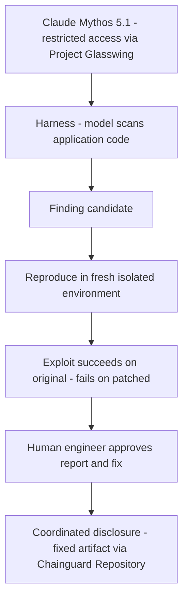
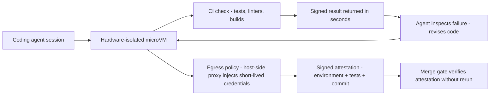

The AI bug-hunting story you keep reading goes like this: a frontier model finds a vulnerability in minutes, a human applies the patch, done. The 1,300-security-leader survey Chainguard commissioned with Wakefield Research points at the part that story leaves out. **More than half of organizations knowingly leave high or critical vulnerabilities unpatched at least some of the time — and at companies doing $1 billion or more in revenue, that figure is 66%**, versus 27% at companies under $250 million.

The gap is not a finding problem. The gap is a *patching* problem. AI can find and chain flaws in minutes; fixing them moves at human speed and competes with product deadlines and uptime. Chainguard's answer is a four-product launch centered on **Harness**, an AI-powered security harness that runs **Claude Mythos 5.1** — a model most companies cannot get direct access to — against application code, with a proof-before-count discipline on every finding.

---

## What the reader gets out of this

- **Why the 66% number matters more than the model** — the economics of the finding-to-patch gap, and where in the pipeline the value actually lands.
- **How Harness proves a finding** — reproduction in fresh isolated environments, the "must fail against the patched version" rule, and human approval before anything ships.
- **The vLLM disclosure, dissected** — a real, patched, multi-tenant inference bug and what its failure mode says about "quiet" vulnerabilities.
- **The agent-isolation story** — hardware-isolated microVMs, credentials held outside the agent, egress policies, and signed attestations you can gate merges on.

---

## The exploit gap, in numbers

The survey — **1,300 security leaders across nine markets**, commissioned by Chainguard, fielded by Wakefield Research — asked a deceptively simple question: does your organization knowingly leave high or critical vulnerabilities unpatched, at least sometimes?

| Company revenue band | Knowingly leave high/critical vulns unpatched (at least sometimes) |
|---|---|
| Under $250M | 27% |
| $1B or more | **66%** |
| All respondents (more than half, overall) | 50%+ |

Read that table the slow way. The *largest* companies are **2.4 times more likely** to leave a critical bug in place. That is counterintuitive until you realize what a patch is: it is a **dependency change with an uptime cost, a regression risk, and a test surface**. A $1B-revenue company has the most of all three. A 27% small company has none of them.

Quincy Castro, Chainguard's CISO, put it plainly:

> "AI can find and chain flaws in minutes, while fixing them still moves at human speed and competes with product deadlines and uptime. Patching faster isn't viable for most folks, and it will consume increasing amounts of resources just to keep pace."

The implication for the hype cycle: a model that finds a bug faster does **nothing** for the 66% unless the organization also moves the *patch* faster. The finding is the cheap half of the equation.

> **Warning**: A vendor-commissioned survey is a signal, not a census. The 66% is from 1,300 security leaders at companies that opted into a Chainguard study, which skews toward security-mature organizations. The direction is real; the exact number will not survive a methodology audit.

---

## Harness: the proof-before-count rule

The product that matters is **Harness**. Chainguard built it first for itself, as part of **Project Glasswing**, an Anthropic program that gives a restricted set of organizations access to **Claude Mythos 5.1**. Most teams cannot get Mythos directly; Harness is the pipe that carries the model to their code.

The launch is four products:

| Product | What it does | Who it is for |
|---|---|---|
| **Harness** | Runs a frontier model (Mythos 5.1 first, model-agnostic later) against application code; finds and *proves* exploitable vulns conventional scanners miss | Teams that want the model's findings, not its noise |
| **Workspaces** | Agent sessions pause during verification and resume with structured failure logs in context | Coding-agent developers who need a stable loop |
| **Checks** | Coding agents run CI checks during development and receive signed results in seconds; no long-lived runner credentials | Teams turning agents into shared, parallel team infrastructure |
| **Libraries** | Secure package endpoints (Go, .NET), CVE remediation (JS, Go), and a channel for AI-discovered dependency bugs | Supply-chain teams that want the fix in the artifact, not the ticket |



The part worth studying is not *which model* runs it. It is the **proof rule**. Chainguard's one-line summary:

> "Harness proves a vulnerability is exploitable before it counts by reproducing potential exploits in fresh, isolated environments."

Everything that does not **reproduce consistently is excluded from the report**. And the proposed *fix* goes through the same proof: the exploit must **succeed against the original code and fail against the patched version** before the fix moves forward. A human engineer approves every fix and every report before it reaches a customer.

That is the entire argument for the "AI finds, human approves" pattern, stated as a *mechanism* rather than a slogan: the model earns its way in by *falsifying itself*. If it cannot reproduce the exploit on a clean build, the finding is noise and it is thrown out, no matter how confident the prose was.

```python
# The harness loop, reduced to its one non-obvious invariant:
# a finding is not a report until it (a) reproduces on clean code
# and (b) the *fix* breaks the reproduction. The model proposes;
# the sandbox disposes.
from dataclasses import dataclass

@dataclass
class Finding:
    vuln: str                 # human description
    poc: str                  # a runnable proof-of-exploit
    reproduces_on_unpatched: bool = False
    reproduces_on_patched: bool = True   # True == the bug is still there

    def is_confirmed(self) -> bool:
        # The rule: confirm ONLY if the exploit works on original code
        # AND the patch actually kills it. One of the two is False
        # -> the "fix" did not fix, or the "bug" was a mirage.
        return self.reproduces_on_unpatched and not self.reproduces_on_patched

def review(f: Finding, human: bool) -> bool:
    # Even a confirmed finding needs a human sign-off before it ships.
    return f.is_confirmed() and human
```

The model can be wrong in two directions, and the two-stage check catches both: a **false positive** (exploit does not reproduce) and a **false fix** (patch is claimed, exploit still reproduces). Conventional scanners are bad at the second one; they report a CVE and stop.

---

## The vLLM disclosure, dissected

The first public finding from Harness is a now-patched flaw in **vLLM**, the open-source inference engine a lot of teams use to serve LLMs. In versions before **v0.31.0**, one client could **force the output returned to other clients sharing the same engine** — and the tampered response came back **looking like a normal, successful completion, with nothing written to the logs**.

The advisory is **GHSA-6cxc-2vcg-w5qc**, fixed in v0.31.0. Chainguard notes the harness "independently found the issue and reproduced it on a clean build," and that "a number of other findings, including some in critical infrastructure software, are now being coordinated for disclosure."

Why is this the *right* kind of example for an AI-discovered bug? Three reasons:

1. **It is multi-tenant.** A single misbehaving client corrupting other tenants' responses is exactly the class of bug a static scanner is bad at, because there is no type error — the code *works*, it just serves the wrong person's data.
2. **It is quiet.** No exception, no log line, a 200 OK with a stranger's completion in it. A "bug that throws" is easy to find; a "bug that lies" is the expensive kind.
3. **It is provable.** You can demonstrate it with two requests, which is precisely the shape of the reproduction harness requires.

```go
//go:build ignore

// Standalone. Run: go run tenant_isolation.go
// Demonstrates the shape of the vLLM bug: a single client controls the
// output returned to a *different* client on the same engine. The "fix"
// is the assertion that the second tenant's response is byte-identical to
// what it would have received had the first tenant never sent a request.
package main

import (
	"bytes"
	"fmt"
	"io"
	"net/http"
)

const engineURL = "http://localhost:8000/v1/chat/completions"

// post sends one completion request; returns the response body.
func post(body string) []byte {
	resp, err := http.Post(engineURL, "application/json", bytes.NewBufferString(body))
	if err != nil {
		panic(err)
	}
	defer resp.Body.Close()
	b, _ := io.ReadAll(resp.Body)
	return b
}

func main() {
	baseline := post(`{"model":"m","messages":[{"role":"user","content":"hello from tenant B"}]}`)

	// Tenant A issues a request that (pre-fix) overwrites the shared
	// output buffer Tenant B is about to read.
	post(`{"model":"m","messages":[{"role":"user","content":"hello from tenant A"}]}`)

	got := post(`{"model":"m","messages":[{"role":"user","content":"hello from tenant B"}]}`)

	// The fix: tenant B's response must be its own, not a function of
	// whatever A did. This is the "fail against patched" check, in
	// one comparison.
	if !bytes.Equal(baseline, got) {
		fmt.Println("FAIL: tenant B output changed after tenant A request")
		return
	}
	fmt.Println("PASS: tenant isolation holds")
}
```

The honest caveat: **one confirmed bug is not a track record.** It is a *reference* finding — proof the pipeline can surface something real and get it fixed. The "66% leave it unpatched" number is the reason the reference finding matters more than the model that found it.

---

## Agent isolation: the other half of the launch

A model that reads your codebase is, by definition, a **new principal with access to it**. Chainguard's answer is to stop treating coding agents as *processes* and start treating them as *tenants*:

- **Every developer and coding agent gets a hardware-isolated microVM** with network policies that restrict access to internal systems.
- **Credentials stay outside the agent's environment**, limiting what a compromised agent — or a malicious dependency it pulled in — can reach.
- **Signed activity logs** record what each agent did, so teams keep an audit trail across multiple autonomous sessions.

**Checks** (the CI-in-the-loop piece) is where this gets concrete. Coding agents can run CI checks *during* development and receive **signed results in seconds**, inspect failures, and revise code *before* opening a pull request — avoiding the CI queues that become unmanageable as vendors like Cognition, Microsoft, and Augment turn coding agents into shared team infrastructure running many sessions in parallel.

The details that make this more than a slogan:

- Warm **snapshots** with dependencies pre-installed; refreshed in the background when the lockfile changes.
- Every workflow step runs in its own **hardware-isolated microVM** built from Chainguard OS packages, including **FIPS-compliant toolchains**.
- **Runners never hold long-lived credentials.** A host-side proxy injects short-lived credentials into outbound requests.
- **Declarative egress policies** restrict network access and can terminate a microVM if it attempts an unauthorized connection.
- Successful runs produce **signed attestations** tied to the execution environment, the test results, and the commit — which merge gates can verify **without rerunning the suite**.



The **Libraries** product closes the loop on the dependency side. When Harness turns up a validated vulnerability in open-source software, Chainguard runs coordinated disclosure, builds and reviews a patch, and distributes the fixed artifact through **Chainguard Repository**. Athena members get the private, hardened, patched build *before* public disclosure; other Libraries customers get it when the embargo lifts — so a company "can stay protected against AI-discovered vulnerabilities immediately upon disclosure" rather than racing the news cycle.

---

## Why this is a DevSecOps story, not an AI story

The 66% number is a **patching** number, and the four products are a **patching** pipeline:

- **Harness** closes the *finding* side: a model, gated by proof, that outputs confirmed exploits rather than a pile of "maybe."
- **Checks** closes the *verification* side: a coding agent that can run and *read* CI in seconds, so the feedback loop is fast enough to matter.
- **Workspaces** closes the *state* side: an agent that pauses and resumes with its failure context, so the loop is durable across sessions.
- **Libraries** closes the *delivery* side: the fixed artifact, signed and embargo-aware, in the registry the build already pulls from.

Each one is a small, boring, *auditable* piece. The model is the interesting bit; the harness is the load-bearing one.

> **Note**: "Model-agnostic" is the stated goal, and Mythos 5.1 is the first entry. The practical reading is that the *proof discipline* is the portable asset: if a finding must reproduce on a clean build and the fix must break it, the model underneath is a swappable component. That is what lets the harness scale past a single restricted-model partnership.

---

## Takeaways

- **The finding is the cheap half.** A frontier model makes the *find* faster; the 66% gap is in the *patch*. Any "AI finds bugs" pitch that does not name what moves the patch is selling the easy half.
- **Proof before count is the whole value.** Reproduce on clean code; break it on the patched build; human signs. That three-step rule is what separates a finding you can gate a merge on from a finding you file in a pile.
- **Treat agents as tenants, not processes.** Hardware isolation, credentials outside the VM, egress policy, signed attestations — the agent's *access* is the surface you must secure, not the model's *output*.
- **One reference finding is a proof of pipeline, not a track record.** vLLM is the proof the machine works; the coordinated-disclosure pipeline is what makes the rest of it *shippable*.

**Next steps:** if you run a CI pipeline, look at whether your checks are *signed* and *rerun-free* — an attestation a merge gate can verify is worth more than a green badge. If you run an agent fleet, move credentials out of the agent's environment and put egress policy in front of it. And if you are buying "AI finds bugs," ask for the reproduction rule in writing: what has to be true before a finding counts. The 66% is the number that should decide your answer.
