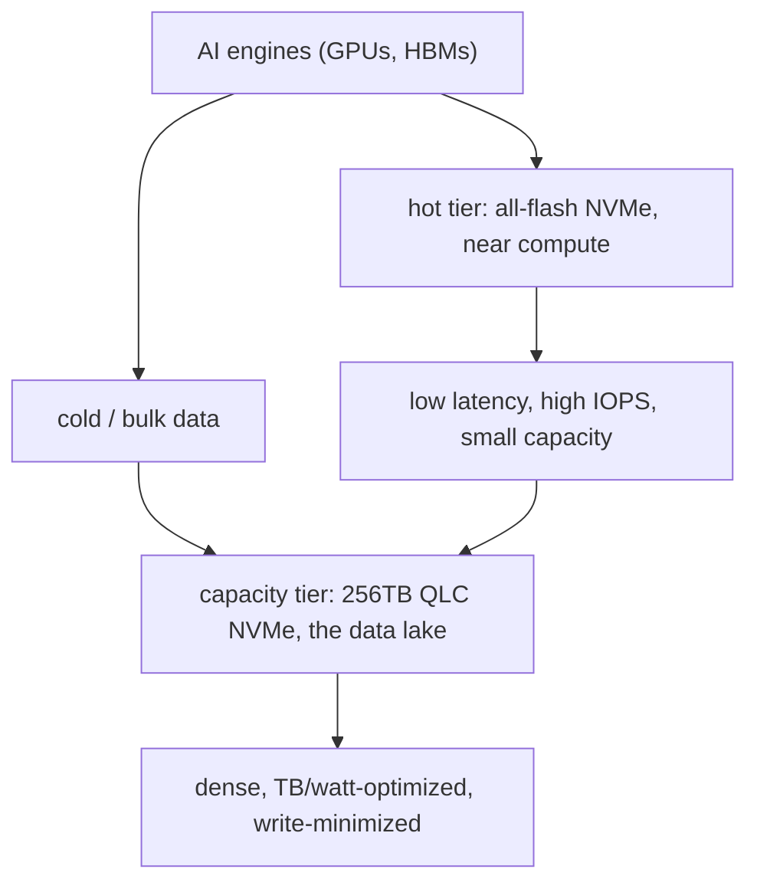
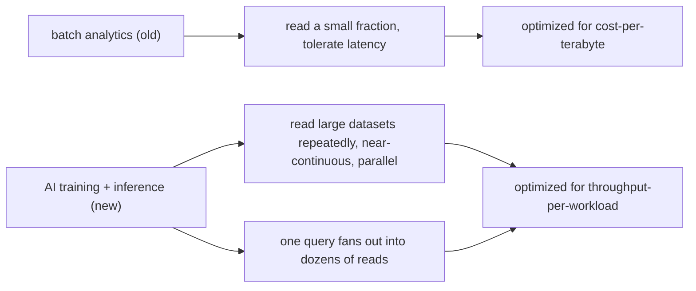

The most pressing AI compute problem is no longer about faster processor cycles. It is about **serving a diverse set of compute engines with data — efficiently, consistently, and at scale.** For decades the data center's storage story was a cost story: store terabytes cheaply, access them in predictable batches, tolerate the latency. AI workloads have broken that story. Training reads large datasets *repeatedly* across distributed clusters; inference generates access events that fan out far beyond a single query, where one apparent request triggers dozens of underlying reads of stored data, intermediate results, and context. The result is that the **data lake is no longer a passive vault — it is an active, persistent, high-throughput delivery platform**, and the storage architecture underneath it was not designed for that.

This is a Sandisk-sponsored technical post, and the argument is about the *physics and economics* of closing the gap: **ultra-high-capacity QLC NAND flash** as the substrate for the AI data lake. The post is a good, concrete case study in how a workload change (batch → continuous) forces a storage-substrate change (capacity-optimized HDD/MLC → dense, power-efficient QLC), and in how the engineering that makes dense flash durable (write-amplification management) becomes a first-order design constraint.

## Why the old model breaks

The traditional data lake assumed three things, and AI has broken all three:

1. **Only a fraction of stored data is accessed at any time.** AI inference demands *near-continuous* parallel access to massive datasets.
2. **Batch-oriented access is the norm.** AI workloads access data continuously, recalled and recombined across training, inference, and agentic workflows.
3. **Latency is tolerable; cost-per-terabyte is the metric.** AI wants *throughput-per-workload*, not cost-per-terabyte.

The old model optimized the wrong axis. It is also a model that is *expensive to scale*: GPU clusters are the most expensive thing in the data center to build and operate, they consume significant power, and they need advanced cooling. **You cannot solve a storage bottleneck by adding more compute or more DRAM-based high-bandwidth memory** — power budgets, physical space, and replacement cycles all put a hard ceiling on that. The lever that is left is storage itself: make it dense, power-efficient, and fast enough to keep the expensive engines fed.

> **Note**: "Data lake" here is the standard data-engineering term for a centralized repository of raw/semi-structured data (text, images, video, sensor output) that is accessed for analytics. The shift the post describes is from *storage* (a noun — where data sits) to *delivery* (a verb — how fast and how concurrently it can be served to the engines that consume it). The storage medium is the same; the *role* of the storage subsystem has changed.

## The substrate: QLC NAND and ultra-high-capacity flash

The core of the argument is **QLC** (quad-level cell) NAND, which encodes **four bits per cell** and therefore buys the highest storage density of the NAND cell types. The practical consequence is that enterprise SSD capacities are moving into the **hundreds of terabytes** — the post cites recent demonstrations of **256TB NVMe drives** built for AI workloads.

Why dense flash is the right answer to the AI data-lake problem, and not just more of the same:

- **Capacity per device.** Storing more data in fewer drives reduces the physical footprint of the storage tier and, critically, the number of controllers and power connections.
- **Power efficiency, measured in TB/watt.** In a hyperscale environment where energy is the primary constraint, a dense drive that stores more per watt is a first-order win, not a nice-to-have.
- **Designed for the workload.** The post is explicit that flash is now being *designed for AI* — sustained access patterns and large datasets dominate — rather than serving as a general-purpose medium.

The NAND cell-type trade-off is the whole storage decision in miniature, and it is worth making the table concrete:

| Cell type | Bits/cell | Relative density | Relative endurance (writes) | Typical role |
|---|---|---|---|---|
| SLC | 1 | lowest | highest | performance-critical, high-write |
| MLC | 2 | low | high | general enterprise, balanced |
| TLC | 3 | medium | medium | the workhorse of most SSDs |
| **QLC** | **4** | **highest** | **lower** | **capacity: data lakes, cold/ warm AI data** |

QLC is the *densest* and the *least durable* of the four. That is exactly the trade the AI data lake is being forced into: it wants maximum capacity (and the TB/watt that comes with it), and it can afford the lower per-cell endurance *if* the drive is managed so it does not rewrite data needlessly.

```
# The write-amplification problem in one line of thinking: at
# hundreds of terabytes per drive, every byte rewritten costs
# endurance and energy. The new SSD architecture's whole job is to
# minimize the *number of rewrites* — better data placement, less
# background recycling — so the dense cells are not churned.
# This is the single most important engineering constraint the
# post is describing.
```

The two-tier result, drawn out:



The workload shift that forces the two tiers, in one diagram:



## The real engineering problem: write amplification at scale

The post's most useful technical content is the section on **rethinking SSD architecture for AI scale**. The problem is that traditional SSDs rely on **background processes to recycle and reorganize data** — garbage collection, wear leveling, read-modify-write of partial pages — to maintain performance and endurance. At conventional capacities those background rewrites are cheap enough to ignore. **At hundreds of terabytes per drive, they are not:** frequently rewriting large volumes of data is neither practical nor energy-efficient, and it shortens the drive's life.

The fix is to **reduce unnecessary data movement** — better I/O handling, better data placement, lower **write amplification**. The post is right to flag that these changes "may seem incremental" but at hyperscale translate into *substantial* cost savings and faster time-to-value. This is the same lesson as any dense-storage system: **the cost of a dense medium is paid in rewrites, so the architecture's job is to stop rewriting.**

## The resulting architecture: segmented storage

The post's conclusion is an **architecture**, not just a component: **segment the storage tier** so that the expensive, fast tiers (all-flash, low-latency) sit *near the compute layer* for the hot working set, while **high-capacity QLC systems anchor the data lake** itself. This is a balanced architecture: it keeps the latency-sensitive path fast and the capacity path dense and cheap, and it is what the post means by "a more balanced architecture that supports current workloads and future needs."

The cloud-provider side is the same argument from the service side. Hyperscalers have already segmented storage into performance tiers (latency, throughput, IOPS, availability), with cheap archival/capacity tiers and premium all-flash tiers. **AI is accelerating the migration of customers from the cheap tiers to the premium ones**, because inference demands near-continuous parallel access. The storage vendor and the cloud provider are converging on the same answer from opposite directions.

```
# The two-tier data-lake architecture the post is describing:
#
#   hot / latency-sensitive path
#     └─ all-flash, near compute, low-latency, high IOPS
#        (the working set the active engines touch every second)
#
#   capacity / data-lake path
#     └─ QLC NVMe, 256TB-class drives, dense, TB/watt-optimized
#        (the bulk of the lake; written once, read many, rewritten
#         as little as possible to protect endurance)
#
# The design constraint is that data *flows down* from hot to
# capacity as it cools, and the QLC tier must be managed so the
# cooling writes do not become a rewrite storm.
```

## What this means for the data center operator

For the person who owns the budget and the roadmap, the post's message is a **trade-off reframe**:

- **The bottleneck moved from compute to data delivery.** Spending more on GPUs is the expensive, power-capped answer; the storage tier is the under-invested lever.
- **The metric changed from $/TB to TB/watt and throughput/workload.** Buy dense, power-efficient media; manage it so it does not chew itself up.
- **Plan for a segmented tier**, not a monolith. Hot near compute, capacity in QLC, and a disciplined write policy to protect the dense cells.
- **Expect the pressure to keep rising.** As models grow and inference expands, the load on storage is *structural*, not a one-time bump.

> **Warning**: The 256TB QLC number is a *demonstration* of what the manufacturing line can do, not a statement that every drive in your rack is a 256TB QLC. Endurance (TBW — terabytes written) is the number to read *alongside* capacity: a 256TB QLC drive with a modest TBW rating is a liability if it sits on a write-heavy path. The post's own write-amplification section is the answer, but it is an *architecture* answer, not a spec-sheet answer — the endurance math has to be done per workload, per tier, before you commit the rack.

## Takeaways

- **The AI data lake is a delivery platform, not a vault.** The workload shifted from batch to continuous, parallel access; the storage tier has to be designed for throughput-per-workload, not cost-per-terabyte.
- **QLC NAND is the dense answer** — four bits/cell, 256TB-class drives, measured in TB/watt — and it is now being *designed for* AI's sustained-access patterns.
- **The engineering constraint is write amplification.** At hundreds of terabytes per drive, the background rewrite that used to be free is now the thing that kills endurance and power; the whole architecture is about minimizing rewrites.
- **The architecture is segmented:** all-flash hot tier near compute, QLC capacity tier anchoring the lake, with a disciplined write policy to protect the dense cells.

## Next steps

- Read the post's QLC section as a design brief: capacity, TB/watt, write-amplification, endurance.
- If you own a data lake, inventory which tier each dataset *actually* lives in and whether the write path into the capacity tier is a rewrite storm.
- Track the hyperscaler storage-tier SLAs as a signal: the migration of inference workloads from capacity tiers to premium all-flash tiers is the market pricing the same constraint the post describes.
