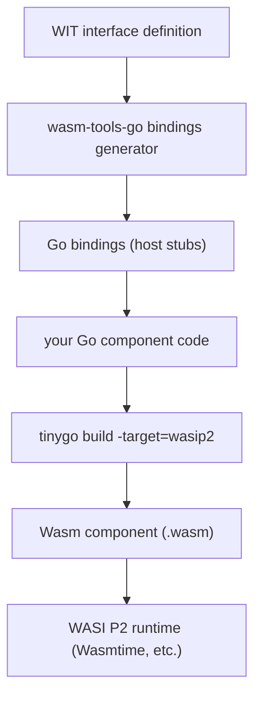
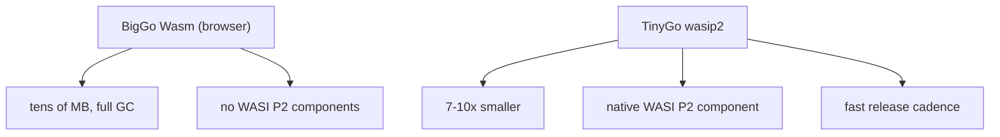

WebAssembly's promise was always **modularity**: compile any language into a Wasm module and run it on any CPU that can decode the instruction set, in the browser or out of it. C++ and Rust got there fast; **Go** kept trailing because the standard `go` toolchain's Wasm target was browser-bound and the **WASI P2 component model** — the thing that turns a Wasm module into a stackable, typed, language-agnostic *component* — had no first-class Go story.

That gap is closing. Two things landed in the same window: the **WASI P2 component model** standardizing the interface layer (WIT, the Wasm Interface Type), and **TinyGo** shipping a `wasip2` build target plus a **bindings generator** that turns WIT interface definitions into idiomatic Go. The result, in the words of wasmCloud's Eric Gregory: "Go developers were writing Wasm apps before; now they can write *Go apps*, and turning them into Wasm is just a compiler flag away." This post shows exactly what that flag is, what the WIT side looks like, and why TinyGo — not `go` — is the realistic path to a production Wasm component in Go for the time being.

## The one-line build

The "it should" part is that a Wasm component is now a **standard compile target**, not a bespoke toolchain. With TinyGo's `wasip2` target and the `wasm-tools-go` bindings generator, the build is one command:

```bash
# tinygo build -o gojq.wasm -target=wasip2 ./cmd/gojq/main.go
```

That single flag is the whole story on the toolchain side. `wasip2` tells TinyGo to compile against the WASI P2 (Wasm 2.2) interface, which is what makes the output a *component* rather than a bare module. The `wasm-tools-go` project sits underneath it: it reads the **WIT** files that define a component's interfaces and generates the Go bindings, so you write ordinary Go and get the component ABI for free.

## A minimal component end to end

The clearest way to see the shape is a tiny JSON-query component — the `gojq` example from the release notes. You define the interface in WIT, generate the Go bindings, implement it in Go, build with the one flag above, and run the result on any WASI P2 runtime.

```go
// main.go — a WASI P2 component written in Go. It implements the
// "query" interface defined in the WIT file below: it reads a JSON
// value from the request stream and writes the query result back.
// The generated bindings (from wasm-tools-go) provide the host
// function stubs; you only implement the logic.
package main

import (
    "encoding/json"
    "fmt"
)

// query is the component entry point. The WIT-defined request carries
// the JSON payload; the response carries the result.
func query(in []byte) (out []byte, err error) {
    var v any
    if err = json.Unmarshal(in, &v); err != nil {
        return nil, fmt.Errorf("bad json: %w", err)
    }
    // for the demo, echo the parsed value back as its JSON encoding
    out, err = json.Marshal(v)
    return out, err
}
```

The WIT side that the bindings generator consumes is the contract:

```wit
// query.wit — the component's interface. The bindings generator reads
// this and emits the Go stubs main.go's `query` function implements.
package gojq;

interface query {
    // query takes a JSON byte string and returns the query result.
    result: func(json: sequence<u8>) -> sequence<u8>;
}
```

And the run, on any WASI P2-compatible runtime such as Wasmtime:

```
$ echo '{"value":"foo"}' | wasmtime --wasm component-model ./gojq.wasm
```

The reason this is the "like it should" moment is the separation: **the interface is WIT, the implementation is Go, and the build is a flag.** None of the three has to know about the others' internals. That is the component model working as intended, and Go is now a first-party participant.



## Why TinyGo and not `go`

The standard `go` toolchain does have a Wasm target, and it is improving, but it is not the realistic answer for Wasm components right now, for three reasons the release notes are explicit about.

| Dimension | `go` (BigGo) `GOOS=js GOARCH=wasm` | TinyGo `-target=wasip2` |
|---|---|---|
| Component model / WASI P2 | browser Wasm only; no P2 components | native WASI P2 component target |
| Binary size | tens of MB (full GC + runtime) | **7-10x smaller** than BigGo Wasm |
| Release cadence | twice-yearly | fast, frequent; lands Wasm features first |
| Garbage collector | full GC, big heap floor | smaller heap, tighter fit for small devices |
| Best use | browser, big runtime | edge / IoT / Wasm components |

The size gap is the one that matters in practice. TinyGo's Ron Evans puts the factor at **seven to ten** smaller binaries than BigGo's Wasm output, and adds that TinyGo has been "leading the way" on new Wasm/WASI features, the component model included. Bailey Hayes (Cosmonic, WASI subgroup co-chair, Bytecode Alliance TSC) frames the standardization angle: with WASI P2 in place, languages can target it directly, and "we're seeing Golang add native support" alongside Rust and .NET. The trade is cadence: TinyGo ships Wasm features first; BigGo is "slated for the next timed release." If you are shipping a Wasm *component* in Go today, TinyGo is the answer.

> **Note**: TinyGo covers the full Go language, but it is a **separate compiler** — written in Go and built on LLVM — with its own release cycle and its own subset of the standard library. "TinyGo can compile it" does not always mean "your exact `import`s will work unchanged." Check the TinyGo stdlib coverage for the packages you depend on before you bet a component on it.

> **Warning**: The 7-10x size win is real but it is not free. TinyGo's smaller runtime and stricter stdlib coverage mean some libraries that work fine under BigGo are simply not there. If your component needs a heavy `net`, `crypto`, or third-party stack, the TinyGo size advantage can be partly or wholly eaten by the work of replacing the libraries. Measure the *actual* artifact and the *actual* dependency set before you commit.



## What this unblocks

The component model is the "Lego blocks" story: components are typed interfaces over WIT that stack into larger systems, so a Go component and a Rust component and a Python-for-AI component can compose in the same Wasm system. Go joining that set with a one-flag build and generated bindings means a whole class of teams that write Go but did not want to learn Rust to touch Wasm can now write the component in the language they already use, and let the standard do the interop. The remaining work is the usual: tooling polish, stdlib coverage, and the BigGo P2 target landing so the two toolchains stop diverging.

## Takeaways

- **The build is one flag.** `tinygo build -target=wasip2` is the entire toolchain story for a Go Wasm component; the WIT + `wasm-tools-go` generator handles the ABI.
- **TinyGo is the realistic path to a Wasm component in Go today** — 7-10x smaller, native P2, faster cadence; BigGo's Wasm is browser-bound and big.
- **The component model is the point.** WIT-defined interfaces let components from different languages stack; Go is now a first-party participant, not a special case.
- **Check TinyGo's stdlib before you commit.** The size win is real; the stdlib-subset constraint is the real cost.

## Next steps

- Run the `gojq` example above with `tinygo build -target=wasip2` and a Wasmtime runtime to see a Go component execute.
- Read the WIT files for a component you care about and run the `wasm-tools-go` generator to see the bindings it emits.
- Track the BigGo P2 target on the Go release notes; when it lands, the "TinyGo vs BigGo" decision becomes a size-vs-stdlib trade, not a capability trade.
