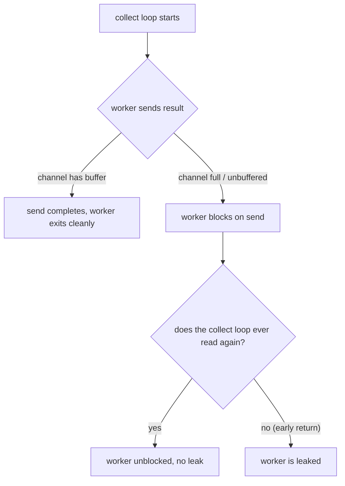
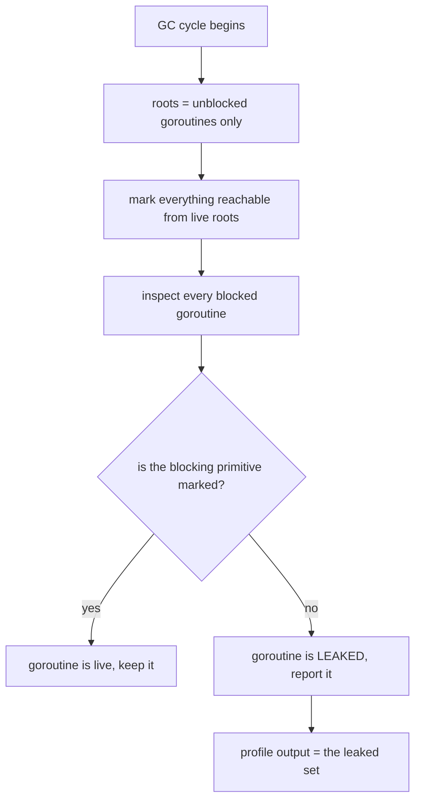

A goroutine that is **blocked forever on a channel or a lock** is a goroutine leak: it will never run again, it holds its stack, its locals, and every object they reference, and it keeps costing the garbage collector work. These leaks are the slow killer of long-lived Go services — the process does not crash, the logs stay clean, and the memory graph just climbs, one leaked goroutine at a time. Until now the only reliable ways to catch them were **goleak** in unit tests and **synctest** for controlled concurrency, both of which test the code you wrote, not the code that runs in production.

Go 1.27 changes that with a **goroutine-leak profile**: a new pprof profile type that runs inside the GC and reports only the goroutines the runtime can *prove* are permanently blocked. This post walks the mechanism, the one new profile endpoint it exposes, and the exact leak patterns it catches in the wild, with the pprof output for each. By the end you will know how to turn the feature on, how to read the profile, and which leaks it will and will not see.

## What counts as a leak

The definition the feature uses is precise, which is what makes it useful. A goroutine is **leaked** when it is **permanently blocked on a concurrency primitive** — a channel send/receive, a `select` with no `default`, or a `sync` lock — and **no other live goroutine can unblock it**. "Live" is defined inductively: a goroutine is live if it is not blocked, or if at least one primitive blocking it is reachable from a live goroutine. The profiler then marks every goroutine that is *not* live and reports it.

The key word is **permanently**. A goroutine blocked because the next request has not arrived yet is not leaked; it will be woken. A goroutine blocked on a channel that only a dead goroutine writes to is leaked. The profiler is built to tell the difference, and the difference is exactly what a raw goroutine profile cannot do: a plain `pprof` goroutine dump shows you *where* goroutines are blocked, not *whether they ever will be unblocked*.

> **Note**: The profile is a **new pprof type** — `goroutineleak` — and it is not a replacement for the existing `goroutine` profile. The `goroutine` profile is still your tool for "show me the stack of every blocked goroutine"; the `goroutineleak` profile is your tool for "show me only the ones that will never be unblocked." They answer different questions and you will use both.

## Turning it on

The profile is exposed the same way every other pprof profile is: through `runtime/pprof` and, if you already run the standard pprof HTTP handlers, at a **new endpoint** with zero code changes.

```go
// main.go — a service that leaks, plus the pprof server that
// now also serves the new goroutineleak profile. If you already
// import "net/http/pprof" you do not need to change anything;
// the new profile endpoint comes for free.
package main

import (
    "log"
    "net/http"
    _ "net/http/pprof" // registers /debug/pprof/* including the new one
)

func main() {
    go func() {
        // The new profile is served at /debug/pprof/goroutineleak.
        // No new handler, no new import — the blank import above
        // registers every registered pprof profile type.
        log.Println(http.ListenAndServe("localhost:6060", nil))
    }()
    // ... your service ...
}
```

To collect it:

```
$ curl http://localhost:6060/debug/pprof/goroutineleack > leak.prof
$ go tool pprof leak.prof
```

You will typically see it wired into a CI or a cron job that scrapes the endpoint every N minutes, because the profile is cheap to take and the interesting signal is *trending*, not a single snapshot.

## A real leak, and the pprof that catches it

Consider a worker pool that fans out to a channel and the main goroutine returns early on the first error. The remaining workers are left blocked on `ch <- result` forever:

```go
// workers.go — each worker blocks on an unbuffered send; if the
// receiver (the collect loop below) exits early, every worker that
// has not yet been received from is leaked.
func processWorkItems(ws []workItem) ([]workResult, error) {
    ch := make(chan result) // unbuffered: senders block until received
    for _, w := range ws {
        go func() {
            res, err := processWorkItem(w)
            ch <- result{res, err} // BLOCKS until the collect loop reads
        }()
    }
    var results []workResult
    for range len(ws) {
        r := <-ch
        if r.err != nil {
            return nil, r.err // early return: the other workers are now leaked
        }
        results = append(results, r.res)
    }
    return results, nil
}
```

The fix is one line — give the channel a buffer sized to the fan-out, so a sender never has to wait for a receiver that may already be gone:

```go
ch := make(chan result, len(ws)) // buffered: senders never block
```

The leak profile pins this exactly. Running the leaking service and collecting the profile, `go tool pprof` names the blocked line:

```
(pprof) list processWorkItems
Total: 116
ROUTINE ======================== main.processWorkItems.func1 in .../workers.go
0        116 (flat, cum)   100% of Total
.          .     32:           go func() {
.          .     33:                   res, err := processWorkItem(w)
.        116     34:                   ch <- result{res, err}
.          .     35:           }()
```

116 goroutines, all parked on the channel send. That is the entire class of leak this feature exists to catch.



## The patterns the profiler is built to catch

The Go team seeded the feature with a catalogue of the leak shapes that show up in real codebases. Each one is a single blocked primitive with no live writer, and each is caught by the same "is this reachable from a live goroutine" check.

**Double send.** A sender sends twice to a channel that only ever receives once; the second send blocks forever.

```go
// double send: the first ch <- nil is consumed, the second
// ch <- struct{}{} blocks forever because the receiver only reads once.
func doubleSend(ch chan any) {
    ch <- nil          // consumed
    ch <- struct{}{}    // LEAK: no one will ever read this
}
```

**Timeout / select exit.** A worker sends to a channel the parent `select`s on, but the parent's `select` takes the `ctx.Done()` branch and stops reading; the sender is leaked.

```go
// the parent picks ctx.Done() and stops reading ch; the sender
// below is then blocked forever.
go func() {
    ch <- struct{}{} // LEAK if the parent's select took the ctx.Done() branch
}()
select {
case <-ch:
case <-ctx.Done():
    // parent exits here; sender above is now unreachable
}
```

**`range` over a channel that is never closed.** Workers in `for range ch` block forever if `ch` is never closed, because the range loop only exits on close.

```go
for item := range ch { // blocks forever if ch is never closed
    _ = item
}
```

**Method-contract violation.** A type's `Start()` spawns a loop that only its `Stop()` can terminate; if a caller never calls `Stop()`, the loop leaks. This is the most common *indirect* leak because the contract is implicit and easy to violate from behind an interface.

**Missing unlock before a `break`.** A lock is taken in a loop, a `break` is hit before the `Unlock()`, and the next caller to the same mutex blocks forever.

```go
// the classic: Lock() then break before Unlock(); the next caller
// to g.mu.Lock() is leaked.
g.mu.Lock()
if g.closed {
    break // LEAK: Unlock() was skipped
}
g.mu.Unlock()
```

**`sync.WaitGroup` misused inside a loop.** `group.Wait()` called inside the loop that `Add()`s, so the first `Done()` unblocks a `Wait()` that was never supposed to run yet, and the remaining goroutines leak.

The coverage boundary, in one table:

| Primitive the goroutine blocks on | Reported as leaked? |
|---|---|
| channel send / receive (including over a `nil` channel) | yes |
| `select` with no `default` (including an empty `select`) | yes |
| `sync.Mutex` / `sync.RWMutex` | yes |
| `sync.WaitGroup` / `sync.Cond` | yes |
| network / file IO, raw syscall, third-party primitive | no |

## What the profiler does not see

The feature is deliberately narrow, and the narrowness is the design. It reports only leaks on **first-class concurrency primitives**: channel send/receive (including over `nil` channels), `select` with no `default` (including an empty `select`), and the `sync` package's `Mutex`, `RWMutex`, `WaitGroup`, and `Cond`.

> **Warning**: A goroutine blocked on **anything else** — a network read, a file read, a raw syscall, a custom spinlock, a third-party primitive — is **not** in the profile's coverage. If your leak is "the reader sat on a socket read," the profiler will not report it. The profile is precise about what it *can* prove; it is silent, by construction, about everything it cannot.

There is also a **memory-overreach** limit: if the primitive a goroutine is blocked on is reachable from a *global* variable or a long-lived runnable goroutine, the profiler conservatively treats the blocked goroutine as live (because that global *might* be the thing that unblocks it), even if the global is dead code. The fix is the same one you would want anyway: keep references to concurrency primitives scoped to the lifetime of the thing that uses them.

## The GC under the hood

The profiler does not add a new mechanism; it **reuses the existing tri-color mark-and-sweep GC** and changes what counts as a root. In a normal GC cycle, every goroutine (and global) is a root — nothing can ever be garbage. The leak profiler runs a *second* pass where the roots are restricted to **unblocked** goroutines, then marks everything reachable, then asks: which blocked goroutines are *not* reachable from any live root? Those are the leaks. The same marking the GC does for memory is what it does for liveness, which is why the memory overhead is negligible and the whole thing runs in the existing GC thread.



The one real cost is a **daisy-chain** of blocked goroutines, where proving the last one live requires proving every one before it, which is an O(n) pass per round and O(n²) over a full cycle in the worst case. The team notes the second point is optimizable; the first is inherent to the problem. The practical answer is the one the article lands on: **tune the profiling frequency** (e.g. every few hours) so the cost is amortized, because a leak that exists at one time exists at all later times — you do not lose anything by sampling.

## How to read a profile in production

Treat `goroutineleak` like any other profile: **trend it**, not snapshot it. A single collection shows you the current leaked set; a series over days shows you the *leak rate*, which is the number that tells you a release is bad.

```
# the one-liner to wire into a cron / CI job:
# collect every 15 minutes, keep the last 14 days, alert on growth.
curl -sf http://localhost:6060/debug/pprof/goroutineleack > leak.prof &&     go tool pprof -top leak.prof
```

The three numbers to track: **total leaked count**, **growth per interval** (the rate), and **the top blocked line** (the `list` output above). When the rate goes non-zero, the top blocked line is your bug; when it goes back to zero, the fix worked.

## Takeaways

- **The profiler is a proof engine, not a counter.** It reports only goroutines it can *prove* are permanently blocked on a first-class primitive; everything else is out of scope by design.
- **It is a new pprof type, not a new tool.** If you already run `net/http/pprof`, the `goroutineleak` endpoint is already there; wiring it into a scraper is a one-liner.
- **The catalogue is the feature.** Double send, timeout-select, unclosed `range`, method-contract, missing-unlock-before-break, and misused `WaitGroup` are the six shapes to check your own code against first.
- **Trend it.** The signal is the leak *rate* over time, and the cost is amortized by sampling every few hours rather than continuously.

## Next steps

- Add the `goroutineleak` endpoint to your existing pprof scraper and a 15-minute cron.
- Re-read your `select` and `range ch` sites with the "will a live goroutine ever read this" question in mind.
- For the test side, keep **goleak** and **synctest** in your suite — they catch the same classes *before* production, where the fix is cheapest.
