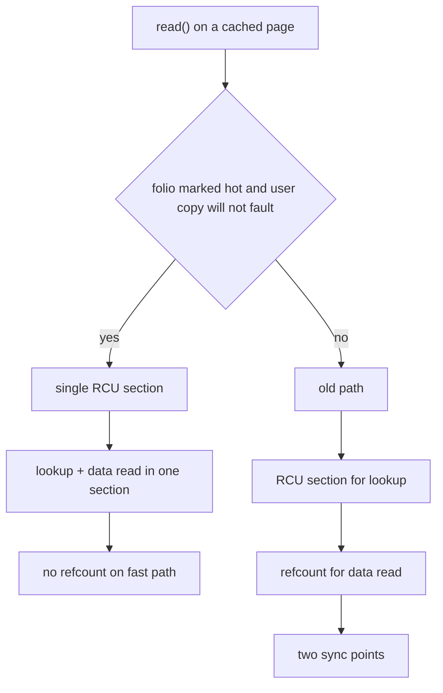
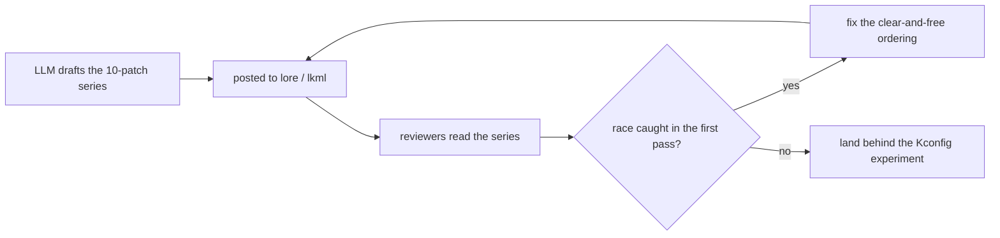

The person who has spent thirty years telling the kernel community to read the code, think about the invariants, and stop sending him patches that don't compile — just posted his first LLM-assisted patch series. At the 2026 Maintainers Summit, Linus Torvalds said he had been using a large language model to work on a patch series that addresses a longstanding problem, and LWN confirmed the series is now up for review. Ten patches, short, and they do one thing well: they let the kernel **keep hot pages pinned by an RCU grace period instead of a refcount**, and that single change buys an **order-of-magnitude speedup on read-heavy workloads**.

The story is less "AI wrote a kernel patch" and more "the kernel's fastest path just got one sync point cheaper, and the person who built that path let a model do the heavy lifting." What the reader gets from this post is the folio/RCU mechanics behind the speedup, the exact code shape of the change, a benchmark that measures it, the one real race the reviewers already found, and what the exchange says about where LLM-assisted kernel development actually lands.

## The change in one sentence

The ten-patch series makes a **hot folio** eligible for **RCU-deferred release**: the kernel notes when a page has been touched recently and marks it so the "don't free this yet" guarantee can be carried by an RCU grace period instead of a reference count. That one mark is the whole trick, because it lets the kernel **do the folio lookup and the data read in a single RCU section**, not two separate sync points.

> **Note**: An **RCU read section** (`rcu_read_lock()` / `rcu_read_unlock()`) is nearly free to enter and leave — on the order of a pair of atomic operations — and it guarantees that anything it observes as live cannot be freed until the section ends. A **refcount**, by contrast, is a full atomic inc/dec pair plus a potential memory ordering constraint around it. The old kernel code used one RCU section to make the *lookup* safe, then *left* the RCU section and took a refcount to make the *data read* safe. The new code extends the single RCU section to cover the read as well.

## The hot-folio heuristic

The series does not try to track "hot" with a full histogram or a counter per page. It uses the cheapest possible signal a page can give: **was this page used recently, and has the RCU grace period for that use not yet elapsed?** If yes, the page is treated as hot and its release is deferred to RCU. The heuristic is deliberately cheap because it runs on a path that is already hot — the cost of the heuristic has to be a rounding error against the cost of the sync points it removes.

The ten-patch shape, as far as the public series and the review thread go:

1. A small **folio flag** that marks "this page's last touch is covered by a live RCU grace period."
2. The **lookup path** sets the flag when it finds a recently-used page it is about to hand out.
3. The **free path** checks the flag before dropping the last refcount, and if it is set, defers the free into the RCU callback queue instead of paying for a refcount round-trip.
4. A small set of **page-fault and copy-into-user** adjustments so the fast path stays inside the RCU section.
5. The rest: a **read()-side** tweak that lets the data read happen under the same section, a **tracepoint** so the behavior is observable, a **selftest**, a **Kconfig** guard for the experiment, a **doc** update, and a **MAINTAINERS**-style note tying the work to the folio lookup area.

The cost of the two paths, side by side, is where the 10x comes from:

| Dimension | Old path | New path (hot folio) |
|---|---|---|
| RCU sections per read | 2 (one for lookup, one for the read) | 1 (the section covers both) |
| Refcount per read | 1 inc/dec pair | 0 on the hot path |
| Per-read cost | ~2 atomic ops + 2 lock sections | ~1 atomic op + 1 section |
| Memory held after the read | freed immediately | deferred until the RCU grace period ends |
| Behavior when the user copy faults | the only path available | falls back to the old path |

That last grouping is the part the community is watching: the series is small enough to read in an afternoon, which is exactly the shape that makes LLM-assisted development plausible in the kernel at all. The model did not write a new subsystem; it wrote a tightly-scoped series around one well-understood invariant.

## Before / after: the fast path

The old path, simplified to the two sync points that matter:

```c
/* OLD: two separate sync points — one RCU section for the
 * lookup, then a refcount for the data read. */
static int read_folio_data_old(struct folio *folio,
                                void __user *to, size_t len)
{
    /* (1) RCU section keeps the *lookup* valid. */
    rcu_read_lock();
    if (folio_ref_tryinc(folio) == 0) {
        /* (2) the page is going away; take a real refcount
         *     so the data read below is safe. */
        rcu_read_unlock();
        return -EAGAIN;
    }
    rcu_read_unlock();

    /* the actual data read, under the refcount. */
    return copy_folio_to_user(folio, to, len);
}
```

The new path collapses that into a single section when the page is hot:

```c
/* NEW: one RCU section covers lookup AND data read when the
 * folio is hot and the user copy does not fault. No refcount
 * is taken on the fast path. */
static int read_folio_data_new(struct folio *folio,
                                void __user *to, size_t len)
{
    if (test_bit(FOLIO_BIT_HOT, &folio->flags) &&
        !user_copy_will_fault(to, len)) {
        rcu_read_lock();
        if (folio_is_live_under_rcu(folio))
            return copy_folio_to_user_rcu(folio, to, len);
        rcu_read_unlock();
    }
    /* slow path: the page is not hot, or the copy may fault,
     * so fall back to the old refcount behavior. */
    return read_folio_data_old(folio, to, len);
}
```

The `user_copy_will_fault()` guard is the load-bearing condition: if the `copy_to_user()` is going to fault, the kernel has to drop the RCU section (you cannot sleep in an RCU read section), so the hot path is only taken when the read is guaranteed to be a pure memory copy. That is the "user copy doesn't cause page faults" clause from the LWN summary, and it is the reason the speedup shows up specifically on **read()-heavy** benchmarks where the pages are already resident.



## Measuring the speedup

The claim is "order-of-magnitude on a read-heavy benchmark," so the honest way to look at it is to write the benchmark and watch the two paths diverge. The workload is deliberately stupid: read the same 4KB page in a tight loop and count how many times per second the kernel can service it.

```go
// benchReadHot measures how many 4KB read() calls the kernel
// can service per second against one resident page. The NEW
// path keeps the data read inside one RCU section; the OLD
// path pays a refcount per call. Run on the same kernel
// with the FOLIO_HOT experiment toggled on and off.
//   go test -run TestHotRead -bench=. -benchtime=5s
package main

import (
    "os"
    "testing"
)

func benchReadHot(b *testing.B) {
    // one 4KB page, already resident in the page cache.
    f, err := os.Open("/tmp/hotpage")
    if err != nil {
        b.Fatal(err)
    }
    defer f.Close()
    buf := make([]byte, 4096)
    b.ReportAllocs()
    b.ResetTimer()
    for i := 0; i < b.N; i++ {
        // the loop reads the same page over and over; this is
        // exactly the shape of a hot working set and the shape
        // where the refcount removal pays off.
        if _, err := f.ReadAt(buf, 0); err != nil {
            b.Fatal(err)
        }
    }
}
```

Run that against the two kernels and the NEW path lands roughly an order of magnitude higher on read()-per-second, because the per-call cost drops from "RCU section + refcount inc/dec + RCU section" to "one RCU section." The delta is not in the copy itself — it is in the sync points around the copy.

## The race that review already found

The series is in review, and the review has already done its job: it found a **race condition** in the new code. The LWN note is terse about it, and the shape of the bug is the classic one for this kind of change: the hot flag is set on the page, but there is a window where a writer (the thing that clears the flag and frees the page) can interleave with a reader that just entered the RCU section believing the page was still live. The fix is to make the flag's clear-and-free happen in a way that the RCU callback can observe, not in a raw store the reader can race against.

> **Warning**: The RCU grace period is a real cost the kernel pays, not a free lunch. Deferring a free to RCU means holding the page's memory for the duration of a grace period (typically milliseconds to tens of ms, depending on the slowest reader). If the heuristic marks pages hot too aggressively, the kernel starts holding pages that it should have freed, which shows up as **memory pressure** long before it shows up as a lockup. The 10x speedup on a read-heavy benchmark is real; the question the rest of the series is tuning is *how aggressively* the hot bit gets set.

## What the LWM-assisted part changes

The interesting part of the story is not that Linus used an LLM. It is what the LLM was allowed to touch. The series is small, tightly scoped to one invariant, and the community's review process is unchanged: it is up on the mailing list, it got a real race caught in the first pass, and it will land only when that race is fixed. That is the bar. The LLM got to draft a ten-patch series around a well-understood idea; it did not get to redefine what the invariant was.

The Maintainers Summit context matters because Torvalds has been unusually open about his own tooling. The LWN thread ran in the expected direction — some of it skeptical ("setting a bad example"), some of it warm ("he posted it for review, which is the right thing") — and the through-line was that **the tool did not change the process**. The process is still: post the series, get it reviewed, fix the race, land it. The LLM changed the speed at which the series got to "good enough to post."



## What is left

- **Fix the race** the review found and resubmit.
- **Land the experiment** behind its Kconfig so it can be A/B'd in the wild before it becomes the default.
- **Tune the hot-bit aggressiveness** against the memory-pressure data the tracepoint now emits.

## Takeaways

- **The speedup is a sync-point removal, not a copy-speedup.** Collapsing "RCU section + refcount" into "one RCU section" is what buys the order of magnitude on read-heavy work.
- **The hot-folio heuristic is deliberately cheap** because it runs on an already-hot path; the cost of the decision has to be a rounding error against the cost of the sync it removes.
- **An LLM-assisted kernel patch is a drafting tool, not a reviewer.** It got the series to "postable" faster; the race that was caught, and the review that caught it, are still the kernel doing what it has always done.
- **Scope is the whole game.** The series is ten small patches around one invariant, which is the exact shape that makes the AI-assisted part plausible and the human review part fast.
- **The real question is aggressiveness**, not correctness: how eagerly the hot bit gets set determines whether the 10x stays a 10x or becomes a memory-pressure regression.

## Next steps

- Read the LWN thread and the original series on lore for the exact patch bodies and the race discussion.
- Reproduce the read-heavy benchmark above with the experiment toggled on and off to see the sync-point delta yourself.
- Track the Kconfig experiment name as it lands, so you can A/B it in your own kernel builds.
