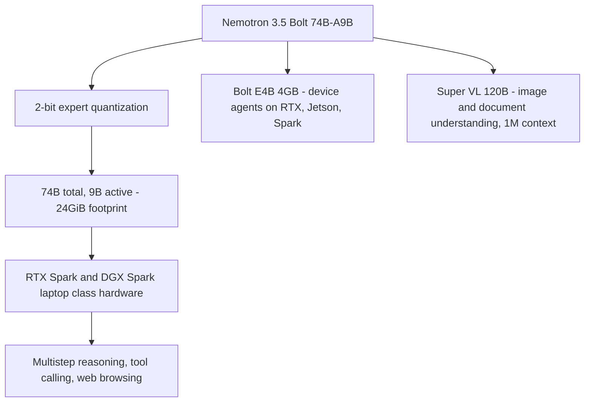
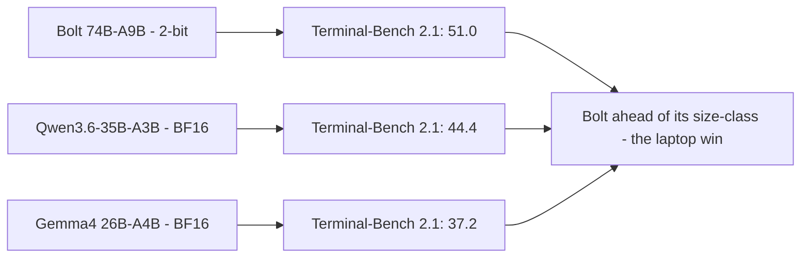

A 74-billion-parameter model in 24 gigabytes of memory is not a rounding error. It is a *category* — the difference between "runs on a datacenter GPU you lease" and "runs on the laptop you already have." That is the claim behind Nvidia's new **Nemotron 3.5 Bolt** models, and it is the part of the release worth paying attention to, because the rest of the family (a **120B** vision-language model and a **4B** device model) is table stakes.

**Nemotron 3.5 Bolt 74B-A9B 24GB** is a **mixture-of-experts (MoE)** agent model that activates **9 billion of its 74 billion** parameters at a time. By using **2-bit quantization** on the experts, Nvidia compresses the memory footprint to 24GB and, it says, the model **beats Qwen and Gemma on agent benchmarks** — while running on **RTX Spark and DGX Spark**, with support for **llama.cpp, Ollama, LM Studio, and vLLM**.

The framing Nvidia gives: these are for **"everyday agentic tasks on laptops, balancing the speed and intelligence needed to handle multistep reasoning, tool calling, and web browsing."** That last clause is the whole pitch — *agentic* means the model is not answering one question, it is *doing* a sequence of things with tools. That is a different workload than a chatbot, and it is the one a laptop-sized model is suddenly supposed to handle.

---

## What the reader gets out of this

- **Why "A9B" matters** — what a 74B-A9B mixture-of-experts actually is, why the *active* count is the number that sets your compute, and how 2-bit experts change the memory math.
- **The three models, side by side** — the 120B Super VL (the marquee), the 74B Bolt (the laptop one), and the 4B E4B (the device one), with what each is *for*.
- **The benchmark reality** — where Bolt wins (Terminal-Bench), where the 120B trails (SWE-bench, document understanding), and the honest "mixed results" read.
- **How to actually run it** — a reproducible local-inference setup, and a Go program that models the 2-bit memory math so you can size your own hardware.

---

## What "74B-A9B" means, and why the active count is the number

A **mixture-of-experts** model is a large parameter budget where only a *fraction* is active for any given token. The naming is the whole story:

- **74B** = total parameters. This is the *memory* number.
- **A9B** = 9B **active** parameters per token. This is the *compute* and *per-token latency* number.

Most of the 74B are "experts" — sub-networks that a **router** selects per token. A token gets processed by the router's chosen experts, so you pay the *compute* of ~9B while carrying the *memory* of 74B. That decoupling is the entire trick: the model is *big* (capable) but *small* per token (fast).

The memory problem that creates is obvious: 74B at full precision (BF16, 2 bytes/param) is **~148GB**. No laptop has that. Nvidia's answer is **2-bit quantization on the experts** — the "Bolt" in the name. Compressed to 2 bits, the 74B fits in **24GB**, which is the memory of an RTX/DGX Spark class machine.

> **Note**: "2-bit" is a *compression* of the weights, not a change to what the model *knows*. The experts are stored as 2-bit integers with a dequant step at runtime; the *architecture* (which experts exist, the router) is unchanged. The cost is a small accuracy tax and an extra dequant pass per token — which is exactly why the *active* parameter count stays 9B: the 2-bit math is on the parts the router does *not* pick for a given token.

The Go program below is the *memory math* you need before you buy hardware: given a target parameter count and a bit width, what is the footprint? It is the difference between "I *think* this fits" and "it *does* fit, with margin."

```go
//go:build ignore

// Standalone. Run: go run memory_math.go
// Models the memory math behind "74B-A9B at 2-bit fits in 24GB."
// The rule of thumb: total-params x bytes-per-param is your footprint.
// MoE decouples *memory* (total params) from *compute* (active params),
// so the number that must fit in RAM is the TOTAL at the chosen bit width.
package main

import (
	"fmt"
	"os"
)

// bytesPerParam returns the weight storage size for a given bit width.
// A bit is 1/8 of a byte; the value is idealized (no padding) per param.
func bytesPerParam(bits int) float64 {
	return float64(bits) / 8.0
}

func gib(params float64, bits int) float64 {
	return params * bytesPerParam(bits) / (1024 * 1024 * 1024)
}

func main() {
	// The three models, each at its realistic storage precision.
	models := []struct {
		name string
		total float64
		active float64
		bits int
	}{
		{"Nemotron 3.5 Bolt 74B-A9B", 74e9, 9e9, 2},   // 2-bit experts
		{"Nemotron 3.5 Super VL", 120e9, 12e9, 16},    // BF16
		{"Nemotron 3.5 Bolt E4B", 4e9, 4e9, 8},        // device model
	}

	for _, m := range models {
		totalGib := gib(m.total, m.bits)
		activeGib := gib(m.active, m.bits)
		fits := "fits in 24GiB"
		if totalGib > 24.0 {
			fits = "exceeds 24GiB"
		}
		fmt.Printf("%-32s total=%6.1fGiB  active=%6.1fGiB  %s\n",
			m.name, totalGib, activeGib, fits)
	}

	// The one check that matters: 74B at 2-bit must be <= 24GiB.
	if g := gib(74e9, 2); g > 24.0 {
		fmt.Fprintln(os.Stderr, "FAIL: 74B at 2-bit exceeds 24GiB")
		os.Exit(1)
	}
	fmt.Println("PASS: 74B @ 2-bit fits in 24GiB with margin")
}
```

The Python equivalent, which is what you'd run in a notebook to size a fleet of these models, is the same math as a small data structure:

```python
# The three models and their realistic storage precisions, as one table.
# total_params is the *memory* driver; active_params is the *compute*
# driver. "bits" is the quantization of the weights.
MODELS = [
    # name,                total,     active,    bits
    ("Bolt 74B-A9B",        74e9,      9e9,       2),
    ("Super VL 120B",     120e9,     12e9,      16),
    ("Bolt E4B",            4e9,      4e9,       8),
]

BYTES_PER_BIT = 1 / 8.0   # a bit is 1/8 of a byte

def footprint_gib(total: float, bits: int) -> float:
    """Weight storage size in GiB for a model at a given bit width."""
    return total * bits * BYTES_PER_BIT / (1024 ** 3)

for name, total, active, bits in MODELS:
    print(f"{name:18} {footprint_gib(total, bits):6.1f} GiB   "
          f"(active {active/1e9:2.0f}B)")

# The claim under test: 74B at 2-bit <= 24 GiB.
assert footprint_gib(74e9, 2) <= 24.0, "74B @ 2-bit should fit in 24GiB"
print("OK: 74B @ 2-bit fits in 24GiB")
```

---

## The three models, and what each one is for

The launch is three models of very different sizes, each aimed at a different *placement*:

| Model | Total / active params | Memory | What it is for |
|---|---|---|---|
| **Nemotron 3.5 Super VL** | 120B / 12B | large (up to 1M-token context) | The marquee: enterprise agents, **image + document understanding**, reasoning + tool use |
| **Nemotron 3.5 Bolt 74B-A9B** | 74B / 9B | **24GB (2-bit)** | **Laptop** agentic tasks: multistep reasoning, tool calling, web browsing |
| **Nemotron 3.5 Bolt E4B** | 4B / 4B | **4GB** | **Device** agents on RTX, Jetson, Spark: device assistants, interactive characters with multiturn tool use |

The **Super VL** is the one Nvidia is most *proud* of, and the one with the "mixed results" caveat. It is a **120B** model (12B active) with **up to 1M-token context** that adds **image and video input** (but not output) on top of Nemotron 3 Super. Nvidia's claim: "leading accuracy on multimodal agentic tasks — instruction following, tool use, multistep business workflows, and visual understanding — **comparable with NVIDIA's largest reasoning model at roughly one-fifth the parameter count**."

That "one-fifth the parameters" is the value proposition of the *large* model. The *small* model's value proposition is the *placement*.



---

## The benchmark reality: where it wins, where it does not

Nvidia's own evaluations are the only benchmarks here, and they are *honest* in a way vendor charts usually are not — because they include the losses:

- **Bolt 74B** scores **51.0 on Terminal-Bench 2.1**, versus **44.4 for Qwen3.6-35B-A3B** and **37.2 for Gemma4 26B-A4B** (both in BF16). That is the win the title is about: a *smaller* model, *faster* per token (9B active), *ahead* on an agentic terminal benchmark.
- The 120B **Super VL** is more mixed. Against **Qwen3.5-122B-A10B** it **wins on scientific reasoning and terminal tasks** (Terminal-Bench 66.7 vs 48.7) but **trails on SWE-bench Verified (71.1 vs 71.9) and document understanding**. The newer **Qwen3.8-Flash-Next** beats it on *all five* tests, at ~180B total.
- On the **SWE-bench Pro throughput** claim, Nvidia reports **4x faster completion of 10,000 tasks on four B200 GPUs** — but its own chart shows **lower accuracy than Qwen3.8-Flash-Next and DeepSeek V4 Flash** on that same benchmark.

The pattern: **Bolt is the credible laptop story** (it beats its size-class on agent tasks). **Super VL is the "comparable at one-fifth the params" story** (real, but with losses). The honest read is in Nvidia's own data: the *small* model is the breakthrough; the *large* model is a "fast and cheap" claim with real benchmarks behind it, not a clean sweep.



> **Warning**: These are **Nvidia's** numbers, on **Nvidia's** hardware, comparing against models that are not always the latest version (Qwen3.6 vs 3.8). A "beats Qwen on Terminal-Bench" line is only as good as the *exact* Qwen build and the *exact* terminal benchmark revision. Before you buy the "laptop agent" story, re-run Terminal-Bench on *your* hardware with the *current* Qwen and Gemma — the margin Bolt has over them is the only number you should trust, and it is the one most likely to shrink as the open-weight field moves.

---

## The architecture: Mamba-2 + attention + MoE, and how it decodes fast

The "how" is worth a line, because it explains *why* a 74B can be both fast *and* capable:

- **Hybrid Mamba-2 / attention / MoE** — the 3.5 family keeps this hybrid architecture and adds a **vision encoder** for Super VL.
- **Distillation from Nemotron 3 Ultra**, then further training for SWE, vision, and agent tasks (per the model card).
- **LiLiCor speculative decoding** — a small helper model drafts several tokens ahead; the big model *checks* them together instead of generating one at a time. Nvidia reports **up to 2.3x faster token generation on DGX Spark** versus non-speculative decoding.

That last one is the "speed" in the title. Speculative decoding is the standard trick for making a *small* active model feel fast: the helper is cheap, the big model verifies in a batch, and you get *draft* speed with *verification* quality. For an *agent* that is doing many tool calls (each a round of generation), decode speed is the difference between "usable" and "I'll do it myself."

```python
# Speculative decoding, the 2.3x trick, in four lines. The helper
# drafts K tokens; the big model scores the WHOLE draft in one forward
# pass (it sees all K+1 tokens at once). Accept the prefix the big model
# agrees with; on a mismatch, generate one real token and try again.
# Net: fewer big-model forward passes per output token.
def speculative_decode(draft_model, big_model, prompt, K=5):
    while True:
        draft = draft_model.generate(prompt, K)          # K cheap tokens
        scores = big_model.score(prompt + draft)         # one batched pass
        keep = prefix_length_where_agree(prompt, draft, scores)
        prompt = prompt + draft[:keep]
        if keep < K:
            prompt += big_model.sample_one(prompt)       # the "real" token
        yield prompt
```

---

## Takeaways

- **2-bit is the placement trick, not an accuracy miracle.** A 74B at 2-bit fits in 24GiB; a 74B at BF16 does not. The compression is what puts "74B" on a laptop. The active count (9B) is what keeps it *fast*.
- **Bolt is the story; Super VL is the "fast/cheap" claim.** The laptop agent model (74B-A9B) beating its size-class on Terminal-Bench is the defensible result. The 120B's "comparable at one-fifth the params" is real but has visible losses.
- **Speculative decoding is why a small agent model *feels* like a big one.** LiLiCor's 2.3x decode speed is the difference between an agent that *does* tool calls and one that just *describes* them.
- **Re-run the benchmarks before you believe the margin.** Vendor numbers on vendor hardware against not-always-current baselines are a starting point, not a conclusion. The one number to trust is the *relative* one: Bolt ahead of its size-class.

**Next steps:** if you are evaluating a local agent model, size it with the memory math above (total params × bit width = footprint), pick a model whose *active* count matches your per-token latency budget, and benchmark **Terminal-Bench** on your *actual* GPU against the current Qwen/Gemma — not against Nvidia's. That is the number that decides "laptop agent" versus "rent a cluster."
