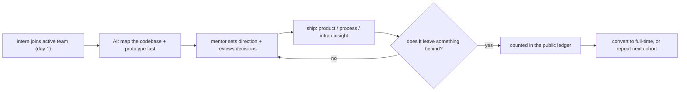
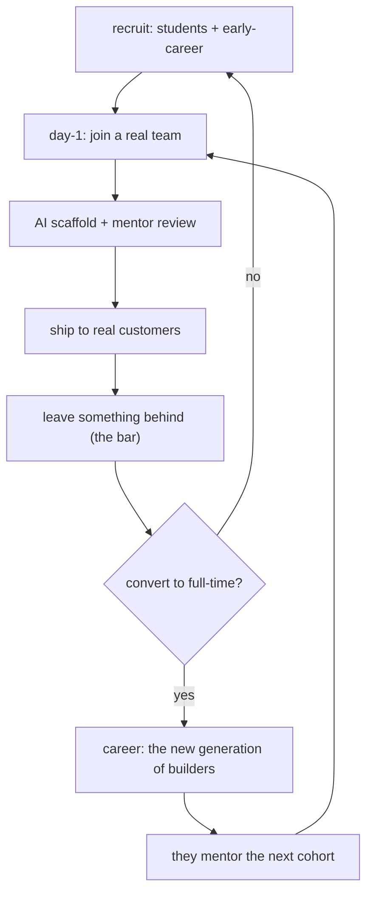

A year ago most companies were **cutting** intern and new-grad hiring. Cloudflare went the other direction: it announced a goal of **1,111 interns in 2026**, a number that is an explicit nod to `1.1.1.1`, its public DNS resolver. The bet was that AI makes early-career engineers *more* valuable and *faster* to impact — not that it replaces them. A year in, the program has produced **750 internships across 48 teams in nine offices**, and the intern work is not a training exercise: it is shipping to customers. This post treats the program as a data point in a bigger question — what does a well-run, AI-augmented early-career program actually produce, and what is the operating model that makes it work?

The one-line thesis: **AI moves the starting line.** It does not remove the energy, curiosity, and fresh eyes a new person brings. And the Cloudflare numbers are what the thesis looks like when it is true.

## The shape of the program

The operating model is worth stating plainly, because it is the whole lesson. Interns **join active teams on day one** — they are not assigned to a sandbox. Each intern is expected to **leave something behind**: a shipped product improvement, a better process, new infrastructure, or an insight that changes how a team works. AI is a tool the interns use to understand unfamiliar codebases, compare requirements to implementations, prototype, and automate repetitive work; **managers and mentors** set direction, review decisions, and enforce the bar. The split is the design: AI accelerates the individual, mentors keep the output honest.

The scale is the part that is hard to replicate. Nine offices — Austin, San Francisco, London, Lisbon, New York, Singapore, Bengaluru, Washington DC, Sydney — 48 teams, 750 internships, all before the 1,111 target is met. The CEO has been hosting dinners with interns in offices around the world to hear what they are building, which is a small detail that says a lot about how seriously the program is taken at the top.

> **Note**: "1.1.1.1" is Cloudflare's public DNS resolver and the name of its consumer-facing DNS service. The intern target of 1,111 is a deliberate nod to that, not a rounding. The program is branded around the company's most-recognized number, which is a cheap, effective way to give it identity.

## What the interns actually shipped

The program's output is a list of real, customer-facing things. Five stand out for what they tell you about the operating model.

**Cache Transcoding.** RAM and disk prices have climbed, so intern Aashi asked whether Cloudflare could get more cache capacity out of the servers it already has. The answer: compress eligible assets **with Zstandard inside the primary proxy before they are written to disk**. Initial testing shrank the assets to **a third of their on-disk size on average** — which points at **petabytes of effective cache capacity** out of existing hardware, with less data moving between data centers.

```go
// Cache Transcoding: compress eligible assets in the primary proxy
// before they are written to the cache disk. This is the intern's
// one-line idea, implemented: zstd at a moderate level on the hot
// path, with a content-type allowlist so only compressible assets
// are touched. The 3x on-disk shrink is the whole win.
func transcode(body []byte, ctype string) []byte {
    if !isCompressibleCType(ctype) {
        return body
    }
    // level 3 is the sweet spot: fast enough to run inline on the
    // proxy hot path, and it gets most of the shrink of level 9.
    return zstd.Compress(body, zstd.Level3)
}
```

**EmDash, the CMS behind the blog.** Noah joined as an intern and became **EmDash's second maintainer**, contributing across the media library, content editor, and admin interface. EmDash **1.0 shipped during Birthday Week** — the same week the interns were in the building. An intern being a named maintainer on the system that runs the company's own blog is the clearest possible signal that "training exercise" is not the model.

**Post-quantum readiness.** Cloudflare is targeting **2029** for post-quantum security, and you cannot migrate what you cannot see. Tiago helped build **CryptoLabe**, an internal AI tool that finds cryptography across the codebase and maps what depends on it; Sophie helped bring **per-connection post-quantum visibility** to Logpush, Log Explorer, and HTTP Traffic Analytics, so customers can check their own migration progress. Interns doing the discovery work that a PQC migration depends on is the kind of thing a normal 12-week program would not get to.

```python
# CryptoLabe (simplified): walk the AST, find crypto usages, map
# what depends on them. The "AI-assisted" part is the classifier that
# decides which usage is a real crypto boundary vs a red herring;
# the traversal itself is a plain AST walk.
import ast

CRYPTO_MODULES = {"cryptography", "hashlib", "hmac", "ssl"}

def find_crypto_usages(tree: ast.AST):
    hits = []
    for node in ast.walk(tree):
        if isinstance(node, (ast.Import, ast.ImportFrom)):
            mods = [a.name for a in node.names if a.name in CRYPTO_MODULES]
            if getattr(node, "module", None) in CRYPTO_MODULES:
                mods.append(node.module)
            if mods:
                hits.append({"line": node.lineno, "modules": mods})
    return hits
```

**The Internet's plumbing.** Iliana measured how often networks rewrite BGP's **ORIGIN** attribute to pull traffic their way and found it on **roughly 70% of observed paths**, then publicly advocated for taking ORIGIN out of route selection entirely. She also tracked adoption of **RFC 9234**, which lets routers reject route leaks on their own. This is "helping build a better Internet" in its purest form: measure a problem no single network owns, publish the data, propose the fix.

**The ISO-compliance pipeline.** An internal audit intern built an **AI-assisted pipeline that automates ISO compliance control testing and documentation** — the kind of unglamorous, high-leverage automation that is exactly the work AI is good at and humans are bad at volunteering for.

The Birthday Week launches were a public scoreboard for all of it: Protected Quick Tunnels, the PQ-migration course-charting, the per-connection PQ visibility, EmDash 1.0, native Rust in Workers via the new Emscripten `wasm-bindgen` target, and BEACON's real-user web measurements — several of them intern-authored or intern-engineered.

## The AI-augmented early-career model

The honest read of the program is that **AI changed what is possible in a 12-week internship**, and the program is a measurement of that change. The intern's own words land the point: "How did previous interns ship anything in 12 weeks without AI?" The model is not "AI replaces the intern"; it is **AI moves the starting line** — the intern maps a new project in days instead of weeks, scaffolds a working prototype fast, and spends the remaining weeks on the hard questions: what should this be, who uses it, how do you know it is correct, what happens when it hits production.

> **Warning**: "AI moves the starting line" is a claim about *speed and scaffolding*, not about *quality or judgment*. The program is only as good as the mentorship and review that sit on top of the AI — the post is explicit that managers and mentors, not the model, set direction and enforce the bar. A team that treats the AI as the reviewer instead of the scaffold inherits the model's confidence without its accountability, which is how the 12-week "impressive demo" becomes the 6-month production incident. The numbers above are a real case for the model; the warning is that the model does not carry the review.

The operating model that makes it work is a set of choices you can copy:

| Operating-model choice | What it does | What it costs to remove |
|---|---|---|
| Day-one real work | the intern joins the team that owns the thing | the sandbox becomes a sandbox, not a career |
| Defined output bar | "leave something behind," checked not assumed | the program stops being measurable |
| Load-bearing mentorship | AI accelerates, mentors set direction and review | the output stops being honest |
| Public ledger | internships, teams, shipped items, conversions counted | the case becomes a feel, not a data point |
| Retention path | many interns convert to full-time | it is a summer, not a pipeline |

- **Day-one real work.** No sandbox. The intern joins the team that owns the thing and works on it.
- **A defined output bar.** "Leave something behind" is the acceptance criterion, and it is checked, not assumed.
- **Mentorship is load-bearing.** AI does not set direction or review decisions; managers and mentors do.
- **A measurable ledger.** Shipped items are counted and published, which is what turns the program from a feel-good story into a data point.
- **A retention path.** Many of this year's interns are converting to full-time roles; the goal is a career, not a good summer.

```
# The compliance-pipeline idea, as a 15-line cron: collect evidence,
# let the LLM classify against the control set, flag the gaps for
# human review. This is the intern's ISO automation in its smallest
# honest form — one script, one model call, one human gate.
$ cat /usr/local/bin/iso-quarterly.sh
#!/usr/bin/env bash
set -euo pipefail
EVIDENCE_DIR=/var/spool/iso/evidence
CONTROL_SET=/etc/iso/controls.yaml
mkdir -p "$EVIDENCE_DIR"
# 1. collect this quarter's evidence artifacts (CI logs, config dumps)
find /var/log/ci -name '*.jsonl' -mtime -90 -exec cp {} "$EVIDENCE_DIR" \;
# 2. the LLM does the classification work (the part humans hate)
classify_evidence --controls "$CONTROL_SET" --dir "$EVIDENCE_DIR"     --out "$EVIDENCE_DIR/classified.json"
# 3. humans gate the result; nothing is "compliant" until reviewed
diff -u /dev/null "$EVIDENCE_DIR/gaps.md" && echo "no new gaps" || echo "gaps found, routed to audit queue"
```



## Why the numbers matter

The 1,111 goal is a number, but the *real* number is the **conversion**: 750 internships, 48 teams, and a meaningful fraction converting to full-time. That is a talent pipeline a company can *own* at a time when most of its peers are cutting the same pipeline. And the PQC + BGP + cache items are not intern projects in the "we made them a toy" sense; they are the actual next steps on the company's roadmap. The program is, in effect, a **low-risk R&D budget** that also happens to be a hiring funnel.

The flywheel the program runs, end to end:



## Takeaways

- **AI moves the starting line, not the finish line.** The Cloudflare program is a measurement of how much faster an early-career engineer ships when AI handles the scaffolding and the humans handle the judgment.
- **Day-one real work + a defined output bar + load-bearing mentorship** is the operating model. Remove any one and it becomes a normal internship.
- **Make it a ledger, not a story.** 750/1,111, 48 teams, named shipped items — the numbers are the argument.
- **It is a talent pipeline disguised as a product program.** The PQC, BGP, and cache work is the company's actual roadmap, staffed by people the company can keep.

## Next steps

- If you run an early-career program, define the output bar in one sentence ("leave something behind") and make it checkable.
- Put AI on the *scaffolding* work (mapping, prototyping, automating) and keep humans on *direction* and *review*.
- Count and publish: internships, teams, shipped items, conversions. The ledger is the whole case.
- Read the Birthday Week posts on the Cloudflare blog to see the intern work as customers actually experience it.
