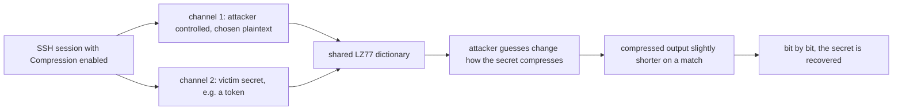

# OpenSSH 10.6 deliberately breaks two features in the name of security

OpenSSH 10.6, released October 7, 2026, does something maintainers rarely do: **breaks two working features on purpose**, and says so up front. The first change disables the LZ77 dictionary coder inside the `Compression` option, because sharing that compression state across the multiple channels of one SSH session lets an attacker recover plaintext. The second rejects `$` and `\` in **command-line** usernames, because those characters can become shell syntax the moment the username is spliced into a directive like `ProxyCommand` or `Match exec`.

Both changes are deliberate, both are known to cost compatibility, and both are exactly the kind of security-ergonomics tradeoff that a polyglot systems team needs to understand before it upgrades a fleet. The post also covers the release's quieter changes — the post-quantum signature algorithm graduating out of its experimental suffix and `scp -R` beginning its deprecation — and ends with what this means if your automation talks to SSH through Go's `x/crypto/ssh`.

## Why break working features at all?

The framing is in the release notes themselves: OpenSSH is seeing a surge of security research driven by AI models that are getting *better* at finding exploitable flaws, and the project's own researchers are no longer the only ones looking. As the project put it, adversaries who don't report what they find "are likely to be able to discover these bugs too." The practical conclusion is a shift from "fix on the normal release cadence" to **release fixes more often**, and a willingness to land a fix that is *less capable* than the feature it protects — because the alternative is an unpatched, discoverable hole.

That philosophy is what makes this release worth a post: it is a concrete example of a standards body choosing **correctness over capability**, with the tradeoff made explicit and documented rather than discovered in the field.

## Break #1: compression context leaks plaintext

### The mechanism

An SSH connection is a single encrypted channel that can **mux** several independent logical streams at once — an interactive shell, a port forward, a dynamic SOCKS proxy — each an independent "channel" in the protocol. When `Compression` is enabled, all of those channels share **one compression state**.

The state in question is the LZ77 **dictionary**. LZ77's core trick is memory: instead of re-encoding a byte sequence the compressor has already seen, it emits a *back-reference* — "the next N bytes are the same as the sequence ending at position P." The dictionary is the memory of "what have I already seen."

The problem is that a dictionary shared across channels is a **side channel**. If an attacker can feed chosen plaintext into one channel and observe how the *encrypted* output of another channel changes, the shared dictionary lets the attacker's guesses alter how the victim's secret is compressed. When a guess happens to match part of the secret, the compressed output for that region gets slightly *shorter* (a back-reference is emitted instead of a literal). That tiny length change leaks a bit of information. Repeat, and the secret is recovered byte by byte.

This is the same family of attack as **CRIME** (2012) and **BREACH** (2013) against HTTP over TLS, both of which exploited a shared compression dictionary to extract secrets (session cookies, specifically) from encrypted traffic. The new work is the same idea, transposed onto SSH's multiplexed channels.

The paper is "Crossing the Streams: SSH Plaintext Recovery via a Common Compression Context in Multiplexed Channels," by Fabian Bäumer and Marcus Brinkmann of Ruhr University Bochum. Their proof-of-concept numbers:

- **Lowest-noise setup**: recovered an 8-character secret over a 26-character alphabet in a **median of 276 guesses** across 100 trials.
- **Browser-based (noisier) scenario**: the same recovery jumped to roughly **27,600 guesses**.

Not a 100%-of-the-time, one-shot break — a *statistical* one. The attacker needs a multiplexed session where they control one channel's input and can observe the ciphertext. That is a narrower setup than a casual attacker gets, which is why the maintainers shipped the fix without a full rework of the compression pipeline.

> **Note**: the attack only works when `Compression` is **on**. OpenSSH leaves it **off by default**, so the exposure was always limited to the minority of sessions that explicitly enabled it. The fix removes the shared dictionary so that even a session with compression enabled no longer leaks across channels.

### The fix: Huffman stays, LZ77 goes

Deflate (the compressor) is two stages: LZ77 finds repeated chunks, then **Huffman coding** represents frequently-seen values with fewer bits. OpenSSH 10.6 **keeps Huffman** and **removes the LZ77 back-reference stage** — in both `ssh` and `sshd`. Compression still *works*; it just compresses less, because the biggest source of redundancy (repeated byte sequences) is no longer captured.

The release notes' recommendation is direct: **do your compression at the application layer** (e.g., gzip the payload yourself, or use a protocol that compresses per-stream), where it "will usually perform better without being vulnerable to this attack." Per-stream compression has no shared dictionary, so there is no cross-stream side channel.



## Break #2: shell metacharacters in usernames

### The mechanism

The second break targets **usernames passed on the command line**. Consider an internal tool, CI job, or agent that does:

```sh
ssh "$INPUT_USER@host"
```

That username does not live only in the connection; it is also the value that gets substituted into certain **configuration directives** — most importantly `ProxyCommand` and `Match exec` — and those directives are **passed to a shell**. Once a username containing `$` or `\` ends up inside a shell command string, it stops being "just part of a name" and starts being **shell syntax**:

- `$` starts a variable expansion → `$(...)` is *command substitution* → arbitrary command execution.
- `\` is a line-continuation / escape character → it can break the quoting the command was built around.

This is the classic **unquoted-`$`-variable-in-a-`ssh`-command** injection, and it has a long history: the well-known "ssh agent hijack via `$(...)` in `ProxyCommand`" class of bugs is exactly this. OpenSSH 10.3 had already fixed a related bug where command-line usernames were checked for shell metacharacters *too late* — after they could already be expanded through `ssh_config`. 10.6 moves the check **earlier**: `$` and `\` are simply **rejected** in usernames that arrive on the command line.

The important scoping: the restriction applies **only to command-line usernames**. A username set via the `User` directive in an `ssh_config` file is **not** subject to it, so legitimate accounts that actually contain `$` or `\` can still work — they just have to be configured, not passed on the command line.

```mermaid
graph TD
    A["ssh \"$INPUT_USER@host\" on the command line"] --> B["username substituted into ProxyCommand / Match exec"]
    B --> C["directives are passed to a shell"]
    C --> D["username contains $ or backslash"]
    D --> E["$ becomes variable/command expansion, backslash breaks quoting"]
    E --> F["arbitrary command execution at connection time"]
```

> **Warning**: if your automation, agent, or CI splices a *user-supplied* username into a command line and then relies on `ProxyCommand`, `Match exec`, or any directive that the client hands to a shell, OpenSSH 10.6 will **reject** that username outright (for `$` and `\`) where it previously *silently interpreted* it. Scripts that used to "work" by luck can now fail fast — which is the point, but it will surface as new connection errors the day you upgrade.

### The Go angle: what `x/crypto/ssh` does (and doesn't) do

This is where the polyglot reader's question lands. If your Go code connects over SSH via `golang.org/x/crypto/ssh`, what does 10.6 change for you?

The short answer: **`x/crypto/ssh` is a client library, not the `ssh` binary**, so it does not itself parse an `ssh_config` file or invoke a shell for `ProxyCommand`. It has no `ProxyCommand` and no `Match exec`. Its compression support is the part that is directly relevant.

`x/crypto/ssh` implements the `ssh` *client protocol*, and it negotiates compression with the server during the transport setup — the relevant knob is the `ssh.ClientConfig` field for the compression mode. The Go client has historically offered `ssh.CompressionNone` (the default) and `ssh.CompressionDefault` (the zlib/deflate `zlib@openssh.com` method). The 10.6 server-side change means a 10.6 `sshd` will now negotiate **Huffman-only** deflate when you ask for compression. A Go client that simply requests `ssh.CompressionDefault` and does not care about the exact dictionary behavior is **unaffected** — it still gets a working, just less effective, compressed stream.

The practical implication for Go users is therefore **not** "your client is broken," but **two things**:

1. **Compression is less effective.** If a Go pipeline pushes large compressible blobs over `x/crypto/ssh` and relied on the `zlib@openssh.com` method to shrink the wire size, expect *more* bytes on the wire after the peer moves to 10.6. Measure it; if it matters, move compression to your application layer (gzip the payload) and keep the SSH channel uncompressed.

2. **Usernames are now validated server-side at the protocol level, too.** `x/crypto/ssh` sends the username as a plain protocol string (no shell involved), so a username containing `$` or `\` is *fine* when it is used the way a library uses it — as data, not as a command. The break is a **`ssh`-binary / `ssh_config`** concern. If your Go code *also* shells out to `ssh` (e.g., via `os/exec` for a feature the library lacks), *that* is the path 10.6's username rule applies to, and it is the path where the "silently worked" behavior can now "fail fast."

```go
// ssh_client.go — x/crypto/ssh as a Go client.
//
// The 10.6 changes are server-side / ssh-binary concerns. The Go
// library is a protocol client: it does not parse ssh_config and
// does not invoke a shell for ProxyCommand, so it is not the
// component that "breaks." What it *does* see is the compression
// behavior change, which is a wire-size concern, not a correctness
// one.
package main

import (
	"fmt"
	"net"

	gossh "golang.org/x/crypto/ssh"
)

func main() {
	cfg := &gossh.ClientConfig{
		// The username is *data* here — a protocol string. It is not
		// substituted into any shell command, so $ and \ are harmless
		// in this path (unlike the ssh binary's ProxyCommand path).
		User: "alice$(weird-name)",
		Auth: []gossh.AuthMethod{
			gossh.PublicKeys(/* ...key ... */),
		},
		// Compression: the 10.6 server will now negotiate a
		// Huffman-only deflate when you ask for the default method.
		// Leave it None for maximum wire efficiency on a 10.6 peer;
		// the application layer is where you should compress.
		HostKeyCallback: gossh.InsecureIgnoreHostKey(),
	}

	addr := "127.0.0.1:22"
	conn, err := net.Dial("tcp", addr)
	if err != nil {
		fmt.Println("dial:", err)
		return
	}
	client, _, _, err := gossh.NewClientConn(conn, addr, cfg)
	if err != nil {
		fmt.Println("handshake:", err)
		return
	}
	fmt.Println("connected as", client.RemoteAddr())
	// A 10.6 peer that had CompressionDefault negotiated will now
	// compress less; large blobs cost more wire bytes. If that
	// matters, gzip the payload in your app and set CompressionNone.
}
```

The rule of thumb: **if your Go code is the `ssh` client, 10.6 mostly changes wire size, not correctness. If your Go code *shells out to the `ssh` binary** (for `ProxyCommand`-dependent features), *that* is where the username and directive-injection rules apply, and it is where you should re-audit how you build command lines after the upgrade.**

## The quieter changes worth knowing

- **Post-quantum signatures graduate.** The hybrid post-quantum signature algorithm `ssh-mldsa44-ed25519` loses its experimental `@openssh.com` suffix. Consequence: keys generated under the *older* experimental implementation are no longer the same thing and **must be regenerated or removed**. If you rolled experimental ML-DSA keys into a fleet, plan a key rotation.
- **`scp -R` begins its deprecation.** Remote-to-remote copies via `scp -R` still work in 10.6 but now emit a **warning** and will eventually be **ignored**. If any pipeline relies on `scp -R` for remote copies, migrate to `sftp`-based copy (or the `rsync`-over-ssh pattern) now, before the warning becomes a no-op.

## Before vs. after

| | Before 10.6 | After 10.6 |
|---|---|---|
| Deflate compression | shared LZ77 dictionary across channels | Huffman only, no shared dictionary |
| Cross-channel plaintext leak | possible (CRIME/BREACH family) | closed |
| Compression effectiveness | full deflate | reduced (no back-references) |
| Command-line usernames with `$`/`\` | accepted, then interpreted by shell in directives | rejected outright |
| `ssh_config` `User` with `$`/`\` | accepted | still accepted (not command-line) |
| `ssh-mldsa44-ed25519` | experimental `@openssh.com` suffix | graduated; old keys must rotate |
| `scp -R` | works silently | works with warning; will be ignored later |

## Takeaways

- **OpenSSH 10.6 is a "break things on purpose" release**, driven by the observation that AI-assisted security research is finding more bugs and the project would rather ship a less-capable, safer feature than an unpatched hole.
- **The compression break is a CRIME/BREACH-family side channel**: a compression dictionary *shared across the channels of one multiplexed SSH session* lets an attacker's chosen plaintext on one channel leak the secret on another. The fix keeps Huffman, drops the shared LZ77 dictionary.
- **The username break is a shell-injection defense**: `$` and `\` in a *command-line* username are rejected, because they can become shell syntax inside `ProxyCommand` / `Match exec`. `ssh_config` `User` directives are exempt.
- **For Go's `x/crypto/ssh`**: the library is a protocol client, not the `ssh` binary — so it is **not** the component that breaks. What it *does* see is **reduced compression effectiveness** on a 10.6 peer. If your Go code *shells out to `ssh` for `ProxyCommand`-dependent features*, *that* is the path the username rule applies to — re-audit how you build those command lines.
- **Plan the two ops tasks now**: rotate experimental ML-DSA keys (the suffix change) and migrate `scp -R` callers (the deprecation).

## Next steps

- **Audit compression**: if a Go pipeline pushes large compressible payloads over `x/crypto/ssh`, benchmark wire size before/after the peer moves to 10.6; move compression to the application layer (gzip the payload) if it matters.
- **Audit command-line building**: grep your automation for `ssh "$...@host"` and any `ProxyCommand`/`Match exec` strings you construct, and confirm no untrusted value can inject `$` or `\` — 10.6 now *rejects* those at the command line, which is a good signal to stop relying on the binary to tolerate them.
- **Plan key rotation**: for the graduated `ssh-mldsa44-ed25519` signature, inventory any keys minted under the experimental `@openssh.com` suffix and schedule regeneration.
- **Migrate `scp -R`**: find remote-to-remote `scp -R` callers and replace them with `sftp`/`rsync`-over-ssh before the warning becomes a no-op.
