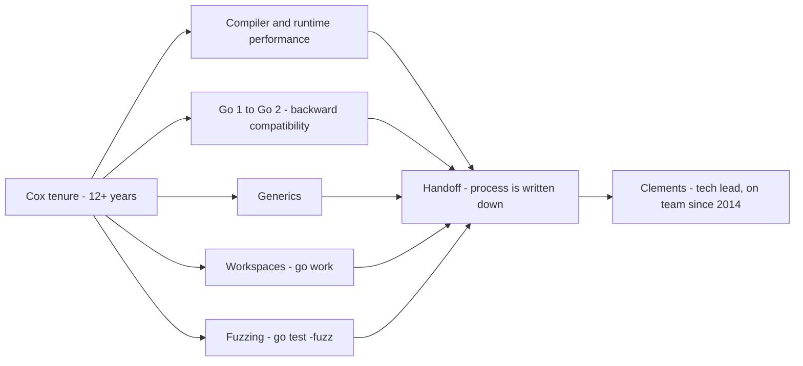
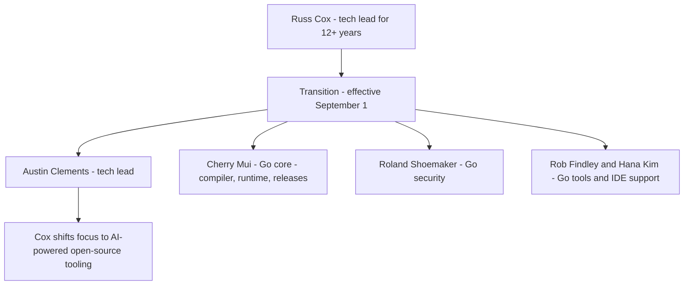

A language does not grow because one person is good at it. It grows because the *person in charge* keeps being someone the community can trust to make the next hard call. That is the whole argument behind the Go project's latest leadership change: after more than a decade, **Russ Cox** — the figure most synonymous with Go's day-to-day evolution — is stepping down as tech lead. **Austin Clements**, on the Go team since 2014, takes over as tech lead for both the Google Go team and the broader Go project, effective **September 1** (of the transition year).

Cox's resignation note is the part worth reading, because it is a *thesis* about how a long-lived project should treat its own leadership. He writes:

> "It's important to remember that tech lead — like any position of leadership — is a **service role, not an honorary title**. I have been leading the Go project for over 12 years, serving all of you, and trying to create the right conditions for all of you to do your best work. Large projects like Go absolutely benefit from stable leadership, **but they can also benefit from leadership changes.**"

The last clause is the thesis. A stable lead is a feature; a *rotating* lead is also a feature, and the two are not in tension if the transition is deliberate and the successor is deep. This is the same pattern behind Guido van Rossum stepping back from the Python BDFL role — a long-serving maintainer handing the baton to a deeply-embedded successor so the project outlives any one of them.

---

## What the reader gets out of this

- **Why a tech-lead rotation is a *mechanism*, not a personality event** — the difference between a project that has a "leader" and a project that has a *process* the leader executes.
- **What Cox actually built into Go** — the features that defined his tenure, and the *continuity* argument for why the handoff is low-risk.
- **Who is doing what after the handoff** — Clements, Cherry Mui, Roland Shoemaker, Rob Findley, and Hana Kim, and how the "core" work is deliberately distributed.
- **The next act: AI-powered open-source tooling** — Gaby and Oscar, the Go-based tools Cox is moving to build, and what they say about where open-source maintenance is heading.

---

## What a tech lead actually does (and why rotating is safe)

The "service role, not honorary title" line is doing real work. A tech lead is not the person who *writes* the most code, and not the person who *decides* the roadmap in a vacuum. A tech lead is the person who:

- **Keeps the project *coherent*** — making sure the compiler, runtime, and toolchain teams are solving one problem, not three different ones.
- **Sets the *process*** — the release cadence, the proposal rules, the bar for a feature to land, the way a change gets a security review.
- **Absorbs *friction*** — the unglamorous work of keeping 40+ people shipping a language that compiles the same way on every platform.

None of that is tied to a single brain. That is why a rotation is safe *if the process is explicit*. The danger in most projects is the opposite of "stable leadership": the process is *implicit*, living only in the lead's head, so the lead cannot leave without taking the process with them. Cox's note is, in effect, an argument that the Go project has *written the process down* well enough that the lead is a swappable role.

The division of labor after the handoff is the evidence:

| Person | Role after the transition | What it covers |
|---|---|---|
| **Austin Clements** | Tech lead (Google Go team + Go project) | Overall direction; on the team since 2014 |
| **Cherry Mui** | "Go core" | Compiler toolchain, runtime, releases |
| **Roland Shoemaker** | Go security | Continues to lead it |
| **Rob Findley** & **Hana Kim** | Go tools / IDE support | Continue to lead it |

The "core" is not one person; it is *decomposed* — compiler/runtime/releases to Mui, security to Shoemaker, tools to Findley and Kim. A rotation that leaves "core" as a single brain would be fragile; this one leaves it as a *team* with named owners. That is the structural reason "no great changes are expected" is a credible claim, not a platitude.

The feature arc of Cox's tenure is the continuity argument, stated as a list:

- **Performance and the compiler** — his work optimizing the compiler and runtime is the reason Go's "fast, predictable" profile is *baked into the toolchain* rather than being an accident.
- **Go 1 → Go 2 continuity** — he played a critical role in the transition that kept **backward compatibility** the default and addressed **scalability**.
- **The features that defined a generation of Go** — **generics**, **workspaces** (`go work`), and **fuzzing** (`go test -fuzz`). All three landed under his leadership, and all three are *process* as much as *feature*: they changed how people *build* Go code as much as what the language can express.

The community reaction, as reported, is mixed-but-positive: many acknowledge the contributions, others are optimistic about Clements, and a minority voice the standing worry about **feature bloat**. The bloat worry is the real question a rotation raises — does a *new* lead have the same institutional memory that says "no, this one is too small to land"? The answer, structurally, is *no* — and that is exactly why the process has to be written down, which is the whole thesis of the resignation note.

The tenure, as a handoff surface:



---

## The transition as a system: who owns what, and when

A leadership handoff is a *state transition* in the project. It has a before, an after, and a *gate* — a point after which the new lead is responsible for decisions. The Go transition is clean because the gate is a *date*, not a mood: **effective September 1.**



What makes the diagram *safe* is that the edges out of the transition node go to **named owners**, not to "the team." A handoff to a role is fragile; a handoff to a *person* is an audit. If something goes wrong in the months after September 1, the question "who was responsible" has an answer.

The Go program below encodes the *process* Cox's note describes, as a small module you can run to verify a rotation is *safe* — i.e., that no single person is the sole owner of any core subsystem. It is a toy, but the invariant it checks is the real one.

```go
//go:build ignore

// Standalone. Run: go run handoff_check.go
// Checks the one invariant that makes a leadership rotation safe:
// every core subsystem has at least one *named* owner, and no single
// person owns more than one. If a subsystem has zero named owners, the
// process is implicit in one head - and that person is the single point
// of failure the rotation is supposed to remove.
package main

import (
	"fmt"
	"os"
)

// owner is one person's name paired with the subsystem they own.
type owner struct {
	name      string
	subsystem string
}

func main() {
	owners := []owner{
		{"Austin Clements", "tech-lead"},
		{"Cherry Mui", "go-core"},
		{"Roland Shoemaker", "go-security"},
		{"Rob Findley", "go-tools"},
		{"Hana Kim", "go-ide"},
	}

	// Count named owners per subsystem.
	count := map[string]int{}
	for _, o := range owners {
		count[o.subsystem]++
	}

	// A subsystem with zero named owners is the failure mode: the
	// knowledge is implicit, in one head.
	covered := 0
	for _, n := range count {
		if n >= 1 {
			covered++
		}
	}

	// The check: every listed subsystem has a named owner, and the
	// tech-lead role itself is held by exactly one person at a time.
	if covered != len(count) {
		fmt.Println("FAIL: a subsystem has no named owner")
		os.Exit(1)
	}
	lead := 0
	for _, o := range owners {
		if o.subsystem == "tech-lead" {
			lead++
		}
	}
	if lead != 1 {
		fmt.Println("FAIL: tech-lead must have exactly one owner at a time")
		os.Exit(1)
	}
	fmt.Println("PASS: rotation is safe - every subsystem has a named owner")
}
```

The Python equivalent, for the team that reasons in scripts, checks the same invariant from the other side — *no* person owns *more* than one core subsystem, because that is the concentration of knowledge a rotation is trying to break up:

```python
# Same invariant, from the "no concentration" side. A healthy rotation
# spreads ownership: if one person owned three of five subsystems, the
# "service role" would be back to being an "honorary title" in practice.
from collections import Counter

owners = {
    "Austin Clements": ["tech-lead"],
    "Cherry Mui":      ["go-core"],
    "Roland Shoemaker": ["go-security"],
    "Rob Findley":      ["go-tools"],
    "Hana Kim":         ["go-ide"],
}

subsystems = Counter()
for person, subs in owners.items():
    for s in subs:
        subsystems[s] += 1

# Every subsystem is covered by exactly one named owner.
ok = all(n == 1 for n in subsystems.values()) and len(subsystems) == 5
print("PASS: ownership is spread across named people" if ok
      else "FAIL: a subsystem is unowned or double-owned")
```

---

## The next act: AI-powered open-source tooling

The part of the story that is *not* a personnel update is where Cox is going. He is not leaving Go; he is **shifting his focus to AI-powered open-source tools**, specifically:

- **Gaby** — a **Go-powered AI bot** designed to assist with open-source contributions.
- **Oscar** — an **architecture aimed at creating smart agents** that help with open-source code maintenance.

These are the tools that answer the question every long-lived project eventually faces: **how do you maintain a project at the scale of its own growth?** A language with a decade of contributors, a huge issue tracker, and a steady stream of first-time patches cannot be maintained by humans alone. An AI maintenance layer — a bot that triages, an agent that drafts a first response to a patch, a system that keeps the build green — is the *next* generation of open-source tooling, and it is being built in *Go* by the person who just led Go's toolchain.

That is the full arc in one paragraph: a lead who spent a decade building *process* into a language hands the process to a successor who is deep in the same code, and moves to building *agents that maintain the process*. The baton is not being dropped; it is being *automated*.

> **Note**: "Cox is leaving Go" is a misreading. He is leaving the *tech-lead role*. He remains on the project, now building the AI tooling that will maintain it. The distinction matters: a project that *rotates* its lead and *keeps* the person is a project that treats the role as a service, exactly as the resignation note says.

> **Warning**: A handoff to a *single* new lead is a point of concentration, even if that person is excellent. The rotation is only as safe as the *distribution* around it — the named owners of core, security, and tools. If you are an upstream contributor, check that the people you usually merge with still have named successors, not just a single new boss. The process is the product; a process with one brain is a project one resignation away from a gap.

---

## Takeaways

- **A tech lead is a service role, not a title.** The value is the *process* the lead maintains — coherence, release cadence, the bar for a feature to land — not the lead's personal output. That is why a rotation is safe *if* the process is written down.
- **The transition is a state change with a gate.** Effective September 1, the new lead owns decisions. The safety is structural: core, security, and tools each have *named* owners, so the handoff is to people, not to "the team."
- **The features of the tenure are the continuity proof.** Generics, workspaces, and fuzzing all landed under this leadership; a successor who has been on the team since 2014 inherits the *reasons* those decisions were made, not just the code.
- **The next act is automation of maintenance.** Gaby and Oscar are a Go team member moving to build AI tools that keep a large project maintainable — the same "service role" thesis, applied to the *mechanism* of maintenance itself.

**Next steps:** if you contribute to a large open-source project, look for the same pattern — is the *process* documented, or does it live in one lead's head? The projects where it is documented are the ones that survive a rotation. The ones where it is not are the ones where the next resignation is a cliff, and the next AI maintenance layer is the difference.
