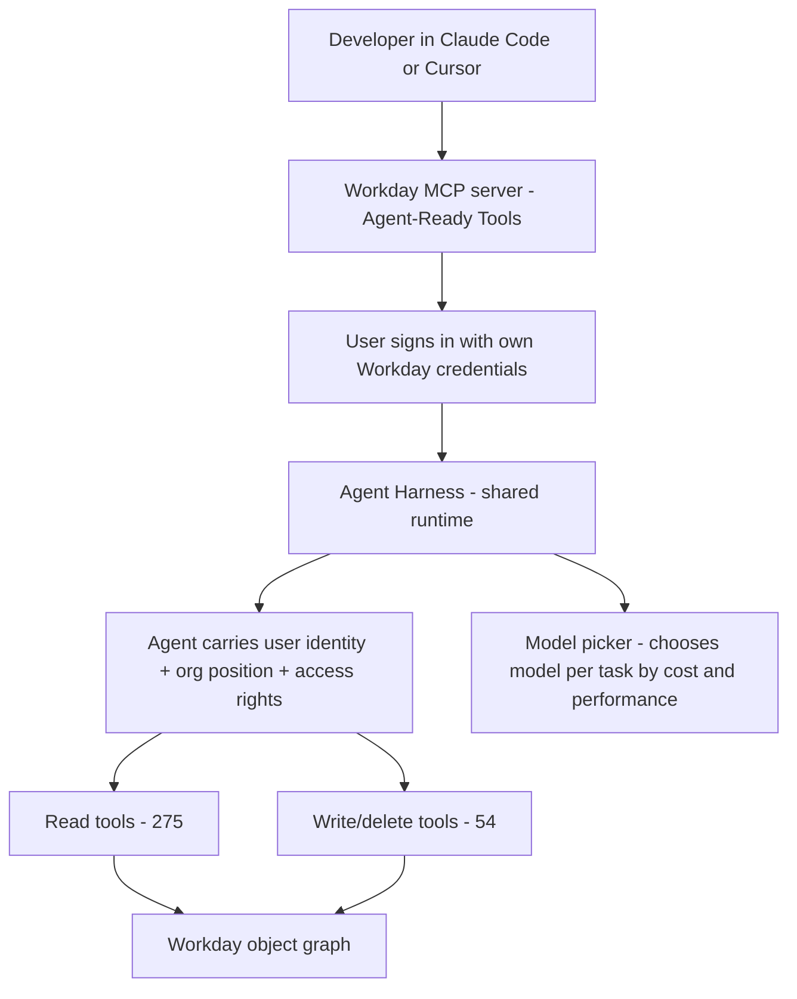
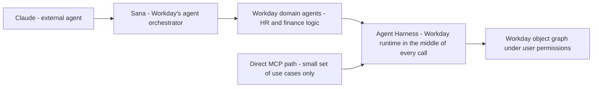

For a decade, the way to get an AI agent at your HR and finance data was to copy the data somewhere the agent could reach — a data lake, a service account, a nightly batch export. Workday's pitch at its **Rising** conference in Las Vegas is that this is the wrong architecture. The agent should talk to Workday *directly*, and inherit **the user's** permissions, approvals, and audit trail.

At Rising, Workday made its **Trusted Agent Platform "headless."** Its **Model Context Protocol (MCP) server**, **SQL access to live Workday data**, and a **shared runtime for agents** are now generally available. Developers can build their own HR and finance agents in **Claude Code, Cursor, and other tools**, running on models from **Anthropic, Google, Meta, Mistral, Nvidia, and OpenAI** — on the condition that those agents follow the same rules as the people using them.

As Workday CTO **Gabe Monroy** put it: **"No matter who builds the agent, it runs under Workday permissions, approvals and audit trail — no agent gets a side door."**

---

## What the reader gets out of this

- **The five GA pieces** — the MCP server (275 read / 54 write tools), Live Data Query (SQL), Agent Harness (the shared runtime), Developer Agent, and Custom Agents — and how they compose.
- **Why "the user's identity" is the security model** — and why the Snowflake demo, which returned the CTO's salary, is the counterexample that motivated the whole design.
- **A practical MCP client** you can run against a Workday-style server, with OAuth scoped to a user, to see exactly what "no side door" means in code.
- **The identity split** — Workday's Agent System Users, Salesforce's agent credentials, and the third path most enterprises actually run today (a service account in a lake).

---

## The five pieces, and what each one is for

The GA set is a small stack. Each piece answers a different question:

| Component | The question it answers | What it does |
|---|---|---|
| **Agent-Ready Tools** (the MCP server) | *How does an agent talk to Workday?* | 275 read tools + 54 write/delete tools; user signs in with their own Workday credentials |
| **Live Data Query** (Workday Data Cloud) | *How does an agent run SQL?* | JDBC-style access to Workday's object graph; each query returns only what the requesting user is cleared to see |
| **Agent Harness** | *Where do agents execute?* | A shared runtime; passes each agent the user's identity, org position, and access rights; picks a model per task by cost/performance |
| **Developer Agent** | *How is an agent built?* | Generates Workday agents and apps from a natural-language prompt in Claude Code, Codex, Cursor, or the Workday Developer Site |
| **Custom Agents** | *Can I deploy my own?* | Deploy agents you built with LangChain or Google's Agent Development Kit (ADK) onto Agent Harness (ADK is design-partner-only for now) |

Two more are on the roadmap for early access in early 2027:

- **Agent Context Service** — preloads *only* the Workday data a task calls for. Workday says this speeds agents up and limits their exposure to sensitive records.
- **Grounded Reasoning** — checks a planned action against the customer's policies, process rules, and Workday records *before* the agent carries it out.

The usage numbers behind the pitch: customers have built **more than 500 agents and more than 6,000 apps** with Developer Agent and Agent-Ready Tools in the past four months.

The call flow, end to end, is the part to internalize:



Notice what is *not* in that diagram: there is no service account in the middle. The identity path is **user → MCP → harness → Workday**, and the user's identity is what rides through it.

---

## The "lawless way" demo: why lakes are the wrong place

Workday's argument is easier to see as a failure than as a feature. In the briefing, Monroy demoed what he called **"headless, the lawless way"** — the status quo, an agent connected to a **custom MCP server** (a setup he said is common among Workday's customers today):

- The agent returned **job requisitions its user had no business seeing.**
- It then **moved the wrong employee between teams, with no approval.**
- Pointed at a **copy of Workday data in Snowflake**, the same agent produced **the CTO's salary** when asked.

> "When it fails, it isn't just a wrong answer," Monroy said. **"It's a wrong action that nobody approved."**

Run the same queries through Workday's own MCP server and Data Cloud, with the user signed in, and the requisitions come back scoped to what that user can see. The demo is doing the obvious work of a permissions system — it just gets to do it because the *identity* is in the request, not in a service account.

The Snowflake case is the one to remember, because it is the architecture most enterprises *already have*:

```python
# The "lawless way" and the "headless" way, as two data paths.
#
# Lawless: an agent reads from a *copy* of Workday in a lake. The copy
# has no Workday permissions on it - only the lake's own (coarser) rules.
# The CTO's salary lives in the same table as everyone else's, and a
# prompt like "what is the CTO's salary?" is answered from that table.
lake_path = (
    "SELECT name, base_salary FROM workday_copy.employees "
    "WHERE name = 'CTO'"
)
# The lake can't say "you are not the CTO, so you cannot read this."
# It never had the permission to begin with - the permission lived in
# Workday, and the copy threw it away.

# Headless: the agent runs SQL *inside* Workday's object graph, through
# Live Data Query. Each query returns only what the requesting user is
# cleared to see, because Workday is the one answering it.
headless_path = (
    "SELECT name, base_salary FROM employees "
    "WHERE name = 'CTO' AND <current user is cleared to see this row>"
)
# The "cleared to see" clause is Workday's security model, applied at
# query time. The CTO's salary is invisible to a requester who is not
# authorized for it - no copy, no drift, no second set of rules.
```

Workday's own framing of the split: **data lakes make sense for analytics and for joining Workday data with the rest of a company's data** — but an external lake is **"the wrong place to build agents"** that need governed access. The reason is in the quote:

> "You can export your data, but **you can't export the rules that govern the data.**" Rebuilding those rules in the lake means "maintaining a second copy" of Workday's security model, "and the day it drifts, it's all wrong."

That is a precise statement of the failure mode: a copy is a *point-in-time* snapshot of a *stateful* security model. The rules change (access reviews, reorganizations, role changes) and the copy does not know.

> **Note**: This is a *vendor's* diagnosis of *their competitors'* data-lake approach. SAP, Microsoft, and others would argue they have access control in place too. The defensible part of the argument is not "lakes are bad" but "a copy of a permissioned system cannot enforce the permission model." That is a true statement, and it is the load-bearing one.

---

## Whose identity does the agent use?

This is the part that actually splits the industry, and it is worth laying out. "Headless" is the goal everyone claims; the *identity model* is where the vendors diverge:

| Vendor / path | Agent identity model | What "no side door" means in practice |
|---|---|---|
| **Workday** (Agent System Users) | Up to **two** ASUs per agent: one acting *on a user's behalf*, one for *ambient* work — each with its own OAuth 2.0 client; plus Integration System Users (ISUs) for traditional integrations | The ambient account is created automatically when a customer enables an ambient skill; the per-user account keeps the user's ACLs in the loop |
| **Salesforce** (Headless 360) | Agents that connect over MCP or its APIs will **register with their own credentials and permissions** instead of acting under a user's identity; MCP clients will eventually need OAuth credentials tied to those agent identities | The agent is its own principal; the user's ACLs are *not* inherited |
| **Service account in a lake** (the status quo) | A long-lived **Integration System User** (ISU) or service account with a *role* that grants read on the shared tables | The agent sees *whatever the ISU's security groups allow*, no matter who is prompting it — the "lawless" path |

The tension in Workday's own story is in its president of product's caveat. **Gerrit Kazmaier** said that building agents directly on Workday's tools and APIs is **"only possible for a small set of use cases where you don't need to have HR or finance domain logic."** For everything else, he pointed to an **AI-to-AI integration**: *Claude hands requests to Sana, Workday's agent orchestrator, which then calls Workday's own domain agents.*

That is the real end-state of "headless Workday" for most customers, and it is a meaningful design bet:



The direct MCP path is the *clean* one, and it is the one the security model is built for. The Sana path is the *practical* one, and it keeps **Workday's runtime in the middle of every call** — which is, functionally, a way of keeping the permission model *on Workday's side of the line* even when the agent is not. The "no side door" claim is true on both paths, but only because the second path routes *through* the door, not around it.

The third row of the table is the path most enterprises are running today, and the one a Workday (or Salesforce) MCP server is most directly competing with: **a service account with a role.** An agent working through an ISU sees *whatever those security groups allow* — not what the *user* who typed the prompt is allowed to see. That is the "CTO's salary" bug, and it is the bug the whole headless architecture exists to close.

---

## A minimal MCP client, so the "user's permissions" claim is concrete

The "no side door" claim is only as good as the OAuth scope behind it. A Workday MCP client is just a standard MCP client; the security lives in *which token the agent presents*. Here is the minimum:

```python
# A minimal Workday-style MCP client. The whole security model is in
# the two lines marked (1): the agent signs in as *the user*, and every
# tool call is authorized against *that user's* ACLs. There is no
# service account to drift.
import json
import urllib.request

# (1) The token is the USER's OAuth token, obtained via Workday's
#     OAuth 2.0 flow (or the user's Agent System User acting on their
#     behalf). NOT a long-lived ISU/service-account token.
user_token = "OBTAINED_VIA_WORKDAY_OAUTH_FLOW"   # a placeholder, not a literal secret
server = "https://mcp.workday.example/mcp"

# (1) The Authorization header is what makes the agent a *person* with
#     a Workday ACL, not a machine with a role.
def call(tool: str, args: dict) -> dict:
    body = json.dumps({
        "method": "tools/call",
        "params": {"name": tool, "arguments": args},
    }).encode()
    req = urllib.request.Request(
        server,
        data=body,
        headers={
            "Content-Type": "application/json",
            "Authorization": f"Bearer {user_token}",  # (1) the user's token
        },
    )
    with urllib.request.urlopen(req) as resp:
        return json.load(resp)

# A read tool: list the job requisitions the *requesting user* can see.
# The server filters the result set against the user's ACLs before it
# responds; the client never sees rows the user is not cleared for.
requisitions = call("list_job_requisitions", {"region": "US"})

# A write tool: move an employee between teams. This one is gated by
# Workday's *approval* workflow on the server side - the agent can
# propose the move, but it is the approver's action that commits it.
move = call("move_employee", {"employee_id": "E-0451", "team": "Platform"})
```

The two lines that matter are the OAuth token (the agent is a *person*) and the fact that **write tools route through Workday's approval workflow** on the server. The agent can *request* the move; it is not the move. That is the "no agent gets a side door" claim, implemented as a token and a workflow gate.

> **Warning**: "The user's permissions" is only as good as the OAuth flow that produced the token. If the client is exchanging a user's Workday session for a long-lived token and caching it, you have rebuilt the service-account problem with a longer expiry. The model works when the token's *lifetime* is short and the *principal* is the user, not a cached credential that outlives the session.

---

## Takeaways

- **Headless means "the identity is in the request."** The MCP server, the SQL path, and the shared runtime all reduce to one invariant: the agent acts as the user, so it can reach no further than the user can. Every "side door" failure (the CTO's salary, the wrong employee moved) is a case where that invariant was broken by a copy or a service account.
- **The lake is for analytics, not for agents.** You can export the data; you cannot export the rules. A copy of a permissioned system drifts, and the day it drifts, it is all wrong.
- **Identity is where the vendors actually split.** Workday gives agents *user-scoped* accounts (plus ambient ASUs); Salesforce is moving agents to *their own* credentials; the status quo is a *service account*. Pick deliberately — this decision is the security model, not an implementation detail.
- **The practical path is usually Sana, not raw MCP.** For anything with HR or finance domain logic, the agent goes through Workday's orchestrator, which keeps the permission model on Workday's side of the line. The "small set of use cases" caveat is real; read it before you architect around the direct path.

**Next steps:** if you are on Workday (or Salesforce), inventory how your agents reach HR and finance data *today* — if it is a service account or a lake copy, you are on the "lawless" path. If you build agents on an MCP server, check two things: that the token is the *user's* (not a cached ISU), and that *write* tools route through an approval workflow the agent cannot bypass.
