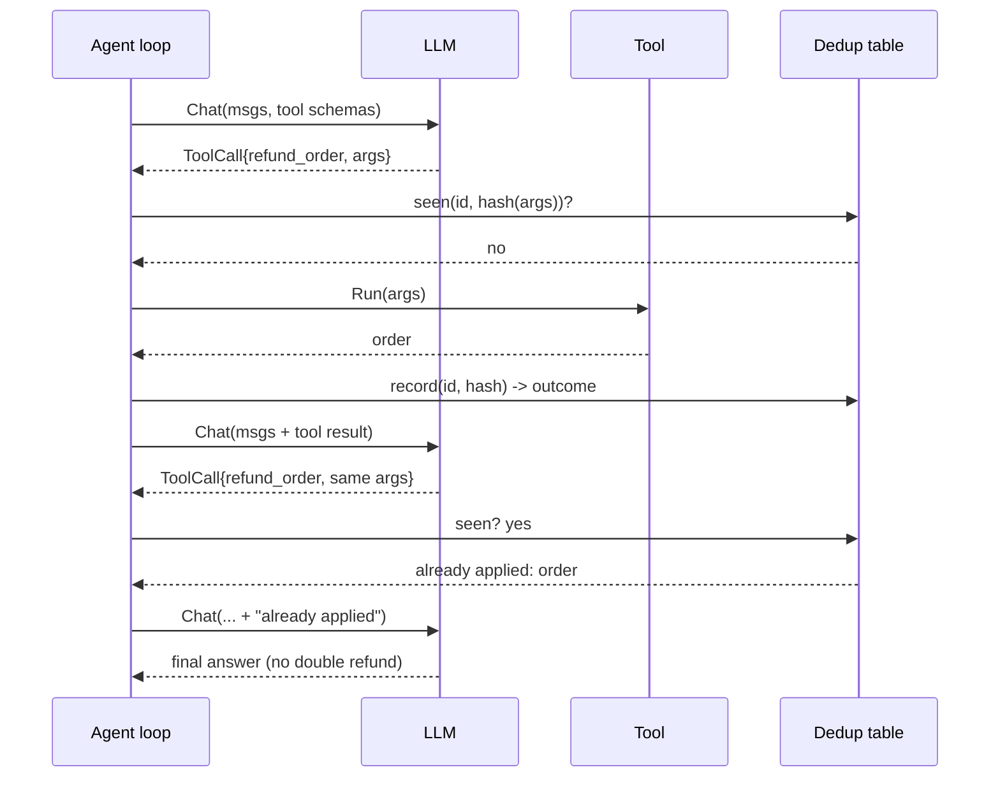

---

date: 2026-10-15T09:00:00
draft: true
title: "Building AI Agents That Actually Work in Production"
summary: Building AI Agents That Actually Work in Production
categories:
  - Artificial Intelligence
---Every "AI agent" demo I have seen works in exactly one mode: the ten-call happy path. Ask it to look up an order, it looks it up. Ask it to send an email, it sends it. Now put a thousand real users on it and the system stops being an agent and becomes a **non-deterministic state machine with a polite API** — it double-sends, half-executes, and 500s on a flaky tool call. The production gap is not about the model. It is about three properties the demo never exercised: **bounded context**, **idempotent actions**, and **degradation instead of death**. This post is about keeping an LLM-driven system *boring* — in the good sense — and the ~300 lines of code that make it so. After reading it you can take a single-purpose agent (triage, lookup, drafting) from demo to a service that survives a bad day.

---

## The three properties that decide production

**1. Bounded context.** A 200k-token window is not a feature. It is the place where a retriever silently returns forty near-misses and the model invents the forty-first. The fix is structural, not prompt-based: a retriever with a **hard top-k = 5** and a **relevance threshold** (cosine ≥ 0.72), with the rule that *no result beats no answer*. If the best chunk scores 0.61, the agent says so. The model is only as good as the worst fact you force it to read.

**2. Idempotent actions.** Every side effect — write, send, charge — must be safe to replay. The mental model splits the agent into two roles: an *intent* (what the model wants to do, a data structure) and a *confirmation* (what the deterministic world actually did). The model emits intents; a separate **executor** applies them against a dedup table keyed by `(intent_id, action_hash)`. If the LLM calls the same tool twice — it does, constantly — the second call is a no-op, not a double charge.

**3. Degrade, don't die.** A failed tool call is a *signal*, not an exception. The correct next model step is "tool X is unavailable, here is what I can still do" — not a 500 and not a hallucinated success. The single most reliable way to make an agent look dumb is to let it 500 on the first tool failure.

---

## The minimal agent loop

```go
package agent

import (
	"context"
	"crypto/sha256"
	"encoding/hex"
	"fmt"
)

// Tool is a function the LLM can invoke. A "tool" is not a framework
// object; it is a named function with a JSON-schema description.
type Tool struct {
	Name        string
	Description string
	Args        string // JSON Schema for the arguments
	Run         func(args []byte) ([]byte, error)
}

// dedup is the idempotency table: (intent_id, action_hash) -> outcome.
// In production this is a SQLite/Redis table; a map is enough to prove
// the design and it survives the unit tests.
type dedup struct {
	seen map[string]string
}

func (d *dedup) record(id string, h [sha256.Size]byte) (string, bool) {
	key := id + ":" + hex.EncodeToString(h[:])
	if prev, ok := d.seen[key]; ok {
		return prev, true // duplicate: the world already did this
	}
	return "", false
}

// run executes one tool call: dedup first, then the tool, then record.
func (d *dedup) run(id string, t Tool, args []byte) (string, error) {
	sum := sha256.Sum256(append([]byte(t.Name), args...))
	if prev, dup := d.record(id, sum); dup {
		return "already applied: " + prev, nil // replay = no-op
	}
	out, err := t.Run(args)
	if err != nil {
		return "", err
	}
	str := string(out)
	d.seen[id+":"+hex.EncodeToString(sum[:])] = str
	return str, nil
}
```

The loop itself. Note what is *not* there: no workflow engine, no DAG, no event bus. One struct, one loop, one table.

```go
const maxSteps = 5 // hard cap: the loop must terminate

type Agent struct {
	llm   LLM                       // your provider, typed by an interface
	tools map[string]Tool
	d     *dedup
}

// Run drives the loop until the model stops calling tools or we hit maxSteps.
func (a *Agent) Run(ctx context.Context, goal string) (string, error) {
	msgs := []Message{{Role: "system", Content: systemPrompt(goal)}}
	msgs = append(msgs, Message{Role: "user", Content: goal})
	for step := 0; step < maxSteps; step++ {
		resp, err := a.llm.Chat(ctx, msgs, a.schemas())
		if err != nil {
			return "", err // the only place a raw error is fatal
		}
		if resp.ToolCall == nil {
			return resp.Content, nil // the model is done; return its answer
		}
		tool, ok := a.tools[resp.ToolCall.Name]
		var outcome string
		var err2 error
		if !ok {
			outcome, err2 = "unknown tool: " + resp.ToolCall.Name, nil
		} else {
			outcome, err2 = a.d.run(goal, tool, resp.ToolCall.Args)
		}
		// Degrade, don't die: a tool failure becomes a *message* to the
		// model so it can plan around it, never a panic and never a 500.
		if err2 != nil {
			outcome = fmt.Sprintf("tool %s unavailable: %v", tool.Name, err2)
		}
		msgs = append(msgs, resp, Message{Role: "tool", Content: outcome})
	}
	return "", fmt.Errorf("max steps exceeded")
}
```

The dedup table is the entire "exactly-once side effects" story. It costs one `map` (or one `INSERT ... ON CONFLICT DO NOTHING`) and it is the difference between an agent that double-books a meeting and one that does not.

---

## Retrieval: the part everyone gets wrong

Three rules, in the order that matters:

- **Embed the *question*, not the document.** Chunk into ~512-token blocks with 64-token overlap, embed *each block*, and at query time embed the *question* and search. Do not precompute one "summary embedding" per document and expect it to answer new questions — it answers the document's average, not your question.
- **Rerank, do not trust the first pass.** A cross-encoder over the top-20 is cheap (an 8B-class model, ~50 ms for a batch) and it fixes the "forty near-misses" problem. The retriever's job is recall; the reranker's job is precision. Keep them separate.
- **Cite or be silent.** Every generated claim must carry a span it can point at — doc id + character range. A citation you cannot locate in the source is a hallucination wearing a bibliography. This is the one test that catches it.

| Retrieval strategy | What it stores | Failure mode it fixes | Cost |
|--------------------|----------------|------------------------|------|
| **embed the document** | one "summary embedding" per doc | — | answers the doc's *average*, not your question |
| **embed the question** | per-block embeddings, query-time match | the "forty near-misses" problem | one extra embedding call per query |
| **+ cross-encoder rerank** | top-20 vectors → rerank to top-5 | a vector's first pass is recall, not precision | ~50 ms for an 8B-class model over a batch |
| **+ citation spans** | doc id + char range per claim | the "hallucination with a bibliography" | a pointer check per claim |

The table is the design: each row is one *layer of precision* you bolt onto the naive "embed the doc" baseline. The first two rows are *retrieval*; the last two are *verification*. An agent that ships only the first row is a demo; an agent that ships all four is the one that does not 500 on a bad day.

```mermaid
flowchart TD
    Q[User goal] --> R1[Chunk store: 512-token blocks]
    Q --> R2[Embed the QUESTION]
    R2 --> R3[Vector search: top-20]
    R3 --> R4[Cross-encoder rerank]
    R4 --> G{best score >= 0.72?}
    G -- yes --> K[top-5 into prompt]
    G -- no --> N["no result -> agent says so"]
    K --> L[LLM step]
    N --> L
    L --> T{tool call?}
    T -- yes --> D[dedup table]
    D --> E{seen this (id, hash)?}
    E -- yes --> S["return prior outcome (no-op)"]
    E -- no --> X[run tool]
    X --> L
    S --> L
    T -- no --> A[final answer]
```

The sequence below is what one step looks like on the wire — and where the "already applied" short-circuit lands.



---

## The 500-line rule

If the *agent* is one file, one struct, and under ~300–500 lines, it is **inspectable**. The moment you need a DAG, an event bus, and a workflow engine to run one agent, you have built a *platform* and it is costing you more than the model. The platforms exist for a reason — when you have twenty agents that share failure modes — but they are the answer to a scale question, not the answer to a correctness question. Correctness comes from the three properties above, and those fit in 300 lines.

What I would ship *this week* for a first real agent:

1. One purpose. One tool domain (e.g., "support-ticket triage").
2. A five-step max loop, a hard budget of three tool calls per step.
3. A dedup table in SQLite keyed by `(intent_id, action_hash)`.
4. A no-result path that returns *a menu of what it can still do* — not an apology.
5. One structured log line per step: `step=3 tool=order_lookup args=... outcome=ok`. That one line is your entire observability story until it is not.

> **Note**: The dedup table *is* your audit log. Keying it by `(intent_id, action_hash)` and persisting it means the "what did the agent actually do" question is a single query, not a replay. If you only add one store to the agent, make it this one.

> **Warning**: Do not let the LLM be the arbiter of its own tool failures. If a tool returns an error, the *executor* (your code) formats the "tool unavailable" message; the model only *reacts*. Giving the model free-text control over how a failure is worded is how a 500 becomes a confident, wrong success.

---

## Takeaways

- **Production = bounded context + idempotent actions + graceful degradation.** The model is a component; the system's reliability is the design around it.
- **Hard top-k=5, relevance ≥ 0.72, no-result-beats-hallucination** is the whole retrieval policy. Rerank with a cross-encoder; don't trust the vector's first pass.
- **Intent vs. confirmation.** The model proposes (intent, a data structure); a deterministic executor applies it against a dedup table. The table is your exactly-once story and your audit log in one.
- **Tool failure is a message, not an exception.** Degrade the plan; never 500, never hallucinate the success.
- **Under 500 lines or it's a platform.** Boring agents are small. DAGs and event buses are the cost of *twenty* agents, not one.

## Next steps

- Take one demo agent and add the dedup table first — it is the cheapest, highest-value change, and it makes your double-side-effect bugs disappear.
- Instrument the loop with the one-line-per-step log; build your "what did the agent do" answer from that log before you build a dashboard.
- Add the no-result menu. The difference between "I couldn't find it" and "I couldn't find it, but I *can* do X, Y, Z" is the difference between a demo and a product.
- When (not if) the second agent shares failure modes with the first, *that* is the moment to extract the platform. Until then, the loop is the platform.
