---

date: 2026-10-15T09:00:00
draft: false
title: "Design Patterns (Refactoring Guru): The Catalogue, Ranked by Implementation Cost"
summary: "Design Patterns (Refactoring Guru): The Catalogue, Ranked by Implementation Cost"
categories:
  - DesignPatterns
---The *Gang of Four* catalogue is 23 patterns, and almost every Go developer has read the refactoring.guru version of it and quietly concluded that most of them do not apply. That is the wrong conclusion. The catalogue is not a set of Go *patterns*; it is a set of *shapes*. Once you stop translating the Java class hierarchies and start translating the *shapes* — a factory is a constructor, a strategy is a function type, an observer is a channel — the catalogue stops being 23 patterns and becomes 6 idioms that cover all 23. This post is the *Go-translation* of the catalogue, ranked by **implementation cost in Go**: the patterns that are *free idioms* (10 lines or less, often just a function type), the ones that are *a small library* (~50 lines), and the ones that are *a real library* (~200 lines, at which point you should ask whether the pattern is even the right fit). After reading it you will know which patterns are *free* and which are *a library you would rather not write*, and you will have a **30-line rule** that tells you when a pattern has stopped being a pattern and started being a *subsystem*.

---

## The one idea: a Go pattern is a *shape*, not a class

The 23 GoF patterns are written against *class hierarchies*: inheritance is the mechanism that makes most of them "work" in Java/C++. Go has no inheritance, so a naive translation produces a *library* of interfaces and `Accept` methods that is more code than the problem it solves. The fix is to recognize that each pattern is a *shape* with a *Go idiom* that is often *simpler* than the Java version:

- A **Strategy** is a *function type*. `type Strategy func(ctx context.Context, T) R` is the whole pattern; the "algorithms" are just values of that type.
- A **Factory** is a *constructor*. `func NewT(deps...) *T` is the Go factory; the "product" is a struct.
- An **Observer** is a *channel*. `type Event struct{...}` + `chan Event` + a `for e := range c` loop is the entire pub-sub pattern, and it is more concurrent than the Java version.
- A **State** machine is a *struct with a `switch`*. No `State` interface, no `Context` interface; just a `switch` on the current state.

The *cost* of a pattern in Go is therefore not "how much Java code does it take" — it is "how much *Go* does it take," and the answer for most of them is *a function type and a value*.

---

## Cost = 0: a Go idiom, 10 lines or less

These twelve patterns are *free* in Go. Each one is a *function type*, a *constructor*, a *channel*, or a *`switch`*; the "pattern" is the idiom, and the idiom is what you already write.

| Pattern | Go idiom | Lines |
|---------|----------|-------|
| **Singleton** | `var x = &T{}` (package-level var) + `sync.Once` if you need lazy init | ~3 |
| **Factory** | `func NewT(deps...) *T` — *this is the Go constructor* | ~5 |
| **Builder** | functional options `func WithX(x) Opt` — *how every Go client library is built* | ~10 |
| **Strategy** | `type Strategy = func(ctx, T) R` — *a function type IS the strategy* | ~2 |
| **Command** | `type Command = func(ctx) (R, error)` — *a command is a function* | ~2 |
| **Adapter** | a 10-line wrapper function that calls the foreign API — *one function, one adapter* | ~10 |
| **Proxy** | `type T struct { inner *RealT }` + method delegation | ~10 |
| **Mediator** | `chan Event` + a `for e := range c` loop — *this is just a Go event loop* | ~10 |
| **Observer** | same as Mediator; *the Go idiom for both is a channel* | ~10 |
| **State** | a struct with a `switch` on the current state | ~10 |
| **Composite** | `type Node interface { Children() []Node }` + a leaf and a branch | ~10 |
| **Chain of Responsibility** | `for _, h := range handlers { if h(h) { break } }` — *the Go middleware pattern, the only pattern you will write every day* | ~10 |

The **Chain of Responsibility** row is the one to internalize, because it is the *only* pattern you will reach for in *real* Go code more than once. The `http.Handler` middleware chain — `func(next http.Handler) http.Handler` — is exactly the Go idiom for this pattern, and it is the reason "a middleware pattern" is the standard Go answer to "how do I compose a request pipeline." Every `net/http` server you have ever written is already a *Chain of Responsibility*; the GoF name is just the label for the shape.

```go
// The entire "Strategy" pattern, and why it is a function type.
// The "algorithms" are values; selecting one is a function *call*, not a
// virtual dispatch. No interface, no class, no inheritance.
type Strategy func(ctx context.Context, in Input) (Result, error)

var (
	Fast       Strategy = func(ctx context.Context, in Input) (Result, error) { return in, nil }
	Thorough   Strategy = func(ctx context.Context, in Input) (Result, error) {
		// a "thorough" strategy is just more work; the *shape* is the same
		return Result{Checked: true}, nil
	}
)

// run is the "context" object from the GoF diagram. It is a function.
func run(s Strategy, in Input) (Result, error) {
	return s(context.Background(), in)
}

// a "state" pattern, and why it is a switch: the current state is a
// value, and the transition is a function. No State interface, no Context.
type State int

const (
	Pending State = iota
	Active
	Done
)

func (s State) next() State {
	switch s {
	case Pending:
		return Active
	case Active:
		return Done
	default: // Done
		return Done
	}
}
```

---

## Cost = 1: a small library, ~50 lines

These four patterns are *not* free in Go, but they are small. The "pattern" is a *small library* — an interface and a couple of impls — and the 50-line number is a ceiling. If your translation is past that, you have written a *subsystem*, not a pattern.

| Pattern | Go translation | Lines | Why it is not free |
|---------|---------------|-------|--------------------|
| **Visitor** | `type Visitor interface { Visit(*T) }` + one method per node type | ~50 | Go has no `accept` method; the visitor *calls* the node, so you need a small `Accept` shim per node type |
| **Flyweight** | `sync.Map[string]Payload` + a key struct | ~30 | the key is the "shared" part, the value is the "unique" part; a map is the whole pattern |
| **Memento** | `copy(orig)` (a struct with a `Clone()` method) | ~20 | Go has no reference type, so "deep copy" is just `clone`; no `Originator` interface |
| **Bridge** | two `type` + one `interface` + two struct impls | ~50 | Go's `interface` *is* the bridge; the two "hierarchies" are just two struct types |

The **Flyweight** row is the one worth a concrete example, because it is the pattern that is *most often over-engineered* in Go (people write a `FlyweightFactory` with an `intern` method and a `Map` and a `Mutex`, when the answer is a `map` and a `Clone`):

```go
// A Flyweight is "share the invariant data, copy the variant data."
// The invariant part is the *key*; the variant part is the *value*.
// Go's map *is* the flyweight factory: the key interns the shared part,
// and the value is the per-instance state. No factory, no interface.
type Flyweight struct {
	mu  sync.RWMutex
	m   map[string]Payload
}

type Payload struct {
	Key   string // the "shared" (invariant) part
	State string // the "unique" (variant) part
}

func (f *Flyweight) Get(key string, state string) *Payload {
	f.mu.RLock()
	if p, ok := f.m[key]; ok {
		p2 := *p // copy: the shared part is shared, the variant is fresh
		p2.State = state
		f.mu.RUnlock()
		return &p2
	}
	f.mu.RUnlock()
	f.mu.Lock()
	defer f.mu.Unlock()
	p := &Payload{Key: key, State: state}
	f.m[key] = p
	return p
}
```

---

## Cost = 2: a real library, ~200 lines

These are the patterns where the Go translation is a *real* amount of code, and where you should ask **is the pattern even the right fit** before you write it.

| Pattern | Go translation | Lines | When it is *not* a pattern |
|---------|---------------|-------|---------------------------|
| **Template Method** | a function that takes a `func` (the "hook") and a `*Receiver` (the "context") | ~30 per use | if the "template" is 30 lines of boilerplate *per use*, you have a *framework*, not a pattern — just write the function |
| **Interpreter** | a real parser (`go/parser` + a `type Node interface { Eval() }` + an AST) | ~200 | this is a *compiler*, not a pattern; if you need an interpreter, you are building a *language* |

The **Interpreter** row is the *warning* of the whole catalogue: the moment a GoF pattern requires a *real parser and an AST*, you are no longer "applying a design pattern," you are *building a compiler*. The GoF authors wrote the Interpreter pattern for *parsing arithmetic expressions*; in Go, if you need to *parse* something, you use `go/parser` and an AST, and the "pattern" is just the *shape* of the AST. That is a *library*, not a *pattern*, and the 200-line number is the line between the two.

---

## The 30-line rule

If a *Gang of Four* pattern needs **more than 30 lines of Go** to express, you have written a *library*, not a *pattern*. The *catalogue* is the *map*; the *30-line rule* is the *compass*. Use the map to *find* the pattern; use the compass to *decide* if it is worth *writing*. The twelve *free* idioms fit the rule; the four *small libraries* are at the edge of it; the two *real libraries* are past it, and past it you should be asking "is this a *pattern* or a *subsystem*?" — because the answer is almost always *subsystem*, and a subsystem wants its own *boundary*, not a *pattern* inside it.

```mermaid
flowchart LR
    subgraph FREE["cost = 0 (free idiom, <=10 lines)"]
        S[Strategy = func type]
        C[Command = func type]
        O[Observer = channel]
        CH[Chain = middleware loop]
        ST[State = switch]
    end
    subgraph SMALL["cost = 1 (small lib, ~50 lines)"]
        V[Visitor = Accept shim]
        F[Flyweight = map + Clone]
        M[Memento = Clone]
        B[Bridge = two structs + iface]
    end
    subgraph BIG["cost = 2 (real lib, ~200 lines)"]
        T[Template Method = framework]
        I[Interpreter = a compiler]
    end
    FREE --> R30{30-line rule}
    SMALL --> R30
    BIG --> R30
    R30 -->|<=30| P[a pattern]
    R30 -->|>30| L[a subsystem<br/>give it a boundary]
    style R30 fill:#1a3a1a
    style L fill:#3a1a1a
```



The *decision* the rule encodes, in sequence:

```mermaid
flowchart TD
    A[GoF pattern in the catalogue] --> B{does a Go *idiom* already express it?}
    B -- "yes (func type / chan / switch / constructor)" --> C[it is *free* — use the idiom, ~10 lines]
    B -- "no, but a *small* lib does" --> D{is the *small* lib <=50 lines?}
    D -- yes --> E[a *small library* — fine, it is a pattern]
    D -- no --> F{is it a *parser* or a *framework*?}
    F -- yes --> G[a *subsystem* — give it its own *boundary*, not a pattern]
    F -- no --> E
    style C fill:#1a3a1a
    style E fill:#1a3a1a
    style G fill:#3a1a1a
```



---

## What I would *not* do

- **Do not write a `FlyweightFactory` with an `intern` method and a `Map` and a `Mutex`.** The answer is a `map` and a `Clone`. The *factory* is the Java reflex; the *map* is the Go idiom.
- **Do not reach for a *Visitor* when a `switch` on the type does the job.** The GoF *Visitor* exists to avoid a `switch` that lives on the *node*; if your `switch` is on the *node* and it is 10 lines, you do not need the *Visitor*.
- **Do not treat the *catalogue* as a *checklist*.** It is a *map*. You will use 4 of the 23 in a real codebase; the other 19 are the *names* of shapes you will recognize when you see them, not code you will write.

> **Note**: The catalogue order here is *implementation cost*, not *importance*. `sync.Once` is the workhorse of every Go service; the Gang of Four class names (Observer, Strategy, Factory) are just the labels your teammates will use in code review — the shapes are what you build, the names are how you talk about them.

> **Warning**: Reaching for a *named* pattern to justify code you wrote first is the classic inversion. Write the simplest working version (usually a plain function + a map), and only extract the pattern when two or more independent call sites prove the shape is stable. A "design pattern" section that exists only to satisfy a reviewer is code that will be deleted at the next refactor.

## Takeaways

- **A Go pattern is a *shape*, not a class.** The 23 GoF patterns collapse into 6 Go idioms: a *function type*, a *constructor*, a *channel*, a *`switch`*, a *map*, and a *middleware loop*.
- **Cost = 0 (free idioms, ~10 lines):** Singleton, Factory, Builder, Strategy, Command, Adapter, Proxy, Mediator, Observer, State, Composite, Chain of Responsibility. These are the idioms you *already* write; the GoF name is just the label.
- **Cost = 1 (small library, ~50 lines):** Visitor, Flyweight, Memento, Bridge. A *small library* — an *interface* and a couple of impls — and the 50-line number is the ceiling.
- **Cost = 2 (real library, ~200 lines):** Template Method, Interpreter. Past the 30-line rule, you are writing a *framework* or a *compiler*, not a *pattern* — and a *subsystem* wants its own *boundary*.
- **The 30-line rule is the compass.** A *pattern* is *free* or *small*; a *subsystem* is *big* and wants a *boundary*. Use the rule to *decide*, not the *catalogue* to *find*.

## Next steps

1. Take the 12 *free* idioms and write a one-paragraph *Go idiom* for each in your codebase's `CONTRIBUTING.md` so the *name* and the *idiom* live together (a *Strategy* is a *function type*, an *Observer* is a *channel*).
2. For the 4 *small* patterns, set the 50-line ceiling explicitly: if your translation of a *Flyweight* or *Bridge* is past 50 lines, you have written a *subsystem* — stop and give it a *boundary*.
3. For the 2 *big* patterns (*Interpreter*, *Template Method*), default to "not the right fit": if you need to *parse* something, use `go/parser` and an AST; if your *template* is 30 lines of boilerplate *per use*, you have a *framework*, and a *framework* wants its own *boundary*.
