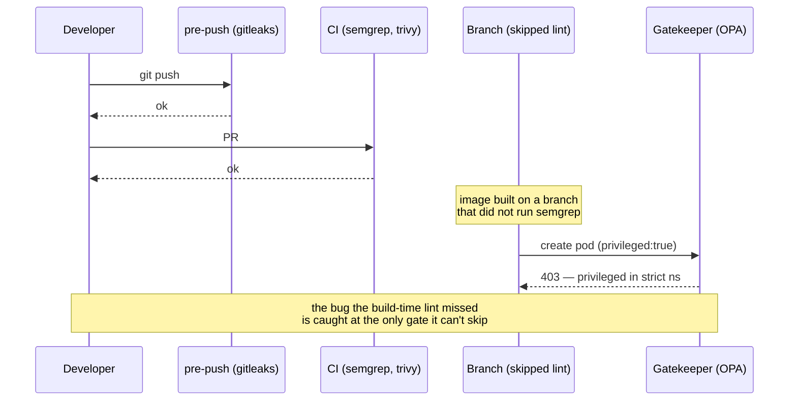

---

date: 2026-10-15T09:00:00
draft: false
title: "DevSecOps That Actually Lands: SAST, Secrets, and Runtime Policies"
summary: "DevSecOps That Actually Lands: SAST, Secrets, and Runtime Policies"
categories:
  - DevSecOps
---Most DevSecOps programs die the same way: the scan runs, the report is 40 pages long, nobody closes a single finding, and the next week's scan is a new 40-page report with the same 37 findings plus three new ones. The tool is not the problem. **A scanner that *reports* is a hobby; a scanner that *blocks* is a control.** This post is the counter to the death spiral: a small, enforced set of three checks — secrets, diff-scoped SAST, and an admission policy — that actually change what ships. No new platform, no new toolchain, and the whole thing fits in one repo and a 10-second pre-push hook. After reading it you can wire a *blocking* pipeline in an afternoon and know exactly which findings are worth a gate and which are noise.

---

## The three checks, in order of value

**1. Secrets in the repo — the only check that is free and always right.**
`gitleaks` (or TruffleHog) as a **pre-push hook + a CI gate**. One false positive per quarter is the cost; the 12:00 a.m. "how did *this* end up in the image" is the thing you are avoiding. This is the only check where the signal-to-noise ratio is effectively 1.0, so it is the one you can afford to *hard-fail* on with zero team friction.

**2. SAST on the *changed* lines only.**
A full-repo Semgrep/CodeQL run is too big for a human to absorb, which is why nobody reads it. The **diff** is the size a human can act on. `semgrep ci --diff` (or CodeQL on the PR) gives you the *delta* — the findings in the lines this PR actually touched — not the whole book. This is the single highest-leverage change to SAST adoption I have made: same findings, 90% less volume, and the developer who *wrote* the line is the one who sees it.

**3. An admission policy that runs *at deploy time*, not build time.**
This is the check that catches the "we deployed a pod with `privileged: true` because the CI image was built from a branch that bypassed the pipeline" class of bug. OPA/Gatekeeper runs the policy *in the cluster, at admission* — the last gate the resource can't sneak past. It is the runtime twin of the build-time checks, and it is the only one that is immune to a bypassed build.

---

## The minimum pipeline (one repo, no new infra)

| Layer | Catches | Runs on | Fails in |
|---|---|---|---|
| **gitleaks** | secrets committed to git | every PR | seconds |
| **SAST (semgrep)** | injection/classic vulns in source | every PR | ~1 min |
| **Trivy (image + IaC)** | CVEs in images, misconfig in manifests | push / plan | ~2 min |
| **OPA (Rego)** | policy drift (RBAC, netpol) that SAST can't see | plan / push | seconds |
| **runtime (Falco/pspy)** | behaviour SAST can't see: exec in a pod, unexpected egress | always, post-deploy | continuous |

Each layer is a *different* question; stacking all five is what 'devsecops that lands' actually means — one of them alone is a demo.

```yaml
# .github/workflows/sec.yml — the whole program
name: security
on: [pull_request]

jobs:
  secrets:
    runs-on: ubuntu-latest
    steps:
      - uses: actions/checkout@v4
        with:
          fetch-depth: 0          # gitleaks needs history to scan the delta
      - uses: gitleaks/gitleaks-action@v2
        env:
          GITLEAKS_ENABLE_EXIT_CODE: "1"   # <-- this is the whole control
  sast:
    runs-on: ubuntu-latest
    steps:
      - uses: actions/checkout@v4
      - run: |
          pip install semgrep
          # --diff: only report findings in changed lines
          # --error: exit non-zero if ANY finding is present
          semgrep ci --diff --error \
            --config p/go,p/python,p/js
  image:
    runs-on: ubuntu-latest
    steps:
      - uses: actions/checkout@v4
      - uses: aquasecurity/trivy-action@master
        with:
          image: "golang4u_server:latest"
          format: "table"
          exit_code: "1"           # block on any HIGH/CRITICAL
```

The *only* thing that makes this "land" is the `--error` / `exit_code: 1` / `GITLEAKS_ENABLE_EXIT_CODE` flags. Without them the job is a dashboard; with them it is a **gate**. Everything else — dashboards, SOC 2, the platform, the quarterly review — is decoration until the *block* is real. The block is the product; the report is the byproduct.

> **Note**: The `fetch-depth: 0` on the secrets job is not optional. `gitleaks` in CI without full history only scans the latest commit; a secret that was committed and force-pushed *before* this PR will be invisible. Full history is what lets it catch the "removed from `main` but never left the packfile" case, which is the one that actually bites.

---

## The OPA policy that catches the rest

```rego
# k8s.policies/privileged-ns.rego — wired to Gatekeeper as a Constraint
package k8s

# Deny any pod that sets `privileged: true` in a namespace that
# is on the "strict" list (i.e. namespaces where we care about
# the blast radius of a container escape).
import data.custom.privileged_namespaces as pn

deny[msg] {
  p := input.review.object
  p.spec.containers[_].securityContext.privileged
  p.metadata.namespace == pn[_]
  msg := sprintf("privileged pod %v in strict namespace %v",
    [p.metadata.name, p.metadata.namespace])
}
```

Wire this through Gatekeeper as one `ConstraintTemplate` + one `Constraint`, and the *runtime* policy is now as real as the build-time one. It is the only check that survives the "the build was made on a branch that does not run the same lint" failure mode, because it does not depend on the build at all — it runs when the object is *about to enter the cluster*, which is the last moment it can be stopped.

The `K8sPSP`-style `Constraint` is what makes it *enforced* rather than *advisory*: the pod admission webhook returns a `403` and the `kubectl apply` fails loudly, in the developer's terminal, with the exact policy name in the message.

> **Warning**: Do **not** let the OPA policy *log* a violation. An OPA/Gatekeeper policy that only *reports* `deny[msg]` (and a dashboard that charts the count) is a *report*, not a *gate* — it has the same force as the `semgrep` line above, which is to say, none, until it *blocks*. The `Constraint` must return a `403` (deny) at admission, not an audit event. The *block* is the control; the *dashboard* is the byproduct. A policy that only counts is a $40k/year dashboard wearing a security costume.

---

## What I would *not* do

- **Do not gate on "critical" severity alone.** Gate on *the finding being in a changed line, and on a trust boundary* (an HTTP handler, an auth path, a deserializer, a template render). A "critical" finding in a dev-only CLI flag is noise; a "medium" in a request deserializer is a bug. Severity is a ranking, not a gate.
- **Do not add a "security platform."** If a team of three can run `gitleaks`, `semgrep`, `trivy`, and read one OPA policy, you have a program. A $40k/year platform is a *procurement* problem, not a *security* one, and it will be solved by the dashboard it ships.
- **Do not make the scanner the bottleneck.** A 20-minute CI is a scanner that gets bypassed. The rule I use: **if a check takes more than 2 minutes, it is a *report*, not a *gate*.** Gate the 10-second checks; report the 20-minute ones.
- **Do not let the pre-push hook be the only gate.** A pre-push hook is *advisory* by nature (the developer can `git push --no-verify`). It is the *fast feedback* layer; the CI gate is the *enforcement* layer. You need both, and the CI gate is the one that counts.

```mermaid
flowchart TD
    A[Developer] -->|git commit| B[pre-push hook<br/>gitleaks ~10s]
    B -->|clean| C[git push]
    B -->|secret found| A
    C --> D{CI gate<br/>on pull_request}
    D -->|gitleaks --exit-code 1| E[block<br/>secret in delta]
    D -->|semgrep ci --diff --error| F[block<br/>SAST in changed lines]
    D -->|trivy exit_code 1| G[block<br/>HIGH/CRIT in image]
    E & F & G -->|all pass| H[merge to main]
    H --> I[build image]
    I --> J{OPA / Gatekeeper<br/>at admission}
    J -->|privileged in strict ns| K[403 pod rejected]
    J -->|ok| L[pod admitted]
    style J fill:#3a1a1a
    style K fill:#3a1a1a
```



The sequence below is the *bypass* this design is built to catch: a branch that skips the build-time lint, caught at admission.



---

## The boring win

The goal is not "we have SAST." The goal is this: **a PR that adds `os.Getenv("PASSWORD")` to a hot path is blocked by the pre-push hook in 10 seconds, the developer fixes it before it is even pushed, and the finding never reaches the 12:00 a.m. Slack.** The pre-push hook is the *advisory* layer that catches the obvious; the CI gate is the *enforcement* layer that catches what slipped through; the OPA policy is the *last* layer that catches what both of those missed because it was built on a branch that skipped the lint. Three layers, one repo, ten seconds of developer feedback, and the 12:00 a.m. alert is a thing of the past. That is the whole program. Everything else is scale.

## Takeaways

- **A scanner that reports is a hobby; one that blocks is a control.** `--error`, `exit_code: 1`, `GITLEAKS_ENABLE_EXIT_CODE` — the *flags* are the program.
- **Gate on three checks, in order:** secrets (free, always right) → diff-scoped SAST (human-absorbable) → an admission policy (immune to bypassed builds).
- **Severity is a ranking, not a gate.** Gate on *changed line + trust boundary*, not on a "critical" label.
- **A check over 2 minutes is a report, not a gate.** Keep the blocking path under 10 seconds per check.
- **Three layers, one repo:** the pre-push hook is advisory, the CI gate is enforcement, the OPA policy is the last gate. The 12:00 a.m. alert is what all three are for.

## Next steps

1. Wire the pre-push `gitleaks` hook into every developer machine *this week* — it is the cheapest 90% of the win.
2. Add `semgrep ci --diff --error` to the CI and measure the finding volume; you will drop ~90% and keep the signal.
3. Stand up Gatekeeper with the one `privileged-ns` policy as the first admission rule; add policies one at a time as the "gotcha" cases appear.
4. Define the 2-minute rule in your team's CI and stop promoting slow checks to the blocking path.
