```mermaid
flowchart LR
    subgraph CLIENT["client pod"]
        C[gRPC client] -->|dial service *name*| S1[Envoy sidecar<br/>127.0.0.1:15001]
    end
    subgraph MESH["the mesh (Envoy)"]
        S1 -->|intercept| LB[load balancer<br/>ring-hash / least-conn]
        LB -->|pick a peer| S2[peer Envoy sidecar]
    end
    subgraph PEER["peer pod"]
        S2 -->|deliver| P[gRPC server]
    end
    style S1 fill:#1a3a1a
    style S2 fill:#1a3a1a
    style LB fill:#1a3a1a
```

---

date: 2026-10-15T09:00:00
draft: false
title: "gRPC in Production: The Service Mesh and the Load Balancer"
image: /images/covers/grpc-in-production-the-service-mesh-and-the-load-balancer.svg
summary: "gRPC in Production: The Service Mesh and the Load Balancer"
categories:
  - gRPC
  - Microservices
---A *gRPC* service in production is not one process talking to one process. It is a **mesh**: a set of gRPC *servers*, a set of gRPC *clients*, a **load balancer** that decides which server a client talks to, and a **service mesh** (Envoy or Istio) that intercepts the traffic in between. The load balancer is the *only* component that decides where a call lands. In Kubernetes, the `Service` object *is* that load balancer (round-robin across the pods behind it); in Envoy, the load-balancing *policy* is a choice among round-robin, least-conn, and ring-hash. The gRPC client does not know which server it talked to — the balancer decides. **This post is about those two things — the load balancer and the mesh — and about the ring-hash balancer specifically**, because it is the one policy that stays *stable* under load: a new server joining the ring moves only the hashes nearest to it, not the whole ring. After reading it you can (a) write a ring-hash load balancer in ~30 lines of Go, and (b) reason about *why* consistent hashing is the right policy for a gRPC mesh that needs session affinity.

---

## The ring-hash load balancer (the 30-line part)

A **ring-hash** balancer is a **consistent hash**: a sorted ring of hash values, each pointing at a server, and the pick for a key is the first server *clockwise* from the key's hash. The invariant that makes it *stable* is the whole point: **a new server joining the ring steals only the keys that fall between it and the next server — not every key.** That is the difference between a ring-hash and naive round-robin. Round-robin reassigns *all* keys the instant a server joins; ring-hash moves only the keys in one arc. For a stateless service that is an unnecessary churn; for a *session* (where a key must always land on the same backend) it is exactly the behavior you want.

```go
package lb

import (
	"hash/fnv"
	"sort"
)

// RingHash is a consistent-hash load balancer. The *ring* is a sorted
// slice of hash values; each value maps to one server. A key is served by
// the first server *clockwise* from hash(key). This is the invariant that
// keeps it stable: inserting one value only re-owns the arc between it and
// the next value, so a server join/leave is a local, O(1) rebalance.
type RingHash struct {
	ring []int32          // sorted hash values, the ring itself
	byHash map[int32]string // hash -> server id
}

// NewRingHash builds the ring from a list of server ids. One hash per
// server is the minimal ring; ~100 virtual nodes per server (one hash each)
// is what makes the distribution even. We build the minimal ring here and
// note where virtual nodes would go.
func NewRingHash(servers []string) *RingHash {
	r := &RingHash{byHash: make(map[int32]string, len(servers))}
	for _, s := range servers {
		h := fnv.New32a()
		h.Write([]byte(s))
		v := int32(h.Sum32())
		r.byHash[v] = s
		r.ring = append(r.ring, v)
	}
	sort.Slice(r.ring, func(i, j int) bool { return r.ring[i] < r.ring[j] })
	return r
}

// Pick returns the server that owns key: the first ring entry strictly
// greater than hash(key), wrapping to the front if we run past the end.
// O(log n) for the binary search, O(1) once the index is found.
func (r *RingHash) Pick(key string) string {
	if len(r.ring) == 0 {
		return ""
	}
	h := fnv.New32a()
	h.Write([]byte(key))
	target := int32(h.Sum32())
	i := sort.Search(len(r.ring), func(i int) bool { return r.ring[i] > target })
	if i == len(r.ring) {
		i = 0 // wrapped around the ring
	}
	return r.byHash[r.ring[i]]
}

// Add and Remove are the two operations the mesh calls as servers scale.
// Each is a single O(log n) insert/delete in the ring — *no* rehashing of
// the keys, which is the entire "stable under load" property.
func (r *RingHash) Add(server string) {
	h := fnv.New32a()
	h.Write([]byte(server))
	v := int32(h.Sum32())
	r.byHash[v] = server
	r.ring = append(r.ring, v)
	sort.Slice(r.ring, func(i, j int) bool { return r.ring[i] < r.ring[j] })
}

func (r *RingHash) Remove(server string) {
	for i, v := range r.ring {
		if r.byHash[v] == server {
			r.ring = append(r.ring[:i], r.ring[i+1:]...)
			delete(r.byHash, v)
			return
		}
	}
}
```

The *stable-under-load* property is a direct consequence of the data structure: **`Add`/`Remove` are single insertions into a sorted slice, and the pick is a binary search.** Adding a server cannot move any key except the ones in the arc it inserted into, and removing one re-assigns only the arc it owned. There is no global recomputation, no round-robin pointer to advance, and no "rebalance storm" when the fleet scales.

---

## The service mesh (the Envoy sidecar)

The **service mesh** is a **sidecar**: a container that runs alongside the service and *intercepts* its inbound and outbound traffic. The service talks to a *localhost* port (the sidecar); the sidecar talks to the *remote* sidecar (the real network). The gRPC client knows nothing about the mesh; the mesh knows everything about the client. That is the entire architectural claim: **the load balancer and the policy (retries, timeouts, mTLS) move into the sidecar, and the service code is freed from all of it.**

```go
package mesh

import (
	"context"
	"fmt"

	"google.golang.org/grpc"
)

// dial is the client's *only* knowledge of the mesh. It dials a *service
// name* (a logical name the mesh resolves), never a pod IP and never a
// port. The local Envoy sidecar (127.0.0.1:15001) intercepts the connection
// and forwards it to the peer sidecar. The client never sees the peer's
// pod IP — that is the whole point of the mesh.
func dial(ctx context.Context, service string) (*grpc.ClientConn, error) {
	// WithBlock + the service name: the mesh, not the client, resolves the
	// name to a concrete endpoint. If the name does not exist, this fails
	// fast at dial time, not at first call.
	conn, err := grpc.DialContext(ctx, service, grpc.WithBlock())
	if err != nil {
		return nil, fmt.Errorf("mesh dial %s: %w", service, err)
	}
	return conn, nil
}

// call is a normal gRPC call *through* the mesh. The client does not pick
// the peer pod; the sidecar (its load balancer) does. The client and the
// server never see each other directly — the mesh is the load balancer.
// conn is closed by the caller; this is the shape of one round trip.
func call(ctx context.Context, conn *grpc.ClientConn, service, method string) (int, error) {
	// In a real service, `conn` is a typed client (pb.NewFooClient(conn))
	// and this is a typed RPC. Here we count the call as a stand-in; the
	// *mesh* is what routes it, not the client.
	_ = method
	return 1, nil
}
```

The sequence below is the honest one: the client dials the *name*, the local sidecar intercepts, the mesh's load balancer picks the peer, and the peer sidecar delivers. The client and the server never see each other's addresses.

```mermaid
sequenceDiagram
    participant C as gRPC client
    participant E1 as Envoy (local sidecar)
    participant E2 as Envoy (peer sidecar)
    participant S as gRPC server
    C->>E1: dial(service name)
    E1->>E1: ring-hash pick on the key
    E1->>E2: forward to the picked peer
    E2->>S: deliver
    S-->>E2: response
    E2-->>E1: response
    E1-->>C: response
    Note over C,S: the client never saw the peer IP;<br/>the mesh is the load balancer
```



---

## The four load-balancing policies, and when each is right

| Policy | Pick rule | Stable under load? | When to use |
|--------|-----------|--------------------|-------------|
| **round-robin** | cycle through the pods in order | no — a join reassigns every key | stateless load, no session affinity |
| **least-conn** | the pod with the fewest active conns | no — it chases the load | very uneven request durations |
| **ring-hash** | first hash clockwise from `hash(key)` | **yes** — only the nearest arc moves | session affinity (a key always maps to the same pod) |
| **random** | uniform over the pods | no | load testing, no affinity at all |

The **ring-hash** row is the one that matters for a gRPC mesh, because it is the only policy that is *stable under load* **and** gives *session affinity*. Round-robin and random are fine for stateless load; ring-hash is the answer when a key (a session, a shard, a tenant) must *always* land on the same pod. The 30-line ring-hash above is the entire load balancer for that case.

> **Note**: The mesh is the *only* load balancer the client knows about. The client dials the *name*; the sidecar decides the *pod*. That is why a gRPC service can scale its pods and the client changes zero lines of code — the load balancing *is* the mesh, not the client.

> **Warning**: Do **not** run a client-side load balancer *and* a sidecar load balancer for the same call. If the client picks a pod and the sidecar picks a pod, the two picks can *disagree*, and the client will reconnect to a pod the mesh just rebalanced away from. **One load balancer per call** — the mesh, not the client.

## Takeaways

- **A gRPC service in production is a mesh:** clients + servers + a load balancer + a sidecar. The load balancer is the *only* component that decides where a call goes.
- **A ring-hash is a consistent hash:** a new server moves only the nearest arc of keys, not every key. That is *why* it is stable under load and *why* it is the right policy for session affinity.
- **The service mesh intercepts traffic at a localhost port.** The client dials the *name*; the sidecar picks the *pod*. The client and the server never see each other directly.
- **One load balancer per call.** The client-side LB and the sidecar LB do not mix; the mesh is the load balancer, and the client does not compete with it.
- **The 30-line rule:** a 30-line gRPC server + a 30-line ring-hash LB + a sidecar = the entire load-balancing story for a gRPC service.

## Next steps

1. Write the 30-line ring-hash above and *unit-test the stability*: add a server, assert that only the nearest key moved, and that every other key still picks the same server.
2. Put Envoy in front of every gRPC server and dial the *name*, not the pod IP. The client code changes by zero lines; the load balancing moves into the mesh.
3. Pick *one* LB policy per service and make it explicit: round-robin for stateless, ring-hash for session affinity. Do not let the mesh default to round-robin and the client default to round-robin and call it a day — that is two load balancers that disagree.
