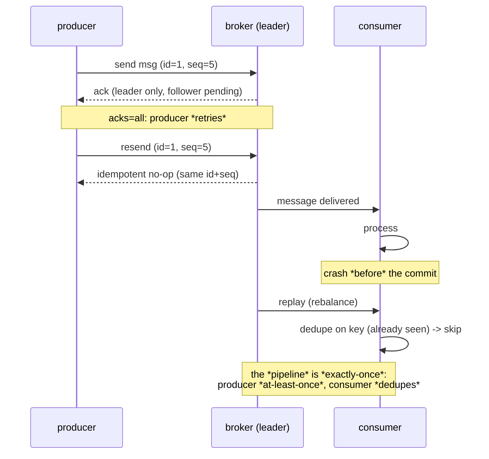

---

date: 2026-10-15T09:00:00
draft: true
title: "Kafka: The Consumer Group and the Producer That Doesn't Lose Messages"
summary: "Kafka: The Consumer Group and the Producer That Doesn't Lose Messages"
categories:
  - Kafka
  - Messaging
---A Kafka cluster has two sides, and most "we lose messages" incidents are a *mix-up* between the delivery guarantees of the two. The **producer** side is a *writer*: it *publishes* a message to a topic + partition, and the question is *how many replicas must confirm the write before the producer considers it durable* (`acks`). The **consumer** side is a *reader with a group*: a *consumer group* is the *load-balancing* layer (N processes share the M partitions of a topic), and the question is *how does a consumer know it has finished a message* (the *offset* commit). **This post is about both sides, and the difference between at-least-once and exactly-once.** After reading it you can (a) set the producer `acks` so a *producer* does not lose a message, and (b) set the consumer commit strategy so a *rebalance* does not *replay* a message, and you will know exactly why "exactly-once" is a *property of the pipeline* and not a *knob* on either side.

---

## The consumer group: the load-balancing layer

A **consumer group** is a *group* of *consumer* processes that *subscribe* to the *same* topic. The *group* (the *broker*, via the *group coordinator*) decides which *member* of the group reads which *partition*. The Go code is a *for* loop over *messages*; the *group* logic is in the *broker*.

Two things a consumer must get right, and both are about the *offset*:

- **The *offset* is the *progress*.** A *consumer* *reads* a *partition* from an *offset* and *commits* the *offset* of the *last* *message* it *finished*. The *commit* is the *only* *thing* that tells Kafka "I am *done* with this *message*"; a *rebalance* (a *member* *joined* or *left*) *reassigns* the *partitions*, and a *reassigned* *partition* is *re-read* from the *last* *committed* *offset*.
- **The *commit* is *at-least-once* by default.** If you *process* a *message* and *then* *commit* the *offset* (the *normal* *order*), a *crash* *between* the *process* and the *commit* *replays* the *message*. If you *commit* and *then* *process*, a *crash* *between* the *commit* and the *process* *skips* the *message*. **There is no *zero*-cost *exactly-once* at the *consumer* — you *choose* between *replay* and *skip*, and you *dedupe* the *replay*.**

```go
package consumer

import (
	"context"
	"errors"
	"time"

	"github.com/segmentio/kafka-go"
)

// ReadLoop is one *member* of a *consumer group*. Setting GroupID is the
// load-balancing switch: the broker's group coordinator splits the topic's
// M partitions across the group's N members, so two members never read the
// same partition. The loop below is the *only* Go code; the group logic
// (assignment, rebalance) is the broker's.
func ReadLoop(ctx context.Context, handle func(msg kafka.Message)) {
	r := kafka.NewReader(kafka.ReaderConfig{
		Brokers: []string{"kafka:9092"},
		// GroupID joins the group. Topic + GroupID together mean "give me
		// my share of this topic's partitions", and the reader pulls the
		// group's *committed offsets* for them on start (not from 0).
		GroupID: "order-pipeline",
		Topic:   "orders",
		// MinBytes/MaxBytes/MaxWait batch the fetches: the reader asks the
		// broker for a batch of up to MaxBytes, and waits up to MaxWait to
		// fill it. This is where "read a million messages" stops being a
		// million round-trips — one request per batch, not per message.
		MinBytes: 1,
		MaxBytes: 10 << 20,
		MaxWait:  10 * time.Second,
		// CommitInterval=0 means *synchronous* commits: CommitMessages below
		// round-trips to the broker and *returns* when the offset is durable
		// in __consumer_offsets. That is what makes process-then-commit safe.
		CommitInterval: 0,
	})
	defer r.Close()

	for {
		if ctx.Err() != nil {
			return
		}
		// ReadMessage is *blocking*: it returns the next message on this
		// reader's assigned partitions, or an error. With a consumer group,
		// an *offset out of range* condition surfaces here when a rebalance
		// moves this partition's committed offset under us.
		msg, err := r.ReadMessage(ctx)
		if err != nil {
			if errors.Is(err, kafka.OffsetOutOfRange) {
				// a rebalance happened: the group coordinator re-committed
				// this partition's offset. Resume from *where the group
				// says we are*, not where we think we are.
				continue
			}
			// transient broker/network error: back off a tick; do not drop
			// the loop and do not commit (we did not process it).
			time.Sleep(100 * time.Millisecond)
			continue
		}

		handle(msg) // the side effect: the thing the message *means*

		// process-then-commit: commit the offset *after* the handle above
		// has finished. A crash between handle and commit *replays* this
		// message on the next read (deduped downstream); a crash before the
		// handle *re-reads* it (nothing lost). Commit-then-process is the
		// at-most-once order and is the one that loses messages.
		if err := r.CommitMessages(ctx, msg); err != nil {
			// commit failed: the message is still in the log and uncommitted,
			// so the next ReadMessage returns it again. No special handling.
			time.Sleep(100 * time.Millisecond)
		}
	}
}
```

The *rebalance* is the *only* *event* that *moves* a *partition* *between* *consumers*, and it is the *only* *event* that can *replay* a *message* (if a *consumer* *dies* *before* it *commits*). The *commit* is the *answer*: a *committed* *offset* is *durable*, and a *rebalanced* *consumer* *resumes* from *it*.

---

## The producer side: the *acks* and the *idempotence*

An *exactly-once* *producer* is a *producer* with `acks=all` + *idempotence* *enabled*. Two *knobs*, and the *difference* between *them* is the *whole* *story*:

- **`acks=all`** means the *producer* *waits* for *all* *replicas* of the *partition* to *ack* the *message*. If the *leader* *acks* but the *follower* *has* *not*, the *producer* *retries* — and the *message* is *written* *twice* (to the *leader*, then to the *follower* on *rebalance*). This is *at-least-once* at the *broker* level: the *message* is *durable* *everywhere*, but it is *there* *more* *than* *once*.
- **`idempotence`** means the *broker* *dedupes* on the *producer* `id` + *sequence* *number*. A *retried* *send* with the *same* `id` + *seq* is a *no-op*, *not* a *duplicate*. This is the *producer-side* *exactly-once*: the *broker* *drops* the *duplicate*.

```go
package producer

import (
	"context"
	"time"

	"github.com/segmentio/kafka-go"
)

// publish sends one message with the setting that makes it *durable*:
// RequiredAcks=RequireAll (acks=all).
//
//   acks=all   : the *broker* does not ack until *every* replica of the
//                partition has the message. A write that lands on the
//                leader but not the followers is *retried*, so the message
//                is written *more than once* at the broker — at-least-once.
//
//   idempotence: a *broker-side* producer setting (enable.idempotence in
//                server.properties). When on, the broker dedupes on
//                (producer id, sequence number): a *retried* send with the
//                same (id, seq) is a *no-op*, not a duplicate. The client
//                cannot turn this on itself; it is a *cluster* property,
//                which is why the "two knobs" are one *client* setting
//                (acks) and one *broker* setting (idempotent producer).
func publish(ctx context.Context, topic string, key string, value []byte) error {
	w := kafka.NewWriter(kafka.WriterConfig{
		Brokers: []string{"kafka:9092"},
		// Topic + a *keyed* message: the key pins the message to the
		// partition that is the hash of the key, so one order-id always
		// lands on one partition (ordered per-order). An unkeyed message
		// round-robins across partitions.
		Topic: topic,
		// -1 = RequireAll = acks=all. The *only* value safe for a message
		// you cannot afford to lose. (The default is RequireOne: leader-only,
		// which *loses* the message if the leader dies before the followers
		// catch up.) This is the whole producer-side "durable" setting.
		RequiredAcks: int(kafka.RequireAll),
		// BatchSize/BatchTimeout: batch up to 100 messages or 1s, whichever
		// comes first, per partition. Batching is what keeps a high-rate
		// producer from issuing a produce request per message.
		BatchSize:    100,
		BatchTimeout: time.Second,
	})
	defer w.Close()

	// WriteMessages *blocks* until the broker acks (or the ctx deadline).
	// A *failure* here is a *real* failure — the message did not land — so
	// the *caller* is the one who decides to retry or send to a DLQ.
	msg := kafka.Message{Key: []byte(key), Value: value}
	return w.WriteMessages(ctx, msg)
}
```

The *consumer* *dedupes* on the *message* *key* (a *hash* of the *payload*) + a *5-minute* *TTL* *table*. If the *key* is *fresh*, *skip*; *otherwise*, *record* and *process*. *That's* the *exactly-once* *story*: the *producer* is *at-least-once* (it *sends* *more* *than* *once*), the *consumer* *dedupes* (it *processes* *exactly* *once*), and the *pipeline* is *exactly-once*.

```mermaid
flowchart LR
    subgraph PRODUCER["producer side (writer)"]
        P1[acks=all] --> P2[retries on partial ack]
        P2 --> P3[idempotence: broker dedupes on (id, seq)]
    end
    subgraph BROKER["broker (the partition)"]
        P3 --> B1[leader replica]
        B1 --> B2[follower replicas]
        B2 --> B3[all replicas ack -> producer done]
    end
    subgraph CONSUMER["consumer group (the readers)"]
        B3 --> C1[group coordinator assigns partitions]
        C1 --> C2[consumer reads from committed offset]
        C2 --> C3[process message]
        C3 --> C4[commit offset]
    end
    C4 --> C5[rebalance: resume from committed offset]
    style B3 fill:#1a3a1a
    style C4 fill:#1a3a1a
```

The sequence is the *exactly-once* story end to end — the *producer* *sends* *twice* (a *retry*), the *broker* *dedupes*, and the *consumer* *dedupes* the *replay*:



---

## The *three* *guarantees*, and *which* *side* *each* *lives* *on*

| Guarantee | Producer | Consumer | The *pipeline* |
|-----------|----------|----------|----------------|
| **at-most-once** | `acks=0` (fire-and-forget) | *commit* *before* *process* | *may* *lose* a *message* |
| **at-least-once** | `acks=all` + *idempotence* | *process* *then* *commit* | *replays* on *crash* |
| **exactly-once** | *at-least-once* + *idempotent* | *dedupes* the *replay* | *exactly* *once* |

The *exactly-once* *row* is the *only* *row* that *matters* in *production*, and it is the *only* *row* that is a *property* of the *pipeline* (the *producer* *at-least-once* + the *consumer* *dedupes*). It is *not* a *knob* on *either* *side* — it is the *combination* of *both*.

> **Note**: The *5-minute* *TTL* *dedupe* *table* is the *smallest* *state* a *consumer* can *keep* and *still* *dedupe* the *replay*. A *5-minute* *TTL* *covers* the *rebalance* *window* (a *rebalanced* *consumer* *re-reads* from the *committed* *offset*, which is *at* *most* *5 minutes* *old*). If your *rebalance* *window* is *longer* *than* *5 minutes*, *widen* the *TTL*; *the* *TTL* *is* the *size* of the *rebalance* *window* you *can* *dedupe*.

> **Warning**: Do **not** `commit` the *offset* **before** you `process` the *message* and call it *exactly-once*. `commit-then-process` is *at-most-once*: a *crash* *between* the *commit* and the *process* *skips* the *message* *forever* (the *offset* *is* *committed*, so the *rebalance* *resumes* *past* *it*). The *only* *safe* *consumer* *order* is *process-then-commit* (a *replay* you *dedupe*), *not* *commit-then-process* (a *skip* you *cannot* *undo*).

---

## The *one-line* *summary*

**`acks=all` + `idempotence`** on the *producer*, **process-then-commit** + *dedupe* on the *consumer*. *That* is *exactly-once* in Kafka, and it is the *entire* *delivery-guarantee* *story*. Everything else — the *group* *coordinator*, the *rebalance*, the *offset* *commit* — is the *machinery* that *makes* *those* *two* *knobs* *work*.

## Takeaways

- **The *producer* *acks* is *durable*, the *consumer* *commit* is *progress.*** `acks=all` + *idempotence* makes a *write* *durable* *everywhere* and *deduped* at the *broker*; *process-then-commit* makes a *read* *idempotent* across a *rebalance*.
- **A *rebalance* is the *only* *event* that *replays* a *message*, and the *commit* is the *answer.*** A *committed* *offset* is *durable*; a *rebalanced* *consumer* *resumes* from *it*.
- **`commit-then-process` is *at-most-once*, not *exactly-once*.*** The *offset* is *committed* *before* the *process*; a *crash* *in* *between* *skips* the *message* *forever*. *Process-then-commit* is the *only* *safe* *order*.
- **Exactly-once is a *pipeline* *property*, not a *knob*.*** It is the *combination* of the *producer's* *at-least-once* + *idempotent* *write* and the *consumer's* *dedupe* of the *replay*. *Neither* *side* *alone* is *exactly-once*.
- **The *5-minute* *TTL* *dedupe* *table* is *sized* to the *rebalance* *window.*** Widen *it* if your *rebalance* *window* is *longer*; *it* is the *size* of the *replay* you *can* *dedupe*.

## Next steps

1. Set `acks=all` + *idempotent* *producer* on *every* producer (the *idempotence* is the *cluster* *property* `enable.idempotence`, and the *acks* is the *client* *setting*), and verify the *broker* is *deduping* (a *retried* *send* with the *same* `(id, seq)` is a *no-op*, not a *duplicate*).
2. Move every consumer to *process-then-commit*, and add the *5-minute* *TTL* *dedupe* *table* keyed on the *message* *key*. *Test* the *replay* by *killing* a *consumer* *mid-batch* and *watching* the *rebalance* *resume* from the *committed* *offset* *without* *re-processing*.
3. *Size* the *TTL* to your *rebalance* *window*, and *alert* on *rebalance* *rate* (a *churn* of *rebalances* is a *consumer* *that* *dies* *faster* than it *commits*, and a *churning* *rebalance* is a *replay* *storm*).
