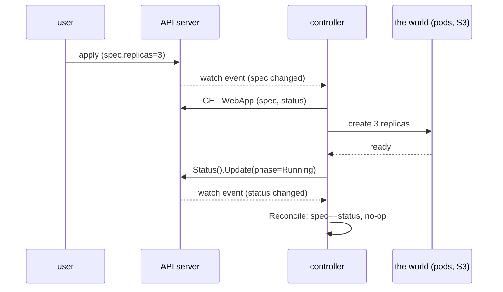

---

date: 2026-10-15T09:00:00
draft: true
title: "Kubernetes Operators: The CRD and the Reconciler That Never Gives Up"
summary: "Kubernetes Operators: The CRD and the Reconciler That Never Gives Up"
categories:
  - Kubernetes
  - DevOps
---An *operator* is the difference between a Kubernetes manifest and a Kubernetes *system*. A manifest declares a desired state — "I want three replicas of this." An operator is a **Go controller** that *watches* that declaration and *reconciles* the world toward it, forever: it notices the replica died and brings it back, it notices the new version is rolled out and drains the old, it notices the external S3 bucket the spec refers to was deleted and re-creates it. The two moving parts are a **Custom Resource Definition** (a `schema` for a resource that is not in the built-in list) and a **reconciler** (a function that runs forever, checks the current state of the resource, and moves it toward the desired state). The reconciler is the heart; the CRD is the contract. This post is the 30-line reconciler that is the entire operator, the three gotchas that break it, and the finalizer pattern that is the only way to clean up things that live outside the cluster. After reading it you can take a "we have YAML that drifts" problem and turn it into a self-healing resource in an afternoon.

---

## The 30-line reconciler (the entire operator)

The controller framework (`sigs.k8s.io/controller-runtime`) gives you the watch loop, the client, and the requeue machinery for free. *You* write exactly one method: `Reconcile`. It is called whenever the object the controller watches changes, and its only job is to look at the **spec** (what the user wants) and the **status** (what is actually true) and take one step toward making them agree.

```go
package controller

import (
	"context"
	"time"

	"k8s.io/apimachinery/pkg/runtime"
	metav1 "k8s.io/apimachinery/pkg/apis/meta/v1"
	"k8s.io/client-go/util/retry"
	ctrl "sigs.k8s.io/controller-runtime"
	"sigs.k8s.io/controller-runtime/pkg/client"
	"sigs.k8s.io/controller-runtime/pkg/controller"
)

// Reconciler is the whole operator: one struct, one method.
// The framework calls Reconcile on every watch event for the CRD,
// and the `return` value decides when to check again.
type Reconciler struct {
	client client.Client
	scheme *runtime.Scheme
}

// +kubebuilder:rbac:groups=app.example.com,resources=webapps,verbs=get;list;watch;update
func (r *Reconciler) Reconcile(ctx context.Context, req ctrl.Request) (ctrl.Result, error) {
	// 1) read the desired state. If the object is gone (deleted),
	//    IgnoreNotFound makes this a no-op and we return cleanly.
	var obj v1.WebApp
	if err := r.client.Get(ctx, req.NamespacedName, &obj); err != nil {
		return ctrl.Result{}, client.IgnoreNotFound(err)
	}

	// 2) the desired state is obj.Spec; the current state is obj.Status.
	//    The controller's job is the delta between the two.
	if obj.Status.Phase != obj.Spec.Phase {
		// move toward desired: flip the phase, then persist the status.
		obj.Status.Phase = obj.Spec.Phase
		obj.Status.ObservedGeneration = obj.Generation

		// the status subresource is updated separately (see gotcha #2):
		// a plain Update() would clobber the spec the user just set.
		if err := r.client.Status().Update(ctx, &obj); err != nil {
			// transient API-server error: requeue with a backoff and
			// let the framework retry. Never block the reconcile slot.
			return ctrl.Result{RequeueAfter: 5 * time.Second}, nil
		}
	}

	// 3) steady state: nothing to do. The framework re-calls us on the
	//    next watch event, so returning an empty Result is "all good."
	return ctrl.Result{}, nil
}
```

Three properties make this *the* operator and not a bug factory:

- **It is idempotent.** A second `Reconcile` with the same state does nothing, because the status is already equal to the spec. Idempotence is the whole correctness model: you can run the function a thousand times and the answer is the same.
- **It never blocks.** A `Reconcile` that hangs on a slow network call holds its *reconcile slot* and starves every other object the controller is supposed to serve. The rule: **return within ~30 seconds, or requeue with `RequeueAfter` and come back.**
- **It is a closed loop.** The framework *watches* the CRD and calls `Reconcile` on every change; the function *moves* the world toward the spec and writes the result back to the *status* subresource, which the watch then sees as a new event. It is a feedback loop with exactly one degree of freedom: the delta between spec and status.

```mermaid
flowchart TD
    A[User kubectl apply WebApp<br/>spec.replicas=3] --> B[API server persists spec]
    B --> C{controller-runtime<br/>watch on CRD}
    C --> D[Reconcile(req)]
    D --> E{status.phase == spec.phase?}
    E -- no --> F[create missing replicas<br/>set status.phase=spec.phase]
    F --> G[Status().Update]
    G --> C
    E -- yes --> H[no-op, return]
    H --> C
    I[pod dies / drift] --> C
    style D fill:#1a3a1a
    style G fill:#1a3a1a
```

The sequence is the honest one: the *user* writes the spec, the *controller* writes the status, and the watch loop is the glue. Nobody writes both at once.



---

## The three gotchas that break the operator

**1. The reconciler must not block the loop.** A `Reconcile` that holds a reconcile slot while it blocks on a 40-second network call starves every other object. The rule: **return within 30 seconds or requeue with `RequeueAfter`.** The framework's work queue is the buffer; your job is to keep the slot free, not to make the call fast.

**2. The status subresource must be separate from the spec.** The `spec` is the *desired* state (the user sets it); the `status` is the *current* state (the controller sets it). If you `Update()` the whole object, you write the *status* you just read back and **clobber the spec the user changed a millisecond ago** — a classic, and it is silent. The fix is `r.client.Status().Update(ctx, &obj)`, which updates only the status subresource and leaves the spec untouched. One method call, and the class of bug disappears.

**3. The finalizer pattern is the only way to clean up external resources.** A CRD that deletes things *outside the cluster* — an S3 bucket, a Kafka topic, a DNS record — needs a `finalizer`: a string in `metadata.finalizers` that **blocks the delete** until the operator has cleaned up the external resource and removed the finalizer itself. Without it, the CRD is gone the instant the object is deleted, and the S3 bucket is orphaned forever. The finalizer is the only guarantee the cleanup happens *before* the CRD is gone.

| Failure mode | What it looks like | The fix | Cost of ignoring it |
|--------------|--------------------|---------|----------------------|
| **blocking the loop** | a `Reconcile` hangs on a 40 s network call | return within 30 s, else `RequeueAfter` | every other object on the CRD starves |
| **spec/status clobber** | a full `Update()` overwrites the user's `spec` | use `Status().Update()` (status subresource only) | the user's next `apply` is silently undone |
| **orphaned external resource** | the CRD is deleted; the S3 bucket is not | a `finalizer` that blocks delete until cleanup | a bill, a DNS record, a topic, forever |
| **unbounded requeue** | a `Reconcile` that always requeues at 5 s | cap the backoff; a hard `maxRequeues` before giving up | a hot object pins a reconcile slot at 20% of throughput |

The finalizer is two lines of *intent* and a delete flow that looks like this:

```go
// the delete path: when the object is being deleted, the API server
// does NOT remove it until the finalizers list is empty. The controller
// notices DeletionTimestamp is set, does the external cleanup, then
// removes the finalizer. Only then does the object actually vanish.

// the finalizer bookkeeping helpers (a dozen lines, not a library)
func has(finalizers []string, f string) bool {
	for _, x := range finalizers {
		if x == f {
			return true
		}
	}
	return false
}

func remove(finalizers []string, f string) []string {
	out := make([]string, 0, len(finalizers))
	for _, x := range finalizers {
		if x != f {
			out = append(out, x)
		}
	}
	return out
}

const finalizer = "app.example.com/cleanup"

// in Reconcile:
if obj.DeletionTimestamp != nil {
    if has(obj.Finalizers, finalizer) {
        if err := r.cleanupExternal(ctx, &obj); err != nil {
            return ctrl.Result{RequeueAfter: 5 * time.Second}, nil
        }
        // remove the finalizer; the API server now completes the delete
        obj.Finalizers = remove(obj.Finalizers, finalizer)
        if err := r.client.Update(ctx, &obj); err != nil {
            return ctrl.Result{}, err
        }
    }
    return ctrl.Result{}, nil
}
// on the create path, add the finalizer so the delete path can find it
if !has(obj.Finalizers, finalizer) {
    obj.Finalizers = append(obj.Finalizers, finalizer)
    if err := r.client.Update(ctx, &obj); err != nil {
        return ctrl.Result{}, err
    }
}
```

The `403`-style "can't delete, finalizer present" behavior is the *feature*: the object is *held* at the door until the external cleanup is done.

> **Note**: A reconciler that returns `RequeueAfter` on a *transient* error (a 500 from the API server, a flaky S3 call) is the correct pattern. Returning the *error* makes the framework requeue with an exponential backoff and logs a stack trace — useful for *your* bugs, noisy for *the world's*. The rule: **error = "this is my bug, back off hard"; `RequeueAfter` = "the world is busy, come back gently."**

> **Warning**: Do **not** let the operator and the user write the same subresource. If your controller does a full `Update()` (not `Status().Update()`), the next apply the user makes is silently overwritten by your last read. The *spec* belongs to the user, the *status* to the controller, and the subresource split is the only thing that keeps them apart. This is the single most common operator bug, and it is one method call to fix.

---

## The 30-line rule

A **30-line reconciler** + a **10-line CRD** YAML = the entire operator. If it is more than that, you have not written an *operator* — you have written a *platform*, and the platform is where the 4 a.m. pages come from. The discipline is the same as the 30-line FFI rule in the Rust post: **the reconciler should be the size of one `if` and one `patch`.** If the "reconcile" is a 400-line state machine with a DAG and an event bus, split it: the *small* reconciler that keeps the spec and status in sync is the operator, and the big thing it orchestrates is a *subsystem* that deserves its own boundary. Under the line, you have a self-healing resource. Over it, you have a job.

## Takeaways

- **An operator = a CRD (the schema) + a reconciler (the loop).** The reconciler is a *function*, not a daemon; the framework is the daemon.
- **Idempotence is the correctness model.** `Reconcile` is called on every watch event and must do *nothing* when the spec already equals the status. A second call with the same state is a no-op by construction.
- **Never block the loop.** Return within ~30s or requeue with `RequeueAfter`. The work queue is the buffer; the slot is the scarce resource.
- **Spec is the user's, status is yours** — and only `Status().Update()` keeps them from clobbering each other. The full `Update()` bug is the most common operator failure.
- **Finalizers are the only external-cleanup guarantee.** A `metadata.finalizers` entry blocks the delete until the controller cleans up the S3 bucket / Kafka topic / DNS record and removes itself.

## Next steps

1. Start from the 30-line reconciler above with one CRD that tracks *one* real thing you are tired of managing by hand. Resist the urge to model five.
2. Add the status subresource and a `Generation`/`ObservedGeneration` pair before you add any second field, so the "did I already see this change" question is answered from day one.
3. Add the finalizer *only when* the resource owns something outside the cluster. If the CRD is cluster-internal, the finalizer is complexity you do not need yet.
4. When the reconciler passes 100 lines, stop and ask what subsystem has moved in. The operator is the 30-line loop; the subsystem gets its own boundary.
