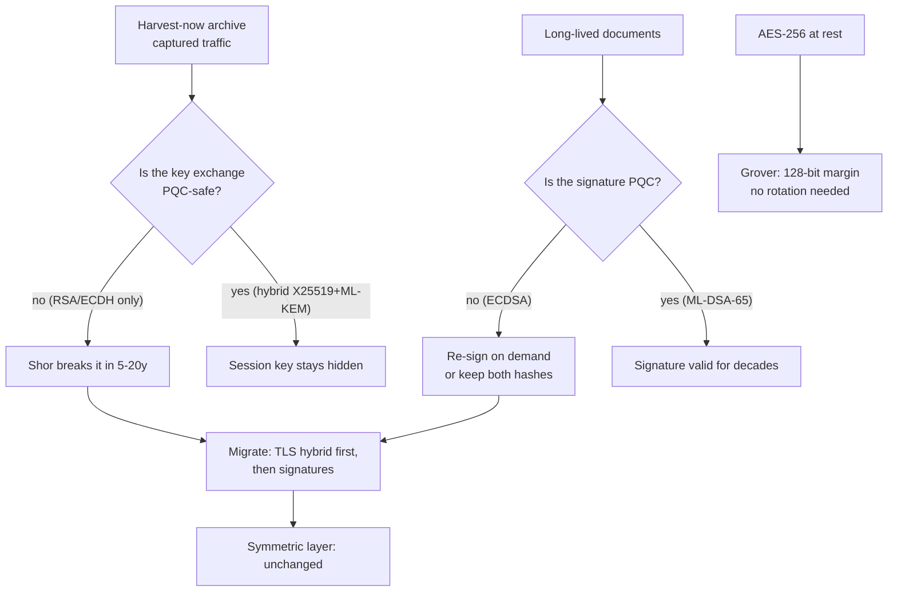

---

date: 2026-10-15T09:00:00
draft: false
title: "Post-Quantum Cryptography: A Practical Migration Guide for Engineers"
summary: "Post-Quantum Cryptography: A Practical Migration Guide for Engineers"
categories:
  - Artificial Intelligence
---Quantum computers have not broken RSA in production. That is not a comfort. Attackers do not need a quantum machine today to defeat a key exchange from today — they need only a **hard drive**. Traffic encrypted today with RSA-2048 or ECDH-P256 is captured, logged, and shelved; a fault-tolerant quantum machine that arrives in five to twenty years runs **Shor's algorithm** on the archive and reads it. The industry term is *harvest now, decrypt later*, and it turns "when do we migrate" into an arithmetic question: **everything in long-lived storage must be re-signable, and everything in transit must have been key-agreed quantum-safely from day one.**

The good news is the exit plan is standardized. NIST finalized three post-quantum (PQC) standards in 2024 — **FIPS 203 (ML-KEM)**, **FIPS 204 (ML-DSA)**, **FIPS 205 (SLH-DSA)** — and OpenSSL 3.2+, Go 1.24+, and every major CA ship them. This post is the engineer's migration guide: what the three standards are, why your first deployment is always *hybrid*, what to migrate in what order, and the five places this bites if you wing it. After reading it you will be able to write a hybrid key exchange, size your database columns, and tell your CTO exactly what "PQC migration" does and does not touch.

---

## The three standards, and what they replace

| FIPS | Name (NIST) | Type | Replaces | Key / signature sizes (largest level) |
|------|-------------|------|----------|--------------------------------------|
| 203 | **ML-KEM** (Kyber) | Key Encapsulation Mechanism | ECDH X25519, secp256r1 ECDH | public key 773 / 1088 / 1568 bytes; 32-byte shared secret |
| 204 | **ML-DSA** (Dilithium) | Digital signature | ECDSA P-256, RSA-PSS | public key 1.3 / 2.1 / 3.2 KB; signature 2.4 / 3.3 / 4.6 KB |
| 205 | **SLH-DSA** (SPHINCS+) | Digital signature, hash-based | same as above, last-resort | public key 32–69 KB; signature 4–62 KB |

Three things to internalize:

- **ML-KEM is a KEM, not a signature scheme.** It encapsulates: the sender produces a public key + a 32-byte shared secret, the recipient decapsulates to the same secret. In TLS this replaces the *role* of ECDH, not the role of the signature.
- **ML-DSA is the workhorse for signatures.** It is lattice-based and fast: sign is ~1.3 ms at level 2 (≈ 2112 security bits), verify ~0.1 ms, on a modern x86 core. Fine for documents, tokens, and TLS handshakes at thousands of connections per second; *not* fine for per-packet signing.
- **SLH-DSA is the insurance policy.** It is hash-only (SHA-256/SHAKE-256), so it survives the day a lattice breakthrough lands, at the cost of 10–100× larger signatures and ~20× slower signing. Use it where the signed artifact outlives the math (legal archives, 50-year records).

The sizes are the migration's main physical cost. **A 4.6 KB ML-DSA-87 signature will not fit in the column your ECDSA signatures live in.** Plan the schema change before the crypto change, not after.

> **Note**: For TLS you will mostly meet ML-KEM inside **hybrid key shares** (X25519 + ML-KEM-768). That is the configuration Cloudflare, Akamai, and Let's Encrypt are rolling out. Pure-PQC key exchange exists in the standards, but no major CA or TLS stack ships it first — expect the hybrid for the next several years.

---

## Why hybrid first: the 99.9% answer to day one

The standard day-one move is a **hybrid key exchange**: run the classical curve *and* ML-KEM in the same key share, and derive the session key from the **HKDF over both shared secrets**. The security argument is asymmetric in a useful way:

- If the lattice is sound, you are quantum-resistant *now*.
- If the lattice has a flaw, you still have the X25519 secret, and the attacker is back to square one.

There is no scenario in which the hybrid is worse than the classical-only key share, and the cost is one extra 1.1 KB in the ClientHello. That is the entire business case.

```bash
# OpenSSL 3.2+: exercise the PQC primitives directly
# 1) generate an ML-KEM-768 key pair (private + public in PEM)
openssl genpkey -algorithm ML-KEM-768 -out kyber768.pem
# 2) encapsulate: emit the 32-byte shared secret + the ciphertext
#    (1088 bytes) that the recipient decapsulates with their private key
openssl pkeyutl -inkey kyber768.pem -encap -out encap.bin
# 3) on the other side, decapsulate back to the same 32-byte secret
openssl pkeyutl -inkey kyber768.pem -decap -in encap.bin -out ss.bin
```

The same primitive in Go. Go 1.24 added the NIST PQC primitives to the standard library (`crypto/mldsa`, `crypto/mlkem`); the pattern below composes them with X25519 into the hybrid:

```go
package pqc

import (
	"crypto/ecdh"
	"crypto/hkdf"
	"crypto/mlkem"
	"crypto/rand"
	"crypto/sha256"
)

// HybridKeyExchange performs X25519 + ML-KEM-768 key agreement and
// returns a 32-byte session key derived from BOTH secrets.
// xPub is the peer's X25519 public key; kyberPub is the peer's
// ML-KEM public key. Both halves are required: dropping either one
// loses the "defense in depth" property that makes hybrids standard.
func HybridKeyExchange(privX [32]byte, xPub [32]byte, kyberPub []byte) ([]byte, *mlkem.Encapsulated, error) {
	// classical half: ECDH over X25519 -> 32-byte shared secret
	ssX, err := ecdh.X25519().NewPrivateKey(privX[:]).ECDH(xPub[:])
	if err != nil {
		return nil, nil, err
	}

	// PQC half: encapsulate to the peer's ML-KEM public key ->
	// 32-byte shared secret + 1088-byte ciphertext the peer decapsulates
	kyb, err := mlkem.New768()
	if err != nil {
		return nil, nil, err
	}
	ssK, enc, err := kyb.Encapsulate(rand.Reader, kyberPub)
	if err != nil {
		return nil, nil, err
	}

	// combine: HKDF-SHA256 over both secrets -> one session key.
	// The ciphertext must travel to the peer so they can decapsulate.
	session := hkdf.DeriveKey(sha256.New, ssX, ssK, nil, 32)
	return session, &enc, nil
}
```

Two implementation details that matter in the wild. First, the **ML-KEM ciphertext is 1088 bytes** and must be transmitted with the key exchange — budget it in your protocol framing. Second, **ML-DSA signatures over a hybrid TLS certificate are ~2–4 KB**; if your CA issues them, your `Authorization`-header budget and your token table's `TEXT` column need to know.

> **Warning**: Do **not** wrap ML-DSA in a SHA-256-based scheme (e.g., hash the message with SHA-256 and sign the digest) as if it were ECDSA. ML-DSA signs over **SHAKE-256** internally with its own padding and salt derivation; a SHA-256 pre-hash changes the security proof. Use the primitive as specified.

---

## The migration order (and what stays put)

1. **TLS, external-facing — first.** Hybrid X25519 + ML-KEM-768. Lowest risk, highest value: clients and servers upgrade independently, and a client that does not understand the hybrid key share simply negotiates X25519. You lose nothing.
2. **Signatures on long-lived data — second.** Move document, record, and token signing to **ML-DSA-65**. SLH-DSA only where you genuinely need a 100-year security margin (contracts, medical records, certificates that outlive the org).
3. **Symmetric keys — leave them alone.** This is the part people get wrong. AES-256 and ChaCha20-Poly1305 are *not* broken by Shor's algorithm; the quantum threat to symmetric ciphers is **Grover's algorithm**, which costs a square root. AES-256 keeps ~128 bits of security under Grover, which is the floor we already accept for everything else. **Rotating symmetric keys because of PQC is 100% of the cost and 0% of the benefit.**
4. **Certificate infrastructure — let the CA be the long pole.** CA hybrids (new key types in the X.509 chain) are a multi-year rollout across the ecosystem. Your job is (a) run a TLS stack new enough to *accept* them (OpenSSL 3.2+, Go 1.24+) and (b) stop pinning `TLS_RSA_*` cipher suites in config. Then the upgrade happens underneath you.



```mermaid
sequenceDiagram
    participant C as Client
    participant S as Server
    participant CA as CA
    C->>S: ClientHello (X25519 + ML-KEM-768 key share)
    S->>S: run both: ECDH(x) and ML-KEM encaps(kyberPub)
    S->>C: ServerHello + hybrid shared-secret context
    S->>C: cert chain (classical for now; hybrid cert later)
    S->>C: Finished = sig over transcript (ECDSA now, ML-DSA later)
    Note over C,S: shared key = HKDF-SHA256( ssX || ssK )<br/>1088-byte kyber ciphertext rides with the handshake
    C->>S: Finished
    C->>S: App data (AES-256-GCM, unchanged by PQC)
    CA->>S: issues hybrid cert over 12-24 months
```

The sequence diagram is the honest version: the *handshake* is hybrid from day one, the *certificate signature* lags because the CA must issue it, and the symmetric data phase is **untouched** throughout. PQC migration is a key-exchange and signature migration, full stop.

---

## Pitfalls that bite in production

- **Column and header budgets.** ML-DSA-65: 1.3 KB public key, 2.4 KB signature. ML-DSA-87: 3.2 KB / 4.6 KB. If a signature lives in a `VARCHAR(512)` column, an HTTP header limit, or a JWT `sig` claim with a 2 KB cap, the migration fails at the *database*, not the crypto library. Audit storage first.
- **Verification is cheap, signing is not.** ML-DSA-65 verifies in ~0.1 ms; signing takes ~1.3 ms (26× a P-256 sign). If your hot path signs *and* the signer is the bottleneck (not just the verifier), move signing off the request path — sign async, verify inline.
- **Don't re-hash the hash.** As noted above, SHAKE-256 is baked into the ML-DSA construction.
- **Use the NIST vectors.** Both `crypto/mldsa` and `crypto/mlkem` ship the FIPS conformance vectors; a test that compares your Encapsulate/Decapsulate round-trip against the published vectors is the entire test suite you need. Do not hand-derive expected bytes.
- **`Reaper` / key rotation is unchanged.** PQC does not change *when* you rotate keys, only *what* you key-agree with. Don't let the PQC project become a rotation project.

---

## Takeaways

- **Harvest now, decrypt later** is the whole threat model: the risk is in the archive, not the quantum lab.
- **Hybrid first, always.** X25519 + ML-KEM-768 with HKDF over both secrets is the day-one key exchange; pure-PQC is an optimization, not a requirement.
- **Migration order:** external TLS → long-lived signature schemes (ML-DSA-65) → SLH-DSA for 50-year artifacts. Symmetric crypto (AES-256, ChaCha20) is **excluded** — Grover leaves a 128-bit margin.
- **The physical cost is size:** 1–4 KB public keys and 2.4–4.6 KB signatures. Size your columns, headers, and JWToken budgets before you touch the crypto.
- **The CA is the long pole.** Your job is a new-enough TLS stack and no pinned `TLS_RSA_*` suites; the ecosystem does the rest.

## Next steps

1. Inventory every **long-lived signed artifact** (contracts, medical records, signed configs) and every **captured-traffic archive** — those two are your real harvest-now surface.
2. Turn on the hybrid X25519 + ML-KEM-768 key share at your edge (OpenSSL 3.2+, Go 1.24+) and measure the ~1.1 KB ClientHello delta.
3. Run the NIST test-vector suites for `mlkem` and `mldsa` in CI before any production signing code ships.
4. Widen signature storage by a factor of 4, and re-run `grep -R "TLS_RSA"` across your configs.
5. Revisit in 12–18 months: by then hybrid **certificates** (not just key shares) will be routine, and pure-PQC will be the one to watch.
