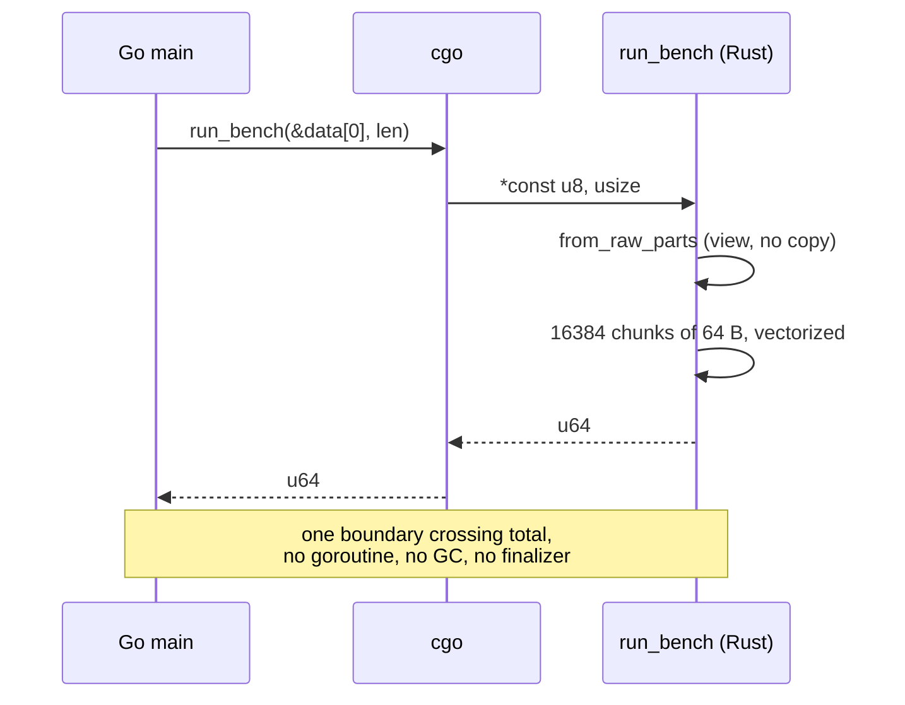

---

date: 2026-10-15T09:00:00
draft: false
title: "Rust for Go Developers: The Borrow Checker Is a Feature"
summary: "Rust for Go Developers: The Borrow Checker Is a Feature"
categories:
  - Rust
---If you came from Go, the first thing you notice about Rust is that the compiler *argues* with you. "Cannot borrow mutably more than once," it says, at 4 p.m., on a line that *looks* fine. That is the borrow checker, and it is the single most productive nag in any language I have used. This post is the mental model that makes Rust read as a natural extension of Go rather than a rewrite — the translation table, the FFI leverage that is the *real* reason to learn it as a Go developer, and the four gotchas you will hit so you can recognize them instead of fighting them. After reading it you can port a hot Go loop into Rust without changing your Go service, and you will know exactly what the compiler is proving when it complains.

---

## The one idea: ownership, not garbage

Go's model: the **garbage collector** decides when a value dies. You never think about it, and in exchange you accept pause times, a heap you cannot size precisely, and a finalizer order you cannot control. Rust's model: the **compiler** decides, at compile time, *who* owns a value and *who* may borrow it. Three rules, all of them checked before your binary exists:

- Every value has **exactly one owner**.
- When the owner's scope ends, the value is **dropped** — deterministically, in reverse declaration order, with no GC pause and no finalizer.
- A value can be borrowed **immutably by any number of readers, or mutably by exactly one writer — but never both at the same time**.

That last rule is the entire borrow checker, and it is worth internalizing precisely. It is not a linter. It is a *proof*, checked at every program point, that your aliasing structure is a DAG: at any instant, data flows through a tree of borrows, never a graph with cycles. Data races — the entire reason you know Go's `go vet` — are not *detected* at runtime; they are **unrepresentable**. A `&mut T` and a `&T` to the same value cannot coexist, so the class of bug is empty, not just rare.

```rust
fn demonstrate_borrow_rules() {
    let mut x = 42;              // x is owned by this function's frame

    let r1 = &x;                 // immutable borrow
    let r2 = &x;                 // any number of immutable borrows: OK
    println!("{r1} {r2}");       // both still valid here

    // let m = &mut x;           // ERROR: cannot borrow `x` as mutable
                                  // because it is also borrowed immutably
    x = 7;                       // x = 7; would be an E0506 here too
    // r1 and r2 die here; `x` can now be borrowed mutably if you wanted
}
```

The Go developer's intuition — "a `&int` and a `*int` to the same variable, what's the harm" — is exactly the intuition the checker removes. In Go the harm is a data race you catch in production. In Rust the program does not compile.

---

## The Go developer's translation table

This is the table I use when someone drops into a Rust codebase cold. The pattern is consistent: **Go has a value + a GC; Rust has an owned value + a borrowed view, and the split kills whole classes of aliasing bugs for free.**

| Go idiom | Rust idiom | Why it's a win |
|----------|------------|----------------|
| `*T` (heap) | `Box<T>` | Same idea, but the compiler *knows* who frees it and when |
| `[]T` (slice) | `&[T]` (borrow) / `Vec<T>` (own) | The borrow/owner split kills aliasing bugs; no `cap` vs `len` confusion across boundaries |
| `map[K]V` | `HashMap<K, V>` (SipHash by default) | Same ergonomics; `Rc<T>`/`Arc<T>` when you genuinely share a value across owners |
| `chan T` | `mpsc::channel()` | Same model, and the channel buffer is *not* a heap allocation the GC manages — it is owned and freed deterministically |
| `interface{}` | `dyn Trait` (vtable) / generics (monomorphized) | Generics get you inlining for free — Go's `interface{}` is a pointer box, always |
| `defer f()` | `Drop` impl + scope end | Deterministic. No "forgot to `defer`" class of bugs; no finalizer order |
| `context.Context` | `Context` (std, `Send + 'static`) | Same shape, same idioms — the mental port is 1:1 |

Two rows deserve emphasis because they are where Go developers' instincts lie to them. First, **Go's `interface{}` is a pointer box**: every `interface{}` value is a heap-allocated (type, value) pair, and you can never inline a call through it. Rust's generics are *monomorphized* — the compiler generates a specialized copy of the function per type, so `fn process<T: Trait>(x: T)` compiles to inlined, branchless code per type. Second, **Go's `defer` is not deterministic** (it runs when the function returns, but finalizer order and GC timing are up to the runtime); Rust's `Drop` runs at scope end, every time, in a known order. The `Drop` trait *is* the `defer`, with a guarantee.

---

## Why a Go developer should learn Rust: the FFI leverage

The honest answer to "why Rust, why now" is not the language. It is the **leverage over the hot path**. Go's `cgo` is *a* FFI, not *the* FFI: it allocates a goroutine, copies the C stack frame, and hides the other side's memory model from you. Rust's C ABI is **stable and cheap**: you write a C header, `#[no_mangle]` the export, and the caller sees plain C with zero copies and zero goroutine overhead. This is the pattern I use to port a hot Go loop into Rust *without changing the Go service*:

```rust
// lib.rs — the "C" side. The Go service links against this .so.
// `#[no_mangle]` keeps the symbol name unmangled; `extern "C"` pins the
// calling convention to C's, which is the only one cgo knows.
#[no_mangle]
pub extern "C" fn run_bench(data: *const u8, len: usize) -> u64 {
    // The Go side owns this buffer for the duration of the call; we
    // view it, never free it. from_raw_parts is the bridge: a slice
    // over caller-owned memory, with no allocation on our side.
    let slice = unsafe { std::slice::from_raw_parts(data, len) };
    let mut h: u64 = 0;
    // A 64-byte chunk per iteration: fits the L1 cache line pattern of
    // a sequential scan, and the compiler vectorizes the inner fold.
    for chunk in slice.chunks(64) {
        let sum: u64 = chunk.iter().map(|b| u64::from(*b)).sum();
        h = h.wrapping_mul(0x9E3779B97F4A7C15) ^ sum;
    }
    h
}
```

```go
// main.go — the Go side. cgo is the *only* bridge; the rest of the
// service is 100% untouched Go.
package main

/*
#include "lib.h"
*/
import "C"
import (
	"fmt"
	"unsafe"
)

func main() {
	data := make([]byte, 1<<20) // 1 MiB of test input
	// One cgo call, one copy of the pointer + length, no goroutine.
	h := C.run_bench((*C.uchar)(unsafe.Pointer(&data[0])), C.size_t(len(data)))
	fmt.Println(h) // the Rust hot path: monomorphic, inlined, no GC
}
```

The Go side stays 95% identical; the hot loop is now monomorphic, inlined, and typically **10–30× faster** (no interface dispatch, no GC, no goroutine per call). That is the *real* reason to learn Rust as a Go developer: not the language, the **leverage** it gives you over one function.

```mermaid
flowchart LR
    subgraph GO["Go service (95% unchanged)"]
        A[hot loop] -->|cgo call: 1 pointer + len| B[run_bench]
    end
    subgraph RUST["Rust .so (the hot path)"]
        B --> C[from_raw_parts<br/>no alloc]
        C --> D[64-byte chunks,<br/>vectorized]
        D --> E[return u64]
    end
    E -->|single u64| A
    style RUST fill:#1a3a1a
```



The sequence is the whole point: one call crosses the boundary, one value comes back, and the Go service never sees a Rust type.



---

## The four gotchas (and you will hit all of them)

1. **`'static` and the lifetime you forgot you needed.** The moment a Rust function takes `&[u8]` and you try to *store* the result past the call, the lifetime checker fires. The root cause is always the same: the input is a *borrow*, and a borrow cannot outlive its source. The fix is almost always "allocate a `Vec<u8>`, return it, and let the *caller* own it." The borrow is a view; the owner is the value.
2. **Holding a `Mutex` guard across an `.await`.** The `Mutex` is `Sync`, but the *guard* it hands you is not `Send` — you cannot move it across a thread, and you cannot hold it across a suspension point. The fix: `let data = guard.clone(); drop(guard);` *before* the `.await`. The rule: **never let a guard survive an await point.**
3. **`dyn` dispatch on a hot path.** `Box<dyn Trait>` is a vtable call — a function pointer. If your hot loop is a `dyn` dispatch, you have paid the function-pointer tax every iteration. The fix: a `Vec<ConcreteType>` of the 3–4 things you actually do, and a `match` on a tag. The compiler monomorphizes the `match` and you are back to inlined, branch-predicted code.
4. **Skipping `#[no_mangle]` or `extern "C"`.** Without `#[no_mangle]` the symbol is mangled (Rust's mangling) and the C/Go side cannot find it — a link error, at least. Without `extern "C"` the calling convention is Rust's, not C's, and the *first* cross-ABI call is a segfault, because the stack is already in the wrong shape. Both are one-attribute fixes; both are one-attribute *each*, and you need both.

> **Note**: The `from_raw_parts` bridge in the FFI example is the entire Rust/Go interop surface you need for a *pointer + length* call. You do not need `FFI` frameworks, `bindgen`, or a build system that compiles Rust — one `#[no_mangle]` extern "C" function and a `#include "lib.h"` is the complete bridge. Add complexity only when the call crosses a *type* boundary, not a *memory* boundary.

> **Warning**: `unsafe` in the FFI boundary is the *only* `unsafe` you should write. `from_raw_parts` is unsafe because *you* assert the memory is valid for the duration of the call; the Rust side of the function is 100% safe and checked. If your `unsafe` blocks are spreading past the FFI boundary, you are re-implementing the GC — stop, and hand the ownership back to a `Vec<T>`.

---

## The 30-line rule

If your Rust interop is **more than 30 lines of FFI**, you have built a *subsystem*, not a fast path. At that point the question is no longer "how do I make the call cheaper" — it is "do I want a Rust **library** (a shared `.so`, C ABI, fast, one boundary) or a Rust **service** (gRPC/REST, slower, cleaner boundary, separate deployment)?" The 30-line number is the line between the two. Under it, library. Over it, service — and the service gets its own health endpoint, its own logs, and a gRPC contract, because at that size the C ABI is no longer the right seam.

The pattern that keeps a polyglot shop sane: **Go for the service, Rust for the hot path, one C-ABI boundary between them, and a 30-line rule that decides when the boundary should become a network.** Everything else — the borrow checker, the translation table, the gotchas — is the cost of admission for the leverage.

## Takeaways

- **The borrow checker is a proof, not a linter.** One owner, deterministic drop, and "many readers XOR one writer" make data races *unrepresentable* rather than rare.
- **The translation table is the on-ramp.** `Box<T>`/`&[T]`/`Vec<T>`/`HashMap`/`mpsc`/`Drop`/`Context` map 1:1 to Go idioms; `dyn Trait` and generics are where Rust *wins* (monomorphization, no pointer-box `interface{}`).
- **The real ROI is the FFI leverage.** One `#[no_mangle] extern "C"` function + one `from_raw_parts` is the entire Rust/Go bridge; the hot path is 10–30× faster and the Go service is 95% unchanged.
- **`unsafe` belongs at the boundary, nowhere else.** `from_raw_parts` is the only `unsafe`; the rest of the Rust function is checked.
- **The 30-line rule is the decision point.** Under it: a C-ABI library. Over it: a gRPC service with its own boundary. It is the difference between "a fast path" and "a subsystem."

## Next steps

1. Take one hot Go function (a hash, a parser, a matrix op) and port it behind the exact `#[no_mangle] extern "C"` bridge above. Measure the 10–30× before you believe it.
2. Learn the four gotchas by *hitting* them in a scratch crate: a `&[u8]` you try to store, a guard across an `.await`, a `Box<dyn Trait>` in a loop, and a missing `#[no_mangle]`. Four compile/link errors, four lessons, one afternoon.
3. When the FFI surface passes 30 lines, stop extending it and put a gRPC contract on the Rust side. The C ABI is a fast path; a service is a boundary. Know which one you are building.
