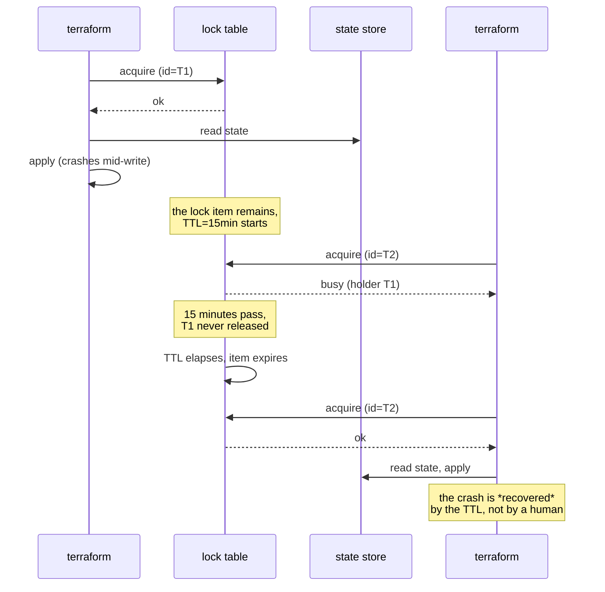

---

date: 2026-10-15T09:00:00
draft: true
title: "Terraform: The State File and the Lock That Makes It Safe"
summary: "Terraform: The State File and the Lock That Makes It Safe"
categories:
  - Terraform
  - IaC
---A Terraform **state file** is a JSON blob that maps a **resource address** — a string like `aws_instance.web` — to a record of that resource's current attributes. It is the *memory*: the one place that says "what we built, and where." The **lock** (a DynamoDB item, an S3 object with a lock flag, a Postgres row) is the *mutex*: the only thing that stops two `terraform apply` runs from clobbering each other. **The state is the memory. The lock is the mutex. That is the entire "safety" story of Terraform**, and everything else — `terraform plan`, workspaces, remote backends — is machinery around those two objects. This post is about the state file and the lock, what a corrupted or *unlocked* state does to a production apply, and the three failure modes that eat teams: the double-apply race, the out-of-band delete, and the state-version mismatch. After reading it you can reason about *why* a remote backend + a lock table is the only sane configuration for a shared team, and what each failure mode actually costs you.

---

## The state file: what it is and what it is not

The state is a JSON document. Every resource the provider knows about appears under its **address**, with its attributes, its `id`, and the resource's `type` and `name`. It is *not* a database of the real world — it is Terraform's *belief* about the real world, and `plan`/`apply` are the process of reconciling the two.

Two consequences follow, and both are the source of most Terraform pain:

1. **The state is the source of truth for *intent*.** If you `terraform import` a resource, the state gains a record for it. If you `terraform apply` against an empty state while the resource exists in the cloud, Terraform *recreates* it — because, from its point of view, it does not exist yet. The state is not a cache of the cloud; it is the *definition* of "what this stack owns."
2. **The state is a single writer's problem.** Two `apply`s against the same state, concurrently, is a *race*. There is no row-level lock inside the state file; the only thing that serializes writers is the *lock* you put in front of it.

```hcl
# the "30-line" remote backend: the entire shared-state story
terraform {
  backend "s3" {
    bucket         = "my-terraform-state"
    key            = "prod/terraform.tfstate"
    region         = "eu-west-1"
    dynamodb_table = "terraform-locks"   # the mutex
    encrypt        = true                 # server-side encryption of the blob
  }
}
```

That block is the whole post. **S3 is the state store. DynamoDB is the lock.** `apply` acquires the lock *before* it reads the state, and releases it *after* the apply completes. A second `apply` blocks on the lock until the first one finishes. There is no `if` in this; it is a single-writer protocol enforced by the backend, and it is the only reason a *team* of engineers can run Terraform at all.

---

## The lock: why it is a *table* and not a flag

The lock is a **single item** in a key-value store, keyed by the *state's identity* (the bucket + key, in the S3 case). Its value carries the *identity of the holder* (usually the `terraform` process id) and a **TTL** — a time-to-live. The TTL is the part that makes it *safe* rather than *fragile*:

- **Normal path:** the lock is acquired, the state is read, the apply runs, the lock is released. The item is deleted.
- **Crashed path:** a `terraform` process dies mid-apply (a laptop closes, a CI node is reaped) and *never releases the lock*. Without a TTL, the next `apply` would block **forever** on a lock held by a ghost. With a TTL (commonly 15–30 minutes), the lock *expires on its own*; the next `apply` re-acquires it after the TTL elapses.

The TTL is the entire answer to "what happens when the holder dies." It is not a feature you add; it is a *requirement* for the protocol to be **live-lock-free**. A lock that can never expire is a lock that can *permanently* block a production apply, and the 4 a.m. page is "terraform won't unlock, someone fix it."

> **Note**: The lock is *advisory-then-mandatory* depending on the backend. In the S3 + DynamoDB case, the lock is **mandatory**: `apply` *refuses* to run if it cannot acquire it. This is the correct default. An advisory lock (the one you can bypass with a `--force-unlock` flag) is the one that produces the 4 a.m. page; a mandatory one is the one that produces a *fast* 4 a.m. page, because the error is clear and the fix is `terraform force-unlock` — not a silent double-apply.

---

## The three failure modes that eat teams

**1. The double-apply race (no lock, or a lock you can bypass).**
Two `apply`s, no lock. Both read the state at `t=0`, both compute a plan, both write their result at `t=1`. The second `apply`'s *read* predates the first `apply`'s *write*, so the second one **overwrites the first one's resource** — often by *recreating* it, because from the second `apply`'s point of view the resource does not exist. The fix is not "be careful"; it is the **DynamoDB lock**, which is exactly the S3 + `dynamodb_table` block above. If your team is on a *local* state file (`terraform.tfstate` on a laptop) with more than one engineer, you are *one bad `apply` away from a race*, and the lock is the only thing that turns "be careful" into "cannot happen."

**2. The out-of-band delete (the state and the cloud disagree).**
An engineer deletes an `aws_instance` in the console. The next `apply` sees a state that says the instance exists, a cloud that says it does not, and — because the state is the source of *intent* — it **recreates the instance from scratch**. The "deleted" instance is back, with a *new* ID, and every DNS record, load-balancer member, and security-group reference that pointed at the old ID is now stale. This is the **drift** failure mode, and it is the reason "the state is the source of truth" is a *feature* and a *liability* at the same time. The state is the only source of truth *you can query* at `plan` time; the cloud is the only source of truth *that is real*. The gap between the two is what you are managing, and the state is the map you use to navigate it.

**3. The state-version mismatch (a hard error, not a warning).**
The state file has a **version** field (a small integer). When you upgrade the `terraform` binary, the state is **migrated in place** to the new version. A *mismatch* — a state written by `terraform 1.5` read by `terraform 1.0` — is a **hard error**: `apply` refuses to run. This is the *good* kind of failure: it fails *fast*, at the start, and it tells you exactly what to do (upgrade the binary, or downgrade the state). The *bad* kind of state failure is the one that *succeeds* and is *wrong*; the version mismatch is the one that is *wrong in a way you can see immediately*.

```mermaid
flowchart TD
    A["terraform apply"] --> B{lock available?}
    B -- no --> C["block / error:<br/>'state locked by X'"]
    C --> D{lock TTL elapsed?}
    D -- no --> C
    D -- yes (crashed holder) --> E[re-acquire the lock]
    B -- yes --> F[read the state<br/>from the remote backend]
    F --> G[plan = spec(state) - cloud]
    G --> H[apply: create/delete/modify<br/>resources to close the gap]
    H --> I[write the new state<br/>+ release the lock]
    I --> J[done]
    E --> F
    style C fill:#3a1a1a
    style E fill:#1a3a1a
```

The sequence is what a *crashed* `apply` looks like end to end — the TTL is the only reason the next `apply` is not blocked forever:



---

## The 30-line rule

A **30-line `terraform` block** (the `backend` above, plus a `dynamodb_table` and an `encrypt = true`) = the entire *shared-state* story for a team. If your "state story" is a *local* `terraform.tfstate` file checked into git, you have a *race* and a *secret* in one: the state is a race (no lock) and it is a secret (it contains your AWS account id and every resource id you have ever built). The rule: **a shared team gets a remote backend (S3) + a lock table (DynamoDB) + encryption, and a local state is a solo developer's toy.** Under that line, you have a safe shared state. Over it — a *git-ignored local state file* — you have a *time bomb with a TTL*.


> **Warning**: `terraform state rm` + `import` is the only safe way to move a resource between a stale state and a fresh one. Deleting the state file directly, or running two applies in parallel on the same state, corrupts it — and S3-backed states have **no undo**: the last writer silently wins.

## Takeaways

- **The state is the memory, the lock is the mutex.** Everything about "safe Terraform" reduces to: a single-writer protocol (the lock) over a shared belief (the state).
- **The lock has a TTL because the holder can die.** A crashed `apply` that never releases the lock is the *expected* case, not the edge case; the TTL is the recovery mechanism, and it is why the lock is *live-lock-free*.
- **The state is the source of *intent*, not of *reality*.** An out-of-band delete makes the two disagree, and the next `apply` *recreates* the deleted resource from the state. Drift is the gap between the two, and the state is the map you use to close it.
- **The state-version mismatch is a *hard* error, and that is good.** It fails fast and tells you exactly what to do. The *bad* state failures are the ones that *succeed* and are *wrong*.
- **Local state = a race + a secret.** A shared team gets a remote backend + a lock table + encryption; the 30-line `backend` block is the entire program.

## Next steps

1. If your team is on a *local* `terraform.tfstate`, migrate it to S3 + DynamoDB *this week* — it is a 30-line `backend` block and a `terraform init -migrate-state`, and it is the single highest-leverage Terraform change you can make.
2. Add a **TTL** to your lock (15–30 minutes is the right range) and test the *crash* path deliberately: kill an `apply` mid-run and watch the next one re-acquire after the TTL.
3. Run a `terraform plan` *after* every out-of-band change (a console delete, a manual `kubectl` edit) so the drift is *seen* before the next `apply` recreates something.
4. Keep the state *encrypted* (`encrypt = true`) and the bucket *versioned*, so a *bad* `apply` is recoverable from the *previous* state object.
